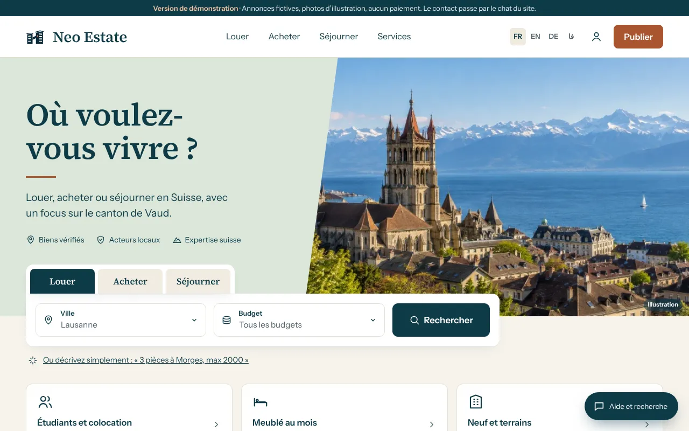
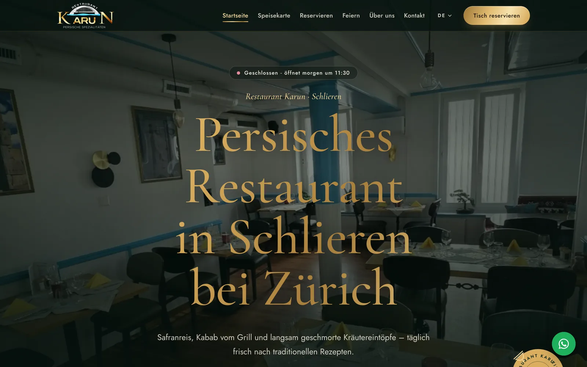
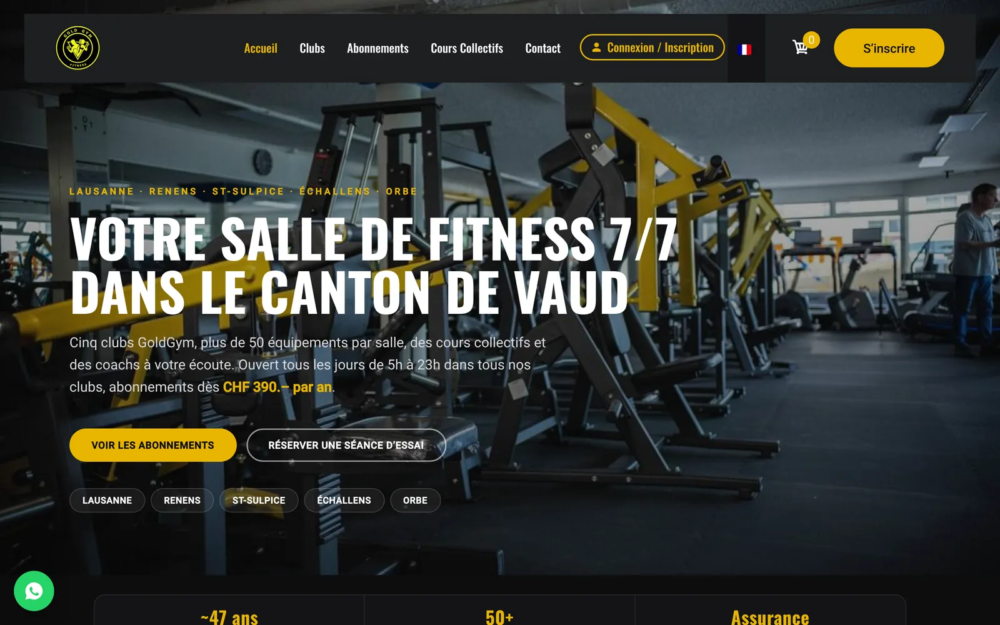
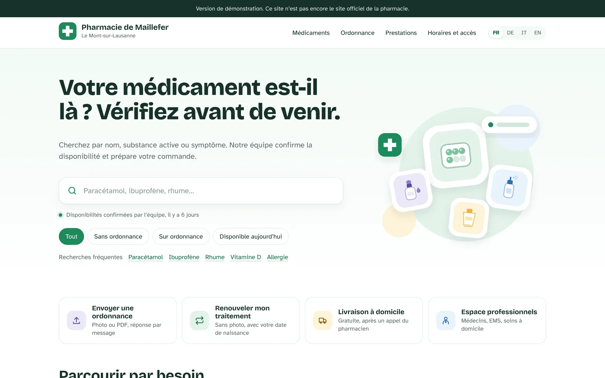
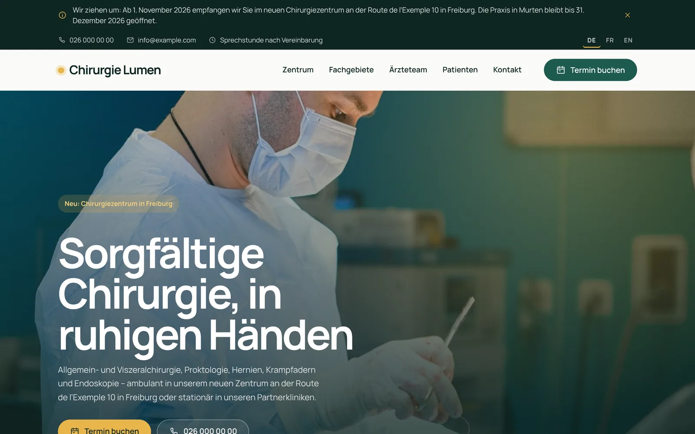
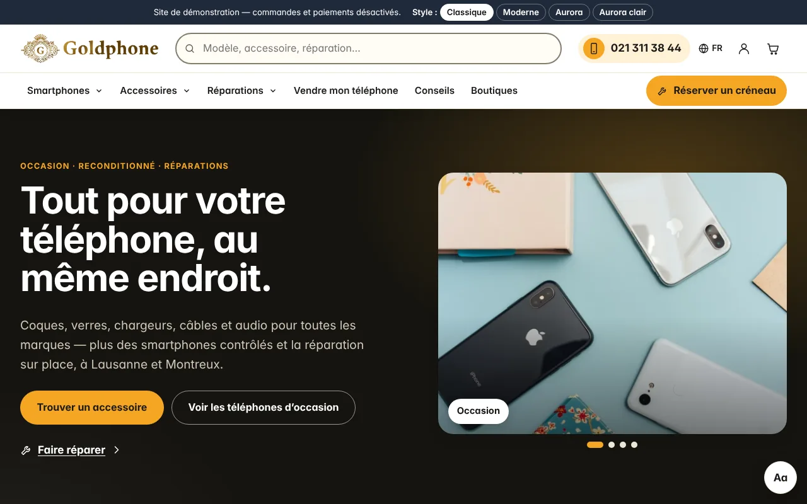
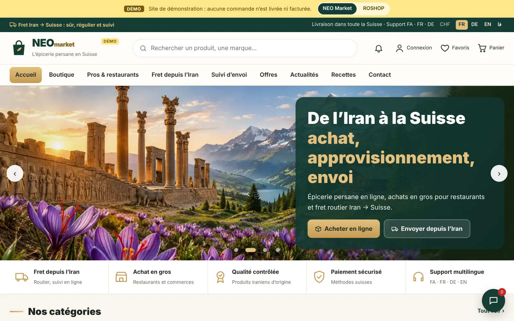
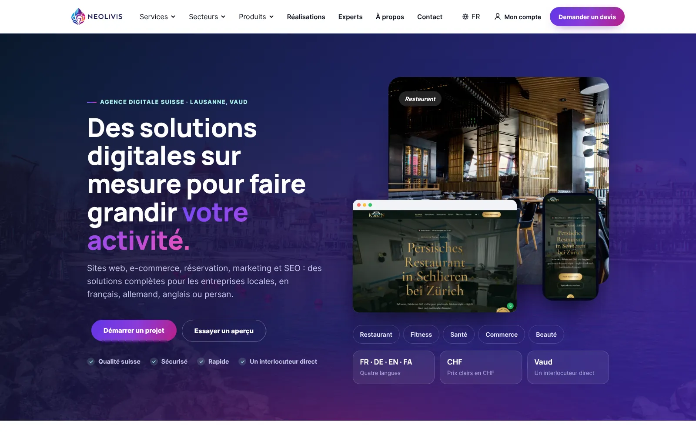

# Bonjour, je suis Morteza Delavar 👋

Ingénieur informatique et développeur web dans le canton de Vaud, en Suisse.
Je conçois et développe des **thèmes, extensions et plateformes WordPress** pour l’immobilier, les cabinets médicaux, les pharmacies, les restaurants, les salles de sport, les salons et les magasins — multilingues, rapides, et modifiables par le client dans Elementor.

**NeoLivis** · produits et projets web — [neo.likenic.com](https://neo.likenic.com/)
**LikeServic** · services informatiques et numériques en Europe — [likeservic.com](https://likeservic.com/)
**LikeNic** · hébergement, domaines et serveurs — [likenic.com](https://likenic.com/)

## Produits

Le code source reste privé. Chaque produit est installé et configuré par nos soins ; pas de téléchargement public.

| Produit | Ce qu’il fait | Statut |
|---|---|---|
| [Neo Estate](https://real.likenic.com/) | Immobilier : location, achat, séjours courts, travaux sur devis ; annonces vérifiées, agences multi-succursales, 4 langues | Démo (nouveau) |
| [LikeServic Restaurant](https://neo.likenic.com/product/likeservic-restaurant/) | Commande à table par QR, à l’emporter, réservations, bons de cuisine, écran d’attente | En ligne chez Restaurant Karun |
| [LikeServic Gym Network](https://neo.likenic.com/product/likeservic-gym-network/) | Un site de marque + un site par salle : abonnements, cours, membres | En ligne chez GoldGym |
| [LikeServic Pharmacy](https://neo.likenic.com/product/likeservic-pharmacy/) | Recherche de médicaments avec stock confirmé, envoi d’ordonnance, livraison | Démo |
| [LikeServic Medic](https://neo.likenic.com/product/likeservic-medic/) | Rendez-vous en ligne, annuaire des médecins, espace patient, rappels | Démo |
| [LikeServic Medica](https://neo.likenic.com/product/likeservic-medica/) | Cliniques esthétiques : choix du soin, programmes, demandes de rendez-vous | Démo |
| [Sense Med](https://neo.likenic.com/product/sense-med/) | Cabinets de chirurgie : spécialités, parcours patient, rendez-vous | Démo |
| [LikeServic Salon](https://neo.likenic.com/product/likeservic-salon/) | Coiffeurs et barbiers : réservation, file d’attente en direct, liste d’attente, agenda | En développement |
| [Neo Mobile](https://mob.likenic.com/) | Boutiques de téléphonie : accessoires par modèle, occasions contrôlées, réparations, reprise ; 5 langues, 4 styles | Démo (premier client : Goldphone, Lausanne) |
| [NEO Market](https://shop.likenic.com/) | Épicerie persane en ligne, commandes B2B pour restaurants, fret Iran → Suisse | En cours |

## Visites guidées

Chaque fonctionnalité, une capture à la fois — en français, anglais et persan :

| Produit | Visite |
|---|---|
| Neo Estate (immobilier) | [FR](portfolio/real-estate.fr.md) · [EN](portfolio/real-estate.md) · [FA](portfolio/real-estate.fa.md) |
| LikeServic Restaurant (Restaurant Karun) | [FR](portfolio/restaurant.fr.md) · [EN](portfolio/restaurant.md) · [FA](portfolio/restaurant.fa.md) |
| LikeServic Gym Network (GoldGym) | [FR](portfolio/gym-network.fr.md) · [EN](portfolio/gym-network.md) · [FA](portfolio/gym-network.fa.md) |
| LikeServic Pharmacy | [FR](portfolio/pharmacy.fr.md) · [EN](portfolio/pharmacy.md) · [FA](portfolio/pharmacy.fa.md) |
| LikeServic Medic | [FR](portfolio/medical-practice.fr.md) · [EN](portfolio/medical-practice.md) · [FA](portfolio/medical-practice.fa.md) |
| LikeServic Medica | [FR](portfolio/aesthetic-clinic.fr.md) · [EN](portfolio/aesthetic-clinic.md) · [FA](portfolio/aesthetic-clinic.fa.md) |
| Sense Med | [FR](portfolio/surgery-practice.fr.md) · [EN](portfolio/surgery-practice.md) · [FA](portfolio/surgery-practice.fa.md) |
| LikeServic Salon | [FR](portfolio/barbershop.fr.md) · [EN](portfolio/barbershop.md) · [FA](portfolio/barbershop.fa.md) |
| Neo Mobile (téléphonie) | [FR](portfolio/mobile-store.fr.md) · [EN](portfolio/mobile-store.md) · [FA](portfolio/mobile-store.fa.md) |

## Réalisations

Restaurant Karun et GoldGym sont des sites clients en ligne ; les autres sont des démos aux noms, adresses et personnes fictifs.

## Ma façon de travailler
- WordPress + Elementor, une extension sur mesure par produit, thèmes enfants, Polylang pour les langues
- Jusqu’à six langues par site (FR, DE, EN, IT, FA, AR …), compatibles droite-à-gauche
- PWA, données structurées pour Google, protection des données suisse (nLPD) et européenne (RGPD) prise en compte
- Hébergement sur serveurs européens (Allemagne) via LikeNic
- Travail à distance possible ; contact : [likeservic.com](https://likeservic.com/)

---

**In English** — IT engineer and web developer in the canton of Vaud, Switzerland. I build WordPress themes, plugins and platforms for real estate, medical practices, pharmacies, restaurants, gyms, salons and shops. Products are on [NeoLivis](https://neo.likenic.com/en/); each feature is shown in the [portfolio](portfolio/real-estate.md). The code stays private; every installation is tailored.

**Auf Deutsch** — Informatik-Ingenieur und Webentwickler im Kanton Waadt. Ich entwickle WordPress-Themes, -Plugins und -Plattformen für Arztpraxen, Apotheken, Restaurants und Fitnessstudios. Die Produkte finden Sie auf [NeoLivis](https://neo.likenic.com/de/); der Code bleibt privat, jede Installation wird individuell eingerichtet.

**به فارسی** — مهندس فناوری اطلاعات و توسعه‌دهندهٔ وب در کانتون وو سوئیس. برای مطب‌ها، داروخانه‌ها، رستوران‌ها، باشگاه‌های ورزشی و فروشگاه‌های موبایل قالب، افزونه و پلتفرم وردپرسی می‌سازم: چندزبانه، سریع و قابل ویرایش در المنتور. محصولات در [NeoLivis](https://neo.likenic.com/fa/) معرفی شده‌اند و همهٔ امکانات هر محصول با تصویر در [بخش نمونه‌کارها](portfolio/restaurant.fa.md) آمده است؛ کد خصوصی است و هر نصب برای همان مشتری انجام می‌شود.

