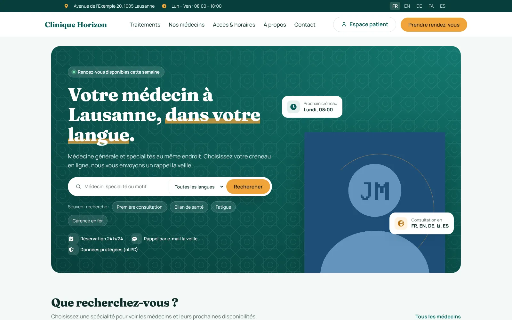
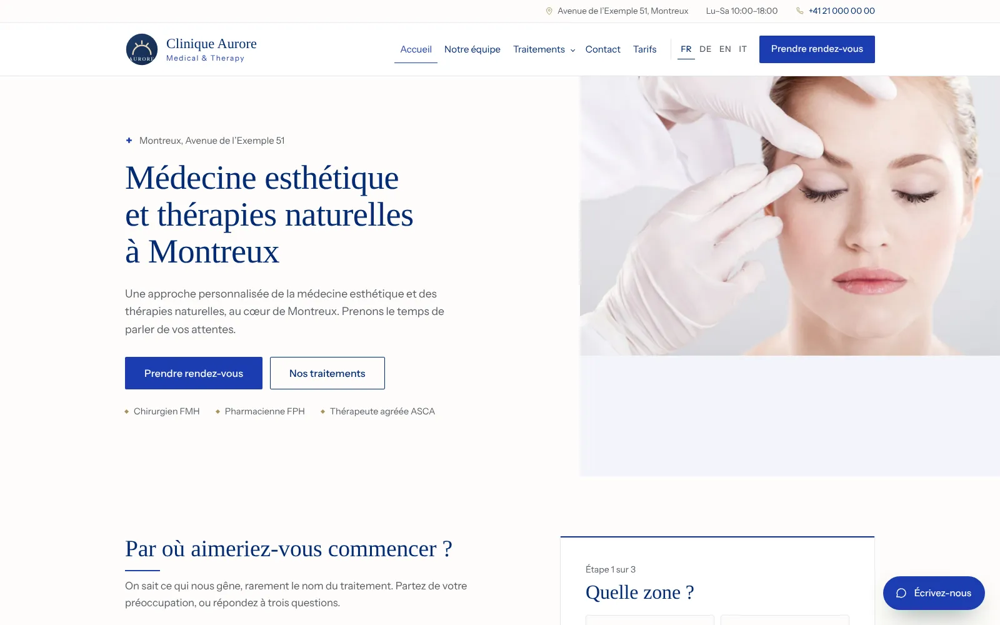

# Hi, I’m Morteza Delavar 👋

IT engineer and web developer based in the canton of Vaud, Switzerland.
I design and build **WordPress themes, plugins and web platforms** for clinics, pharmacies, restaurants and gyms — multilingual, fast, and editable by the client in Elementor.

**NeoLivis** · products and web projects — [neo.likenic.com](https://neo.likenic.com/en/)
**LikeServic** · IT and digital services in Europe — [likeservic.com](https://likeservic.com/)
**LikeNic** · hosting, domains and servers — [likenic.com](https://likenic.com/en/)

## Products

Source code is kept private. Each product is installed and set up by us; there is no public download.

| Product | What it does | Status |
|---|---|---|
| [LikeServic Restaurant](https://neo.likenic.com/en/product/likeservic-restaurant-en/) | QR table ordering, takeaway, bookings, kitchen tickets, waiting screen | Live at Restaurant Karun |
| [LikeServic Gym Network](https://neo.likenic.com/en/product/likeservic-gym-network-en/) | One brand site + one site per gym: memberships, classes, members | Live at GoldGym |
| [LikeServic Pharmacy](https://neo.likenic.com/en/product/likeservic-pharmacy-en/) | Medicine search with confirmed stock, prescription upload, delivery | Demo |
| [LikeServic Medic](https://neo.likenic.com/en/product/likeservic-medic-en/) | Online booking, doctor directory, patient portal, reminders | Demo |
| [LikeServic Medica](https://neo.likenic.com/en/product/likeservic-medica-en/) | Aesthetic clinics: treatment finder, programmes, appointment requests | Demo |
| [Sense Med](https://neo.likenic.com/en/product/sense-med-en/) | Surgical practices: specialties, patient journey, booking | Demo |
| [LikeServic Salon](https://neo.likenic.com/en/product/likeservic-salon-en/) | Hair salons & barbers: online booking, live walk-in queue, waiting list, agenda | In development |
| [Neo Mobile](https://mob.likenic.com/) | Phone shops: accessories by phone model, checked used phones, repair booking, trade-in; 5 languages, 4 looks | Demo (first client: Goldphone, Lausanne) |
| [NEO Market](https://shop.likenic.com/) | Online Persian grocery, B2B orders for restaurants, freight Iran → Switzerland | In progress |

## Feature tours

Every feature of each product, one screenshot at a time — in English, French and Persian:

| Product | Tour |
|---|---|
| LikeServic Restaurant (Restaurant Karun) | [EN](portfolio/restaurant.md) · [FR](portfolio/restaurant.fr.md) · [FA](portfolio/restaurant.fa.md) |
| LikeServic Gym Network (GoldGym) | [EN](portfolio/gym-network.md) · [FR](portfolio/gym-network.fr.md) · [FA](portfolio/gym-network.fa.md) |
| LikeServic Pharmacy | [EN](portfolio/pharmacy.md) · [FR](portfolio/pharmacy.fr.md) · [FA](portfolio/pharmacy.fa.md) |
| LikeServic Medic | [EN](portfolio/medical-practice.md) · [FR](portfolio/medical-practice.fr.md) · [FA](portfolio/medical-practice.fa.md) |
| LikeServic Medica | [EN](portfolio/aesthetic-clinic.md) · [FR](portfolio/aesthetic-clinic.fr.md) · [FA](portfolio/aesthetic-clinic.fa.md) |
| Sense Med | [EN](portfolio/surgery-practice.md) · [FR](portfolio/surgery-practice.fr.md) · [FA](portfolio/surgery-practice.fa.md) |
| LikeServic Salon | [EN](portfolio/barbershop.md) · [FR](portfolio/barbershop.fr.md) · [FA](portfolio/barbershop.fa.md) |
| Neo Mobile (phone shop) | [EN](portfolio/mobile-store.md) · [FR](portfolio/mobile-store.fr.md) · [FA](portfolio/mobile-store.fa.md) |

## Work

Restaurant Karun and GoldGym are live client sites; the others are demos with fictitious names, addresses and people.

## How I work
- WordPress + Elementor, one custom plugin per product, child themes, Polylang for languages
- Up to six languages per site (FR, DE, EN, IT, FA, AR …), right-to-left ready
- PWA, structured data for Google, Swiss and EU data-protection rules in mind
- Hosting on European servers (Germany) through LikeNic

---

**En français** — Ingénieur informatique et développeur web dans le canton de Vaud. Je crée des thèmes, des extensions et des plateformes WordPress pour cabinets médicaux, pharmacies, restaurants, salles de sport, salons de coiffure et magasins de téléphonie. Les produits sont présentés sur [NeoLivis](https://neo.likenic.com/), et chaque fonctionnalité est montrée en images dans le [portfolio](portfolio/pharmacy.fr.md) ; le code reste privé et chaque installation est faite sur mesure.

**Auf Deutsch** — Informatik-Ingenieur und Webentwickler im Kanton Waadt. Ich entwickle WordPress-Themes, -Plugins und -Plattformen für Arztpraxen, Apotheken, Restaurants und Fitnessstudios. Die Produkte finden Sie auf [NeoLivis](https://neo.likenic.com/de/); der Code bleibt privat, jede Installation wird individuell eingerichtet.

**به فارسی** — مهندس فناوری اطلاعات و توسعه‌دهندهٔ وب در کانتون وو سوئیس. برای مطب‌ها، داروخانه‌ها، رستوران‌ها، باشگاه‌های ورزشی و فروشگاه‌های موبایل قالب، افزونه و پلتفرم وردپرسی می‌سازم: چندزبانه، سریع و قابل ویرایش در المنتور. محصولات در [NeoLivis](https://neo.likenic.com/fa/) معرفی شده‌اند و همهٔ امکانات هر محصول با تصویر در [بخش نمونه‌کارها](portfolio/restaurant.fa.md) آمده است؛ کد خصوصی است و هر نصب برای همان مشتری انجام می‌شود.

