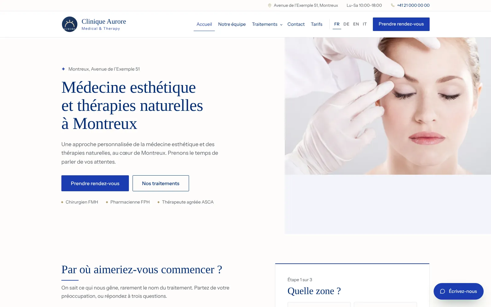
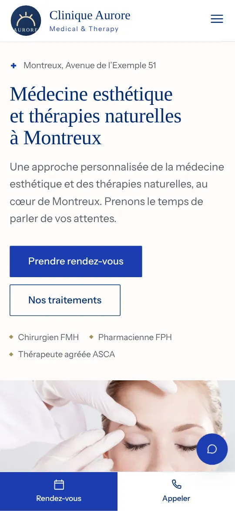
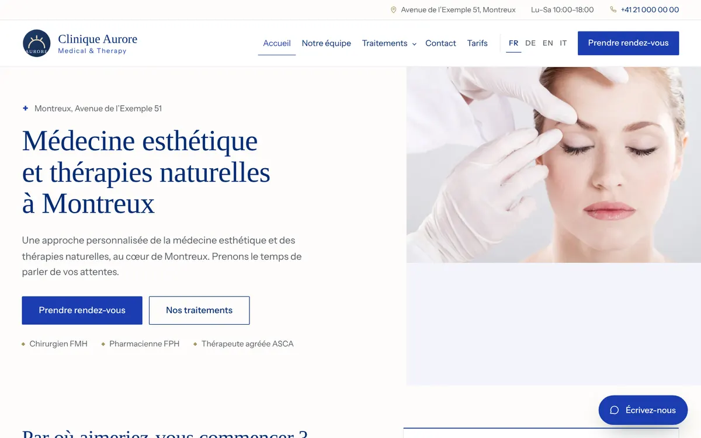
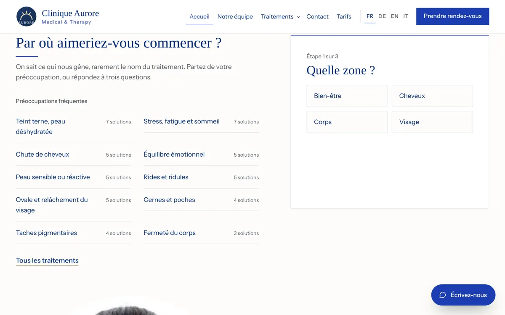
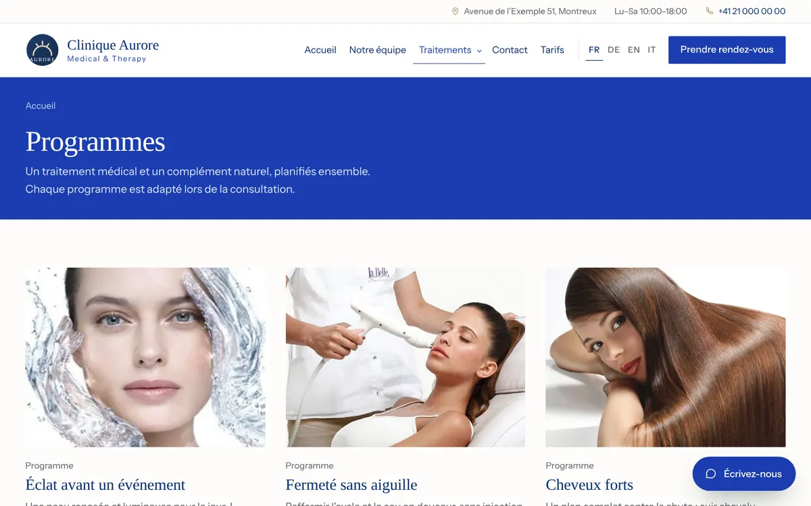
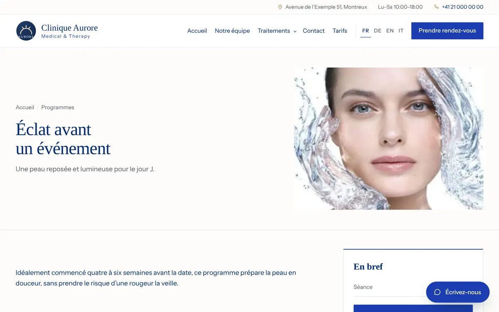
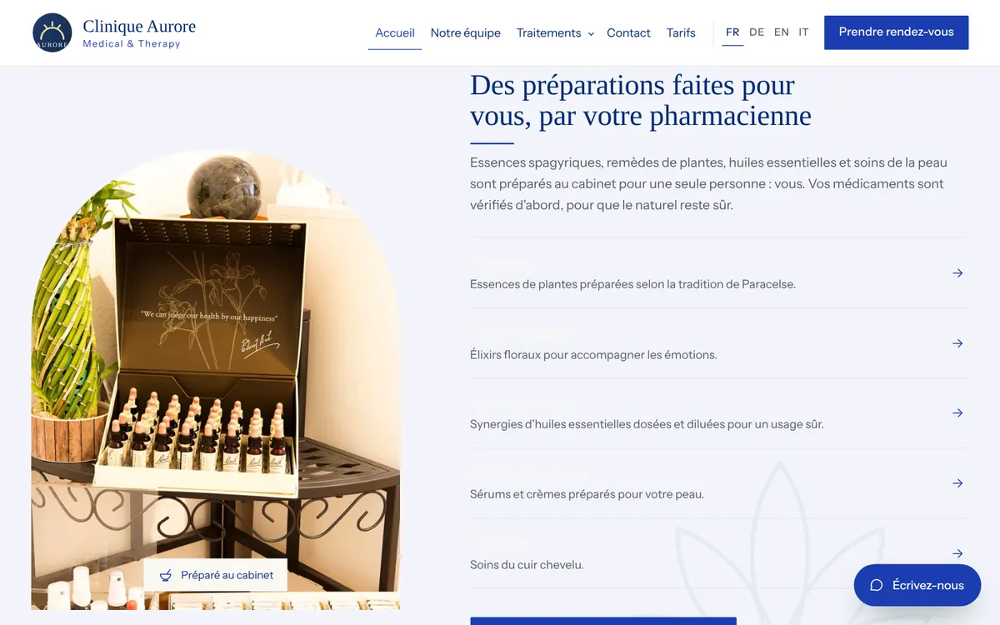
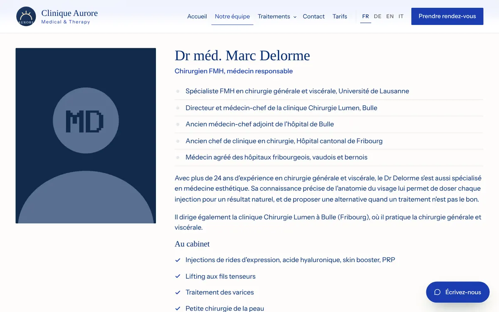
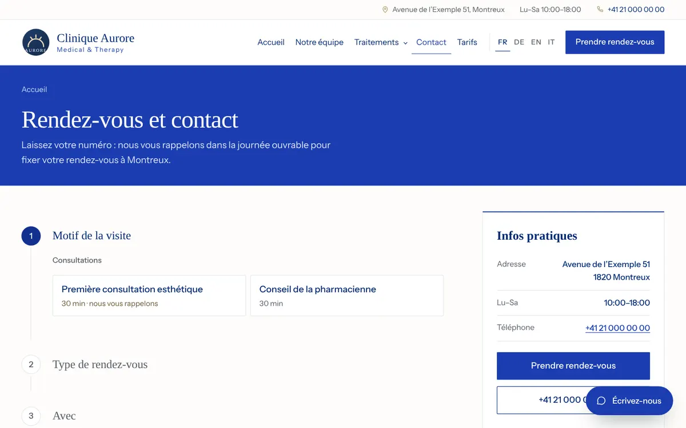
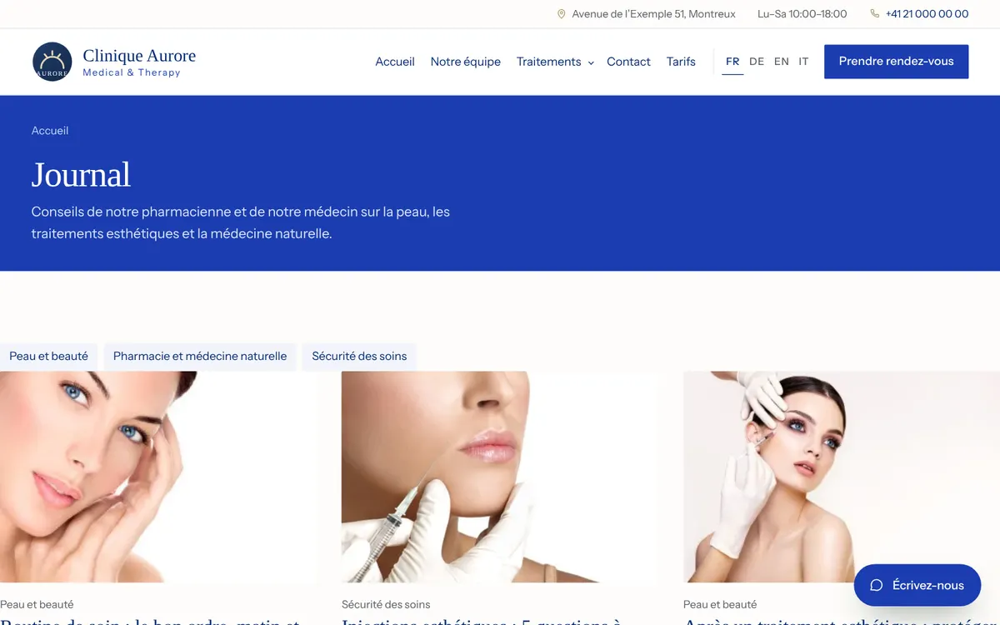

[English](aesthetic-clinic.md) · [Français](aesthetic-clinic.fr.md) · [فارسی](aesthetic-clinic.fa.md)

# LikeServic Medica

**سایت پزشکی زیبایی و درمان، با راهنمای انتخاب درمان.**

بازدیدکننده از مشکلش شروع می‌کند – چین و چروک، خستگی، ریزش مو – و سایت درمان‌های مناسب را پیشنهاد می‌دهد و او را به درخواست نوبت می‌رساند. قالبی شیک و افزونه‌ای ماژولار برای کلینیک زیبایی، درمان‌های طبیعی و داروخانه‌های مشاوره‌محور.

**دموی آنلاین:** https://beuti.likenic.com/  
**صفحهٔ محصول در NeoLivis:** https://neo.likenic.com/fa/product/likeservic-medica-fa/

## تصاویر

| کامپیوتر | موبایل |
|---|---|
|  |  |

## امکانات، صفحه به صفحه

_همهٔ تصویرهای زیر از دموی آنلاین گرفته شده؛ نام‌ها، آدرس‌ها و افراد در دموها ساختگی هستند._

### 1. پزشکی زیبایی و طب طبیعی در یک سایت

همان صفحهٔ اول معلوم است چه کسی درمان می‌کند: جراح FMH، داروساز FPH و درمانگر تأییدشدهٔ ASCA.

### 2. شروع از مشکل، نه از اسم درمان

مراجعه‌کننده معمولاً اسم درمان را نمی‌داند. مشکلش را انتخاب می‌کند (پوست کدر، ریزش مو، چین‌وچروک…) یا به سه سؤال کوتاه جواب می‌دهد و سایت راه‌حل پیشنهاد می‌کند.

### 3. یک صفحه برای هر مشکل

هر مشکل به زبان ساده توضیح داده شده و درمان‌های مناسبش کنار آن آمده.

### 4. زمان، دوران نقاهت و قیمت، شفاف

روی کارت هر درمان مدت جلسه و قیمت «از…» نوشته شده تا مراجعه‌کننده قبل از تماس بداند با چه چیزی روبه‌روست.

### 5. برنامه‌های ترکیبی

درمان پزشکی و مکمل طبیعی که با هم برنامه‌ریزی می‌شوند؛ مثلاً برای قبل از یک مراسم یا تقویت مو.

### 6. صفحهٔ برنامه با زمان‌بندی

از کی شروع شود، چند جلسه لازم است و یک کادر خلاصه کنار توضیحات.

### 7. فرآورده‌های داروساز

اسانس‌های اسپاژیریک، گل‌های باخ، روغن‌های اسانسی و محصولات پوستی که در خود مطب آماده می‌شوند، هر گروه با صفحهٔ خودش.

### 8. معرفی درمانگران

مدارک، سابقه و درمان‌هایی که هر درمانگر در مطب انجام می‌دهد.

### 9. درخواست نوبت در چهار مرحله

دلیل مراجعه، نوع نوبت، درمانگر، تاریخ و ساعت؛ آدرس، ساعات کاری و تلفن همیشه کنار فرم دیده می‌شوند.

### 10. مجله

مقاله‌های داروساز و پزشک در سه دستهٔ پوست و زیبایی، طب طبیعی و ایمنی درمان.

### 11. نسخهٔ موبایل

دکمه‌های ثابت «نوبت» و «تماس» پایین صفحه و دکمهٔ چت برای پیام دادن به مطب.

---

کد منبع خصوصی است و هر نصب برای همان مشتری انجام می‌شود. اگر کارم را ارزیابی می‌کنید، برای دیدن کد درخواست دسترسی بدهید.

[← بازگشت به پروفایل](../README.md)

