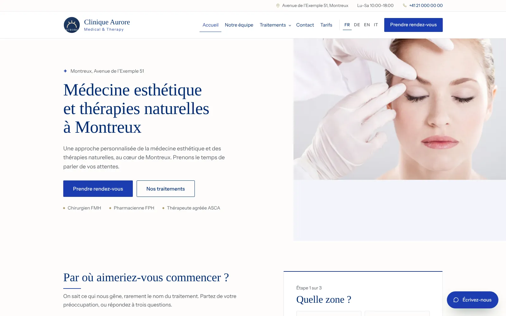
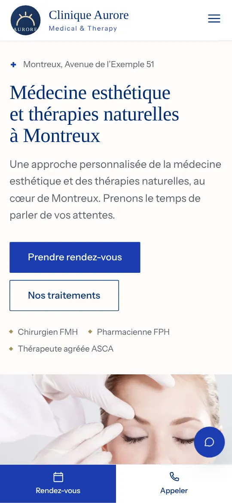
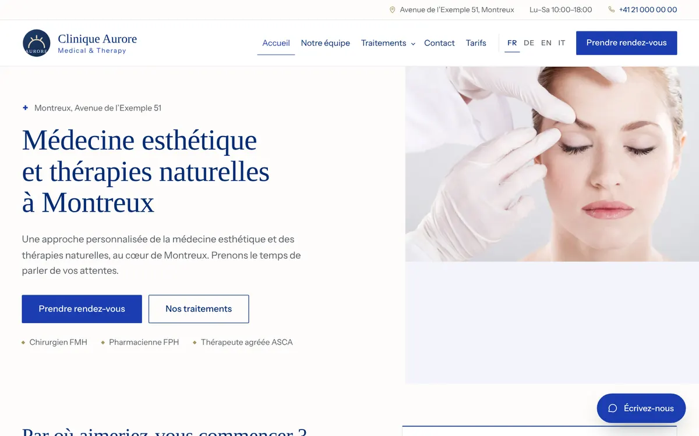
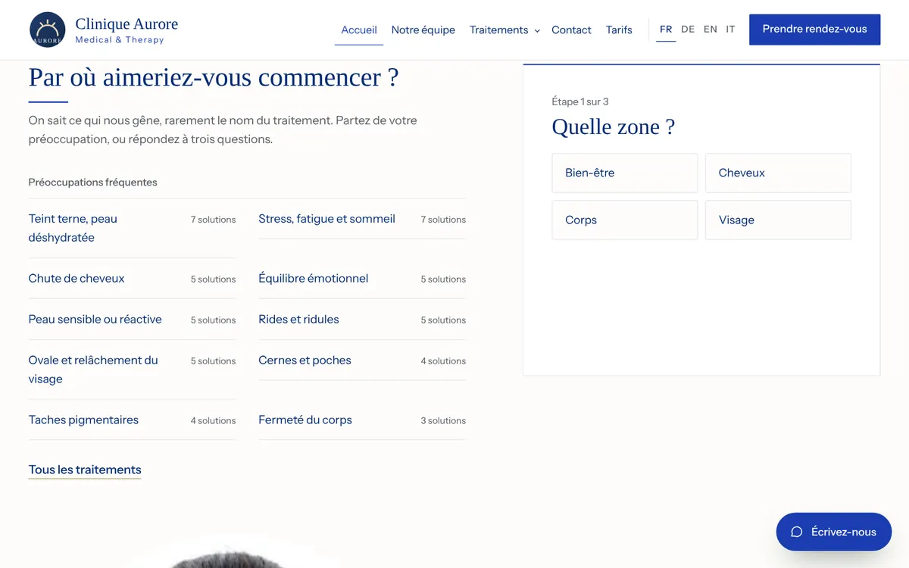
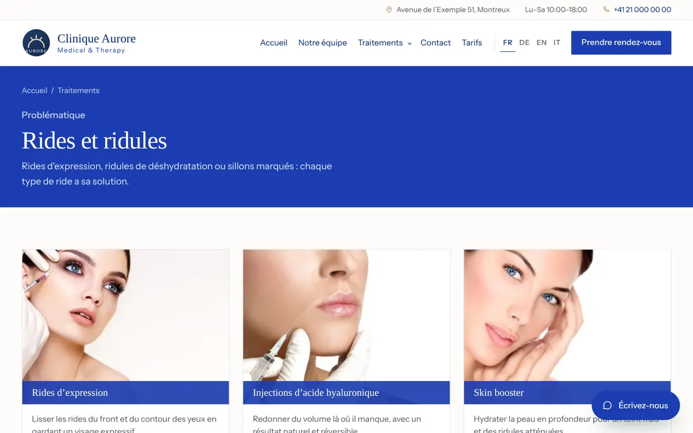
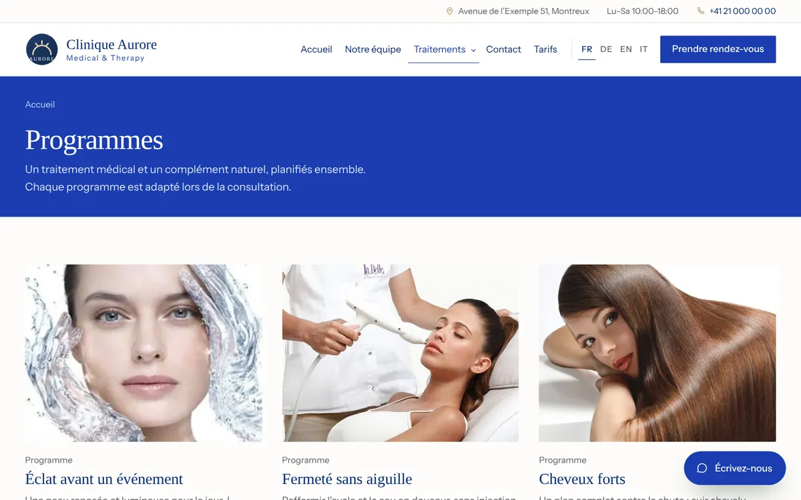
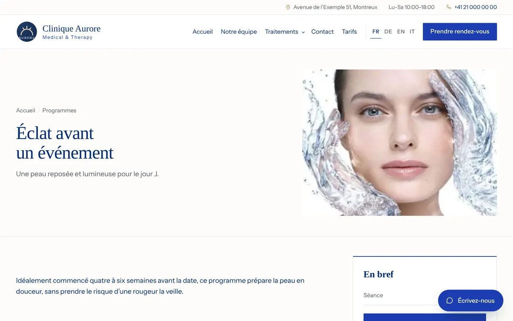
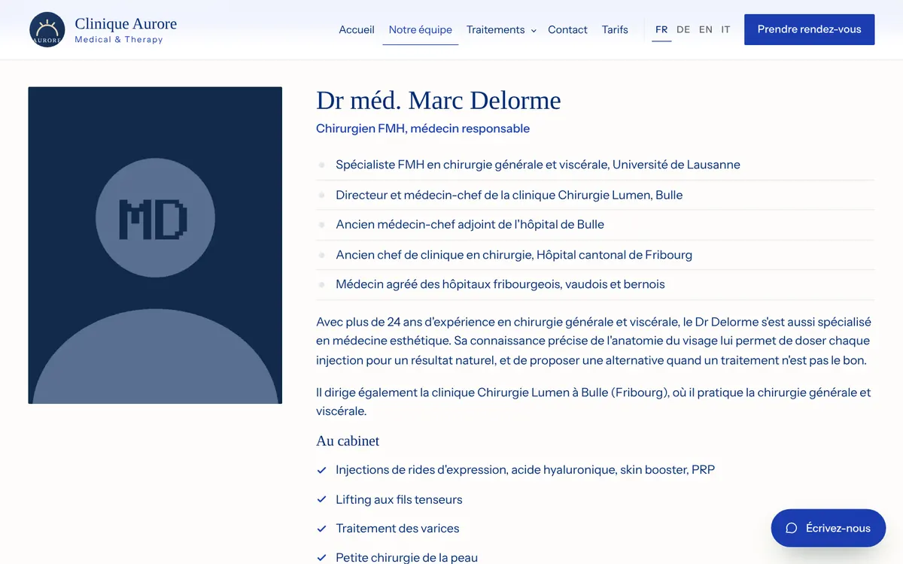
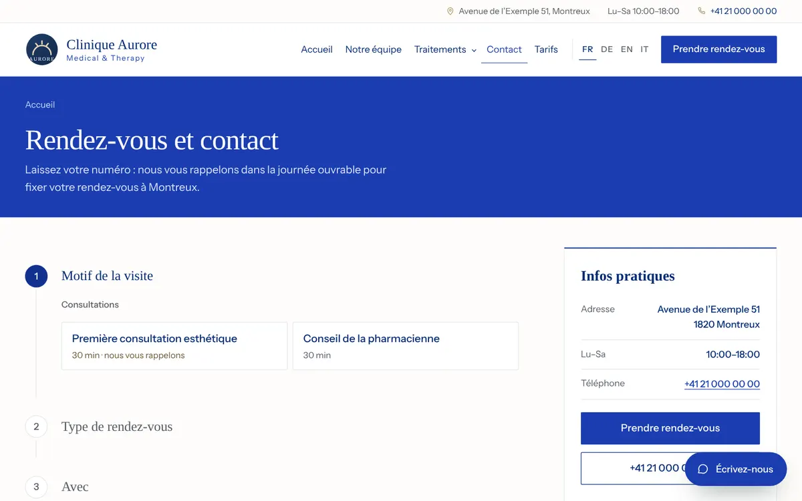

[English](aesthetic-clinic.md) · [Français](aesthetic-clinic.fr.md) · [فارسی](aesthetic-clinic.fa.md)

# LikeServic Medica

**Site de médecine esthétique et de soins, avec guide de traitements.**

Le visiteur part de ce qui le gêne – rides, fatigue, chute de cheveux – et le site lui propose les traitements adaptés, puis l’amène vers un rendez-vous. Thème élégant et extension modulaire pour cabinet esthétique, thérapies naturelles ou pharmacie de conseil.

**Démo en ligne:** https://beuti.likenic.com/  
**Page produit sur NeoLivis:** https://neo.likenic.com/product/likeservic-medica/

## Captures d’écran

| Ordinateur | Téléphone |
|---|---|
|  |  |

## Les fonctionnalités, écran par écran

_Chaque capture provient de la démo en ligne ; les noms, adresses et personnes des démos sont fictifs._

### 1. Médecine esthétique et naturelle sur un seul site

Dès l’accueil, on sait qui soigne : un chirurgien FMH, une pharmacienne FPH et une thérapeute agréée ASCA.

### 2. Partir de la gêne, pas du nom du traitement

On connaît rarement le nom d’un traitement. Le visiteur choisit ce qui le gêne – teint terne, chute de cheveux, rides… – ou répond à trois questions, et le site propose des solutions.

### 3. Une page par problématique

Chaque problématique est expliquée simplement, avec les traitements adaptés.

### 4. Durée, éviction et prix affichés

Chaque traitement indique la durée de la séance et un prix « dès », pour savoir à quoi s’attendre avant d’appeler.

### 5. Programmes

Un traitement médical et un complément naturel planifiés ensemble, par exemple avant un événement ou pour des cheveux plus forts.

### 6. Page programme avec calendrier

Quand commencer, combien de séances, et un encadré « En bref » à côté des explications.

### 7. Préparations de la pharmacienne

Essences spagyriques, fleurs de Bach, huiles essentielles et soins préparés au cabinet, chaque gamme avec sa page.

### 8. Profils des praticiens

Formation, expérience et traitements réalisés par chaque praticien au cabinet.

### 9. Demande de rendez-vous en quatre étapes

Motif, type de rendez-vous, praticien, date et heure – avec adresse, horaires et téléphone toujours visibles à côté.

### 10. Journal

Articles de la pharmacienne et du médecin, classés en peau et beauté, médecine naturelle et sécurité des soins.

### 11. Sur téléphone

Boutons fixes « Rendez-vous » et « Appeler » en bas, et un bouton de chat pour écrire au cabinet.

---

Le code source est privé : chaque installation est faite pour le client. Demandez un accès au code si vous évaluez mon travail.

[← Retour au profil](../README.md)
