[English](aesthetic-clinic.md) · [Français](aesthetic-clinic.fr.md) · [فارسی](aesthetic-clinic.fa.md)

# LikeServic Medica

**A website for aesthetic medicine and treatments, with a treatment finder.**

Visitors start from what bothers them – wrinkles, tiredness, hair loss – and the site suggests the right treatments, then leads them to an appointment request. An elegant theme and a modular plugin for aesthetic clinics, natural therapies and advice-led pharmacies.

**Live demo:** https://beuti.likenic.com/  
**Product page on NeoLivis:** https://neo.likenic.com/en/product/likeservic-medica-en/

## Screenshots

| Computer | Phone |
|---|---|
| 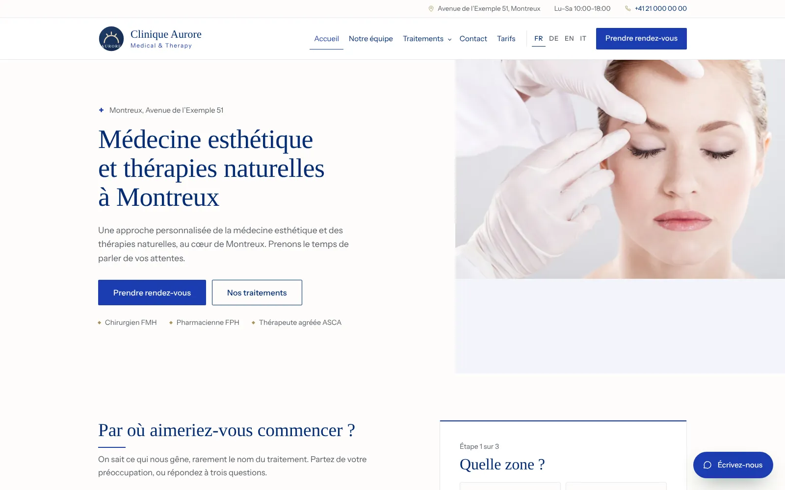 | 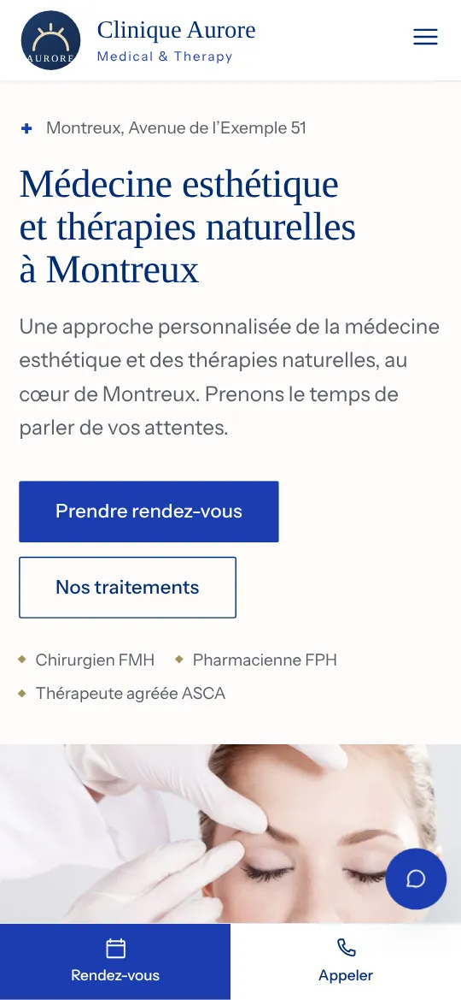 |

## Features, screen by screen

_Every screenshot below comes from the live demo; names, addresses and people on the demos are fictitious._

### 1. Aesthetic and natural medicine on one site

The home page says who treats you before anything else: an FMH surgeon, an FPH pharmacist and an ASCA-approved therapist.

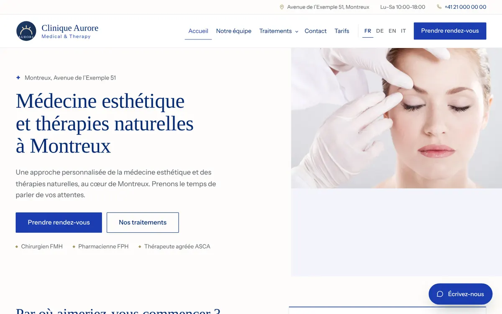

### 2. Start from the concern, not the treatment name

Visitors rarely know what a treatment is called. They pick what bothers them – dull skin, hair loss, wrinkles… – or answer three short questions, and the site suggests solutions.

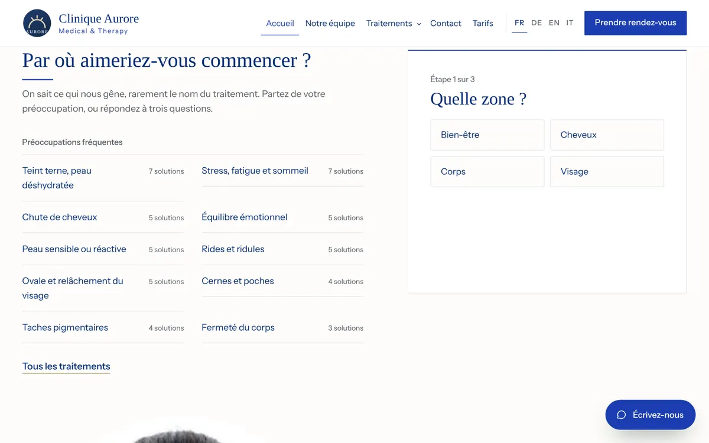

### 3. One page per concern

Each concern explains the problem in plain words and lists the treatments that suit it.

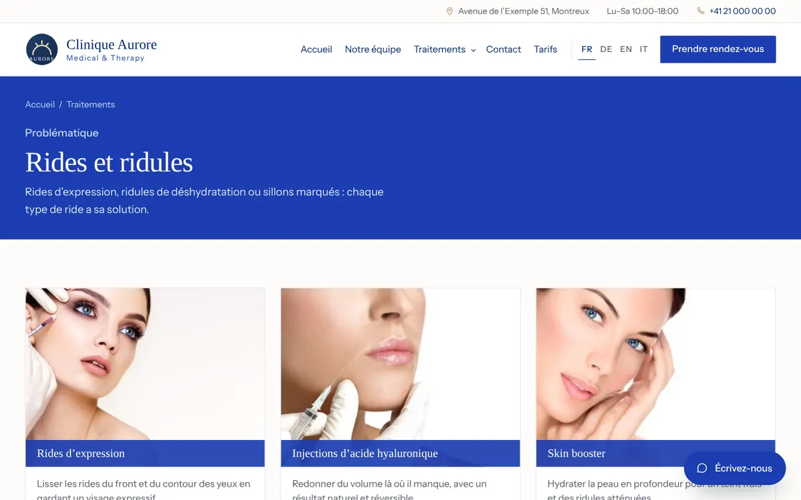

### 4. Duration, downtime and price shown openly

Every treatment card gives the session length and a “from” price, so people know what to expect before they call.

### 5. Programmes

A medical treatment and a natural complement planned together, for example before an event or for stronger hair.

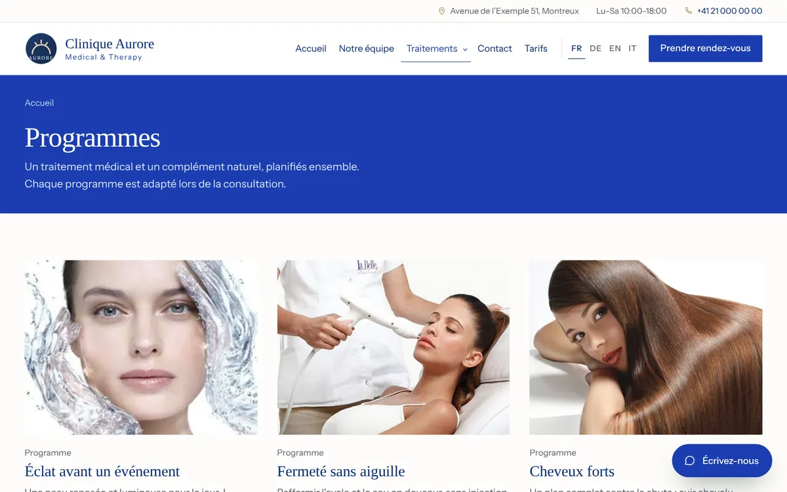

### 6. Programme page with timing

When to start, how many sessions and a short summary box next to the explanation.

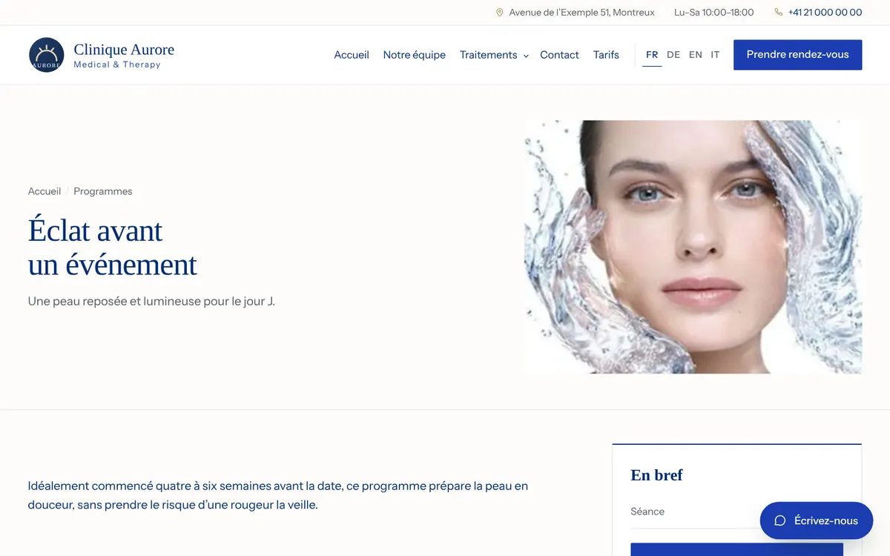

### 7. Preparations made by the pharmacist

Spagyric essences, Bach flowers, essential oils and skin care prepared at the practice, each range with its own page.

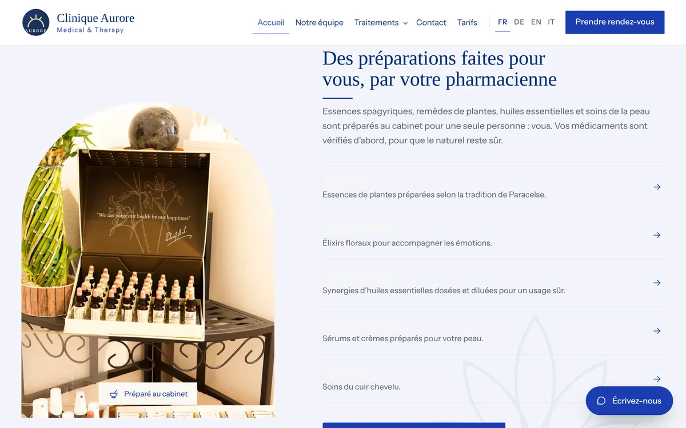

### 8. Practitioner profiles

Qualifications, experience and the treatments each practitioner carries out at the practice.

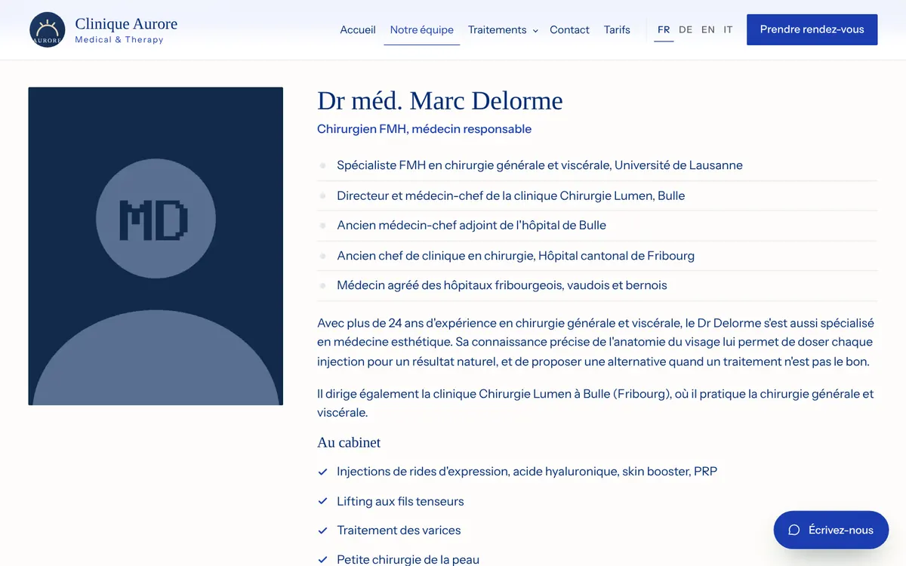

### 9. Appointment request in four steps

Reason, type of appointment, practitioner, date and time – with address, hours and phone always visible on the side.

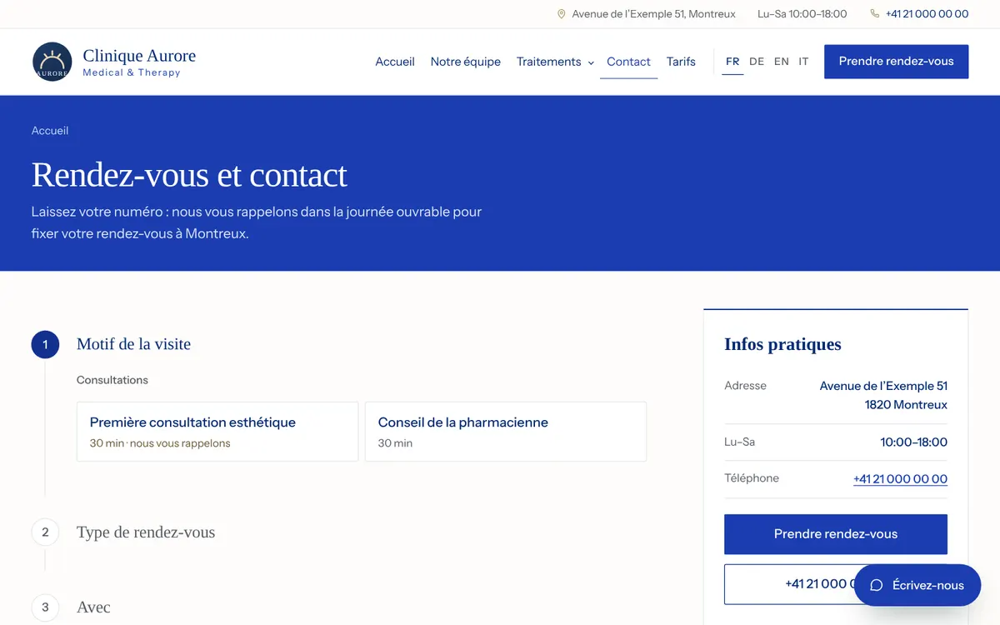

### 10. Journal

Articles by the pharmacist and the doctor, sorted into skin and beauty, natural medicine and treatment safety.

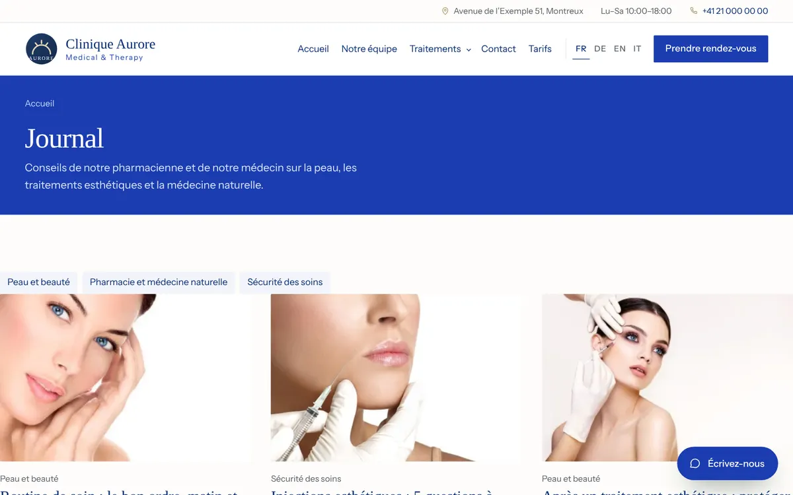

### 11. Phone layout

Fixed “Appointment” and “Call” buttons at the bottom and a chat button to write to the practice.

---

Source code is private: every installation is set up for the client. Ask for access to the code if you are evaluating my work.

[← Back to the profile](../README.md)
