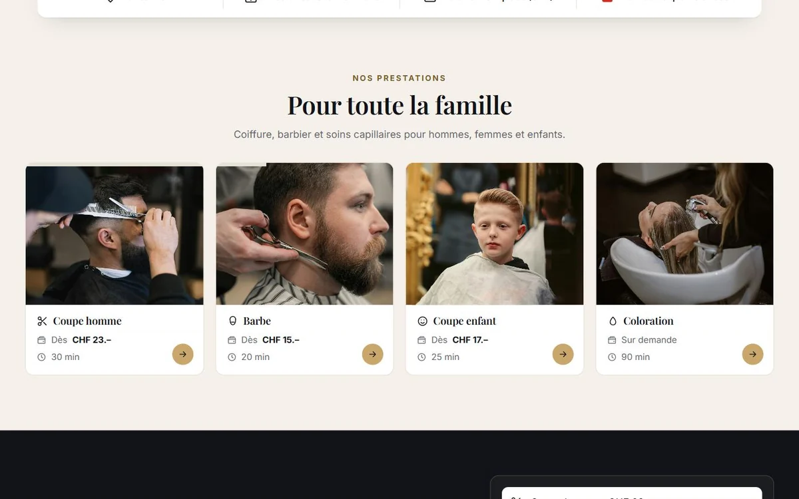
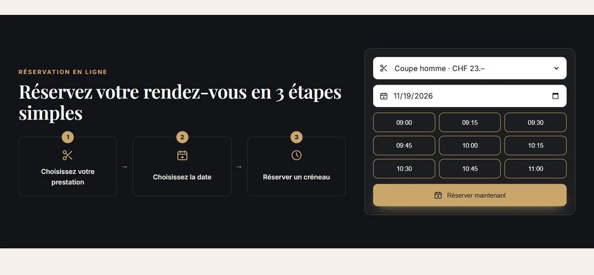
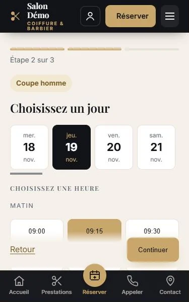
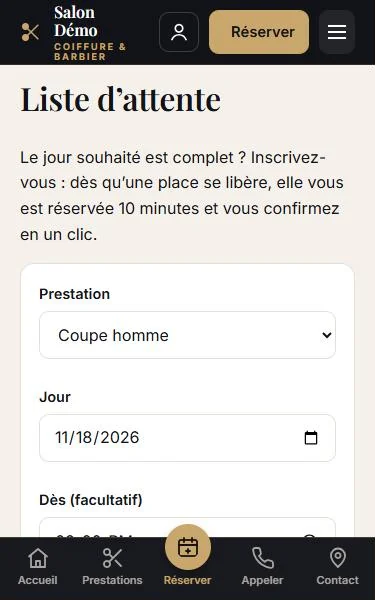
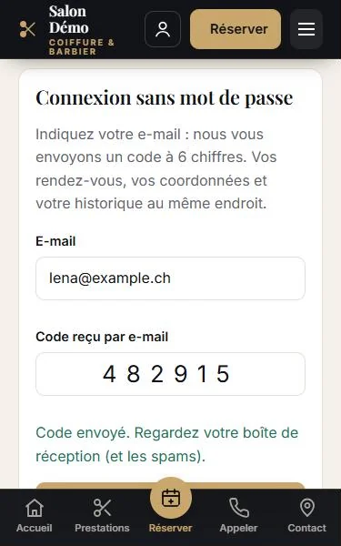
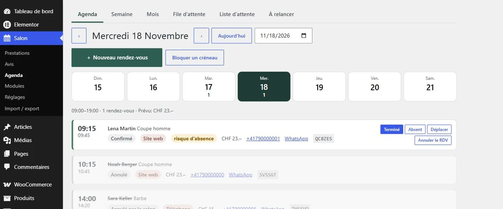
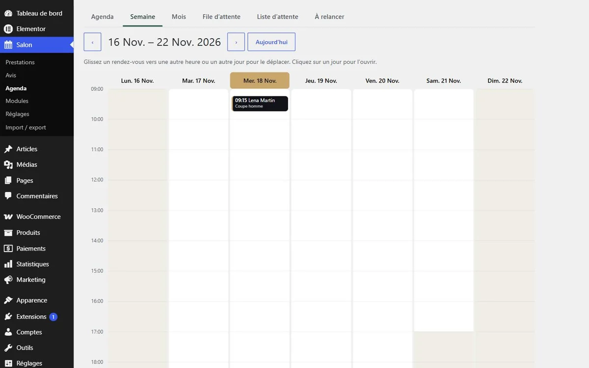
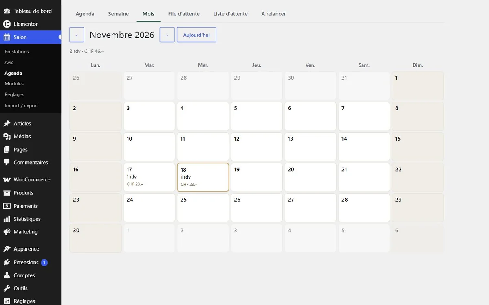

[English](barbershop.md) · [Français](barbershop.fr.md) · [فارسی](barbershop.fa.md)

# LikeServic Salon

**رزرو آنلاین، صف حضوری زنده و تقویم سالن، همه در یک سایت.**

برای آرایشگاه‌ها و باربرشاپ‌هایی که هم نوبت می‌دهند و هم مشتری بدون نوبت دارند. مشتری در سه قدم خدمت و ساعت خالی را انتخاب می‌کند، یا نوبت حضوری می‌گیرد و صف را روی گوشی‌اش دنبال می‌کند. سالن همه‌چیز را از یک تقویم ساده اداره می‌کند: روزانه، هفتگی یا ماهانه.

**دموی آنلاین:** در صورت درخواست (تصاویر پایین)  
**صفحهٔ محصول در NeoLivis:** https://neo.likenic.com/fa/product/likeservic-salon-fa/

## تصاویر

| کامپیوتر | موبایل |
|---|---|
|  |  |

## امکانات، صفحه به صفحه

_تصویرها از نسخه‌ای گرفته شده که برای اولین مشتری در حال نهایی‌شدن است؛ نام، آدرس، تلفن و مشتری‌های سالن با اطلاعات ساختگی جایگزین شده‌اند._

### 1. خدماتی که مستقیم به رزرو می‌رسند

هر کارت خدمت عکس، قیمت شروع و مدت زمان را نشان می‌دهد و فلش آن، رزرو را با همان خدمت باز می‌کند. بالای صفحه هم نوشته شده سالن همین الان باز است یا نه.

### 2. رزرو از همان صفحهٔ اصلی

خدمت و روز را انتخاب می‌کنید و ساعت‌های خالی، مستقیم از تقویم، به شکل دکمه ظاهر می‌شوند. با یک لمس فرم رزرو با همان ساعت باز می‌شود.

### 3. سه قدم روی گوشی

خدمت، ساعت خالی، مشخصات تماس؛ بدون حساب کاربری و بدون پرداخت آنلاین. ساعت در لحظهٔ آخر دوباره بررسی می‌شود تا دو مشتری هیچ‌وقت یک صندلی را نگیرند.

### 4. لیست انتظار برای روزهای پر

اگر روز پر باشد، مشتری برای همان روز ثبت‌نام می‌کند. با اولین لغو، آن وقت ده دقیقه برای نفر اول نگه داشته و با ایمیل به او پیشنهاد می‌شود.

### 5. حساب مشتری بدون رمز

مشتری ایمیلش را وارد می‌کند و یک کد شش‌رقمی می‌گیرد. نوبت‌های بعدی، لغو، سابقه و مشخصاتش آنجاست.

### 6. روز کاری سالن در یک صفحه

همهٔ نوبت‌ها با وضعیت، منبع و درآمد پیش‌بینی‌شده. انجام شد، نیامد، جابه‌جایی یا لغو با یک لمس؛ نوبت تلفنی و حضوری هم همین‌جا ثبت می‌شود.

### 7. هفته، با کشیدن و رها کردن

هفت ستون با ساعت‌های کاری و بازه‌های بسته. با کشیدن یک نوبت به ساعت دیگر، بعد از تأیید جابه‌جا می‌شود، با همان کنترلی که رزرو آنلاین دارد.

### 8. ماه در یک نگاه

تعداد نوبت‌ها و درآمد پیش‌بینی‌شدهٔ هر روز؛ روزهای تعطیل کم‌رنگ‌اند. با لمس هر روز، همان روز باز می‌شود.

### 9. محصولات، با پرداخت در سالن

یک فروشگاه کوچک ووکامرس: مشتری محصول را آنلاین رزرو می‌کند و هنگام تحویل در سالن پول آن را می‌دهد. پرداخت آنلاین ندارد.

---

کد منبع خصوصی است و هر نصب برای همان مشتری انجام می‌شود. اگر کارم را ارزیابی می‌کنید، برای دیدن کد درخواست دسترسی بدهید.

[← بازگشت به پروفایل](../README.md)

