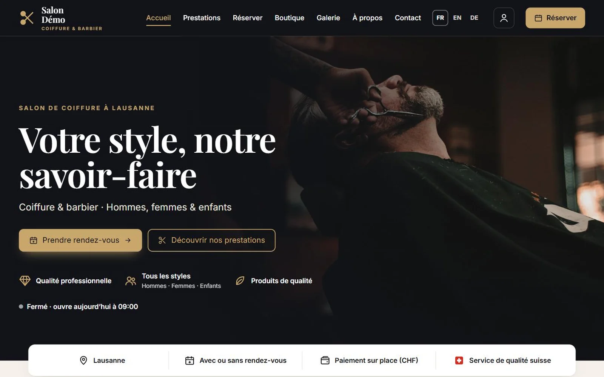
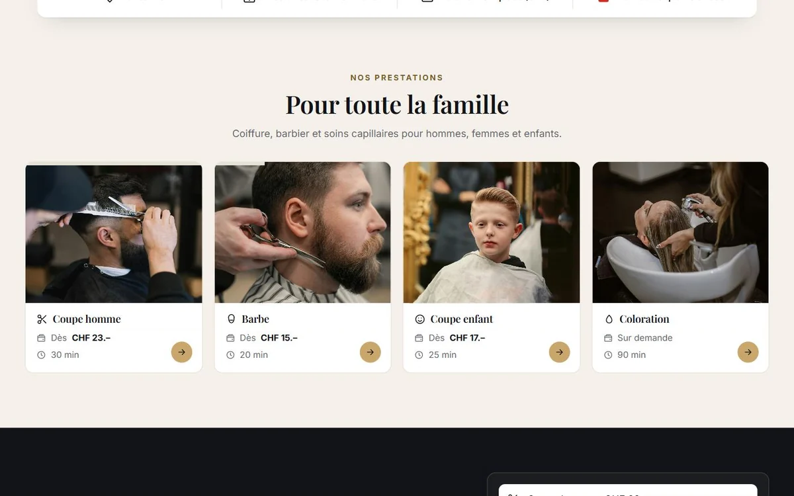
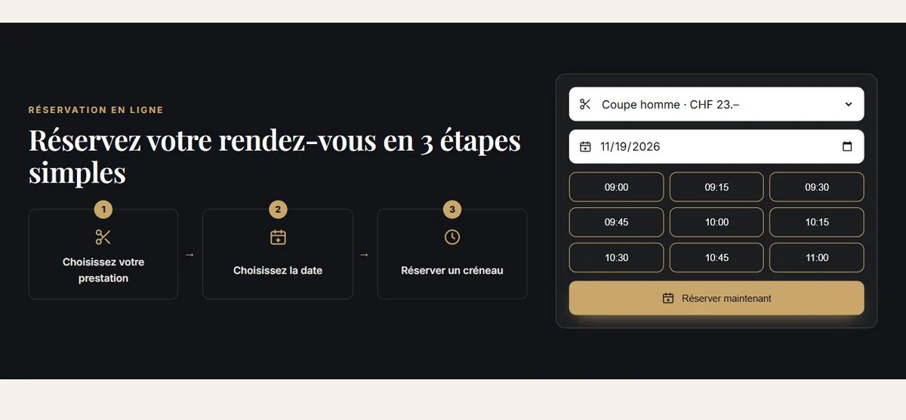
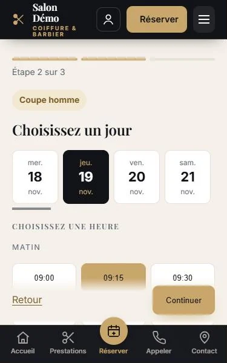
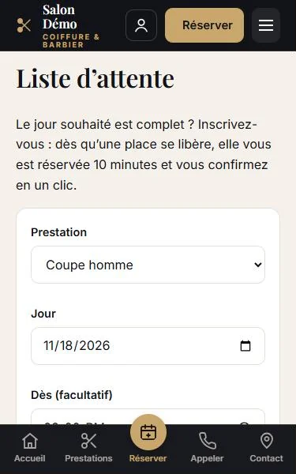
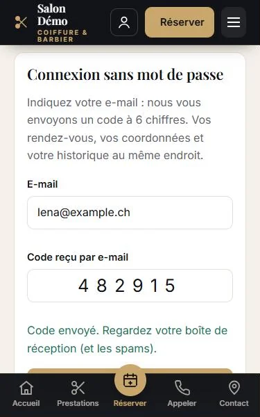
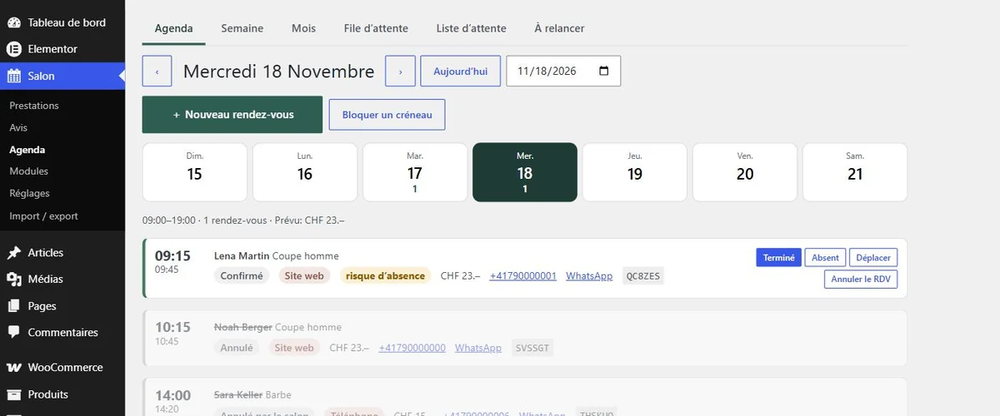
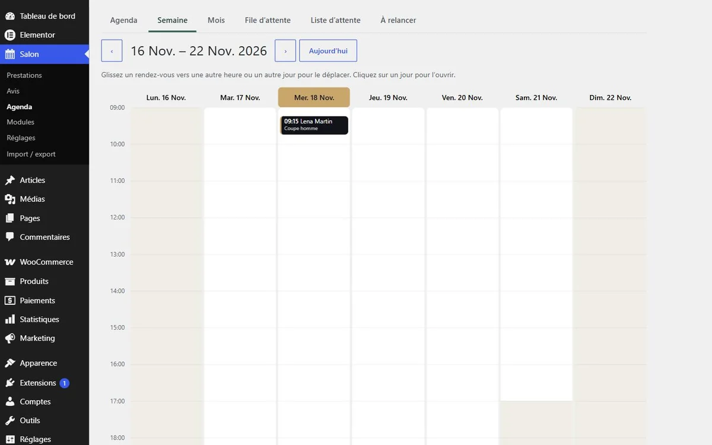
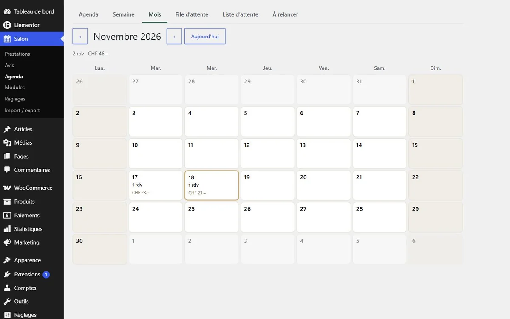
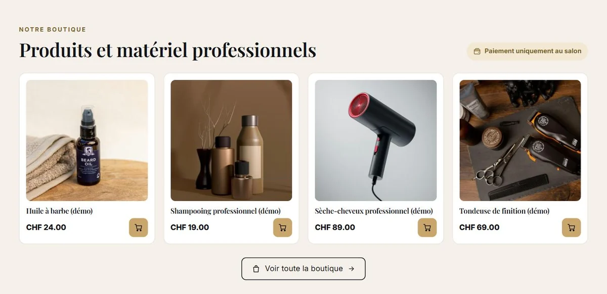

[English](barbershop.md) · [Français](barbershop.fr.md) · [فارسی](barbershop.fa.md)

# LikeServic Salon

**Réservation en ligne, file d’attente en direct et agenda du salon, dans un seul site.**

Pour les salons de coiffure et barbiers, avec ou sans rendez-vous. Le client choisit sa prestation et un créneau libre en trois étapes, ou prend un ticket et suit l’attente sur son téléphone. Le salon gère tout depuis un agenda simple, au jour, à la semaine ou au mois.

**Démo en ligne:** sur demande (captures ci-dessous)  
**Page produit sur NeoLivis:** https://neo.likenic.com/product/likeservic-salon/

## Captures d’écran

| Ordinateur | Téléphone |
|---|---|
|  |  |

## Les fonctionnalités, écran par écran

_Les captures viennent de l’installation en cours de finalisation chez un premier client ; le nom, l’adresse, le téléphone et les clients du salon ont été remplacés par des données fictives._

### 1. Des prestations qui mènent droit à la réservation

Chaque carte montre la photo, le prix de départ et la durée ; la flèche ouvre la réservation avec la prestation déjà choisie. En haut de page, on voit aussi si le salon est ouvert en ce moment.

### 2. Réserver depuis l’accueil

On choisit une prestation et un jour : les heures libres apparaissent en boutons, lues en direct dans l’agenda. Un geste ouvre la réservation avec l’heure déjà choisie.

### 3. Trois étapes sur le téléphone

Prestation, heure libre, coordonnées – sans compte et sans paiement en ligne. Le créneau est revérifié au dernier moment : deux clients ne peuvent jamais avoir le même fauteuil.

### 4. Une liste d’attente pour les jours complets

Si le jour est complet, le client s’inscrit pour ce jour-là. Dès qu’une annulation arrive, la place est gardée dix minutes pour le premier inscrit et proposée par e-mail.

### 5. Un espace client sans mot de passe

Le client saisit son e-mail et reçoit un code à six chiffres. Il y retrouve ses prochains rendez-vous, peut annuler, voit son historique et ses coordonnées.

### 6. La journée du salon sur un écran

Chaque rendez-vous avec son statut, son origine et le chiffre prévu. Terminé, absent, déplacer ou annuler en un geste ; les rendez-vous par téléphone ou sur place s’ajoutent ici aussi.

### 7. La semaine, en glisser-déposer

Sept colonnes avec les heures d’ouverture et les plages bloquées. Glisser un rendez-vous vers une autre heure le déplace après confirmation, avec le même contrôle que la réservation en ligne.

### 8. Le mois d’un coup d’œil

Le nombre de rendez-vous et le chiffre prévu pour chaque jour ; les jours de fermeture sont grisés. Un geste sur un jour l’ouvre.

### 9. Des produits, payés au salon

Une petite boutique WooCommerce : le client réserve ses produits en ligne et les paie au moment du retrait au salon. Aucun paiement en ligne.

---

Le code source est privé : chaque installation est faite pour le client. Demandez un accès au code si vous évaluez mon travail.

[← Retour au profil](../README.md)
