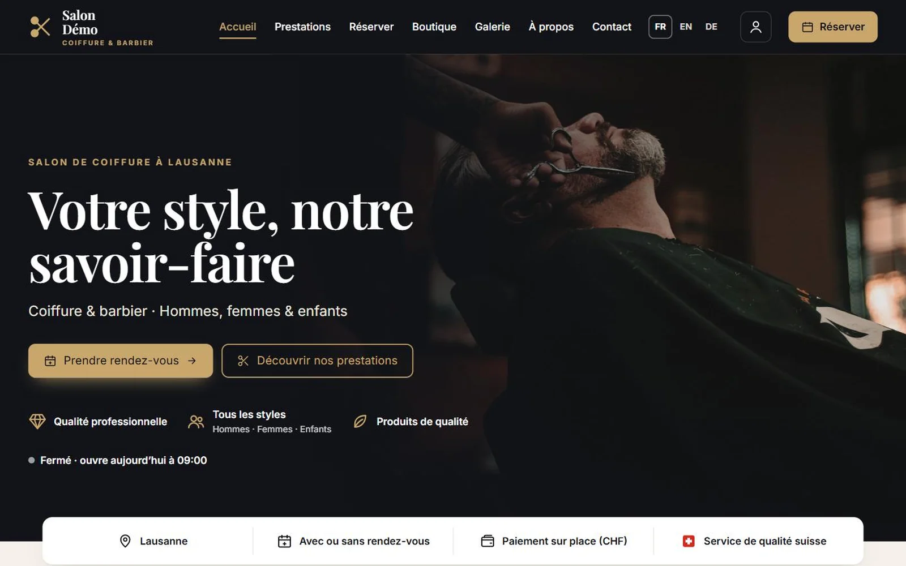
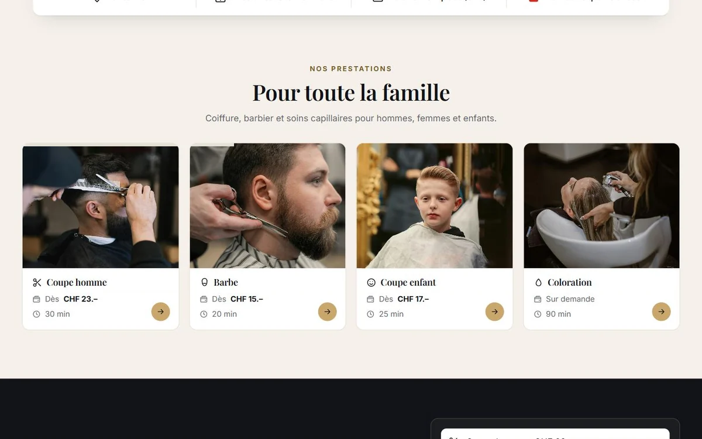
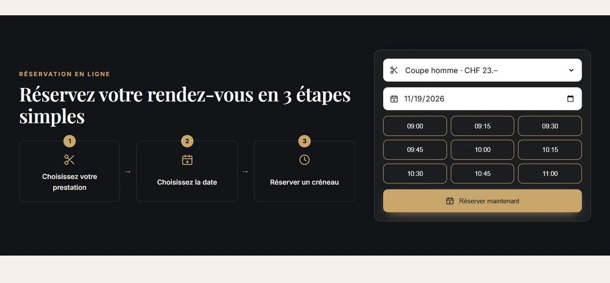
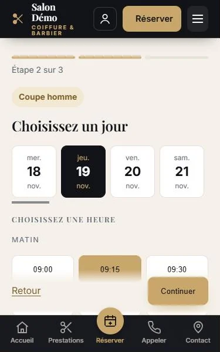
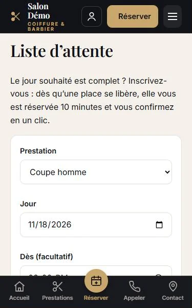
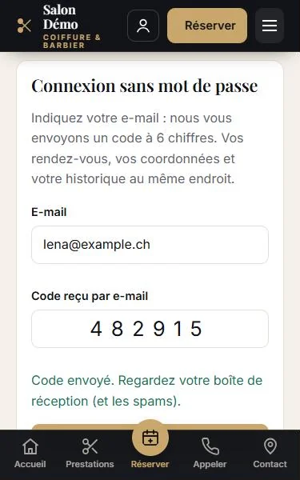
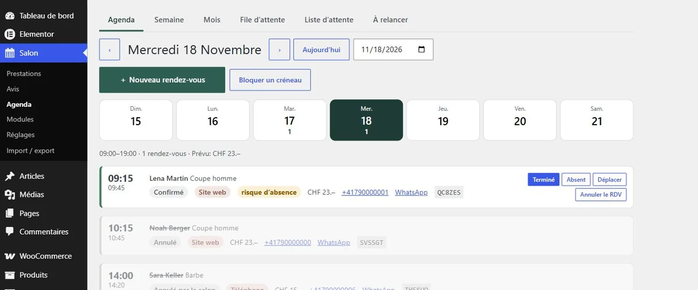
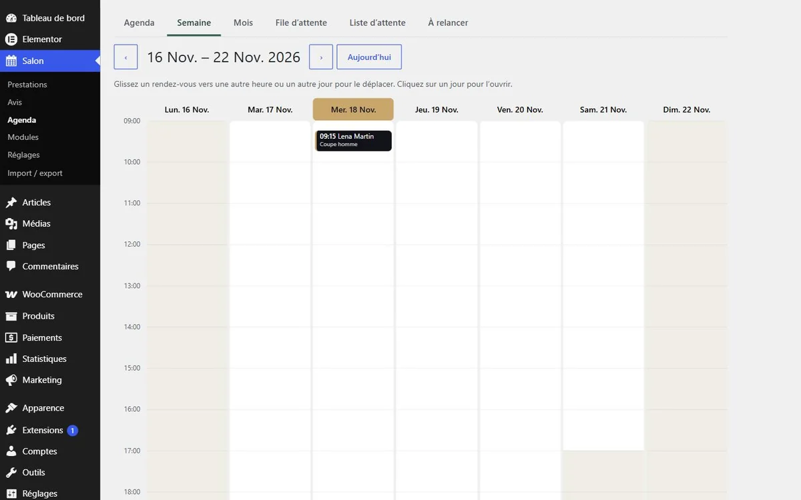
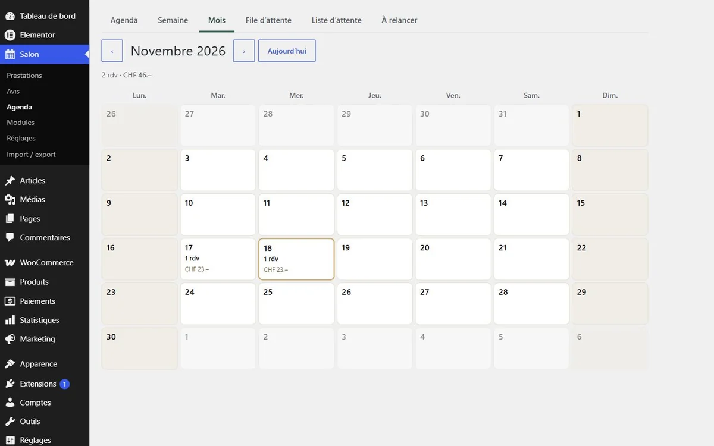
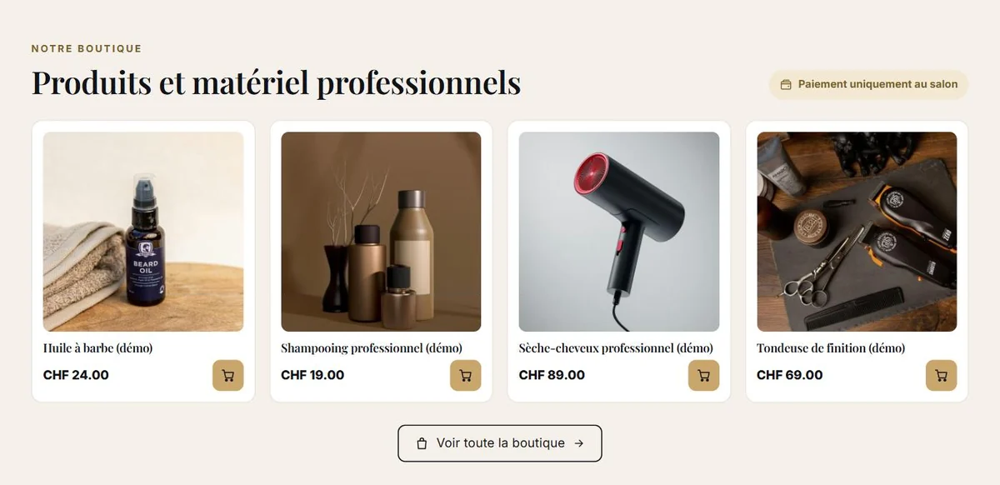

[English](barbershop.md) · [Français](barbershop.fr.md) · [فارسی](barbershop.fa.md)

# LikeServic Salon

**Online booking, a live walk-in queue and the salon’s agenda in one website.**

Made for hair salons and barbers that take both appointments and walk-ins. Customers pick a service and a free time in three steps, or take a ticket and watch the queue on their phone. The salon runs everything from one simple agenda – by day, week or month.

**Live demo:** on request (screenshots below)  
**Product page on NeoLivis:** https://neo.likenic.com/en/product/likeservic-salon-en/

## Screenshots

| Computer | Phone |
|---|---|
|  |  |

## Features, screen by screen

_Screenshots come from the installation being finished for a first client; the salon’s name, address, phone and customers were replaced with fictitious ones._

### 1. Services that lead straight to booking

Each service card shows its photo, starting price and duration; the arrow opens the booking with that service already chosen. Under the hero, visitors also see whether the salon is open right now.

### 2. Book from the home page

Choose a service and a day: the free times appear as buttons, read live from the agenda. One tap opens the booking form with that time already chosen.

### 3. Three steps on the phone

Service, free time, contact details – no account and no online payment. The booking is checked again at the last moment, so two customers can never get the same chair.

### 4. A waiting list for full days

If the day is full, the customer joins the list for that day. When someone cancels, the time is held for the first person for ten minutes and offered by e-mail.

### 5. A customer area without a password

The customer enters their e-mail and receives a six-digit code. Inside: upcoming appointments, cancelling, history and their details.

### 6. The salon’s day on one screen

Every appointment with its status, source and expected takings. Done, missed, move or cancel in one tap; phone and walk-in appointments are added here too.

### 7. The week, with drag and drop

Seven columns with opening hours and blocked times. Dragging an appointment to another time moves it after a confirmation, with the same safety check as online booking.

### 8. The month at a glance

Appointments and expected takings for each day; closed days are shaded. A tap on a day opens it.

### 9. Products, paid in the salon

A small WooCommerce shop: the customer reserves products online and pays for them when collecting them in the salon. No online payment.

---

Source code is private: every installation is set up for the client. Ask for access to the code if you are evaluating my work.

[← Back to the profile](../README.md)
