

[English](gift-shop.md) · [Français](gift-shop.fr.md) · [فارسی](gift-shop.fa.md)

# LikeServic Gift

**فروشگاه سوغاتی سوئیسی، آمادهٔ فروش آنلاین.**

برای فروشگاه‌های سوغاتی و هدیه: کاتالوگ ووکامرس، ده مقصد سوئیس، راهنمای انتخاب هدیه، جعبهٔ هدیهٔ دلخواه، مقاله‌هایی دربارهٔ سوئیس و بخش فروش عمده، به پنج زبان. نسخهٔ ۲ «Swiss Premium»: ساخته‌شده برای Euro Mega Mart در رومانل‌سورمورژ، با کاتالوگ واقعی خودش.

**دموی آنلاین:** https://gif.likenic.com/

## تصاویر

| کامپیوتر | موبایل |
|---|---|
| 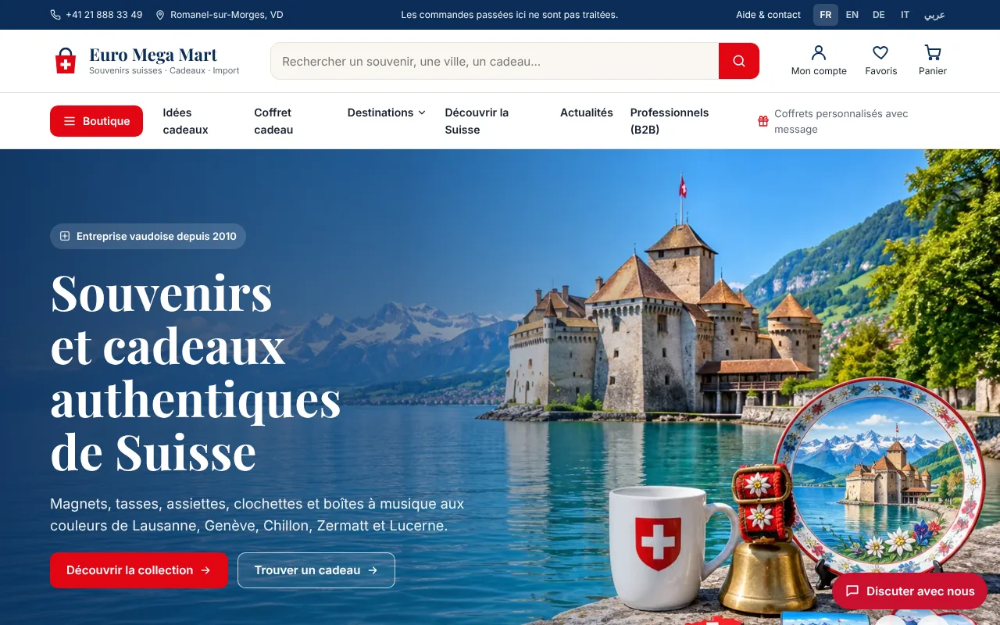 | 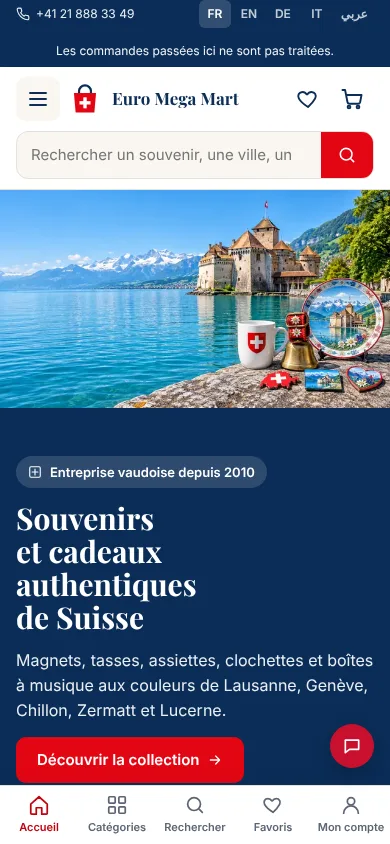 |

## امکانات، صفحه به صفحه

_همهٔ تصویرهای زیر از سایت آزمایشی gif.likenic.com است؛ محصولات، قیمت‌ها و اطلاعات تماس، داده‌های واقعی Euro Mega Mart هستند._

### 1. صفحهٔ اصلی که با سوئیس باز می‌شود

اسلایدر تمام‌عرض با مناظر سوئیس، یک جملهٔ کوتاه، دو مسیر ورود (کل مجموعه یا ایدهٔ هدیه) و شمارهٔ تلفن فروشگاه که همیشه بالای صفحه است.

### 2. ده مقصد سوئیس

لوزان، ژنو، مونترو، شیون، زرمات، لوسرن، زوریخ، برن، اینترلاکن و بازل؛ هر کدام با کارت عکس و تعداد سوغاتی‌ها یا راهنمای سفر.

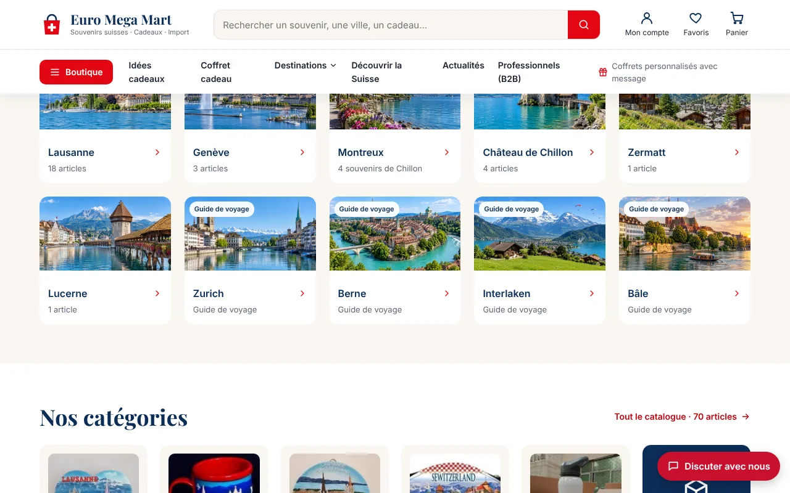

### 3. یک صفحه برای هر شهر

عکس بزرگ، معرفی کوتاهی که برای هر زبان جدا نوشته شده و سوغاتی‌های همان شهر، آمادهٔ افزودن به سبد.

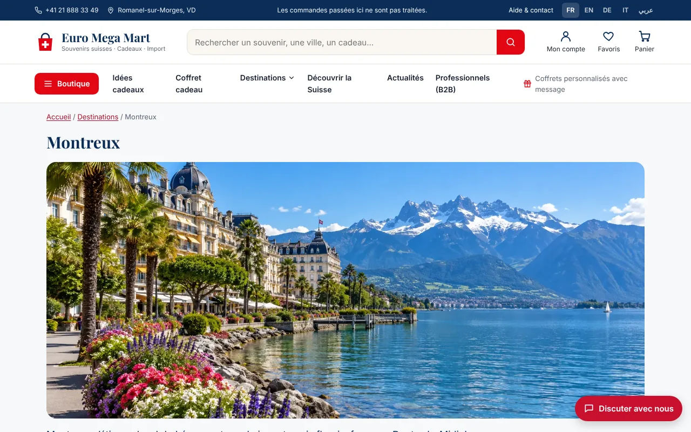

### 4. سوغاتی‌های منتخب در چند زبانه

منتخب‌ها، زیر ۱۰ فرانک، خانه و آشپزخانه، و لوزان در یک ردیف کارت؛ هر کارت با قلب برای علاقه‌مندی‌ها و دکمهٔ افزودن سریع به سبد.

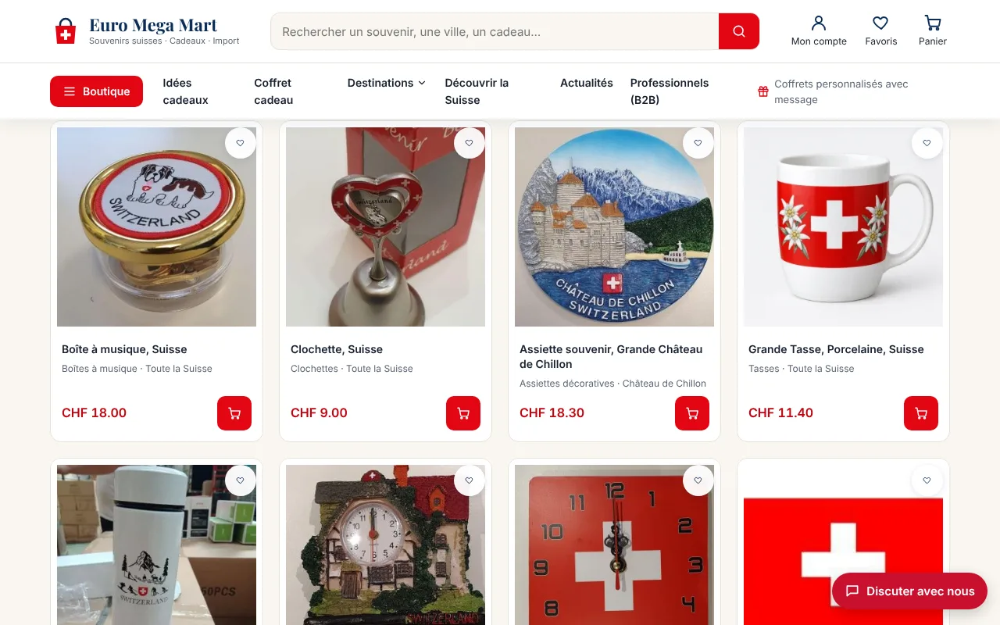

### 5. کاتالوگی که مثل خرید واقعی دسته‌بندی شده

دکمه برای هر خانوادهٔ سوغاتی و برای هدیه‌های زیر ۱۰ فرانک، مرتب‌سازی بر اساس قیمت، و کاتالوگ واقعی به فرانک سوئیس.

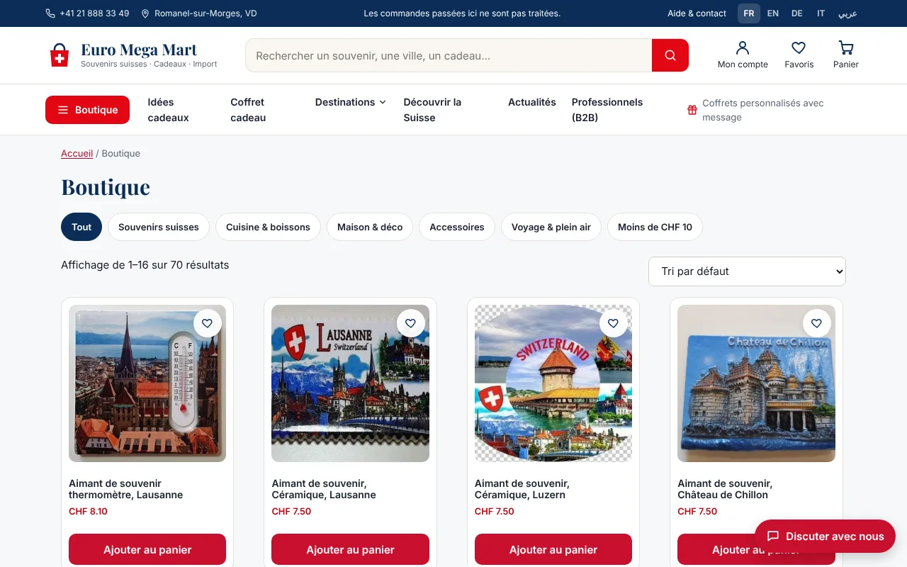

### 6. صفحهٔ محصول با دکمهٔ خرید همیشه در دسترس

عکس بزرگ و قیمت، زبانهٔ «کمی تاریخ» دربارهٔ آن شیء، و نوار افزودن به سبد که هنگام اسکرول ثابت می‌ماند.

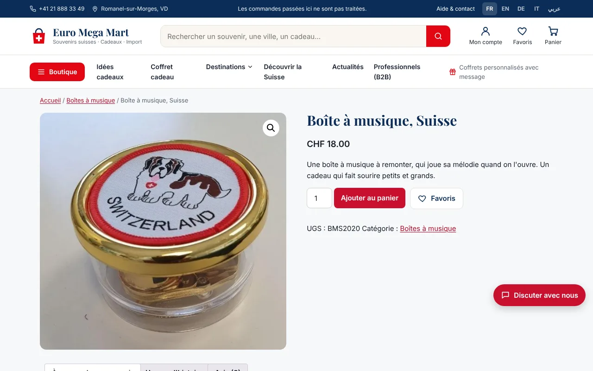

### 7. ایدهٔ هدیه با چند سؤال

برای چه کسی، چه مناسبتی، چه بودجه‌ای: پیشنهادها فقط از محصولاتی است که واقعاً در کاتالوگ هست.

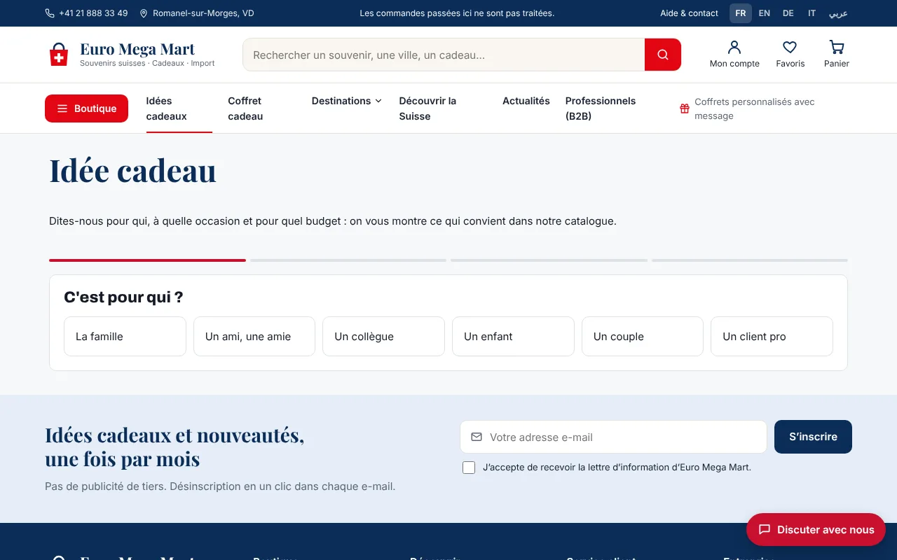

### 8. ساختن جعبهٔ هدیهٔ دلخواه

انتخاب سه تا هشت سوغاتی، دیدن جمع قیمت، افزودن پیام شخصی و فرستادن جعبه به سبد خرید.

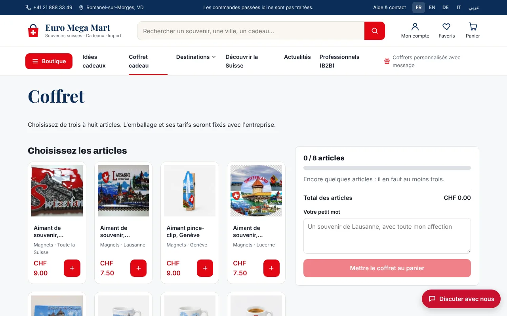

### 9. کشف سوئیس: مقاله‌های با منبع

مقاله‌های کوتاه دربارهٔ تاریخ سوئیس، شکلات، ساعت‌سازی و رسوم، هر کدام با ذکر منابع رسمی یا معتبری که از آن‌ها استفاده شده.

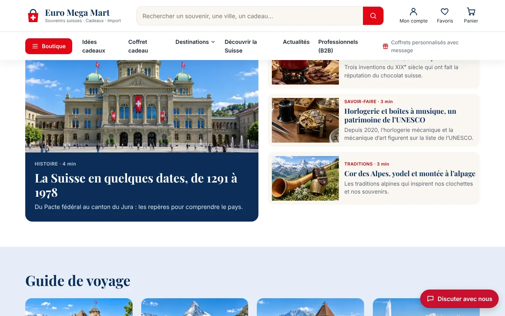

### 10. اخبار و رویدادها با تاریخ واقعی

بازارهای کریسمس مونترو و ژنو و جشن اسکالاد، با تاریخ‌هایی که از سایت خود برگزارکنندگان بررسی شده.

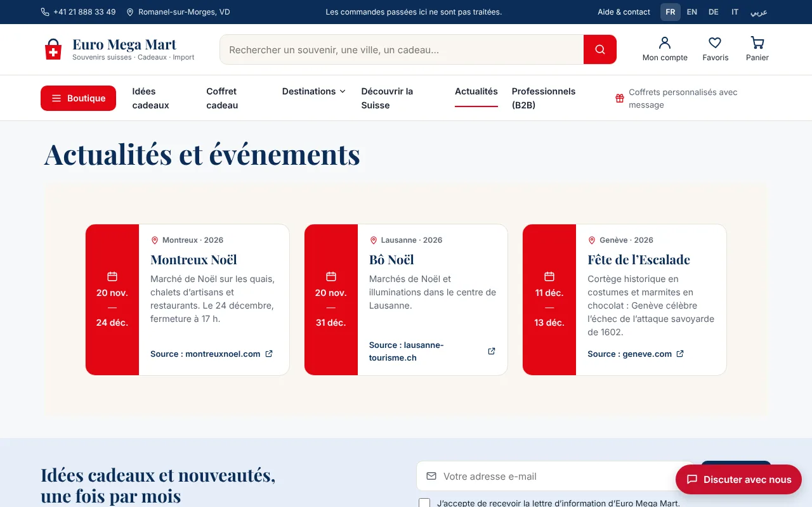

### 11. بخش ویژهٔ هتل‌ها و فروشندگان عمده

هتل‌ها، کیوسک‌ها، فروشگاه‌ها و شرکت‌ها کالا و تعداد را می‌نویسند و درخواست قیمت مستقیم به فروشگاه می‌رسد.

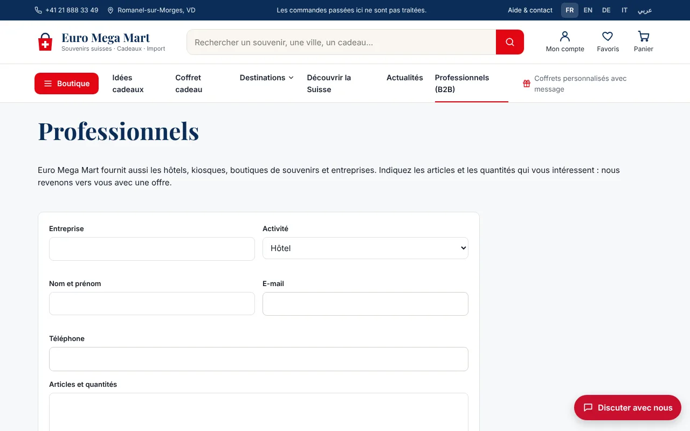

### 12. پاسخ پیش از پرسش

سفارش، پرداخت، ارسال، جعبهٔ هدیه، فروش عمده، مرجوعی و زبان‌ها، در یک بخش بازشونده که گوگل هم آن را می‌خواند.

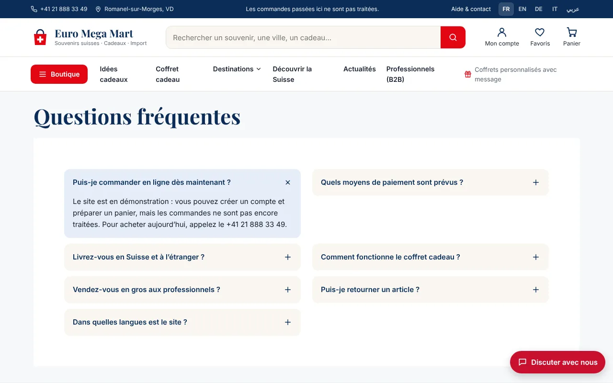

### 13. روی گوشی مثل یک اپلیکیشن

نوار پایین صفحه (خانه، دسته‌ها، جست‌وجو، علاقه‌مندی‌ها، حساب)، جست‌وجوی لحظه‌ای و نصب روی صفحهٔ اصلی گوشی. امتیاز PageSpeed موبایل: ۹۸ سرعت، ۱۰۰ دسترس‌پذیری، ۱۰۰ اصول فنی و ۱۰۰ سئو.

### 14. پنج زبان، از جمله عربی راست‌به‌چپ

فرانسوی، آلمانی، انگلیسی، ایتالیایی و عربی، هر کدام برای خوانندهٔ خودش نوشته شده؛ نسخهٔ عربی کل چیدمان را آینه‌ای می‌کند.

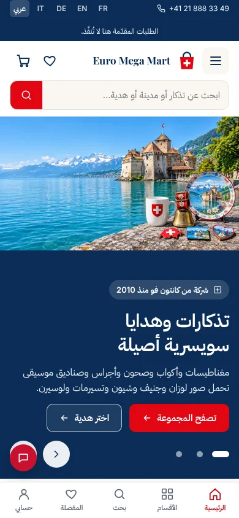

---

کد منبع خصوصی است و هر نصب برای همان مشتری انجام می‌شود. اگر کارم را ارزیابی می‌کنید، برای دیدن کد درخواست دسترسی بدهید.

[← بازگشت به پروفایل](../README.md)

