[English](gift-shop.md) · [Français](gift-shop.fr.md) · [فارسی](gift-shop.fa.md)

# LikeServic Gift

**Une boutique de souvenirs suisses, prête à vendre en ligne.**

Pour les commerces de souvenirs et de cadeaux : un catalogue WooCommerce, dix destinations suisses, une aide au choix du cadeau, un coffret sur mesure, des articles sur la Suisse et un espace pour les pros, en cinq langues. Version 2 « Swiss Premium » : préparée pour Euro Mega Mart, à Romanel-sur-Morges, avec son vrai catalogue.

**Démo en ligne:** https://gif.likenic.com/

## Captures d’écran

| Ordinateur | Téléphone |
|---|---|
| 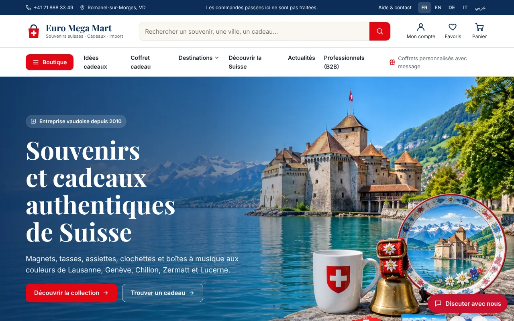 |  |

## Les fonctionnalités, écran par écran

_Chaque capture provient du site de préproduction gif.likenic.com ; produits, prix et coordonnées sont les vraies données d’Euro Mega Mart._

### 1. Une page d’accueil qui s’ouvre sur la Suisse

Un grand diaporama de paysages suisses, une promesse courte, deux entrées (la collection ou une idée cadeau) et le téléphone de la boutique toujours en haut.

### 2. Dix destinations suisses

Lausanne, Genève, Montreux, Chillon, Zermatt, Lucerne, Zurich, Berne, Interlaken et Bâle, chacune avec sa carte photo, le nombre de souvenirs ou un guide de voyage.

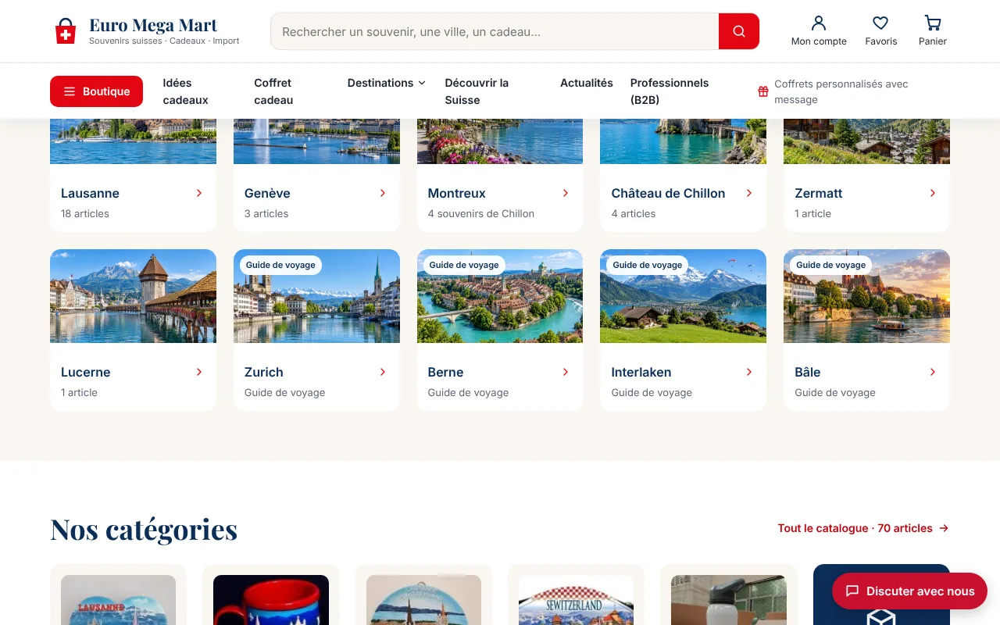

### 3. Une page par lieu

Une grande photo, une présentation écrite pour chaque langue et les souvenirs qui portent ce lieu, prêts à mettre au panier.

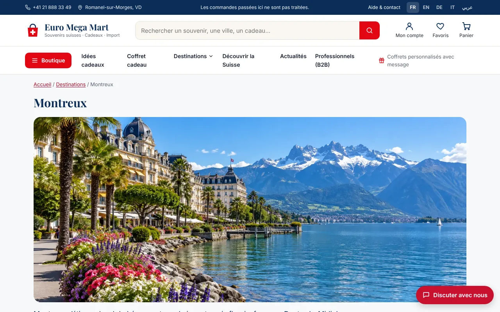

### 4. Les souvenirs à la une, en onglets

Sélection, moins de 10 CHF, maison et table, Lausanne : une rangée de cartes, chacune avec un cœur pour les favoris et un ajout rapide au panier.

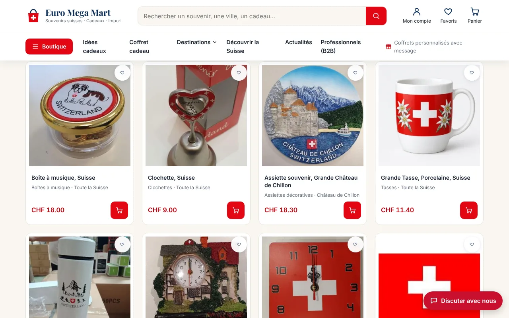

### 5. Un catalogue classé comme on achète

Des pastilles pour chaque famille de souvenirs et pour les cadeaux à moins de 10 CHF, un tri par prix, et le vrai catalogue en francs suisses.

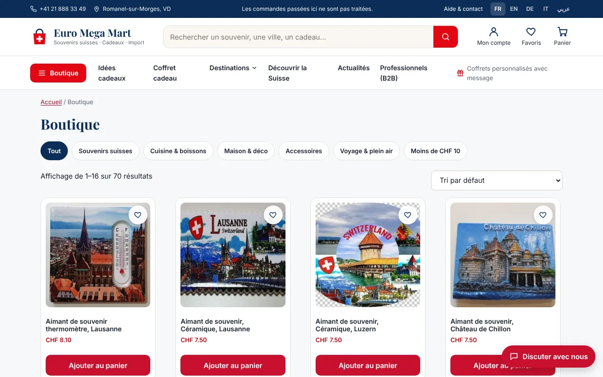

### 6. Une fiche produit qui garde le bouton à portée

Grande photo et prix, un onglet « Un peu d’histoire » sur l’objet, et une barre d’ajout au panier qui reste visible au défilement.

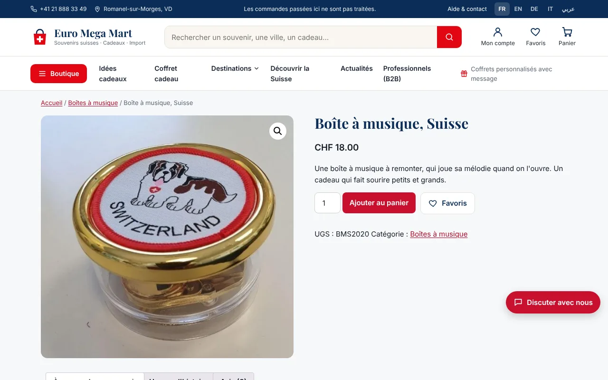

### 7. Une idée cadeau en quelques questions

Pour qui, quelle occasion, quel budget : les réponses ne proposent que des articles vraiment au catalogue.

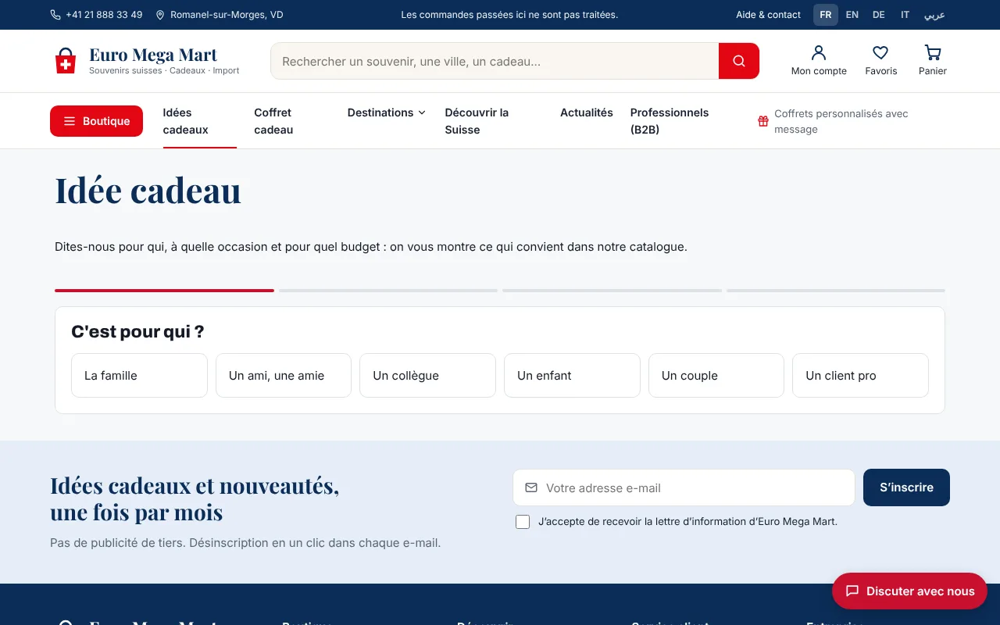

### 8. Composer son coffret

Choisir de trois à huit souvenirs, voir le total se mettre à jour, ajouter un mot personnel et envoyer le coffret au panier.

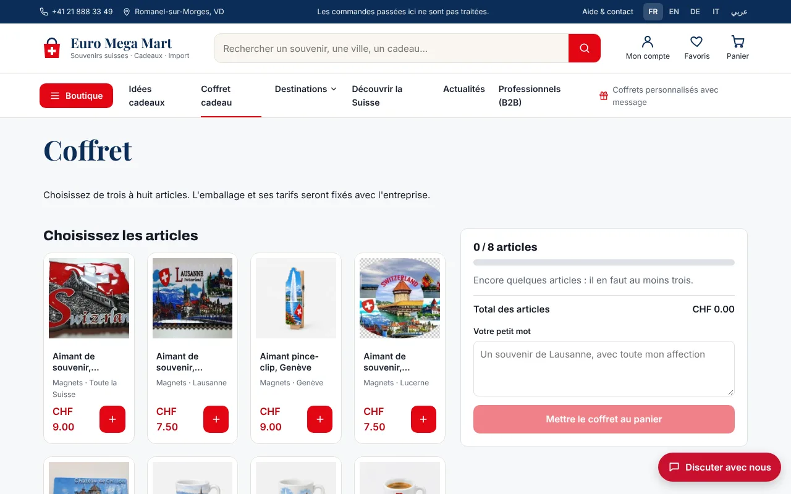

### 9. Découvrir la Suisse : des articles sourcés

De courts articles sur l’histoire suisse, le chocolat, l’horlogerie et les traditions, chacun avec les sources officielles ou de référence utilisées.

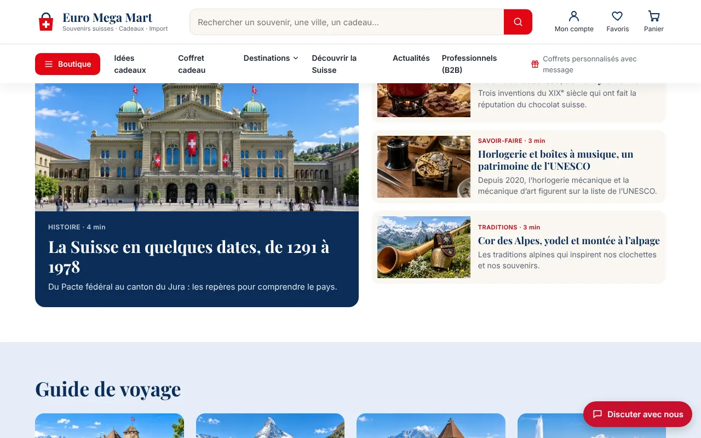

### 10. Actualités et événements, dates vérifiées

Marchés de Noël de Montreux et de Genève, l’Escalade : des dates vérifiées sur les sites des organisateurs.

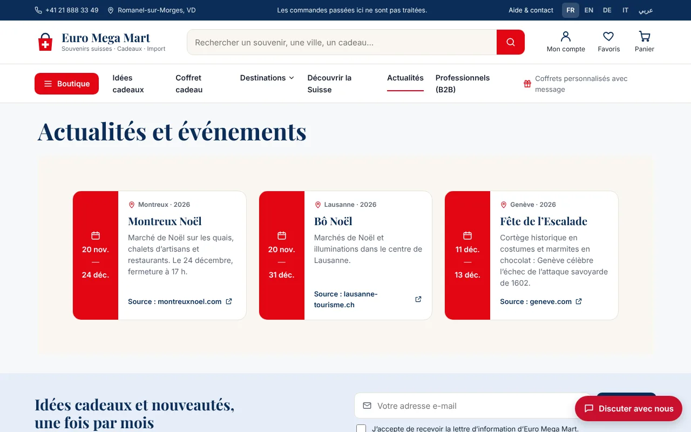

### 11. Un espace pour hôtels et revendeurs

Hôtels, kiosques, boutiques et entreprises indiquent articles et quantités ; la demande de devis arrive directement à la boutique.

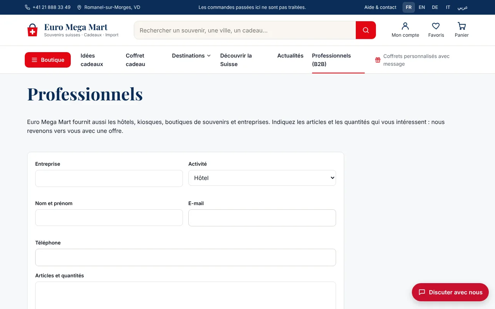

### 12. Les réponses avant les questions

Commande, paiement, livraison, coffrets, vente aux pros, retours et langues, dans un accordéon que Google sait aussi lire.

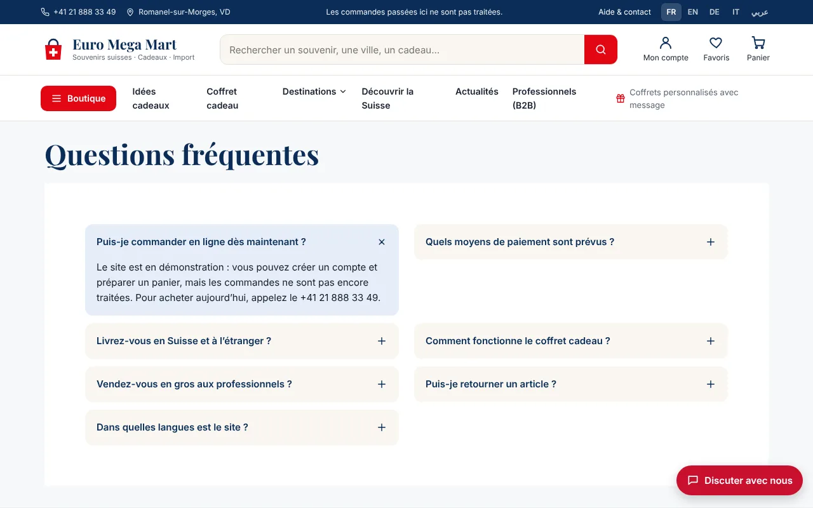

### 13. Comme une application sur téléphone

Une barre d’onglets en bas (accueil, catégories, recherche, favoris, compte), une recherche instantanée et l’installation sur l’écran d’accueil. PageSpeed mobile : 98 en performance, 100 en accessibilité, bonnes pratiques et SEO.

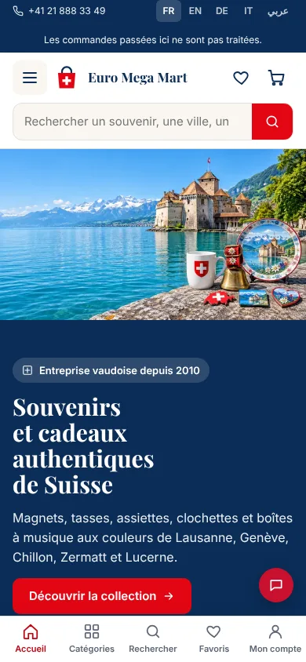

### 14. Cinq langues, dont l’arabe de droite à gauche

Français, allemand, anglais, italien et arabe, chacune écrite pour ses lecteurs ; la version arabe inverse toute la mise en page.

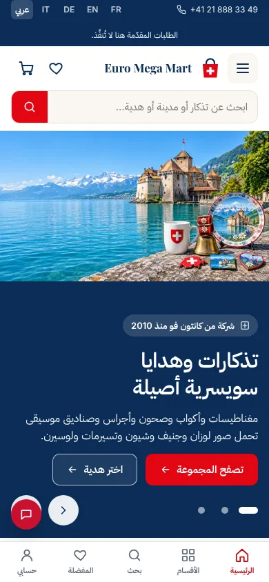

---

Le code source est privé : chaque installation est faite pour le client. Demandez un accès au code si vous évaluez mon travail.

[← Retour au profil](../README.md)
