[English](gift-shop.md) · [Français](gift-shop.fr.md) · [فارسی](gift-shop.fa.md)

# LikeServic Gift

**A Swiss souvenir shop, ready to sell online.**

For souvenir and gift retailers: a WooCommerce catalogue, ten Swiss destinations, a gift finder, build-your-own gift boxes, articles about Switzerland and a trade area, in five languages. Version 2 “Swiss Premium”: built for Euro Mega Mart in Romanel-sur-Morges, with its real catalogue.

**Live demo:** https://gif.likenic.com/

## Screenshots

| Computer | Phone |
|---|---|
| 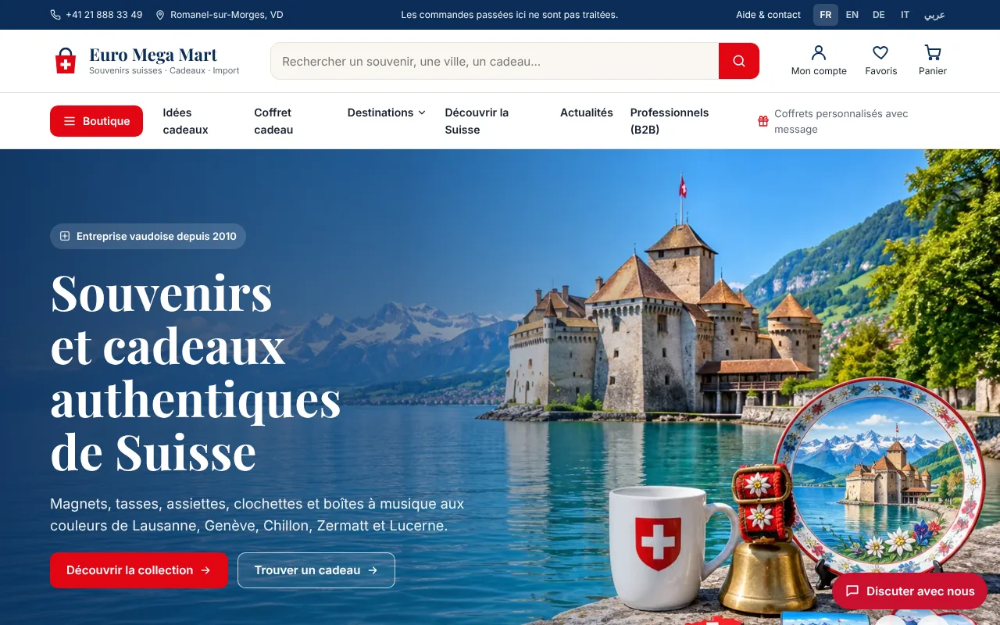 | 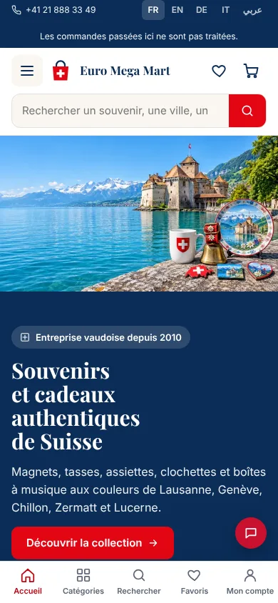 |

## Features, screen by screen

_Every screenshot below comes from the staging site gif.likenic.com; the products, prices and contact details are Euro Mega Mart’s real data._

### 1. A home page that opens on Switzerland

A full-width slider of Swiss landmarks, a short promise, two ways in (the collection or a gift idea) and the shop’s phone number always at the top.

### 2. Ten Swiss destinations

Lausanne, Geneva, Montreux, Chillon, Zermatt, Lucerne, Zurich, Bern, Interlaken and Basel, each with a photo card showing how many souvenirs it has, or a travel guide.

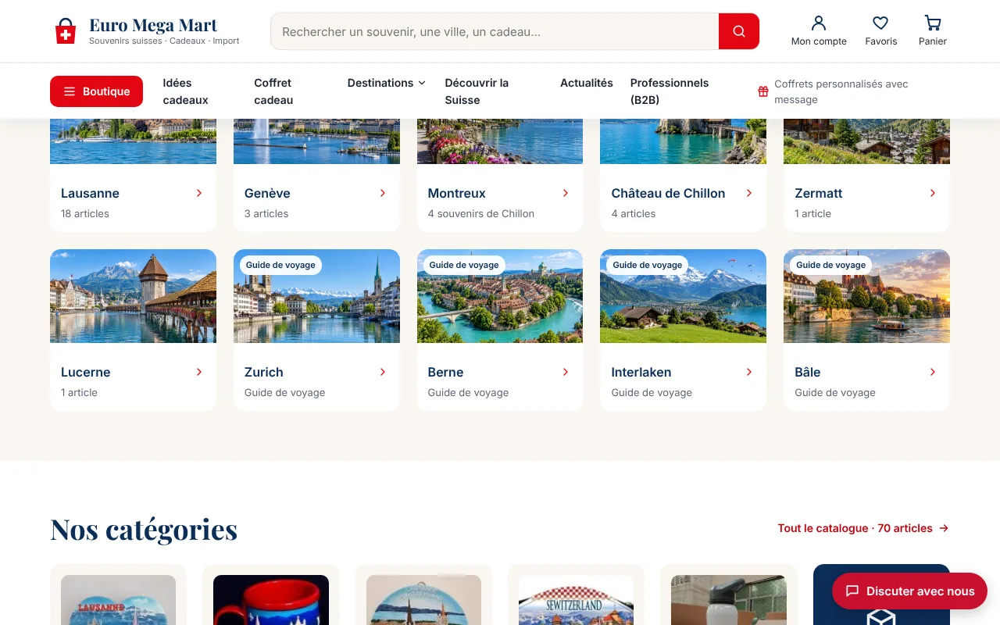

### 3. A page for every place

A large photo, a short introduction written for each language and the souvenirs that carry that place, ready to add to the cart.

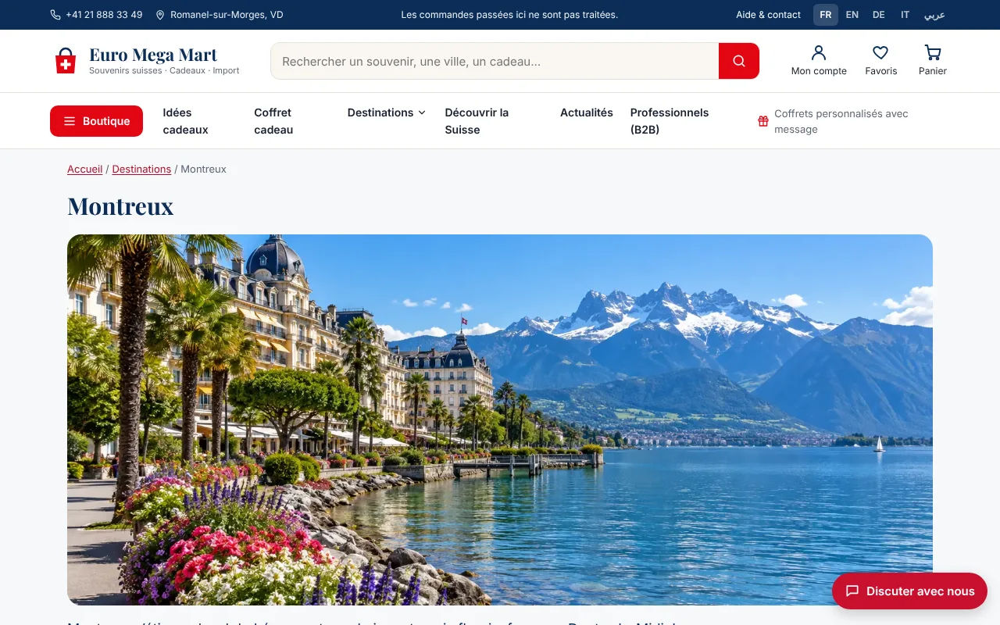

### 4. Featured souvenirs in tabs

A selection, gifts under CHF 10, home and table, and Lausanne on one row of cards, each with a heart for the wishlist and a quick add-to-cart button.

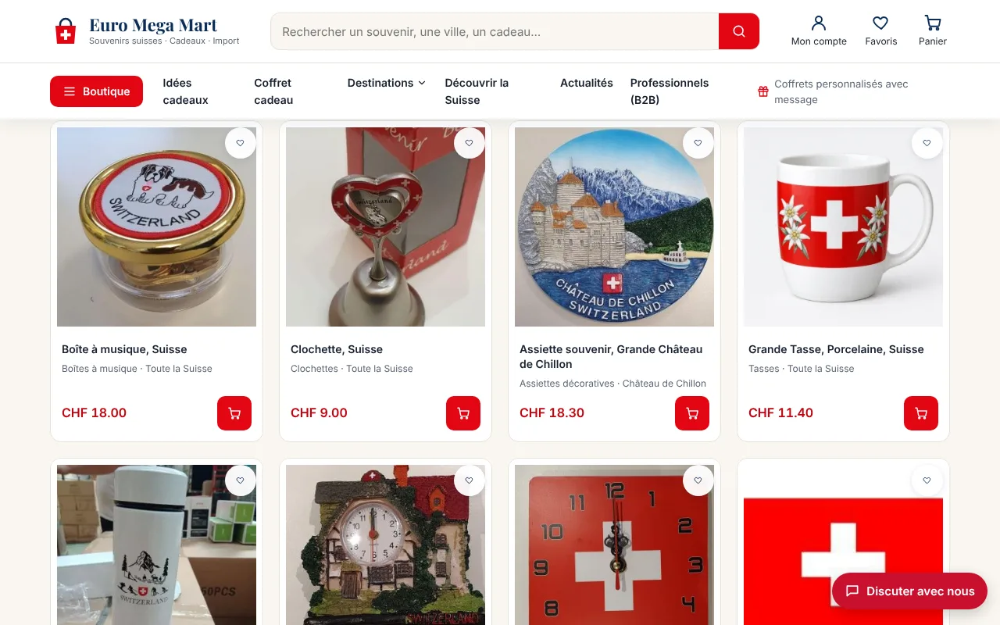

### 5. A catalogue sorted the way people shop

Chips for each family of souvenirs and for gifts under CHF 10, sorting by price, and the real catalogue in Swiss francs.

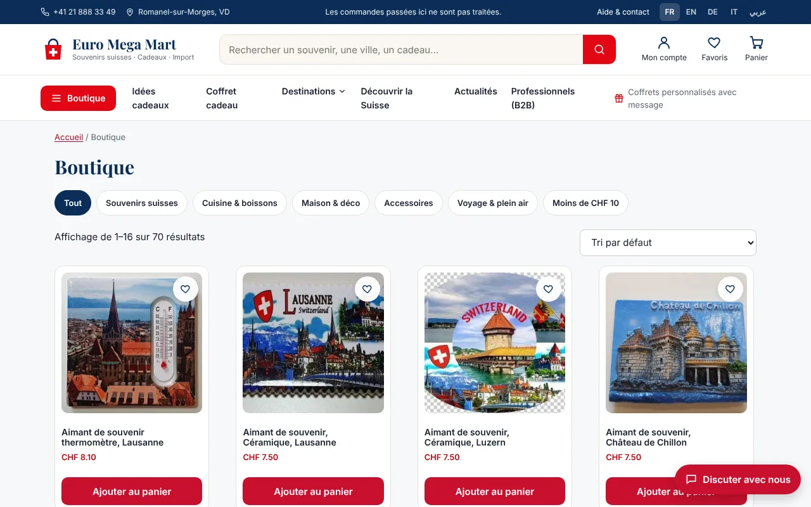

### 6. A product page that keeps the button in reach

Large photo and price, a tab with a little history of the object, and an add-to-cart bar that stays visible while scrolling.

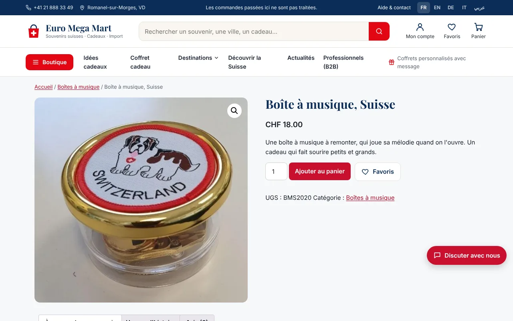

### 7. Gift ideas in a few questions

Who it is for, the occasion and the budget: the answers only suggest products that are really in the catalogue.

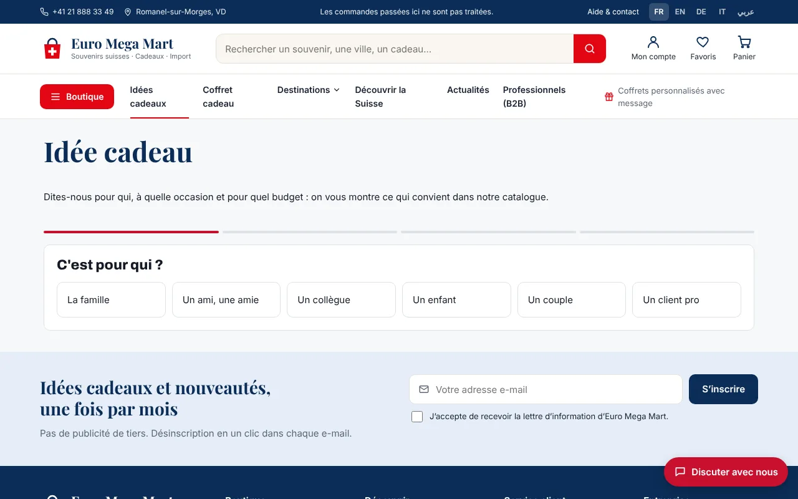

### 8. Build your own gift box

Pick three to eight souvenirs, see the total update, add a personal note and send the box to the cart.

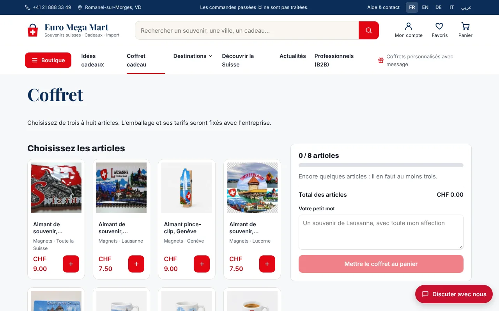

### 9. Discover Switzerland: articles with sources

Short articles on Swiss history, chocolate, watchmaking and traditions, each citing the official or reference sources it relies on.

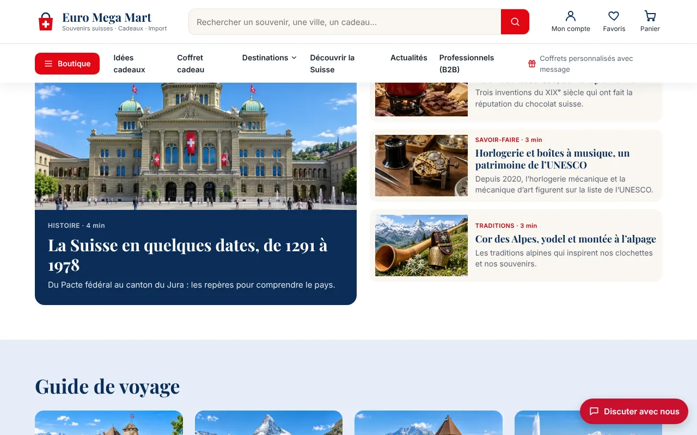

### 10. News and events with real dates

Christmas markets in Montreux and Geneva and the Escalade, with dates checked against the organisers’ own sites.

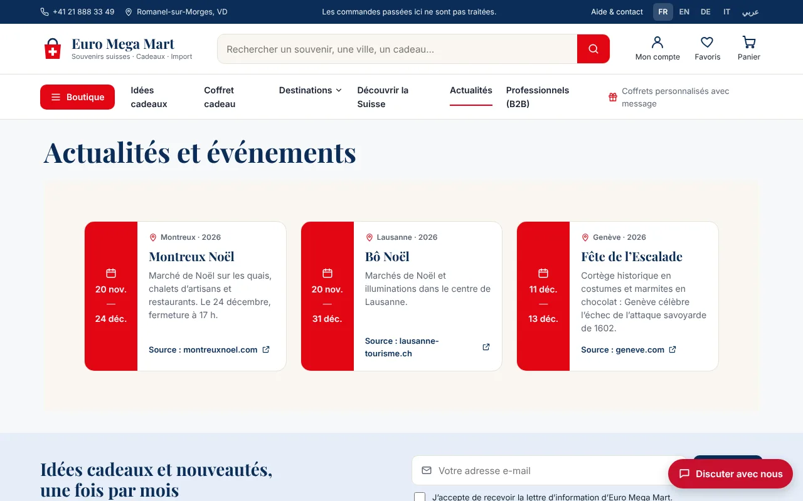

### 11. A trade area for hotels and resellers

Hotels, kiosks, souvenir shops and companies list the items and quantities they need; the quote request reaches the shop directly.

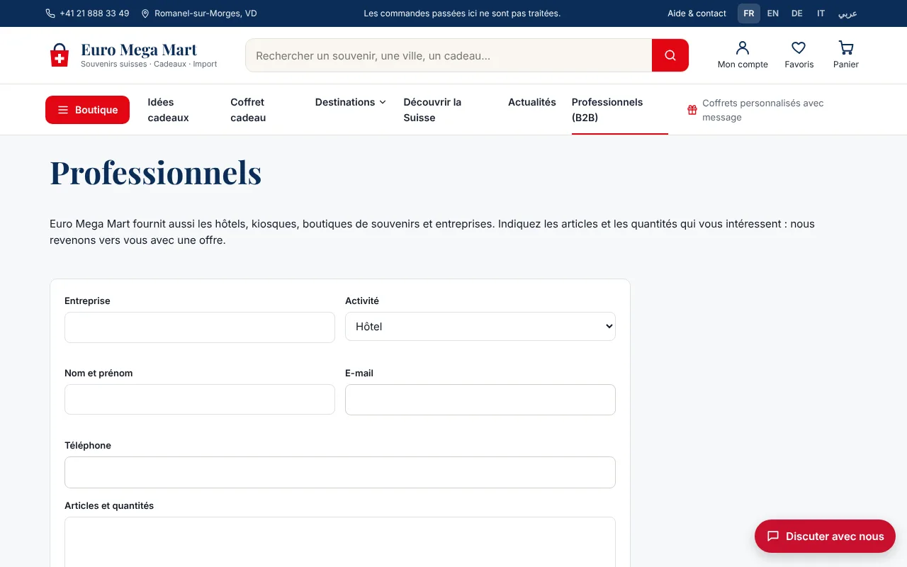

### 12. Questions answered before they are asked

Ordering, payment, delivery, gift boxes, trade orders, returns and languages, in an accordion that Google can also read.

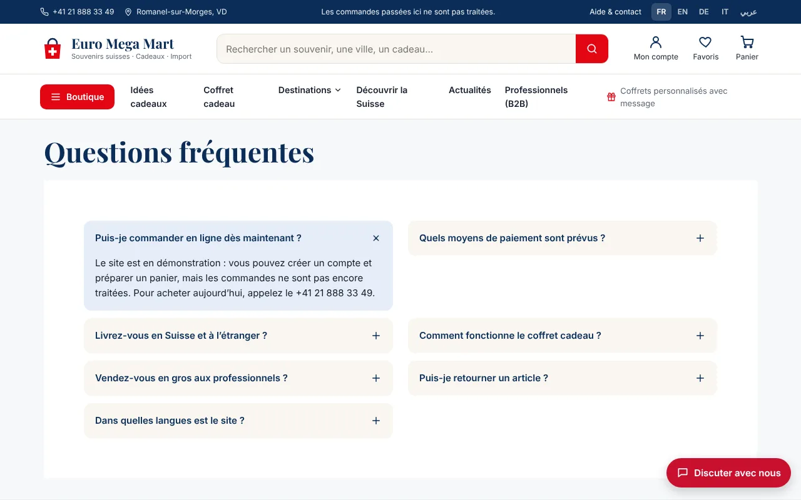

### 13. Like an app on the phone

A bottom tab bar (home, categories, search, wishlist, account), live search and installation on the home screen. PageSpeed on mobile: 98 performance, 100 accessibility, best practices and SEO.

### 14. Five languages, Arabic right to left

French, German, English, Italian and Arabic, each written for its readers; the Arabic version mirrors the whole layout.

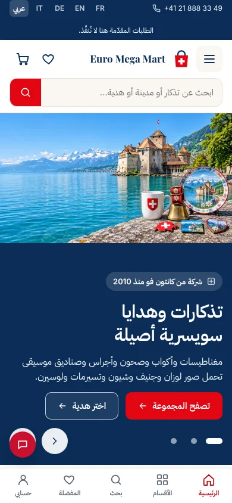

---

Source code is private: every installation is set up for the client. Ask for access to the code if you are evaluating my work.

[← Back to the profile](../README.md)
