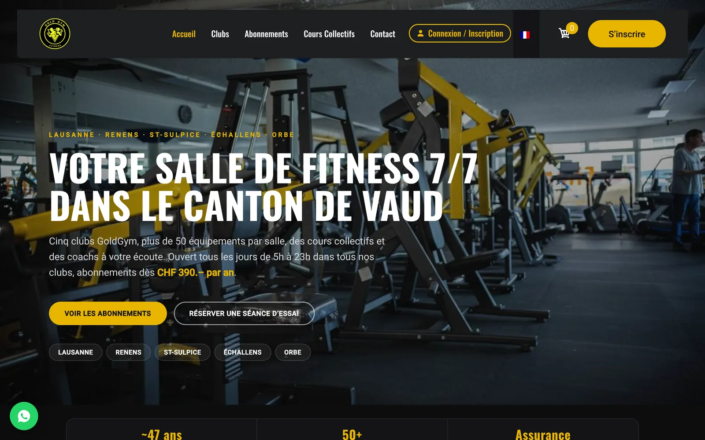
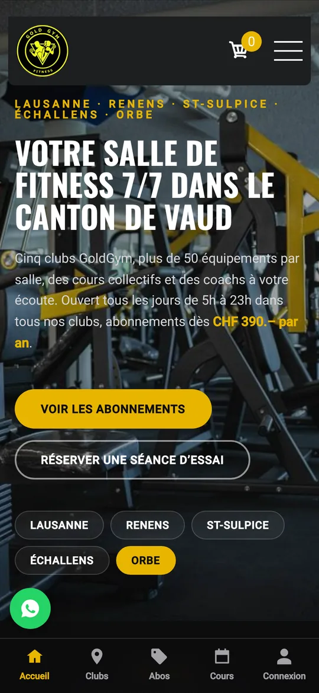
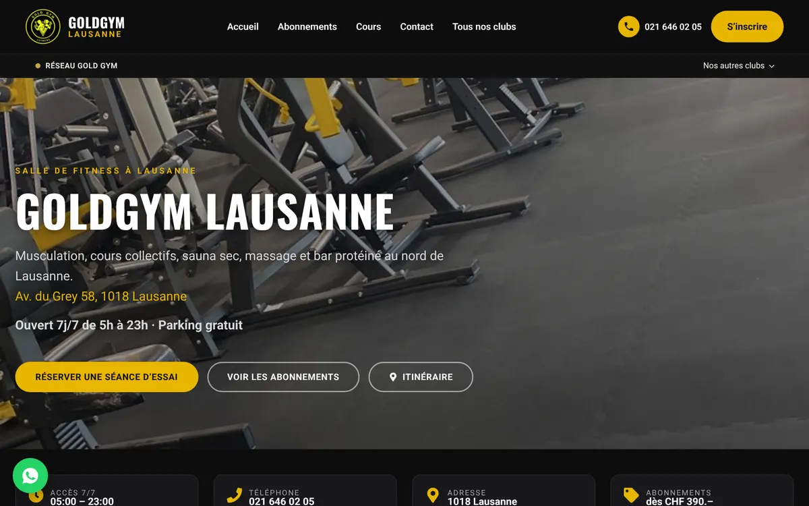
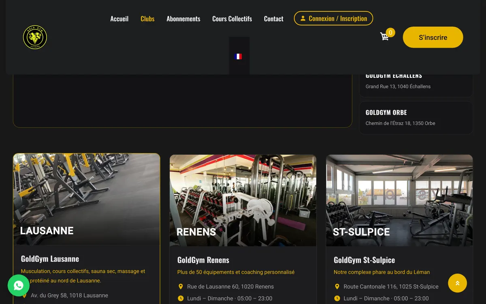
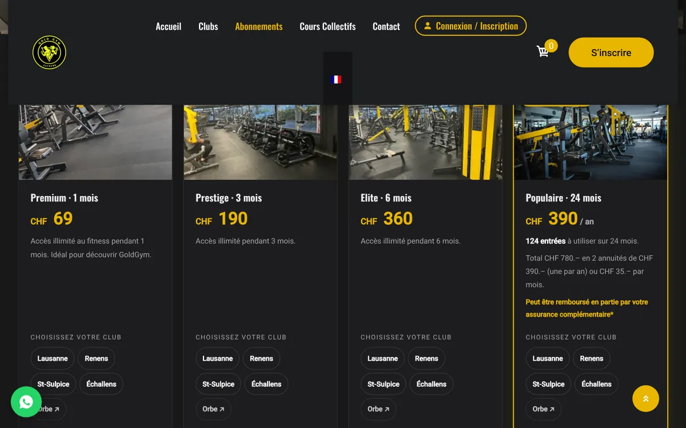
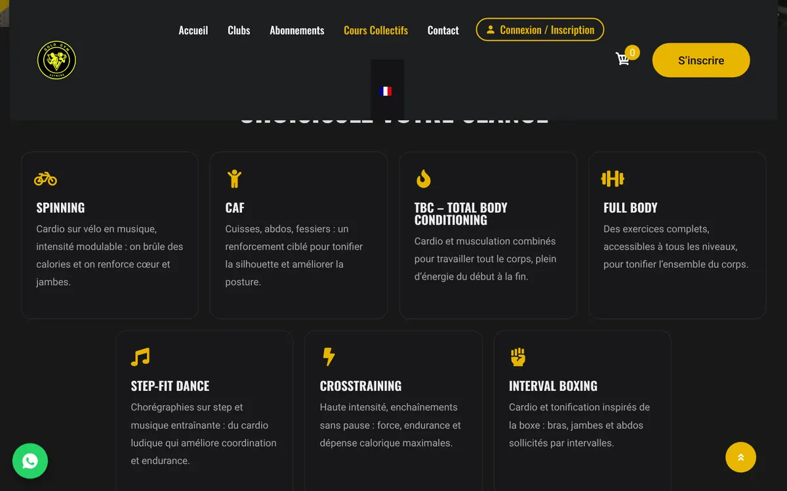
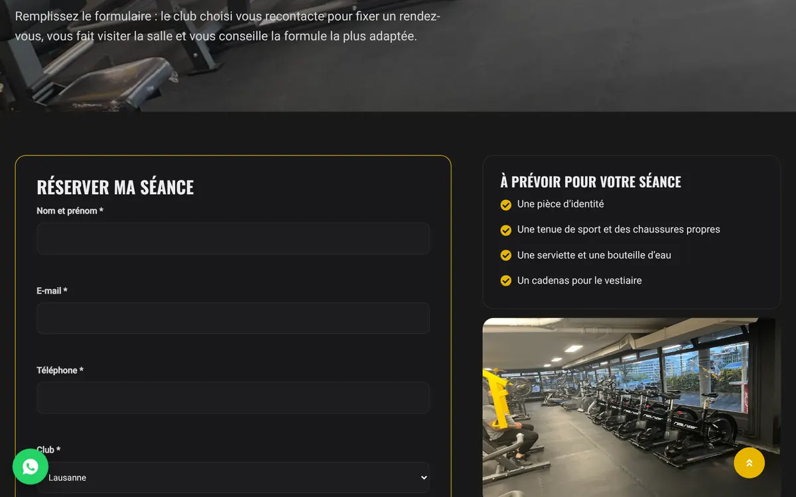
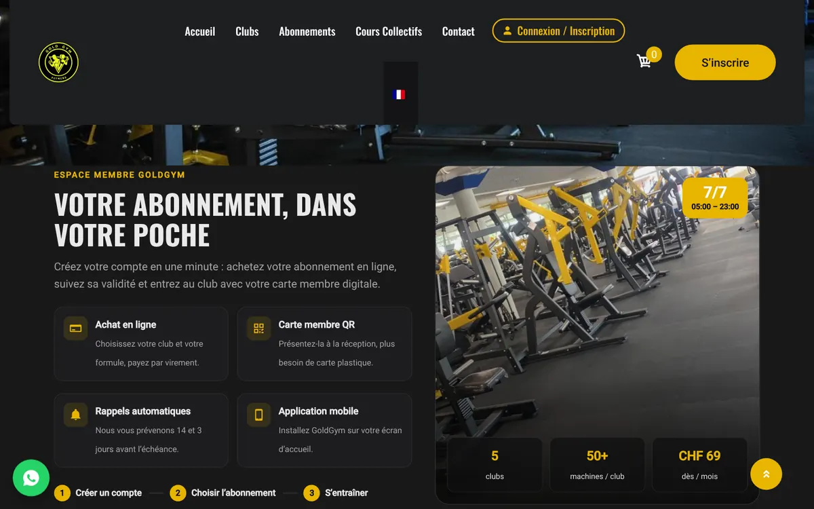
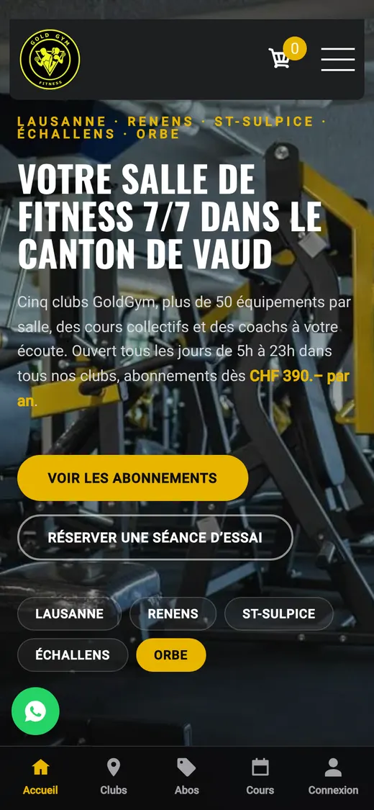
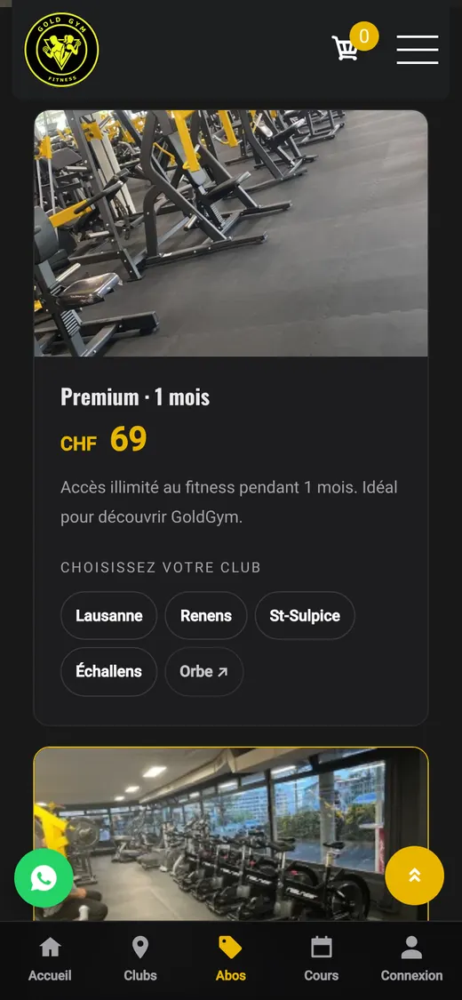

[English](gym-network.md) · [Français](gym-network.fr.md) · [فارسی](gym-network.fa.md)

# LikeServic Gym Network

**Un site principal et un site par salle, reliés entre eux.**

Pour une chaîne de salles de fitness : un site de marque qui présente toutes les salles, et un site pour chaque salle qui gère ses propres abonnements, cours et membres. En service chez GoldGym, cinq salles dans le canton de Vaud.

**Démo en ligne:** https://goldgym.ch/  
**Page produit sur NeoLivis:** https://neo.likenic.com/product/likeservic-gym-network/

## Captures d’écran

| Ordinateur | Téléphone |
|---|---|
|  |  |

## Les fonctionnalités, écran par écran

_Chaque capture provient du site en ligne du client._

### 1. Un site par club

Chaque salle a son propre site (ici Lausanne) avec horaires, adresse, téléphone, parking et un bouton de séance d’essai, sous la marque commune.

### 2. Tous les clubs sur le site de la marque

Cinq clubs avec photo, adresse, horaires et ce que chacun propose.

### 3. Abonnements achetés en ligne

Un, trois, six ou vingt-quatre mois, avec le club choisi sur la carte. La formule longue se paie en plusieurs fois et la page explique le remboursement possible par l’assurance.

### 4. Cours collectifs

Spinning, CAF, TBC, step, crosstraining, interval boxing et plus, chacun avec une courte description et le planning par club.

### 5. Séance d’essai

Un formulaire court envoie la demande au club choisi, qui rappelle pour fixer l’heure ; la page indique quoi apporter.

### 6. Espace membre

Acheter son abonnement en ligne, présenter une carte membre QR à l’accueil, recevoir un rappel 14 et 3 jours avant la fin, et installer l’application sur son téléphone.

### 7. Accueil sur téléphone

Raccourcis vers les clubs en haut et une barre en bas pour clubs, abonnements, cours et compte membre.

### 8. Choisir sa formule sur téléphone

Formule, prix et club se choisissent sur la même carte, puis direction le paiement.

---

Le code source est privé : chaque installation est faite pour le client. Demandez un accès au code si vous évaluez mon travail.

[← Retour au profil](../README.md)
