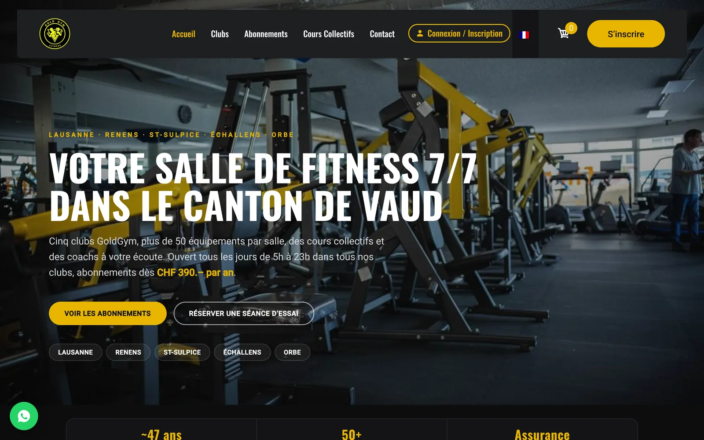
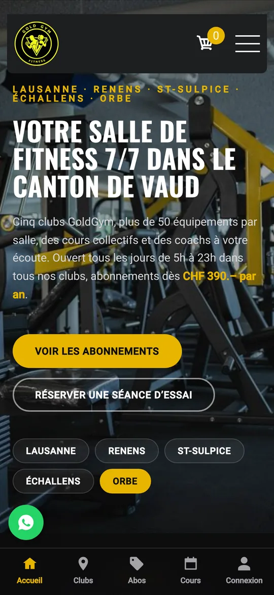
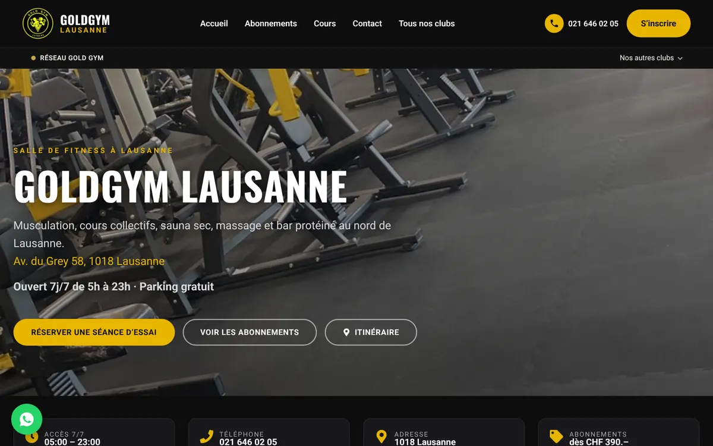
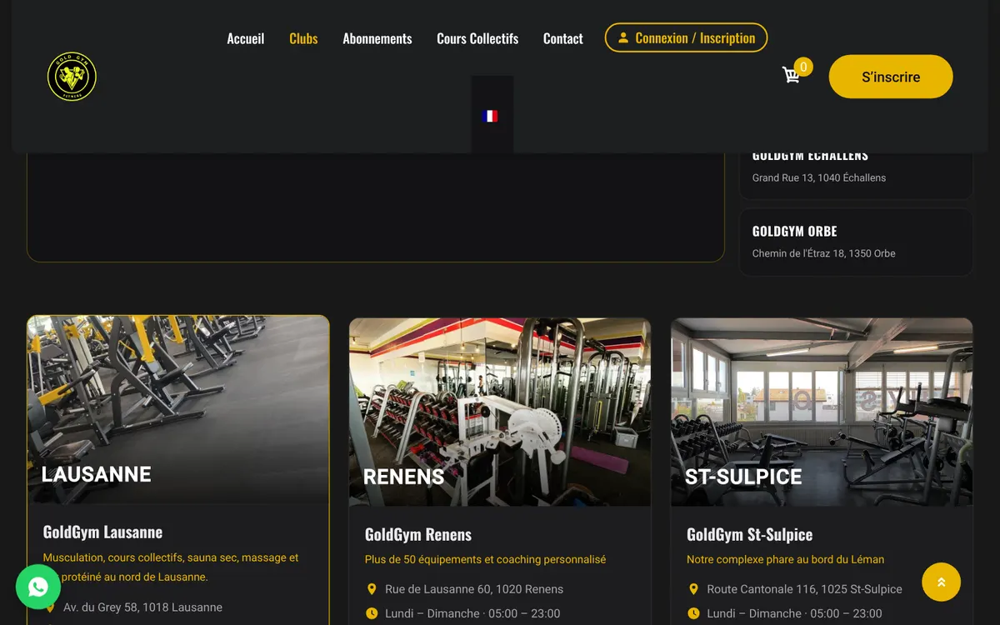
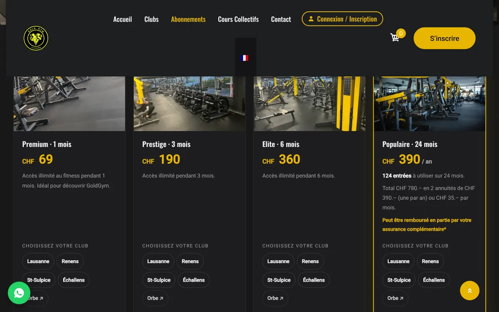
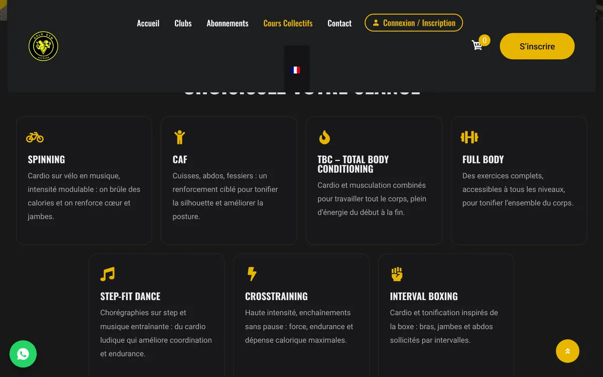
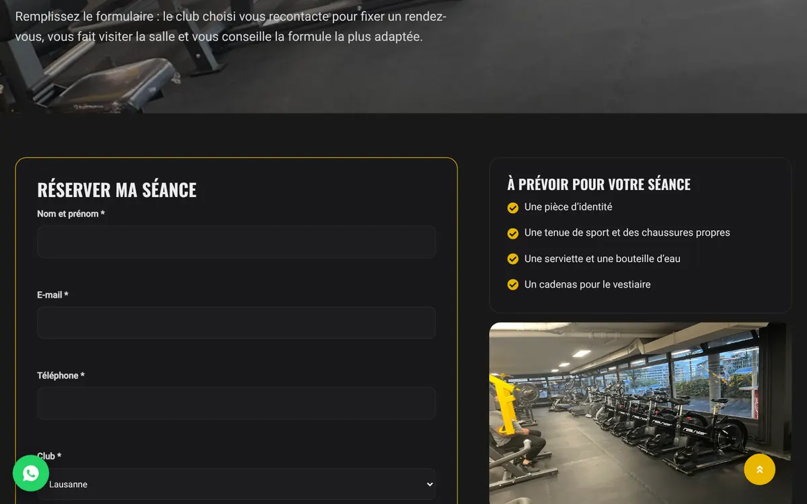
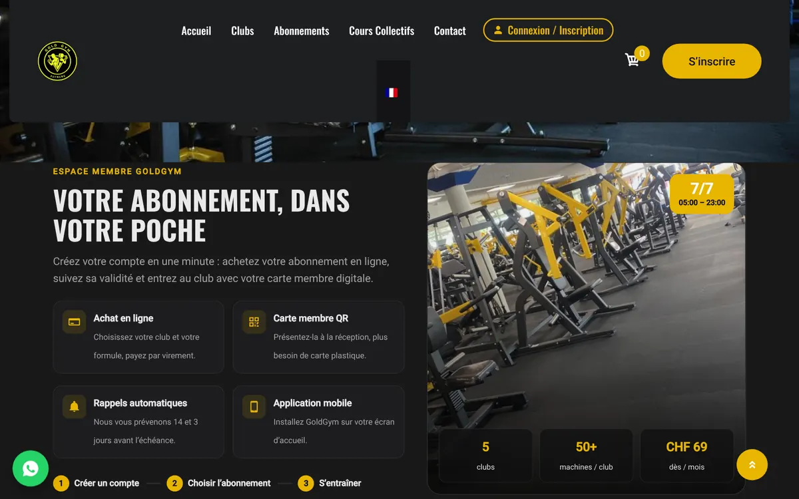
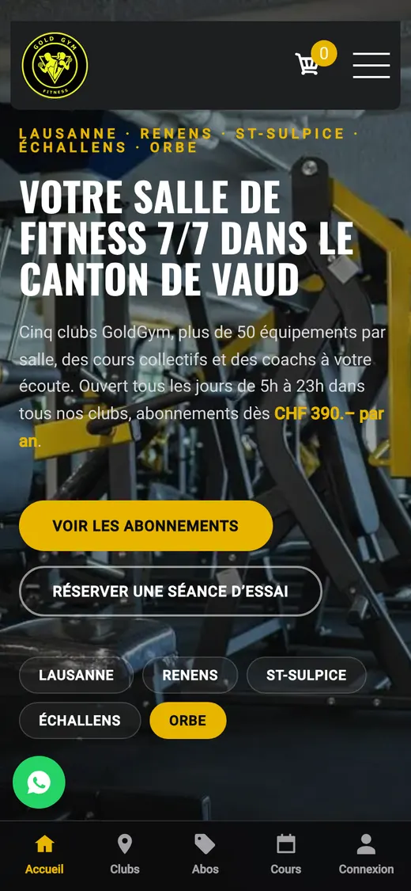
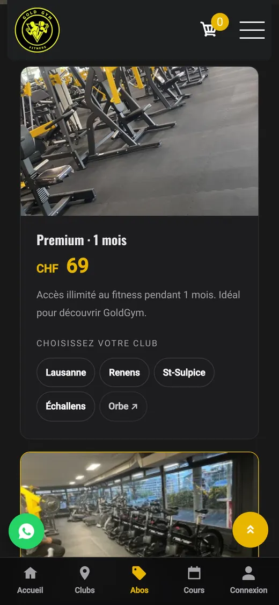

[English](gym-network.md) · [Français](gym-network.fr.md) · [فارسی](gym-network.fa.md)

# LikeServic Gym Network

**One main site and one site per gym, linked together.**

For fitness chains: a brand site that presents every gym, plus a site for each gym that runs its own memberships, classes and members. Running at GoldGym, five gyms in the canton of Vaud.

**Live demo:** https://goldgym.ch/  
**Product page on NeoLivis:** https://neo.likenic.com/en/product/likeservic-gym-network-en/

## Screenshots

| Computer | Phone |
|---|---|
|  |  |

## Features, screen by screen

_Every screenshot below comes from the client’s live website._

### 1. One site per club

Each gym has its own site (here Lausanne) with hours, address, phone, parking and a trial-session button, under the common brand.

### 2. All clubs on the brand site

Five clubs with photo, address, opening hours and what each one offers.

### 3. Memberships bought online

One, three, six or twenty-four months, with the club chosen on the card. The long plan can be paid in instalments and the page explains possible refunds by health insurance.

### 4. Group classes

Spinning, CAF, total-body conditioning, step, cross-training, interval boxing and more, each with a short description and a timetable per club.

### 5. Trial session

A short form sends the request to the chosen club, which calls back to set the time; the page lists what to bring.

### 6. Member area

Buy a membership online, show a QR member card at reception, get reminders 14 and 3 days before it ends, and install the club app on the phone.

### 7. Phone home page

Club shortcuts at the top and a bottom bar for clubs, memberships, classes and the member account.

### 8. Choosing a plan on the phone

Plan, price and club are picked on the same card, then straight to checkout.

---

Source code is private: every installation is set up for the client. Ask for access to the code if you are evaluating my work.

[← Back to the profile](../README.md)
