

[English](medical-practice.md) · [Français](medical-practice.fr.md) · [فارسی](medical-practice.fa.md)

# LikeServic Medic

**نوبت‌دهی آنلاین و پنل بیمار برای مطب و کلینیک.**

بیماران شبانه‌روز آنلاین نوبت می‌گیرند، پزشک را بر اساس تخصص یا زبان انتخاب می‌کنند و یک روز قبل یادآور دریافت می‌کنند. سایت کامل مطب به پنج زبان، از جمله فارسی.

**دموی آنلاین:** https://clinic.likenic.com/  
**صفحهٔ محصول در NeoLivis:** https://neo.likenic.com/fa/product/likeservic-medic-fa/

## تصاویر

| کامپیوتر | موبایل |
|---|---|
| 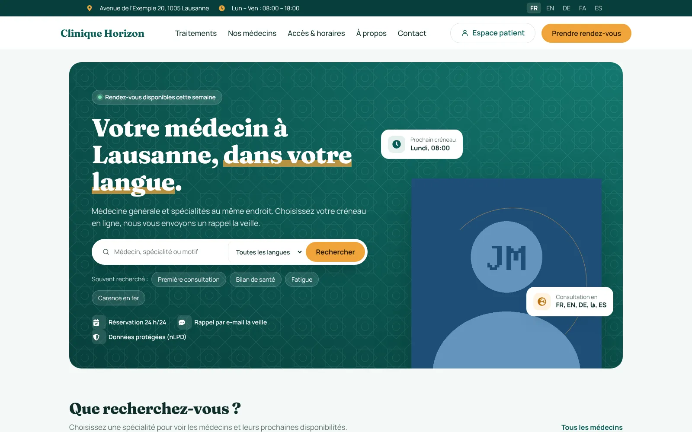 | 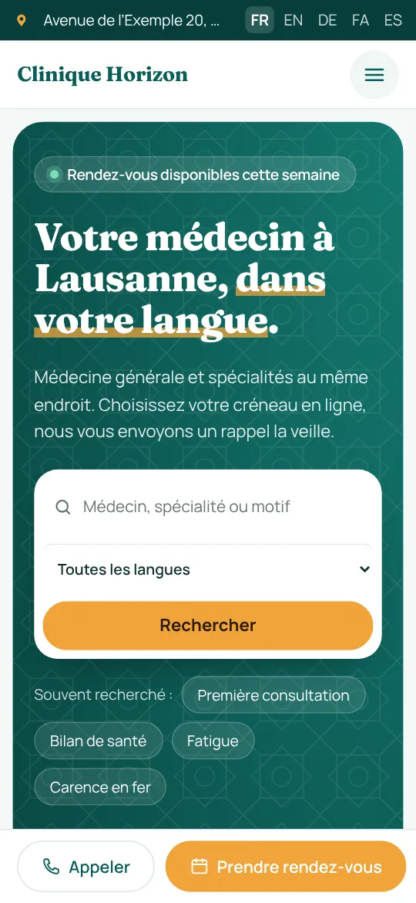 |

## امکانات، صفحه به صفحه

_همهٔ تصویرهای زیر از دموی آنلاین گرفته شده؛ نام‌ها، آدرس‌ها و افراد در دموها ساختگی هستند._

### 1. پیدا کردن پزشکی که زبان شما را می‌فهمد

جستجو با نام پزشک، تخصص یا دلیل مراجعه و فیلتر زبان. نزدیک‌ترین نوبت خالی همان صفحهٔ اول دیده می‌شود.

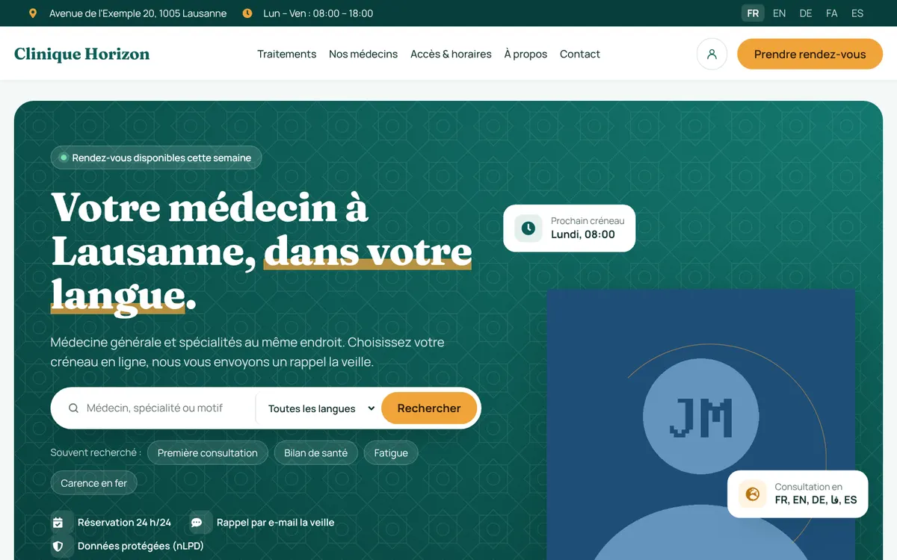

### 2. فهرست پزشکان

فیلتر با نام، تخصص، زبان و محل. هر کارت به صفحهٔ پزشک و تقویم نوبت‌هایش می‌رود.

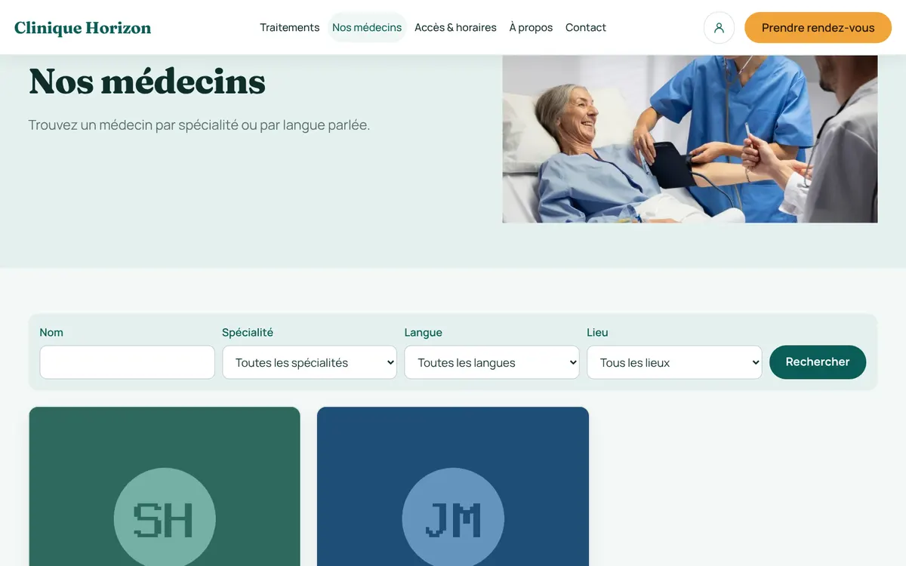

### 3. نوبت گرفتن از صفحهٔ پزشک

فرم نوبت کنار پروفایل پزشک است، همراه با توضیحات مطب؛ مثلاً کدام مراجعه‌ها باید تلفنی هماهنگ شوند.

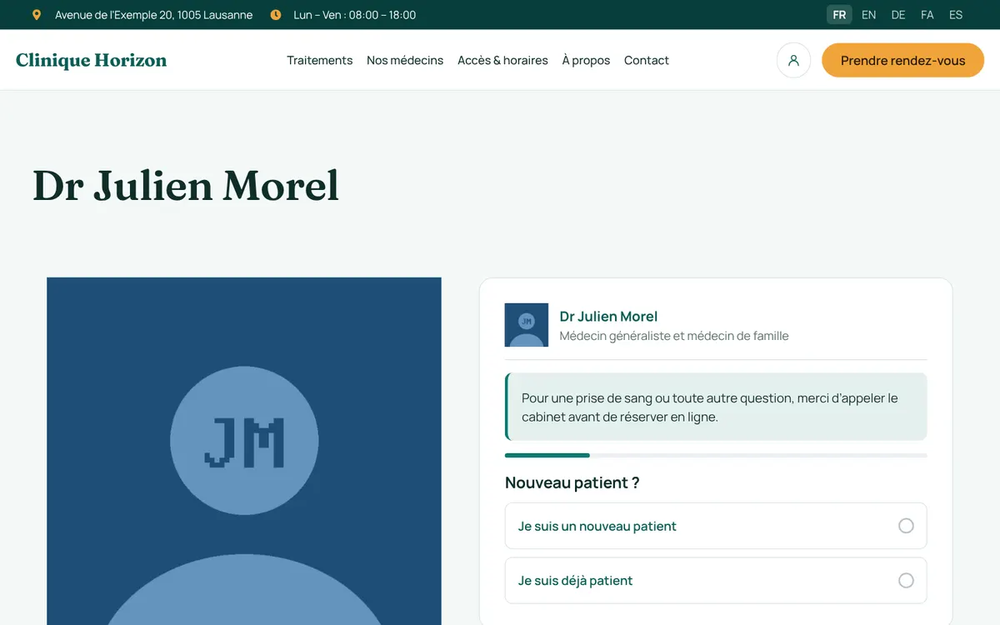

### 4. نوبت‌دهی در چند مرحله

بیمار جدید یا قبلی، بعد دلیل مراجعه همراه با مدت آن. زمان‌ها از تقویم واقعی پزشک می‌آیند و یک روز قبل یادآوری فرستاده می‌شود.

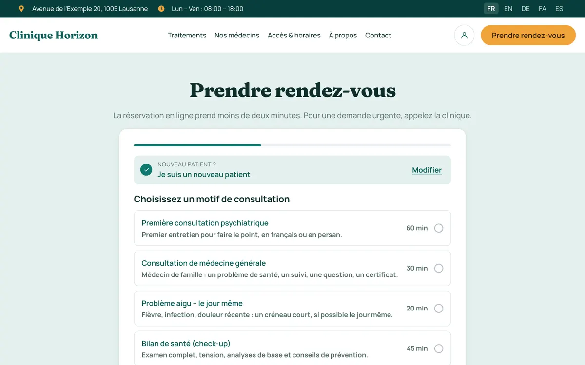

### 5. پزشک و داروخانه نزدیک شما

با موقعیت گوشی یا کد پستی، با فیلتر تخصص و زبان. موقعیت فقط برای همین جستجو استفاده می‌شود و ذخیره نمی‌شود.

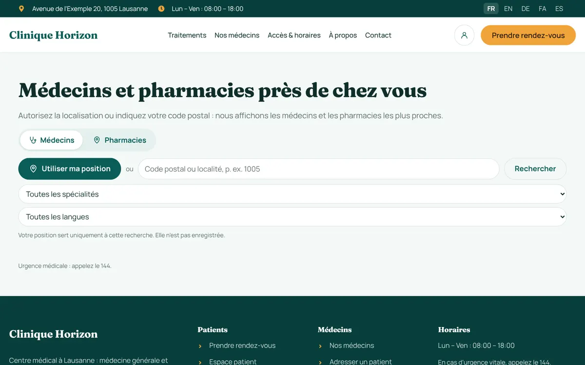

### 6. قبل از مراجعه

چه چیزهایی همراه بیاورید، هر نوع ویزیت چقدر طول می‌کشد و چه چیزی را به پزشک بگویید؛ تماس تلفنی کمتر برای پذیرش.

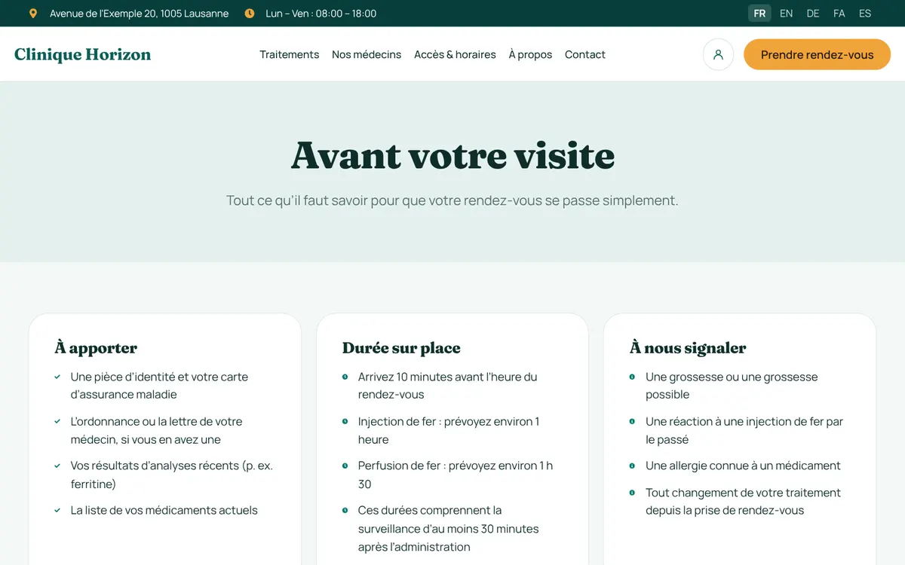

### 7. ارجاع بیمار از پزشکان دیگر

صفحه‌ای برای پزشکانی که می‌خواهند بیمار ارجاع دهند، با اطلاعات لازم برای مطب و گزارش روند درمان.

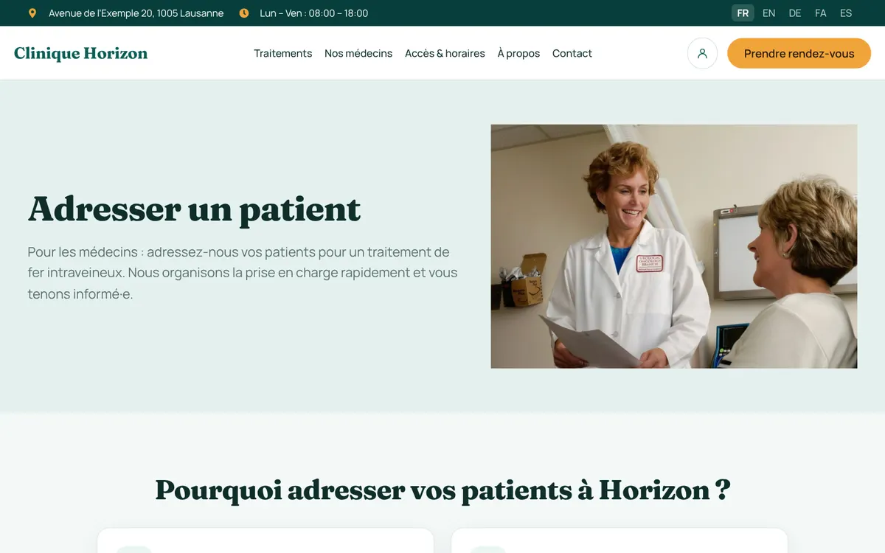

### 8. عضویت پزشکان در فهرست

ثبت‌نام در چهار مرحله (مشخصات، مطب، مدارک، تأیید). پروفایل‌ها قبل از نمایش بررسی می‌شوند.

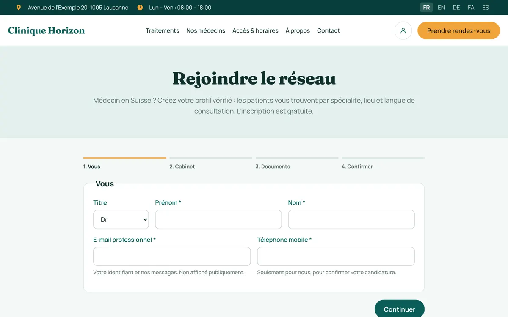

### 9. حساب بیمار بدون رمز عبور

ورود با کد شش‌رقمی که به ایمیل می‌آید؛ رمز عبور اختیاری است.

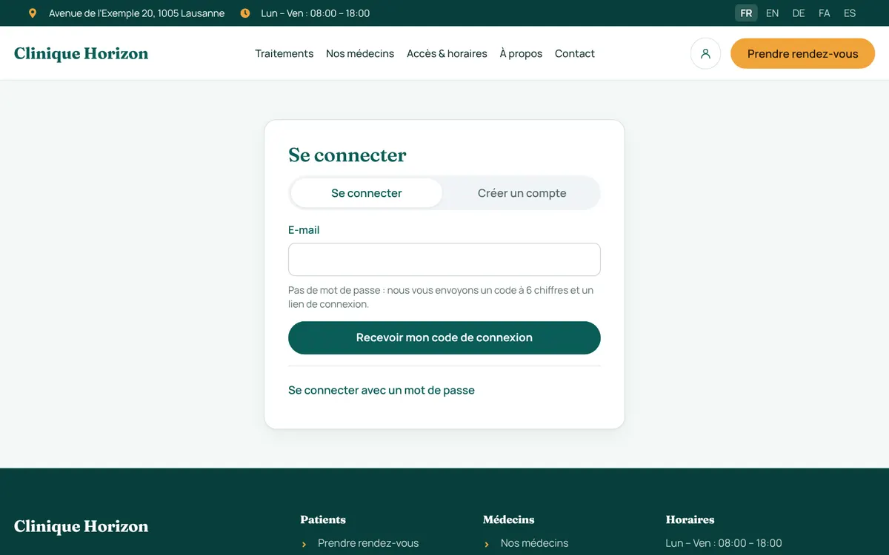

### 10. صفحهٔ هر درمان

هر درمان صفحهٔ خودش را دارد با توضیح و دکمهٔ نوبت؛ نوشته‌شده برای بیمار، نه فقط برای موتور جستجو.

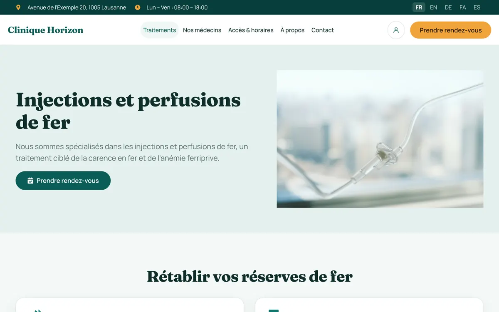

### 11. پنج زبان، همراه با راست‌به‌چپ

فرانسوی، انگلیسی، آلمانی، فارسی و اسپانیایی؛ نسخهٔ فارسی کاملاً راست‌به‌چپ است.

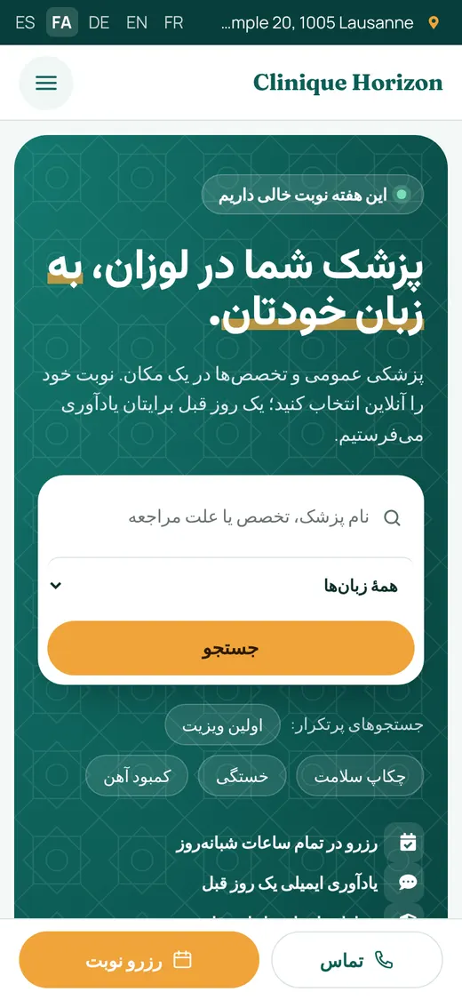

### 12. تماس یا نوبت از هر صفحه

روی گوشی دو دکمهٔ ثابت پایین صفحه: تماس با مطب یا گرفتن نوبت.

---

کد منبع خصوصی است و هر نصب برای همان مشتری انجام می‌شود. اگر کارم را ارزیابی می‌کنید، برای دیدن کد درخواست دسترسی بدهید.

[← بازگشت به پروفایل](../README.md)

