[English](medical-practice.md) · [Français](medical-practice.fr.md) · [فارسی](medical-practice.fa.md)

# LikeServic Medic

**Rendez-vous en ligne et espace patient pour cabinet médical.**

Vos patients réservent en ligne jour et nuit, choisissent un médecin selon la spécialité ou la langue parlée, et reçoivent un rappel la veille. Un site de cabinet complet, en cinq langues dont le persan.

**Démo en ligne:** https://clinic.likenic.com/  
**Page produit sur NeoLivis:** https://neo.likenic.com/product/likeservic-medic/

## Captures d’écran

| Ordinateur | Téléphone |
|---|---|
| 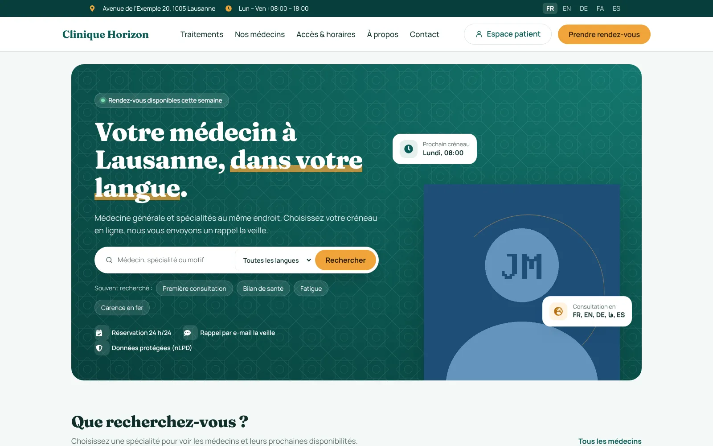 | 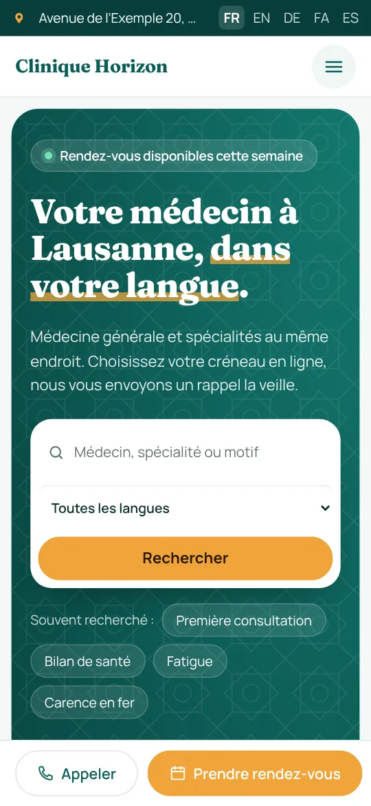 |

## Les fonctionnalités, écran par écran

_Chaque capture provient de la démo en ligne ; les noms, adresses et personnes des démos sont fictifs._

### 1. Trouver un médecin qui parle votre langue

Recherche par médecin, spécialité ou motif, filtrée par langue. Le prochain créneau libre est affiché dès l’accueil.

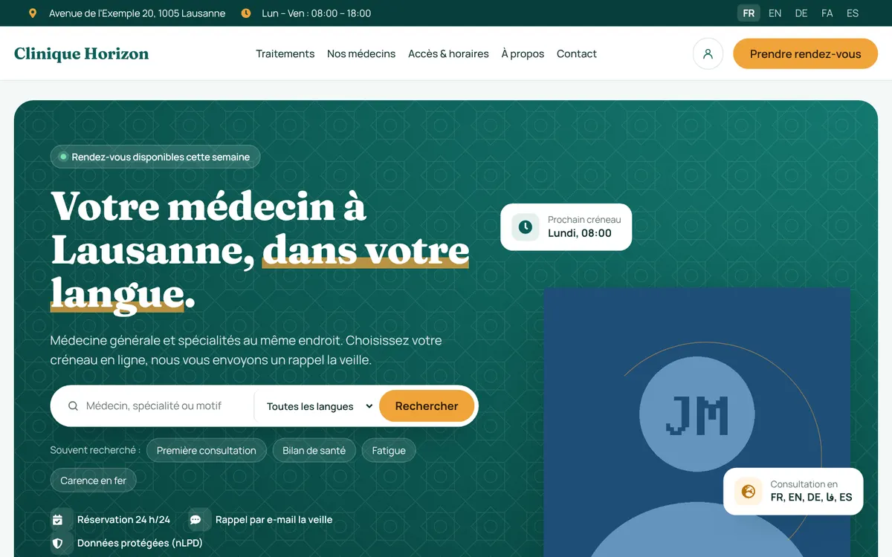

### 2. Annuaire des médecins

Filtres par nom, spécialité, langue et lieu. Chaque fiche mène au profil et à l’agenda du médecin.

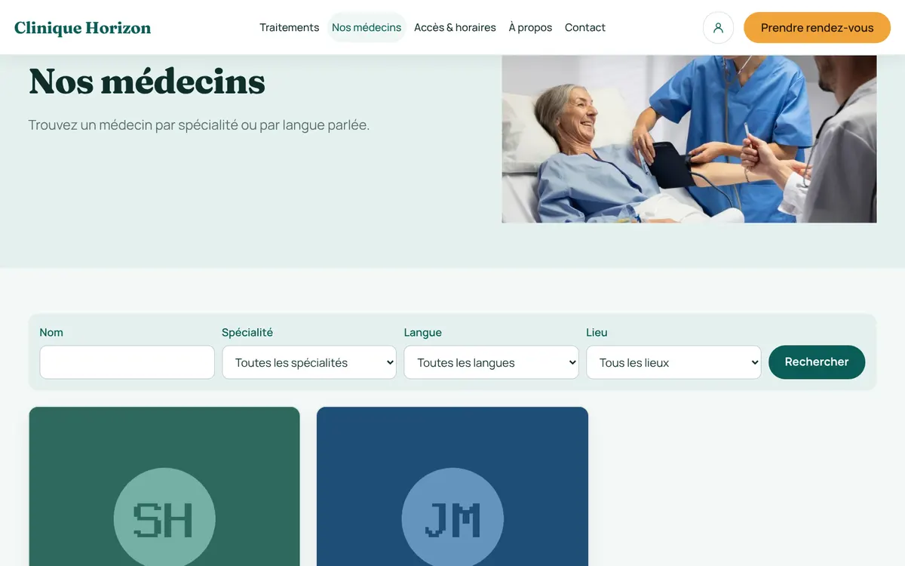

### 3. Réserver depuis le profil

Le formulaire de réservation est à côté du profil, avec les consignes du cabinet – par exemple les visites à organiser par téléphone.

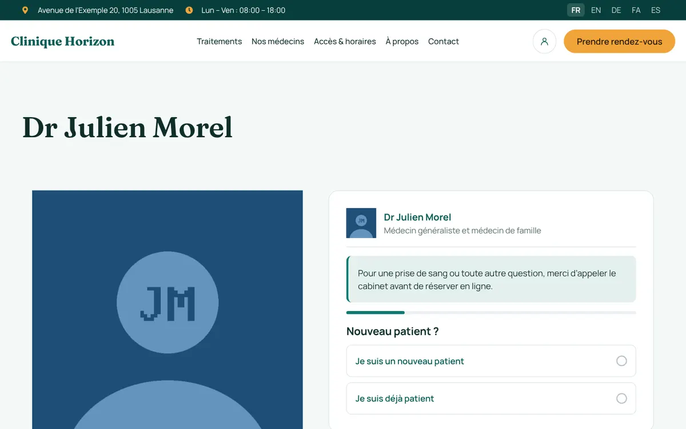

### 4. Réservation en quelques étapes

Nouveau patient ou patient connu, puis le motif avec sa durée. Les créneaux suivent l’agenda réel du médecin et un rappel part la veille.

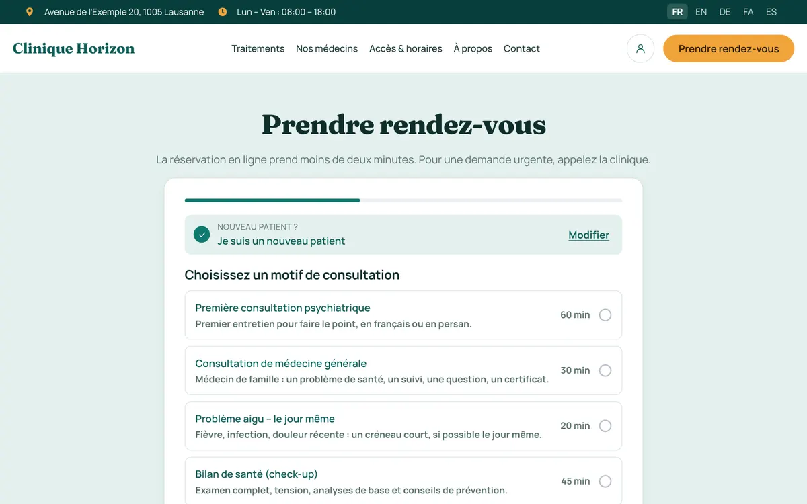

### 5. Médecins et pharmacies près de chez vous

Avec la localisation du téléphone ou un code postal, filtré par spécialité et langue. La position sert uniquement à cette recherche et n’est pas enregistrée.

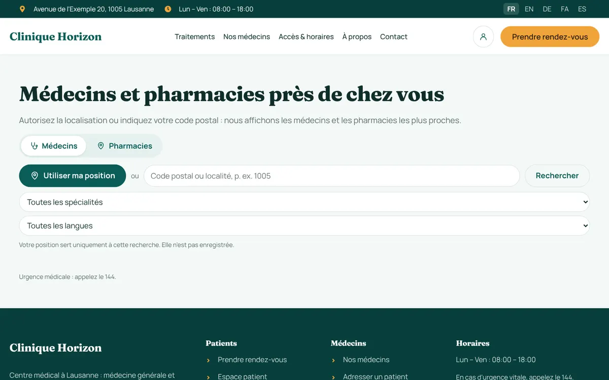

### 6. Avant votre visite

Quoi apporter, combien de temps dure chaque type de visite et quoi signaler – moins d’appels pour l’accueil.

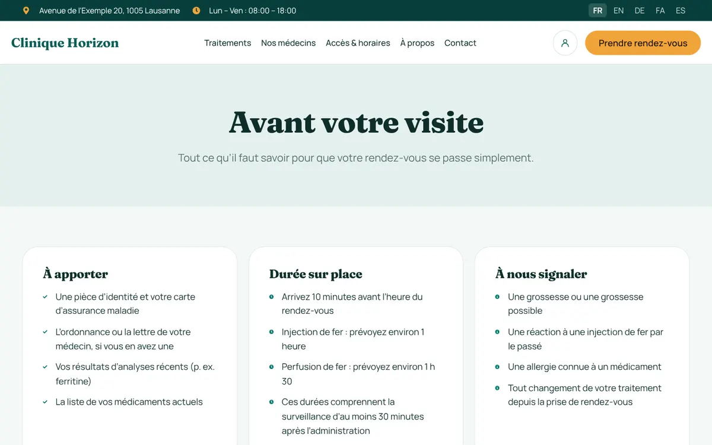

### 7. Adresser un patient

Une page pour les médecins qui souhaitent adresser un patient, avec les informations dont le cabinet a besoin et un retour sur le suivi.

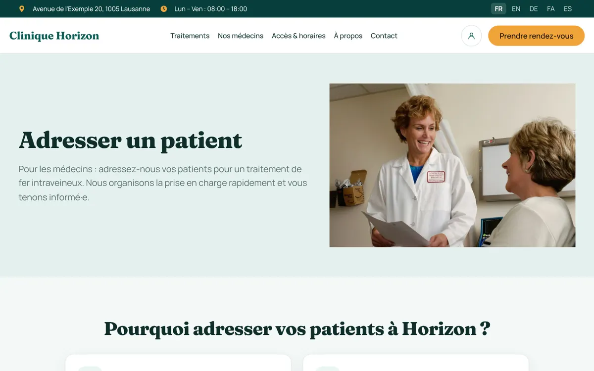

### 8. Les médecins rejoignent l’annuaire

Inscription en quatre étapes (vous, cabinet, documents, confirmation). Les profils sont vérifiés avant publication.

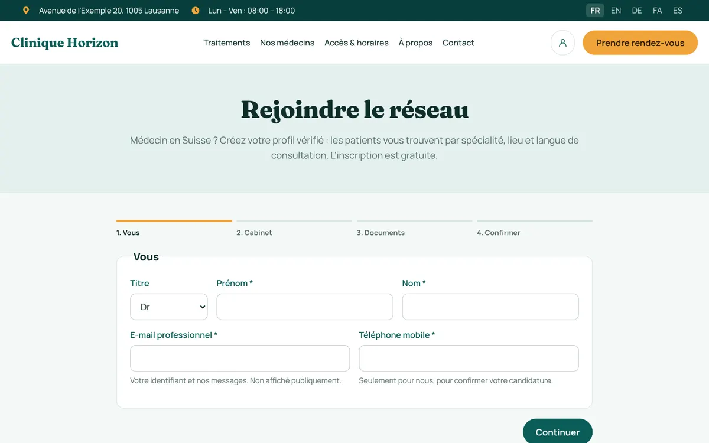

### 9. Espace patient sans mot de passe

Connexion avec un code à six chiffres reçu par e-mail ; le mot de passe est facultatif.

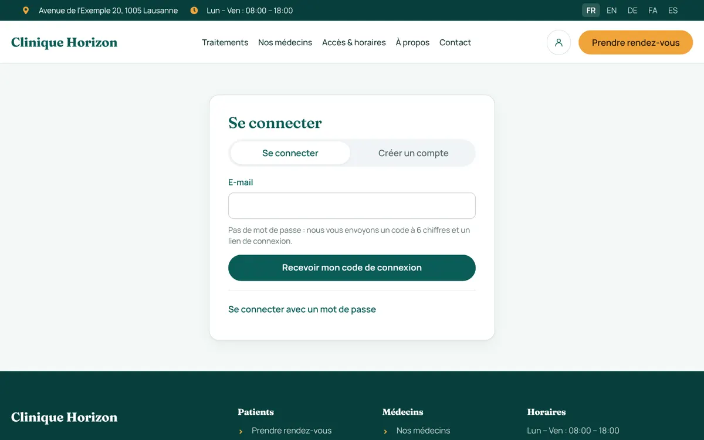

### 10. Pages de traitements

Chaque traitement a sa page avec des explications et un bouton de réservation, écrite pour les patients plutôt que pour les moteurs de recherche.

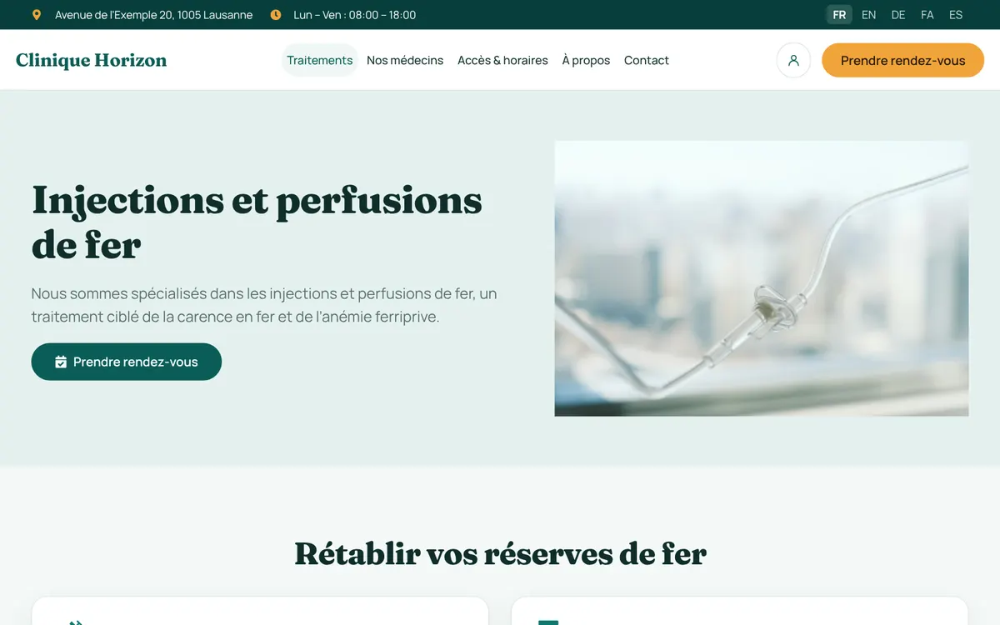

### 11. Cinq langues, y compris de droite à gauche

Français, anglais, allemand, persan et espagnol ; la version persane s’affiche de droite à gauche.

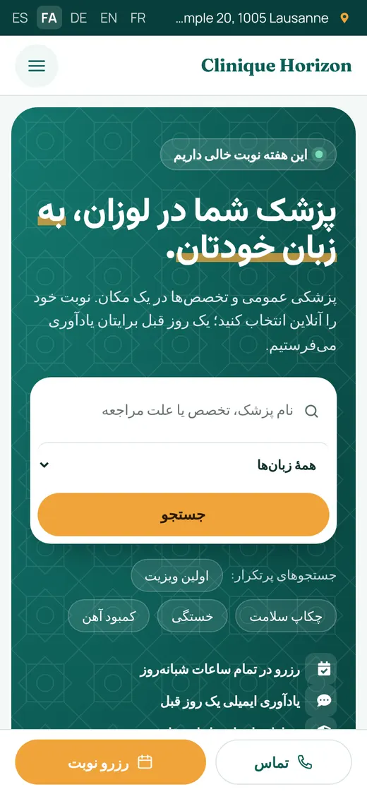

### 12. Appeler ou réserver depuis chaque page

Sur téléphone, deux boutons fixes en bas : appeler le cabinet ou prendre rendez-vous.

---

Le code source est privé : chaque installation est faite pour le client. Demandez un accès au code si vous évaluez mon travail.

[← Retour au profil](../README.md)
