[English](medical-practice.md) · [Français](medical-practice.fr.md) · [فارسی](medical-practice.fa.md)

# LikeServic Medic

**Online booking and a patient portal for medical practices.**

Patients book online day or night, choose a doctor by speciality or by the language they speak, and get a reminder the day before. A complete practice website in five languages, including Persian.

**Live demo:** https://clinic.likenic.com/  
**Product page on NeoLivis:** https://neo.likenic.com/en/product/likeservic-medic-en/

## Screenshots

| Computer | Phone |
|---|---|
| 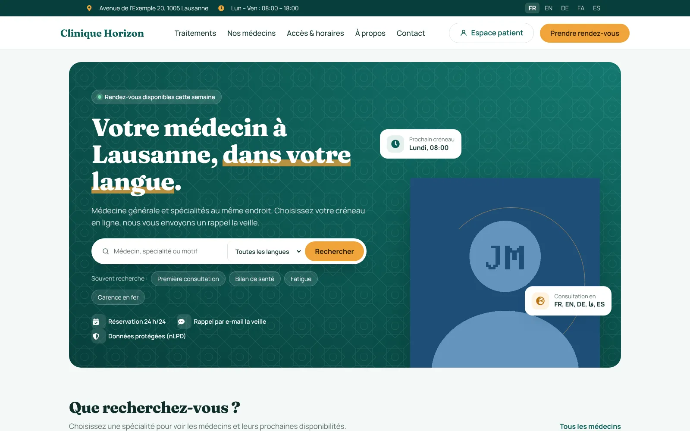 | 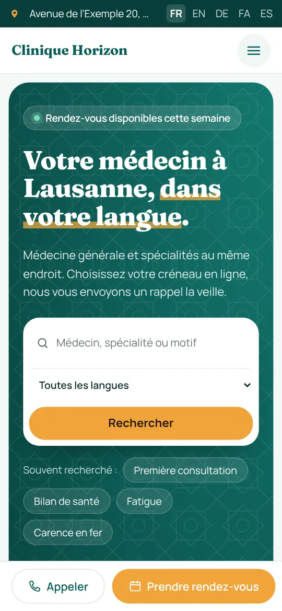 |

## Features, screen by screen

_Every screenshot below comes from the live demo; names, addresses and people on the demos are fictitious._

### 1. Find a doctor who speaks your language

Search by doctor, specialty or reason for the visit, filtered by language. The next free slot is shown on the home page.

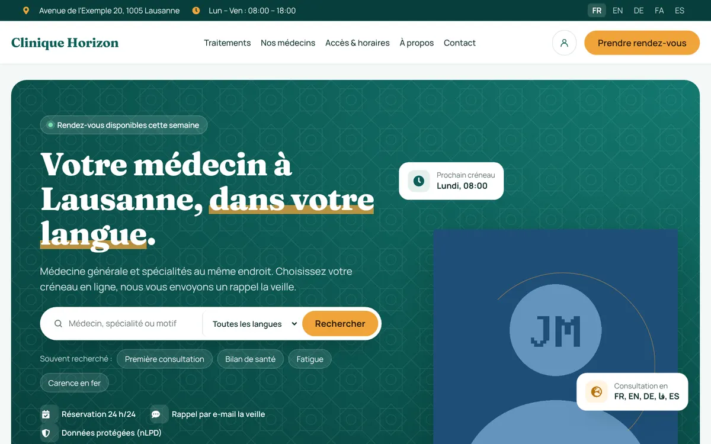

### 2. Doctor directory

Filters for name, specialty, language and location. Each card leads to the doctor’s profile and calendar.

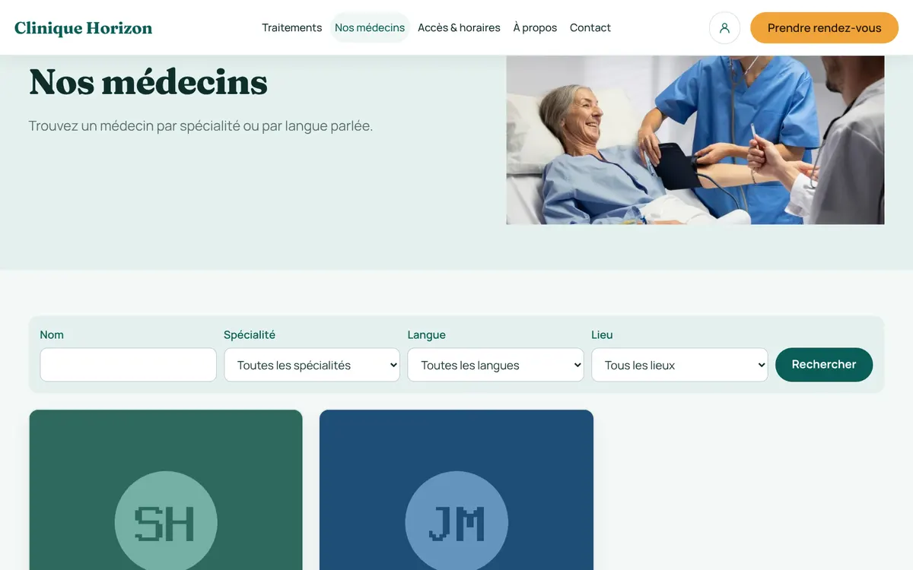

### 3. Book from the doctor’s profile

The booking form sits next to the profile, with the practice’s own notes – for example which visits must be arranged by phone.

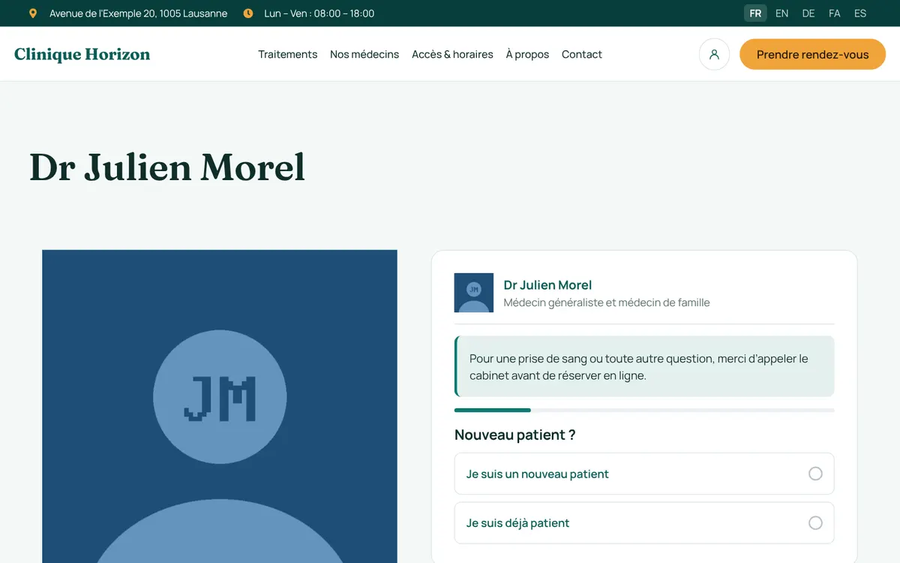

### 4. Booking in a few steps

New or returning patient, then the reason for the visit with its length. Slots come from the doctor’s calendar and the patient gets a reminder the day before.

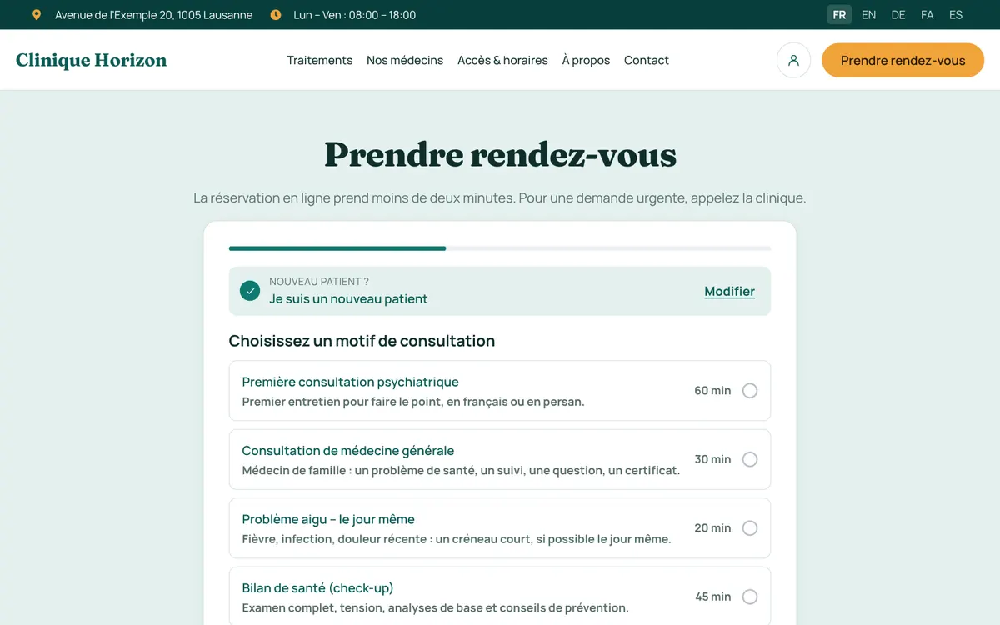

### 5. Doctors and pharmacies near you

With the phone’s location or a postcode, filtered by specialty and language. The location is used only for this search and not stored.

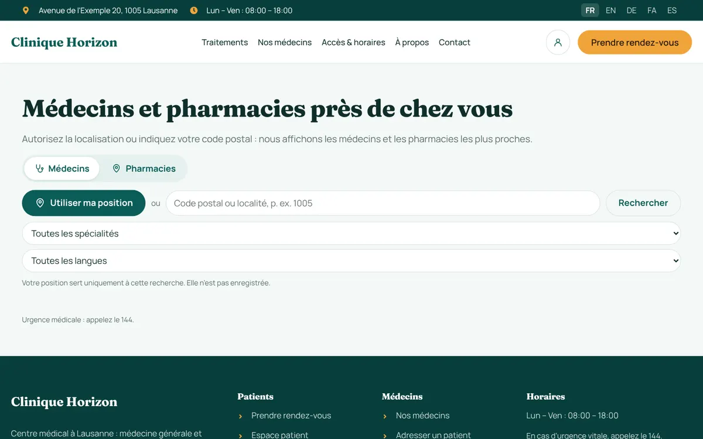

### 6. Before your visit

What to bring, how long each type of visit takes and what to tell the doctor – fewer phone calls for the front desk.

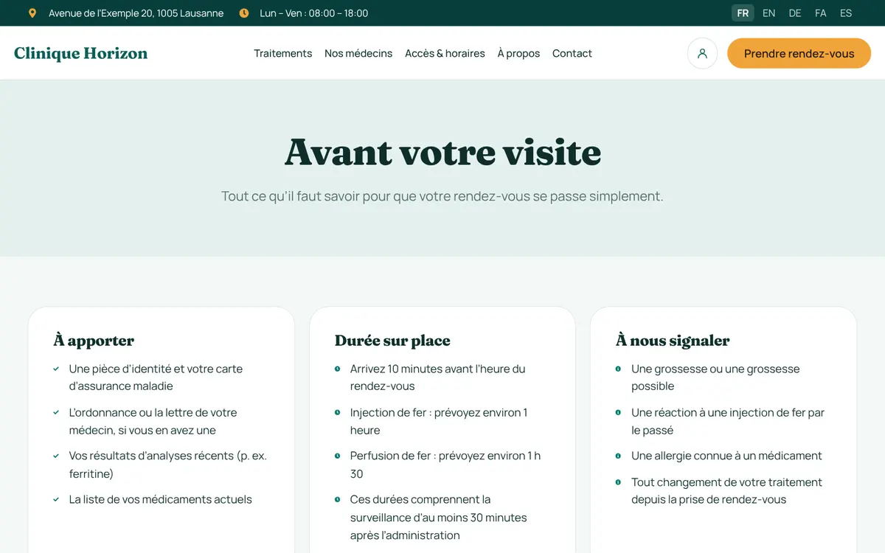

### 7. Referrals from other doctors

A page for GPs who want to send a patient for treatment, with the information the practice needs and feedback on the follow-up.

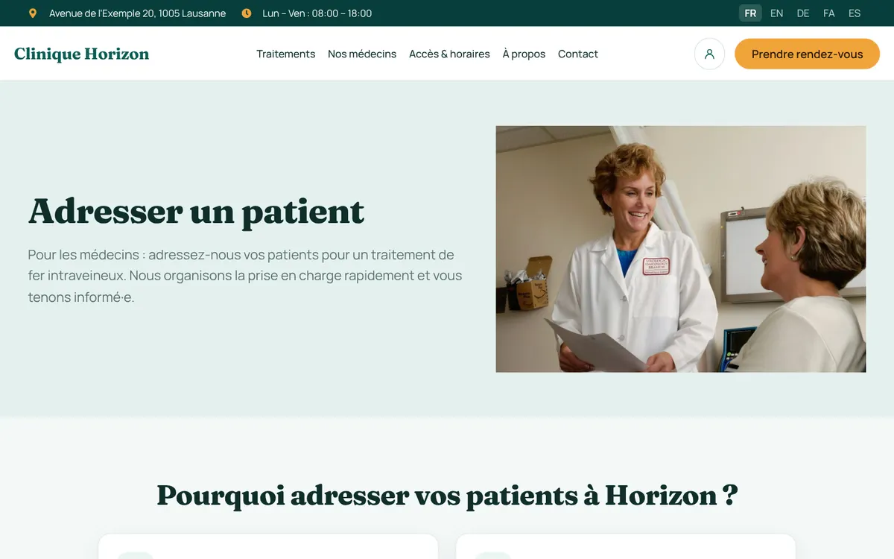

### 8. Doctors join the directory

Registration in four steps (person, practice, documents, confirmation). Profiles are checked before they appear.

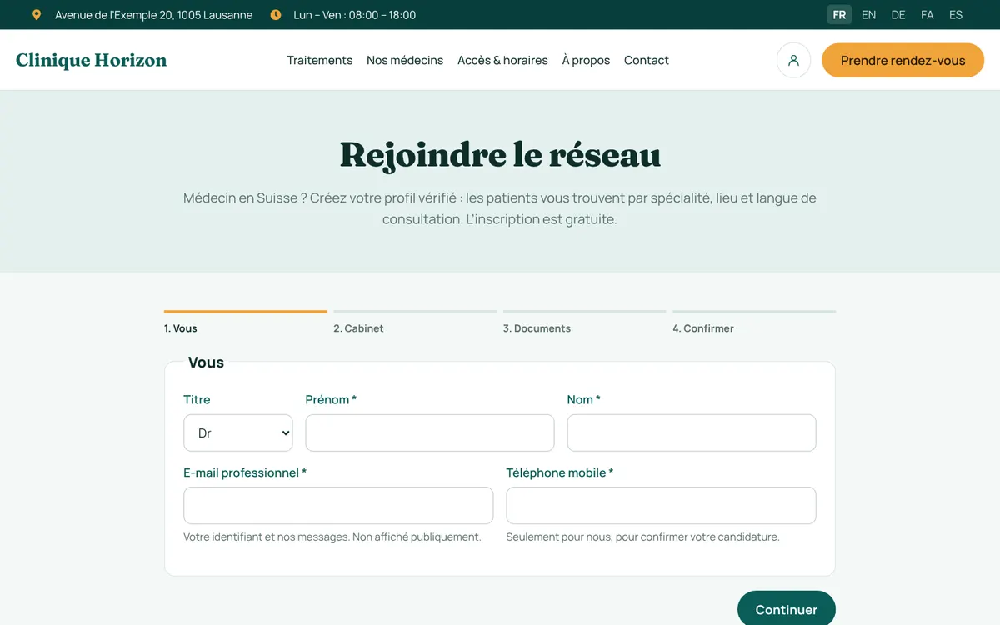

### 9. Patient account without a password

Patients sign in with a six-digit code sent by email; a password is optional.

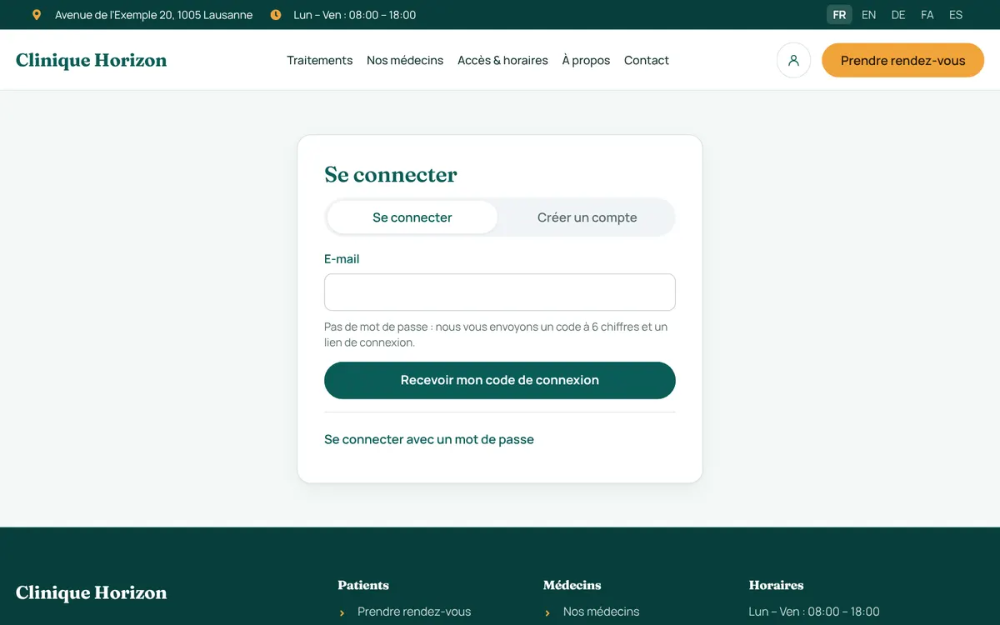

### 10. Treatment pages

Each treatment has its own page with explanations and a booking button, written for patients rather than for search engines.

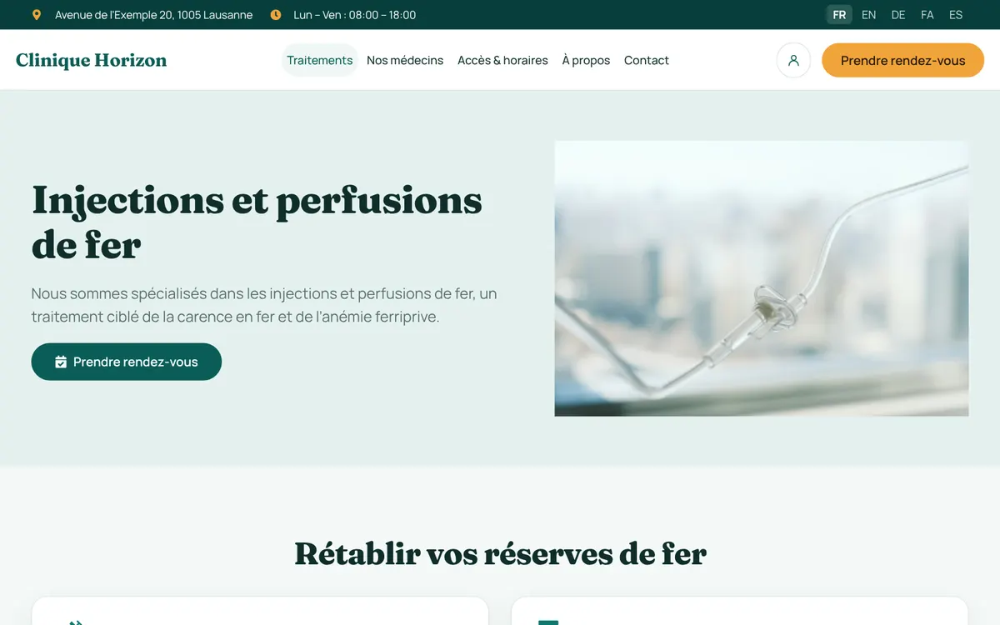

### 11. Five languages, right-to-left included

French, English, German, Persian and Spanish; the Persian version is laid out right to left.

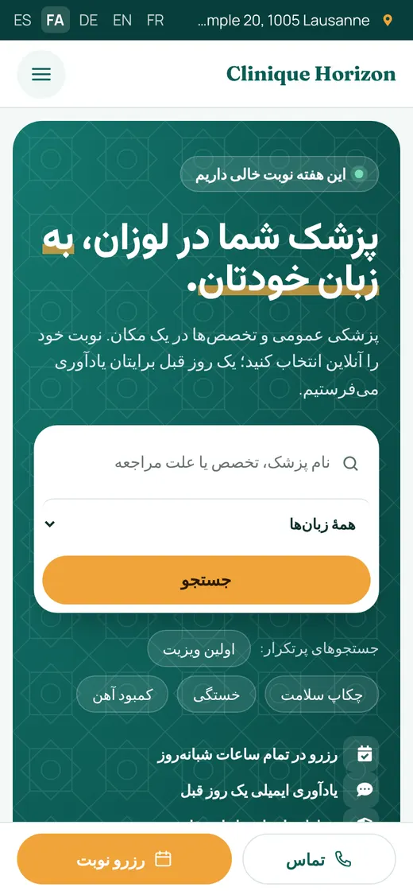

### 12. Call or book from any page

On the phone, two fixed buttons at the bottom: call the practice or book an appointment.

---

Source code is private: every installation is set up for the client. Ask for access to the code if you are evaluating my work.

[← Back to the profile](../README.md)
