

[English](mobile-store.md) · [Français](mobile-store.fr.md) · [فارسی](mobile-store.fa.md)

# Neo Mobile

**فروشگاه کامل موبایل: لوازم جانبی، گوشی کارکرده و تعمیر.**

برای مغازه‌های موبایل: مشتری از گوشی خودش شروع می‌کند و هرچه لازم دارد پیدا می‌کند؛ قاب، گلس، شارژر، تعمیر یا یک گوشی کارکردهٔ بررسی‌شده. پنج زبان و چهار ظاهر مختلف. اولین دمو: ساخته‌شده برای Goldphone در لوزان و مونترو.

**دموی آنلاین:** https://mob.likenic.com/

## تصاویر

| کامپیوتر | موبایل |
|---|---|
| 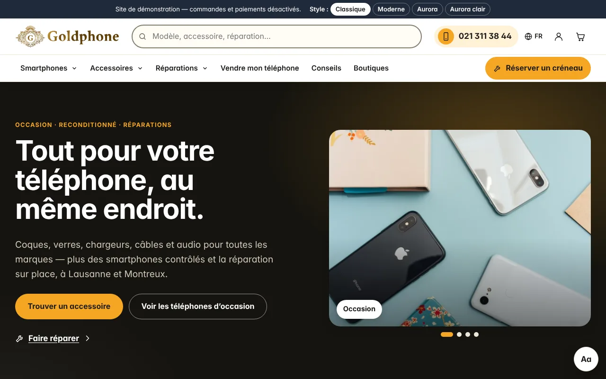 | 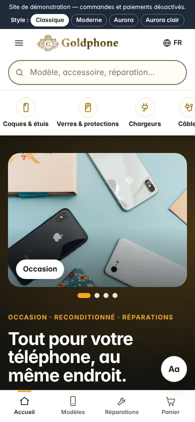 |

## امکانات، صفحه به صفحه

_همهٔ تصویرهای زیر از دموی آنلاین گرفته شده؛ نام‌ها، آدرس‌ها و افراد در دموها ساختگی هستند._

### 1. هرچه گوشی‌تان لازم دارد، یک‌جا

صفحهٔ اصلی از سه دلیل آمدن مشتری شروع می‌شود: لوازم جانبی، گوشی کارکرده یا تعمیر؛ شمارهٔ تلفن فروشگاه هم همیشه بالای صفحه هست.

### 2. برند و بعد مدل، مستقیم از منو

با بردن ماوس روی هر برند، مدل‌های جدیدش کنارش نشان داده می‌شود؛ همهٔ برندها در فهرست هستند، با لینک همهٔ مدل‌ها و میان‌بر بر اساس بودجه.

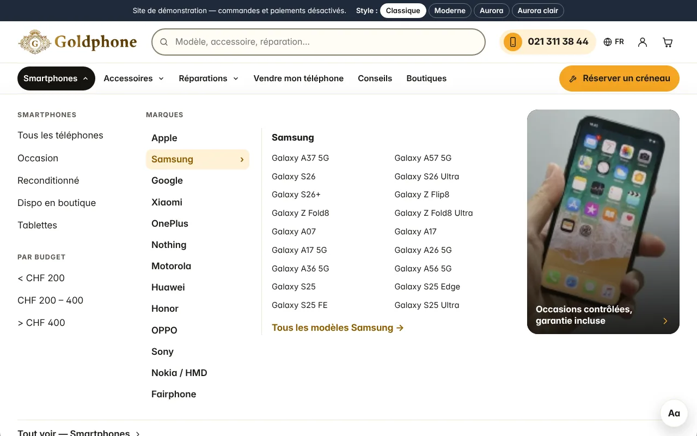

### 3. برندها در یک ردیف

روی کارت هر برند، گوشی پرچم‌دار فعلی‌اش دیده می‌شود. ردیف وقتی ماوس به لبه نزدیک می‌شود خودش حرکت می‌کند؛ با فلش‌ها و کشیدن هم جابه‌جا می‌شود.

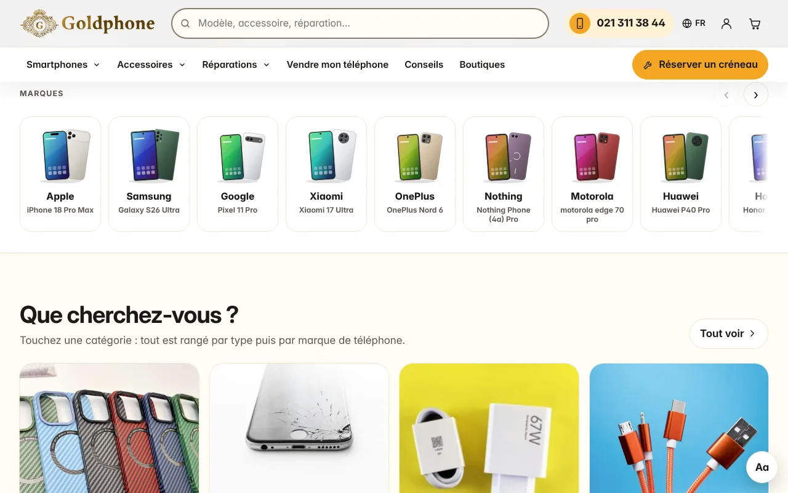

### 4. هر سری با تصویر خودش

در صفحهٔ هر برند، هر سری — iPhone Pro Max، iPhone SE، iPad Air و… — تصویری دارد که از روی شکل واقعی‌اش کشیده شده (دکمهٔ هوم، ناچ، چیدمان دوربین، تبلت یا تاشو)، همراه با تعداد مدل‌ها و سال‌ها.

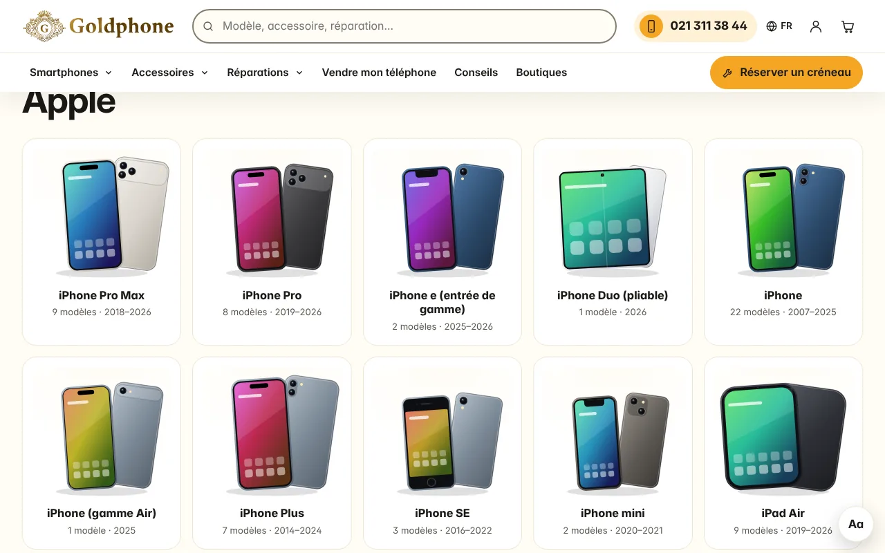

### 5. یک صفحه برای هر مدل، سه جواب

گوشی‌های قابل خرید، لوازم سازگار و قیمت تعمیر برای همان مدل. اگر چیزی موجود نباشد، به‌جای فهرست خالی پیشنهاد تماس یا پیام می‌دهد.

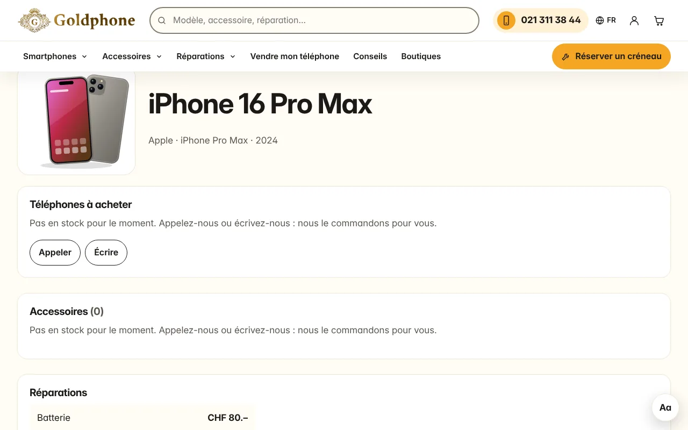

### 6. گوشی کارکرده، بدون اغراق

درجهٔ سلامت و معنی‌اش، درصد باتری با تاریخ اندازه‌گیری، قطعات تعویض‌شده، محتویات جعبه، شعبه و گارانتی. هرچه ثبت نشده باشد همین را می‌گوید و حدس نمی‌زند.

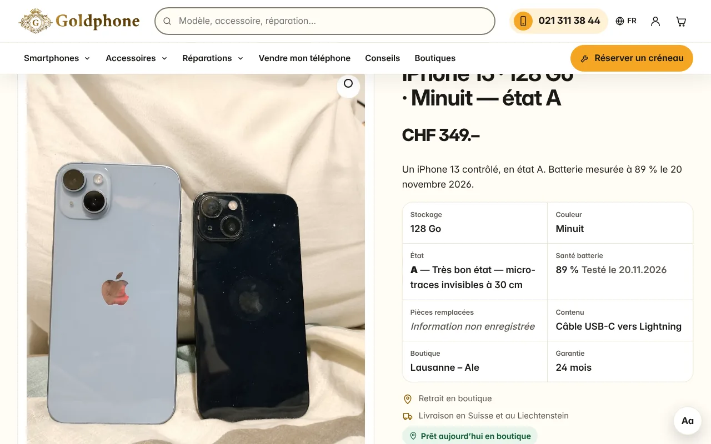

### 7. رزرو تعمیر

مدل را قدم‌به‌قدم انتخاب می‌کنید، تعمیرهای لازم و شعبه را مشخص می‌کنید و اگر بخواهید روز و ساعت هم می‌گذارید. فروشگاه با ایمیل یا پیامک تأیید می‌کند.

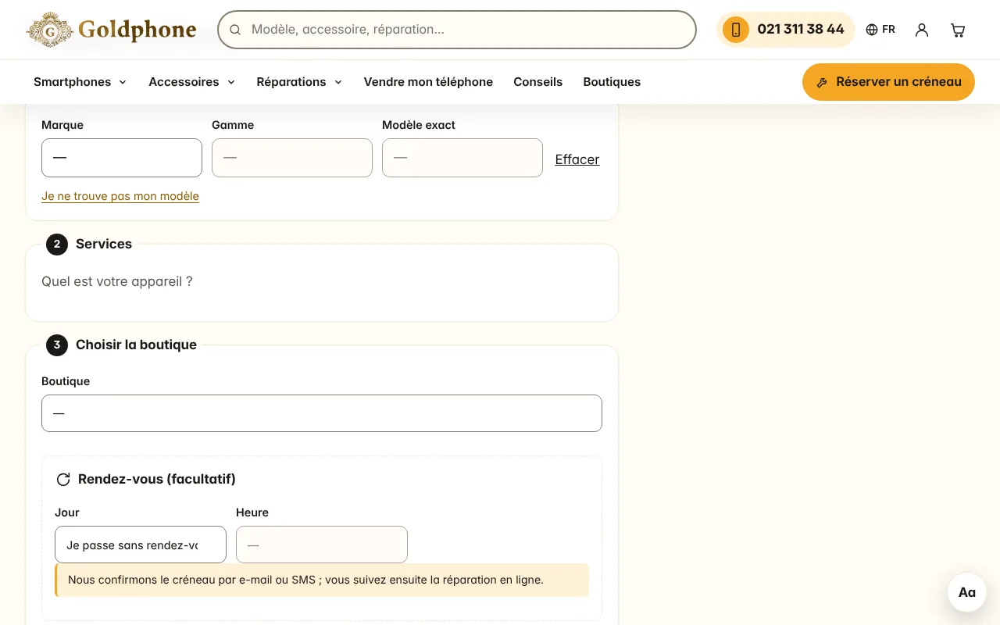

### 8. فروش گوشی به فروشگاه

مدل، حافظه و وضعیت، با توضیح ساده برای هر درجه، تا فروشگاه پیش از آمدن مشتری قیمت پیشنهاد بدهد.

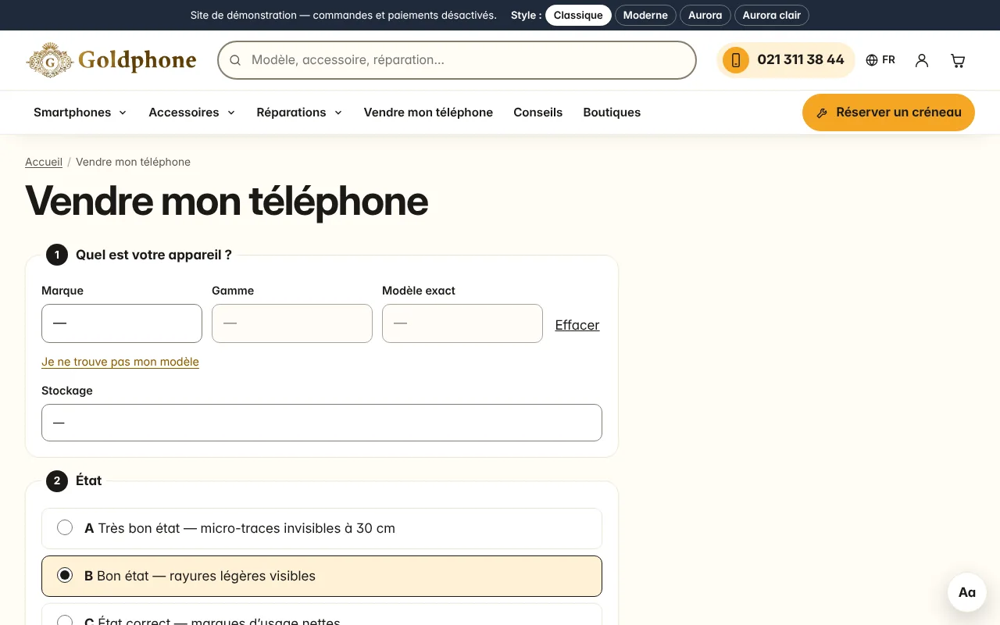

### 9. چهار ظاهر، یک فروشگاه

کلاسیک، مدرن، تیره و روشن: همان محتوا و امکانات با چهار طراحی که از تنظیمات انتخاب می‌شود. در ظاهر تیره، با اسکرول کردن یک گوشی قطعه‌به‌قطعه باز می‌شود.

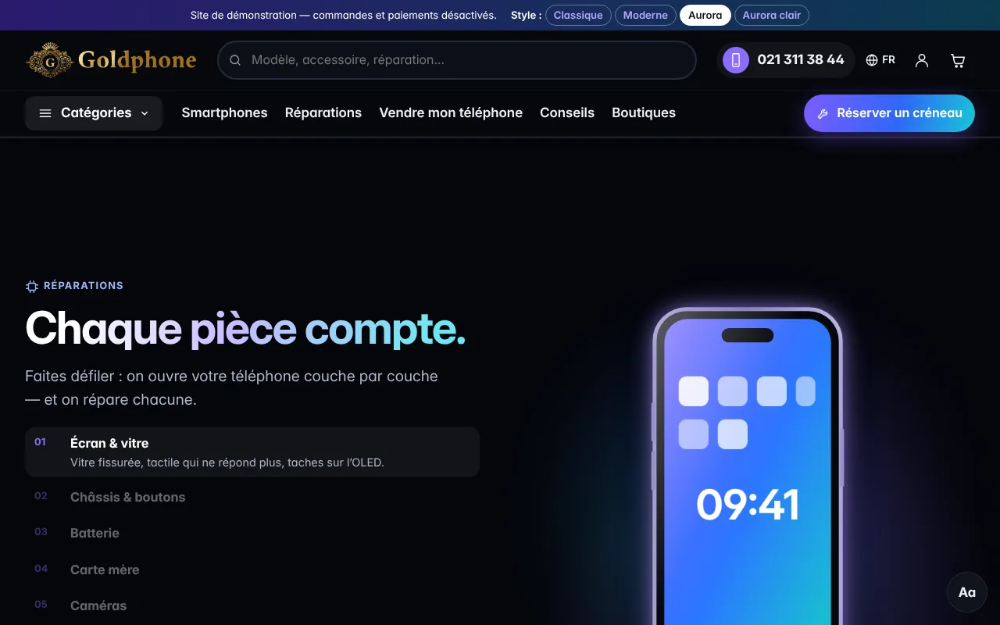

### 10. پنج زبان، با راست‌به‌چپ

فرانسوی، آلمانی، انگلیسی، فارسی و عربی، هر کدام برای خوانندهٔ خودش نوشته شده؛ فارسی و عربی تا نوار پایین صفحه راست‌به‌چپ هستند.

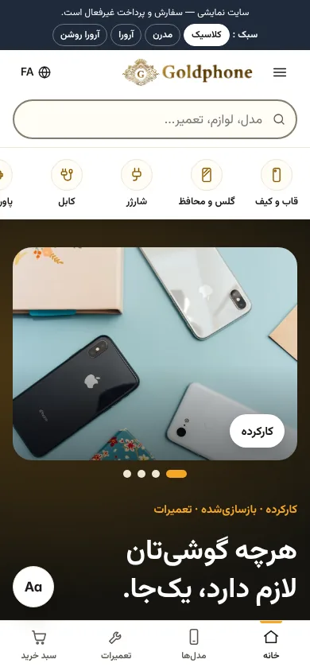

### 11. ساخته‌شده برای گوشی

دو کارت در هر ردیف، دسته‌ها زیر جستجو و نوار پایین برای خانه، مدل‌ها، تعمیرات و سبد خرید. سایت مثل اپلیکیشن نصب می‌شود.

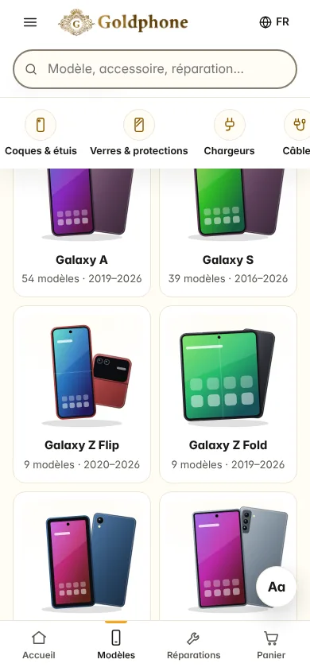

---

کد منبع خصوصی است و هر نصب برای همان مشتری انجام می‌شود. اگر کارم را ارزیابی می‌کنید، برای دیدن کد درخواست دسترسی بدهید.

[← بازگشت به پروفایل](../README.md)

