[English](mobile-store.md) · [Français](mobile-store.fr.md) · [فارسی](mobile-store.fa.md)

# Neo Mobile

**Le magasin de téléphonie complet : accessoires, occasions et réparations.**

Pour les boutiques de téléphonie : on cherche d’abord son téléphone, puis on trouve ce qui va avec — coque, verre, chargeur, réparation ou un appareil d’occasion contrôlé. Cinq langues, quatre styles au choix. Première démo : préparée pour Goldphone, à Lausanne et Montreux.

**Démo en ligne:** https://mob.likenic.com/

## Captures d’écran

| Ordinateur | Téléphone |
|---|---|
| 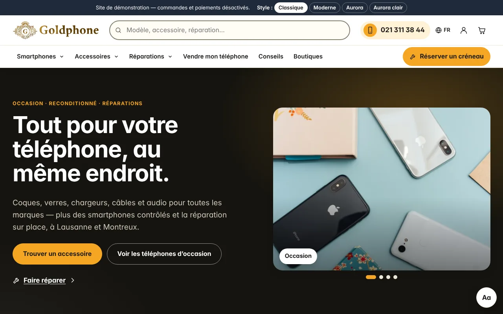 | 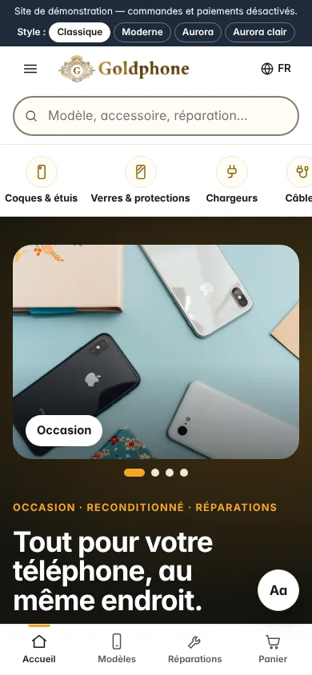 |

## Les fonctionnalités, écran par écran

_Chaque capture provient de la démo en ligne ; les noms, adresses et personnes des démos sont fictifs._

### 1. Tout pour votre téléphone, au même endroit

L’accueil part des trois raisons d’entrer dans une boutique : un accessoire, un téléphone d’occasion ou une réparation, avec le numéro de la boutique toujours visible en haut.

### 2. La marque, puis le modèle, depuis le menu

Au survol d’une marque, ses modèles récents s’affichent à côté ; toutes les marques sont là, avec un lien vers tous leurs modèles et des raccourcis par budget.

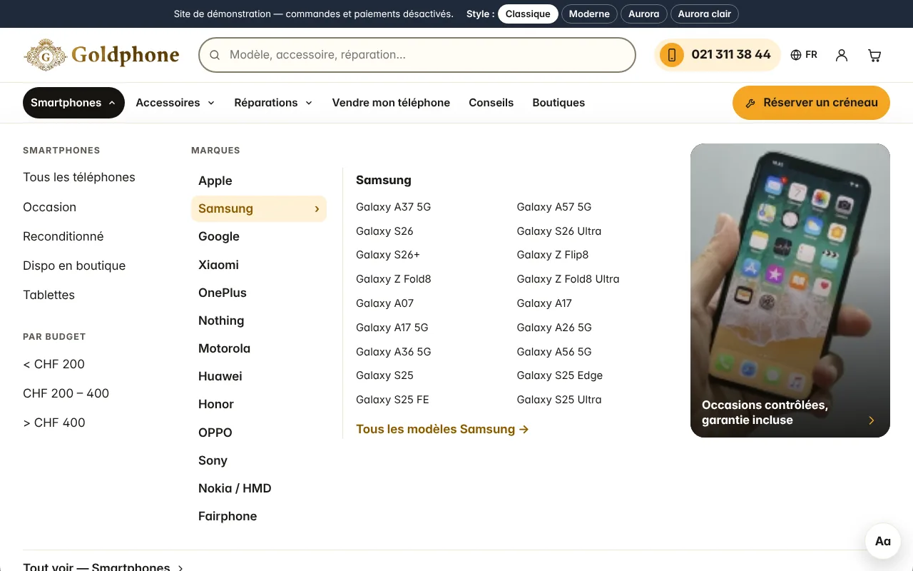

### 3. Les marques sur une seule ligne

Chaque carte montre le modèle phare de la marque. La ligne défile d’elle-même quand la souris approche d’un bord, ou avec les flèches et au glisser.

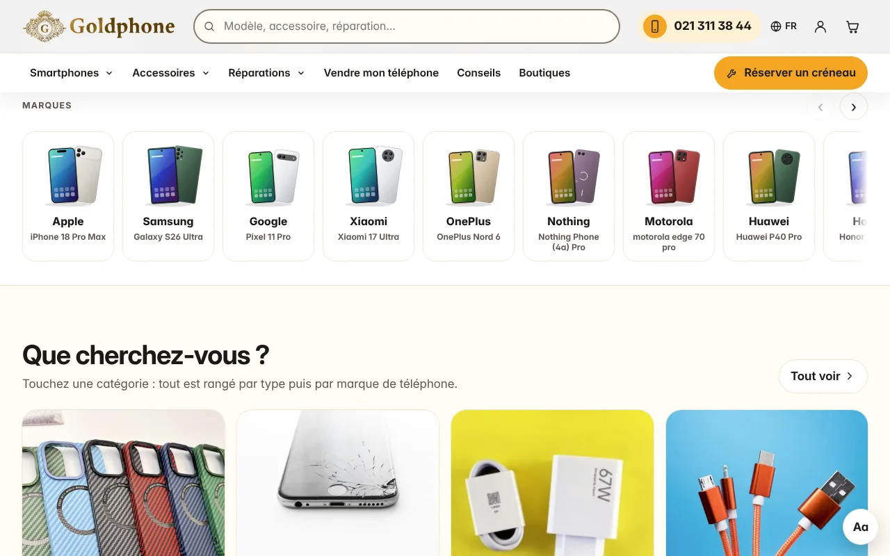

### 4. Chaque gamme avec son image

Sur la page d’une marque, chaque gamme — iPhone Pro Max, iPhone SE, iPad Air… — a une image dessinée d’après sa vraie forme (bouton d’accueil, encoche, appareils photo, tablette ou pliable), avec le nombre de modèles et les années.

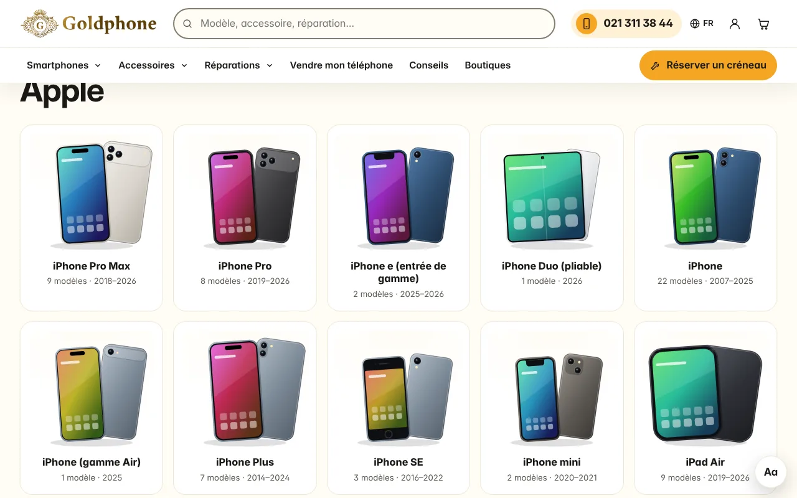

### 5. Une page par modèle, trois réponses

Les téléphones à acheter, les accessoires compatibles et les prix de réparation pour ce modèle précis. Si rien n’est en stock, la page propose d’appeler ou d’écrire plutôt qu’une liste vide.

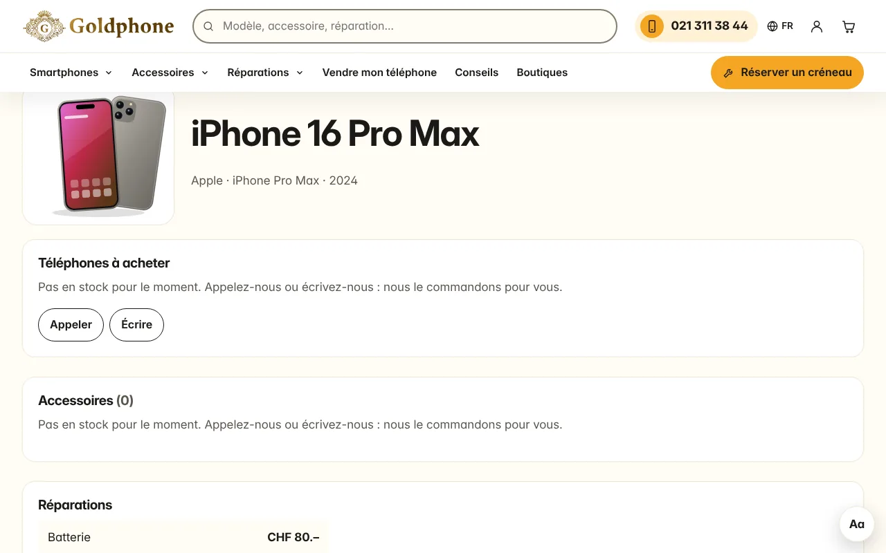

### 6. Des occasions décrites honnêtement

L’état et ce qu’il veut dire, la santé de la batterie avec la date de mesure, les pièces changées, le contenu, la boutique et la garantie. Ce qui n’est pas noté est indiqué comme tel, jamais deviné.

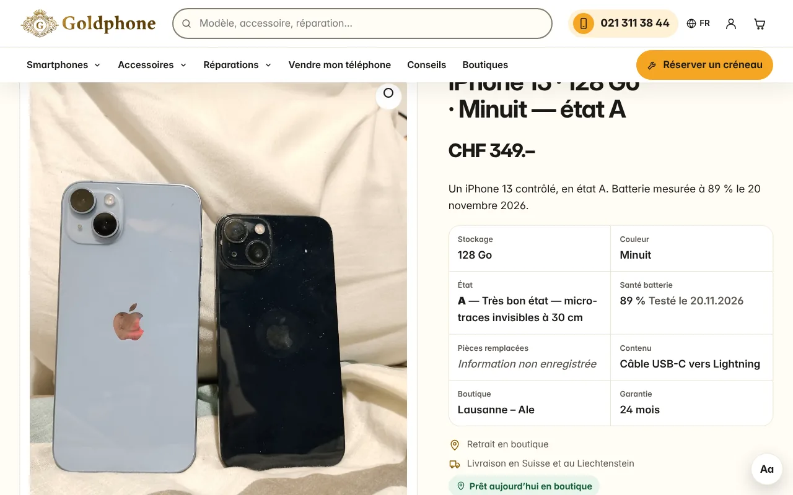

### 7. Réserver une réparation

On choisit le modèle pas à pas, les réparations et la boutique, puis un jour et une heure si on le souhaite. La boutique confirme par e-mail ou SMS.

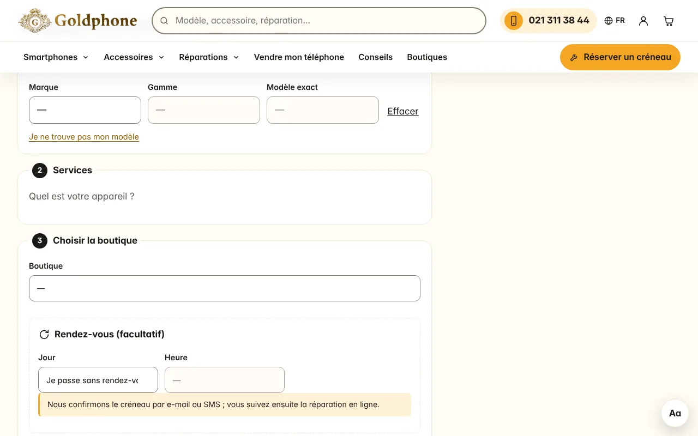

### 8. Vendre son téléphone à la boutique

Modèle, capacité et état, chaque niveau expliqué simplement, pour que la boutique fasse une offre avant la visite.

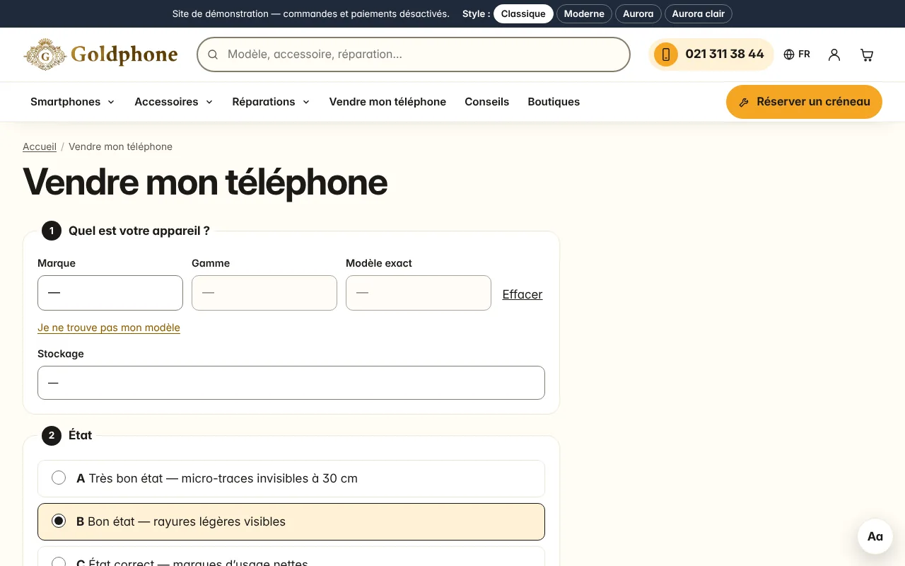

### 9. Quatre styles, une seule boutique

Classique, moderne, sombre et clair : le même contenu et les mêmes fonctions sous quatre designs, au choix dans les réglages. En style sombre, un téléphone s’ouvre pièce par pièce au défilement.

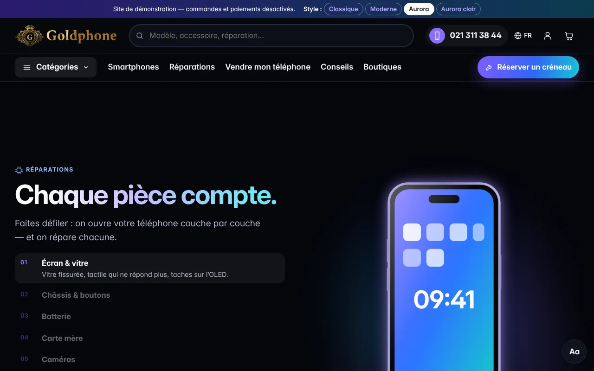

### 10. Cinq langues, droite à gauche comprise

Français, allemand, anglais, persan et arabe, chacune écrite pour ses lecteurs ; le persan et l’arabe se lisent de droite à gauche, jusqu’à la barre du bas.

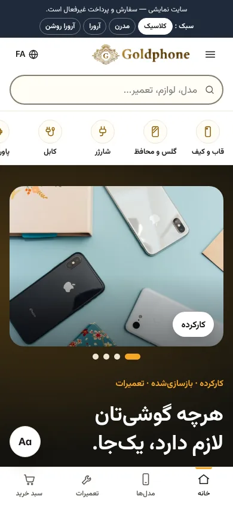

### 11. Pensé pour le téléphone

Deux cartes par ligne, les catégories sous la recherche et une barre en bas vers Accueil, Modèles, Réparations et Panier. Le site s’installe comme une application.

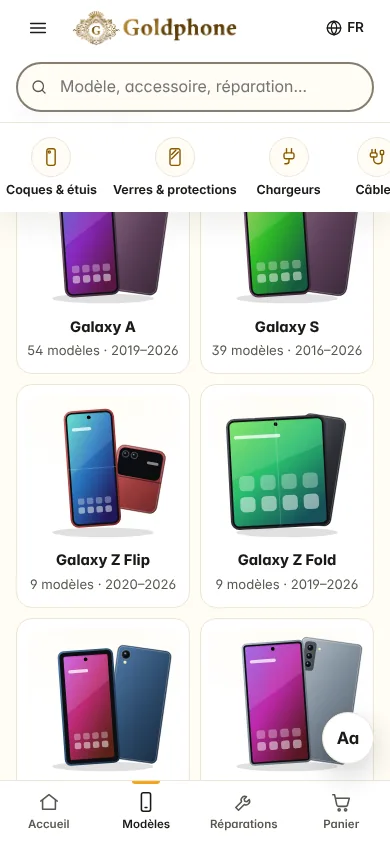

---

Le code source est privé : chaque installation est faite pour le client. Demandez un accès au code si vous évaluez mon travail.

[← Retour au profil](../README.md)
