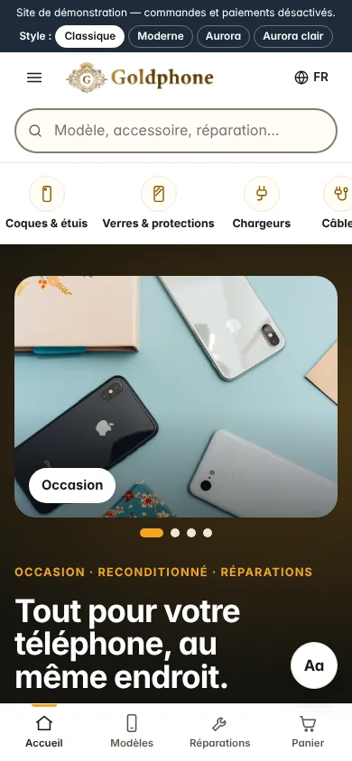
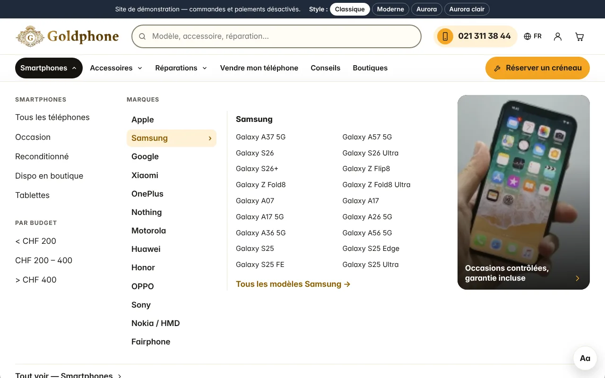
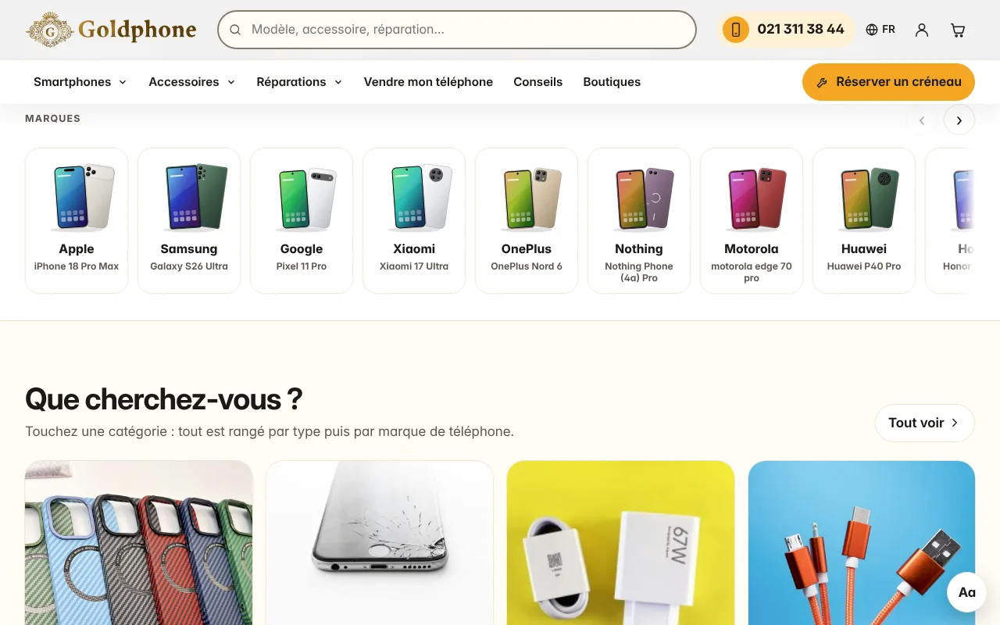
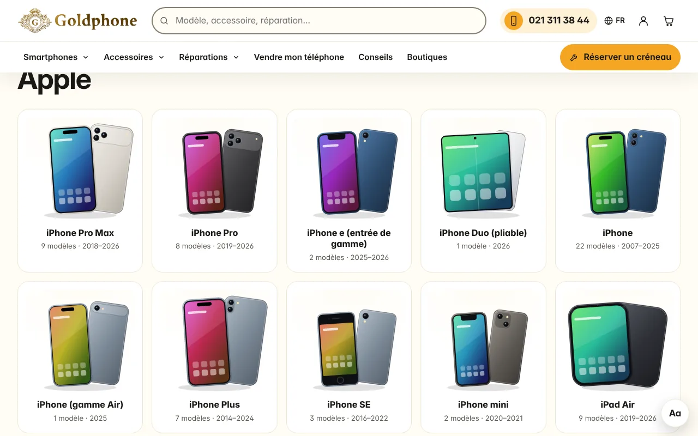
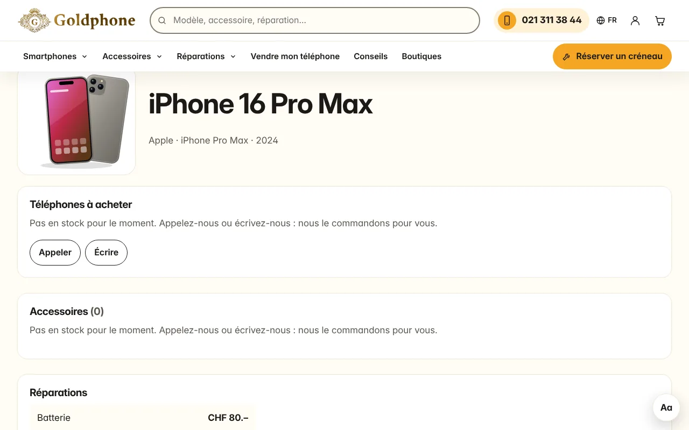
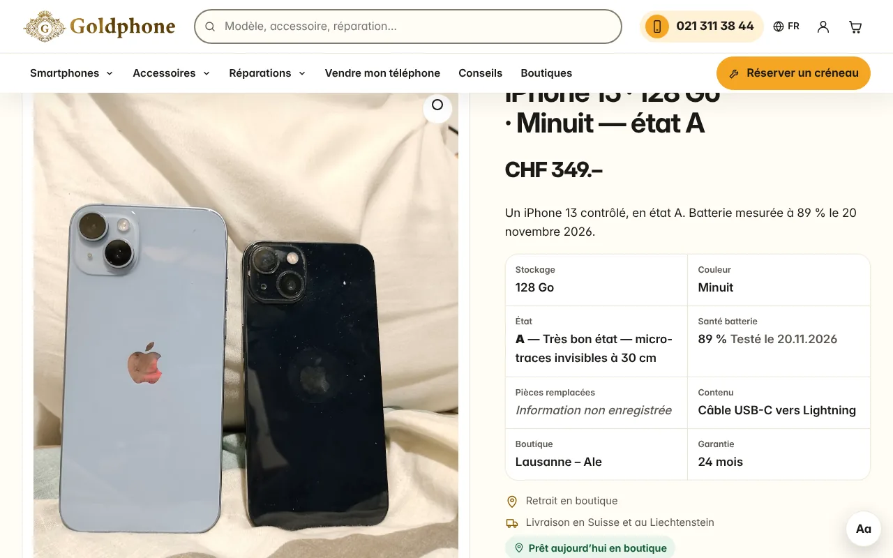
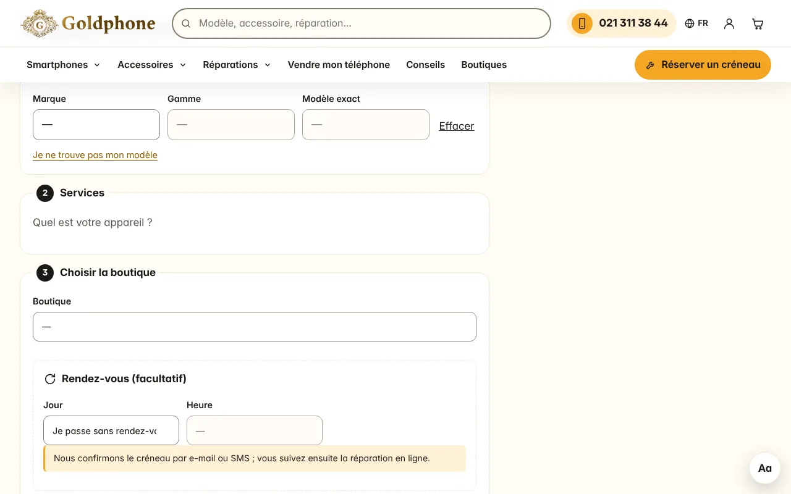
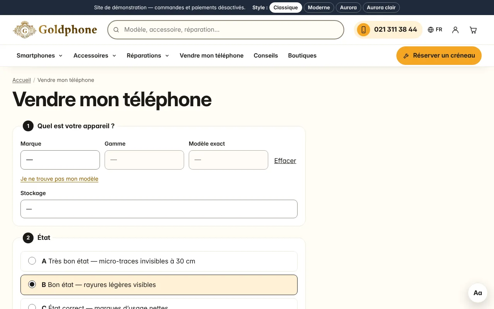
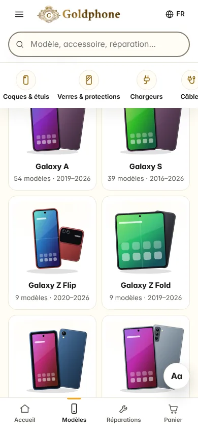

[English](mobile-store.md) · [Français](mobile-store.fr.md) · [فارسی](mobile-store.fa.md)

# Neo Mobile

**A complete phone shop online: accessories, used phones and repairs.**

For mobile phone shops: customers start from their own phone and find everything that goes with it — a case, a screen protector, a charger, a repair or a checked second-hand phone. Five languages and four looks to choose from. First demo: built for Goldphone in Lausanne and Montreux.

**Live demo:** https://mob.likenic.com/

## Screenshots

| Computer | Phone |
|---|---|
|  |  |

## Features, screen by screen

_Every screenshot below comes from the live demo; names, addresses and people on the demos are fictitious._

### 1. Everything for your phone, in one place

The home page opens on the three reasons people walk into a phone shop: an accessory, a used phone or a repair, with the shop's phone number always in the header.

### 2. Brand, then model, straight from the menu

Hover over a brand and its newest models appear beside it; every brand is listed, with a link to all of its models and shortcuts by budget.

### 3. Brands in one row

Each brand card shows its current flagship. The row moves on its own when the mouse nears either edge, and also with the arrows or by dragging.

### 4. Every range with its own picture

On a brand page each range — iPhone Pro Max, iPhone SE, iPad Air… — has a picture drawn from its real shape (home button, notch, camera layout, tablet or foldable), with the number of models and years covered.

### 5. One page per model, three answers

Phones to buy, accessories that fit and repair prices for that exact model. When nothing is in stock, the page offers to call or write instead of showing an empty list.

### 6. Used phones described honestly

Grade with its meaning, battery health with the date it was measured, replaced parts, what is in the box, the store it is in and the warranty. Anything not recorded is said so, never guessed.

### 7. Book a repair

Choose the model step by step, the repairs needed and the store, then a day and a time if you want one. The shop confirms by e-mail or text.

### 8. Sell your phone to the shop

Model, storage and condition, each grade explained in plain words, so the shop can make an offer before the customer comes in.

### 9. Four looks, one shop

Classic, modern, dark and light: the same content and features under four designs, chosen in the settings. In the dark look, a phone opens part by part as you scroll.

### 10. Five languages, right to left included

French, German, English, Persian and Arabic, each written for its readers; Persian and Arabic read right to left, down to the bottom bar.

### 11. Made for the phone

Two cards per row, category shortcuts under the search, and a bottom bar to Home, Models, Repairs and Cart. The site installs like an app.

---

Source code is private: every installation is set up for the client. Ask for access to the code if you are evaluating my work.

[← Back to the profile](../README.md)
