

[English](pharmacy.md) · [Français](pharmacy.fr.md) · [فارسی](pharmacy.fa.md)

# LikeServic Pharmacy

**سایتی که می‌گوید دارو موجود است یا نه.**

مشتری پیش از آمدن به داروخانه می‌بیند دارو هست یا نه، عکس نسخه را می‌فرستد و تحویل حضوری یا ارسال به خانه را انتخاب می‌کند. قالب و افزونه برای داروخانه‌های مستقل، به چهار زبان.

**دموی آنلاین:** https://pharm.likenic.com/  
**صفحهٔ محصول در NeoLivis:** https://neo.likenic.com/fa/product/likeservic-pharmacy-fa/

## تصاویر

| کامپیوتر | موبایل |
|---|---|
| 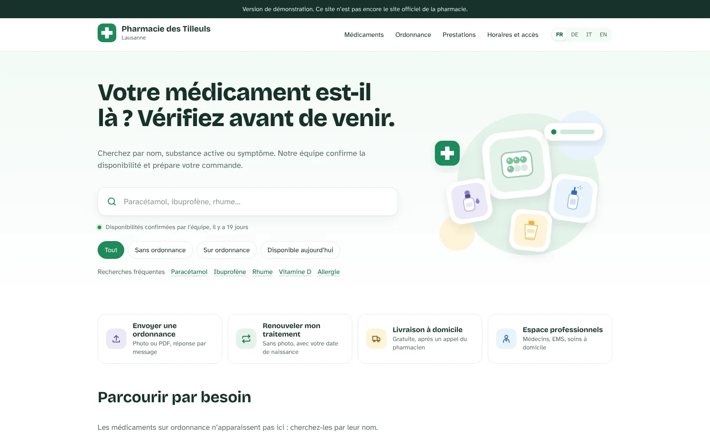 |  |

## امکانات، صفحه به صفحه

_همهٔ تصویرهای زیر از دموی آنلاین گرفته شده؛ نام‌ها، آدرس‌ها و افراد در دموها ساختگی هستند._

### 1. جستجو با نام دارو، مادهٔ مؤثر یا علامت

نتیجه‌ها همزمان با تایپ نشان داده می‌شوند. کنار هر دارو مشخص است نسخه لازم دارد یا نه و موجود است یا سفارشی، با دکمهٔ رزرو.

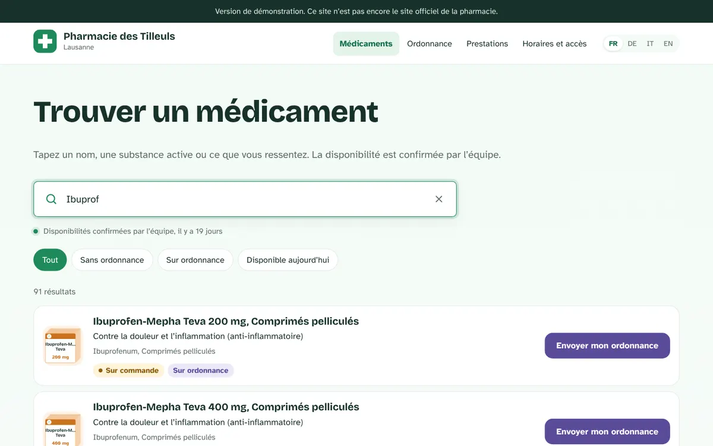

### 2. انتخاب بر اساس نیاز

چهارده دستهٔ روزمره مثل درد، سرماخوردگی، حساسیت، خواب و ترک سیگار، هر کدام با تعداد محصولات. داروهای نسخه‌ای در این فهرست نمی‌آیند.

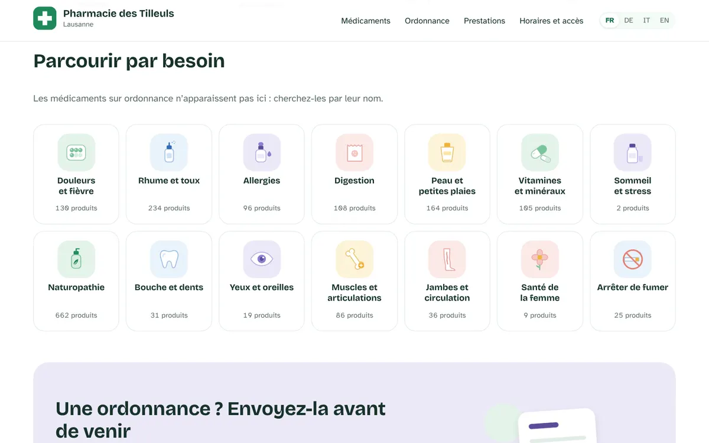

### 3. فیلترهایی که به سؤال اصلی جواب می‌دهند

در هر دسته: بدون نسخه، با نسخه، موجود برای امروز. تاریخ آخرین بررسی موجودی توسط تیم داروخانه بالای فهرست نوشته شده.

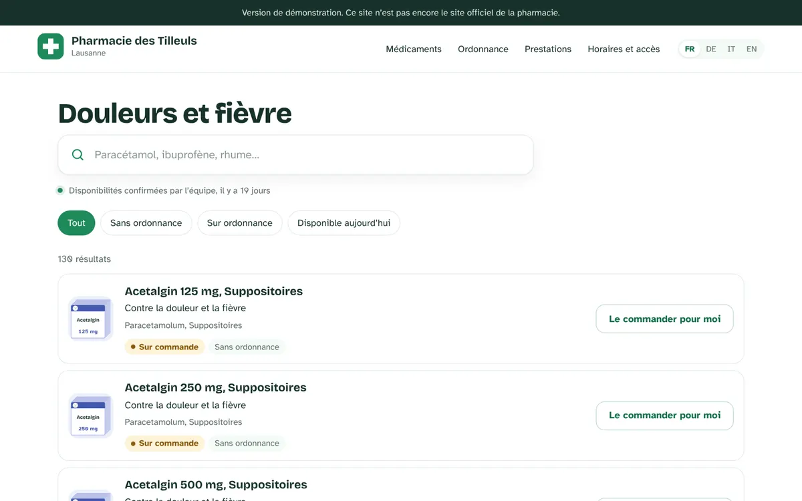

### 4. ارسال نسخه قبل از مراجعه

عکس یا PDF نسخه (تا ۱۰ مگابایت)، یا تمدید داروی همیشگی بدون عکس. تیم داروخانه تک‌تک داروها را بررسی می‌کند و وقتی آماده شد خبر می‌دهد.

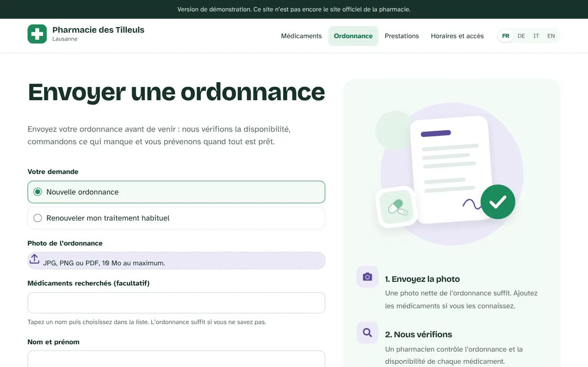

### 5. خدمات با زمان و قیمت

فشار خون، قند، کلسترول، تست عدم تحمل و خدمات دیگر با فیلتر نوع خدمت. برای هر خدمت نوشته شده نوبت لازم دارد یا نه، چقدر طول می‌کشد و هزینه‌اش چقدر است.

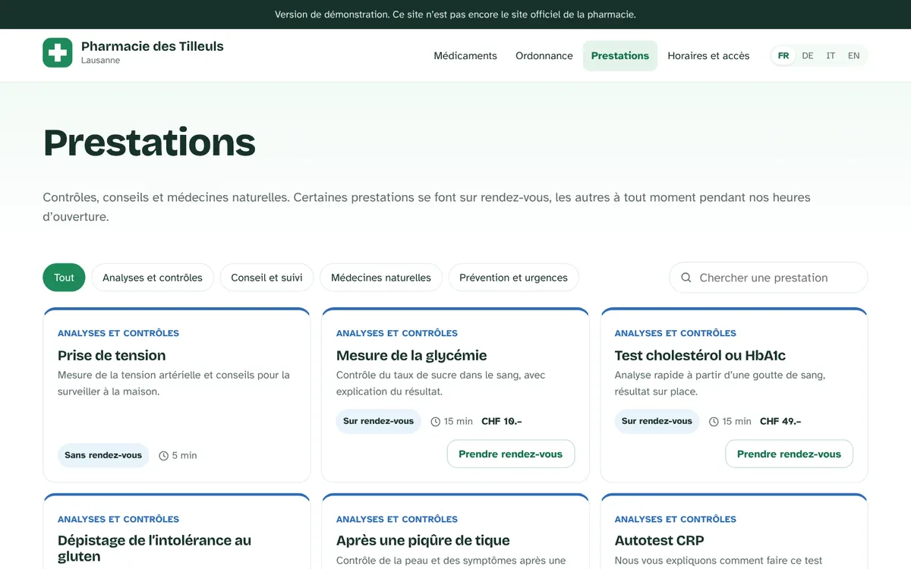

### 6. بخش ویژهٔ پزشکان و مراکز مراقبت

پزشک‌ها، خانه‌های سالمندان و مراقبت در منزل درخواست حساب می‌دهند، داروخانه آن را با شمارهٔ GLN تأیید می‌کند و بعد نسخهٔ بیمارانشان را می‌فرستند و وضعیتش را دنبال می‌کنند.

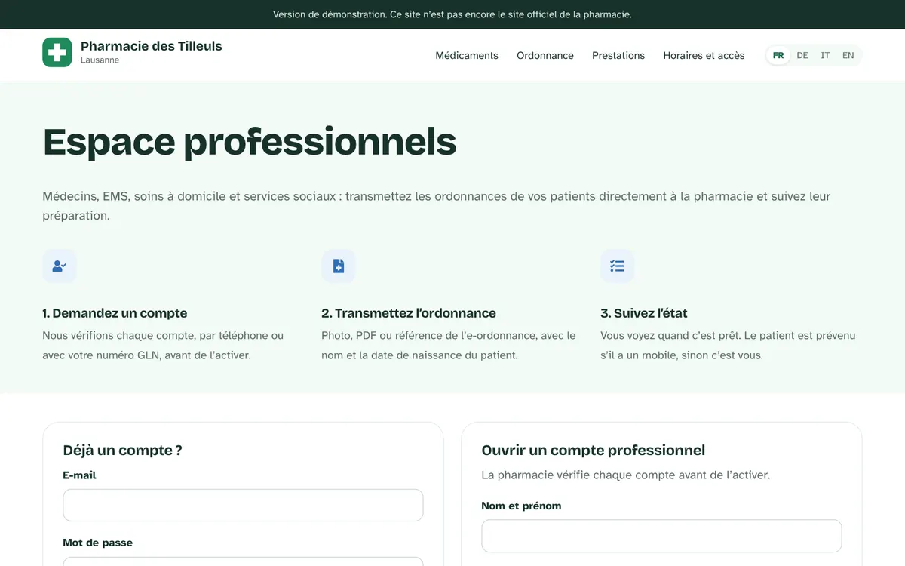

### 7. ساعات کاری با وضعیت لحظه‌ای

باز یا بسته بودن همین حالا، زمان باز شدن بعدی، دکمهٔ تماس و ایمیل؛ پربازدیدترین صفحه، ساده و سریع.

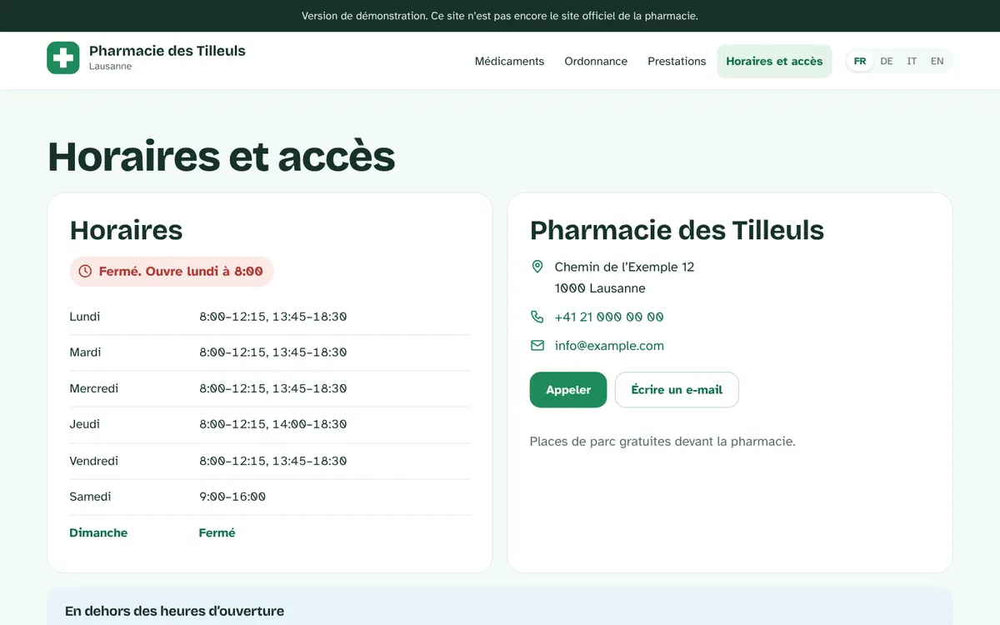

### 8. اخبار و اعلان روی گوشی

توصیه‌های فصلی و خبرهای داروخانه. مشتری می‌تواند اعلان را روشن کند تا مثلاً وقتی سفارشش آماده شد روی گوشی پیام بگیرد.

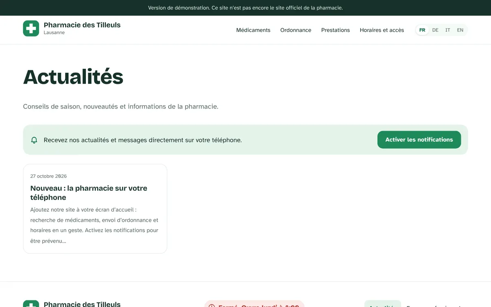

### 9. روی گوشی مثل اپلیکیشن

نوار پایین صفحه با دکمهٔ نسخه در وسط؛ سایت روی صفحهٔ اصلی گوشی نصب می‌شود (PWA).

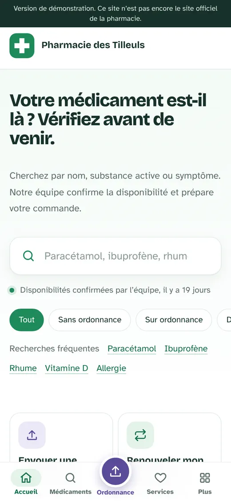

### 10. چهار زبان

فرانسوی، آلمانی، ایتالیایی و انگلیسی، هر کدام با متن و کلمات جستجوی خودش.

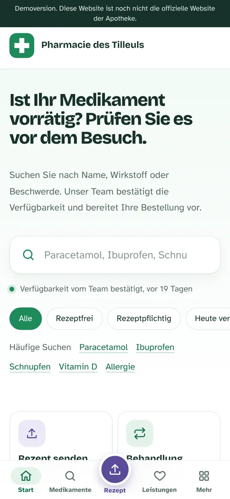

---

کد منبع خصوصی است و هر نصب برای همان مشتری انجام می‌شود. اگر کارم را ارزیابی می‌کنید، برای دیدن کد درخواست دسترسی بدهید.

[← بازگشت به پروفایل](../README.md)

