[English](pharmacy.md) · [Français](pharmacy.fr.md) · [فارسی](pharmacy.fa.md)

# LikeServic Pharmacy

**Le site qui dit si le médicament est là.**

Votre client vérifie qu’un médicament est disponible avant de se déplacer, envoie son ordonnance en photo et choisit retrait ou livraison. Thème et extension pensés pour une pharmacie indépendante, en quatre langues.

**Démo en ligne:** https://pharm.likenic.com/  
**Page produit sur NeoLivis:** https://neo.likenic.com/product/likeservic-pharmacy/

## Captures d’écran

| Ordinateur | Téléphone |
|---|---|
| 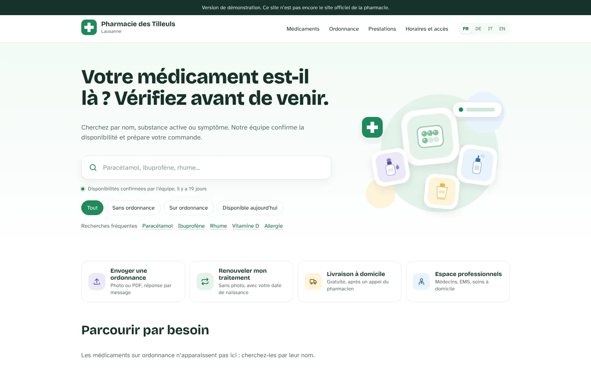 |  |

## Les fonctionnalités, écran par écran

_Chaque capture provient de la démo en ligne ; les noms, adresses et personnes des démos sont fictifs._

### 1. Recherche par nom, substance ou symptôme

Les résultats s’affichent pendant la saisie. Chaque médicament indique s’il faut une ordonnance et s’il est en stock ou commandé, avec un bouton pour le réserver.

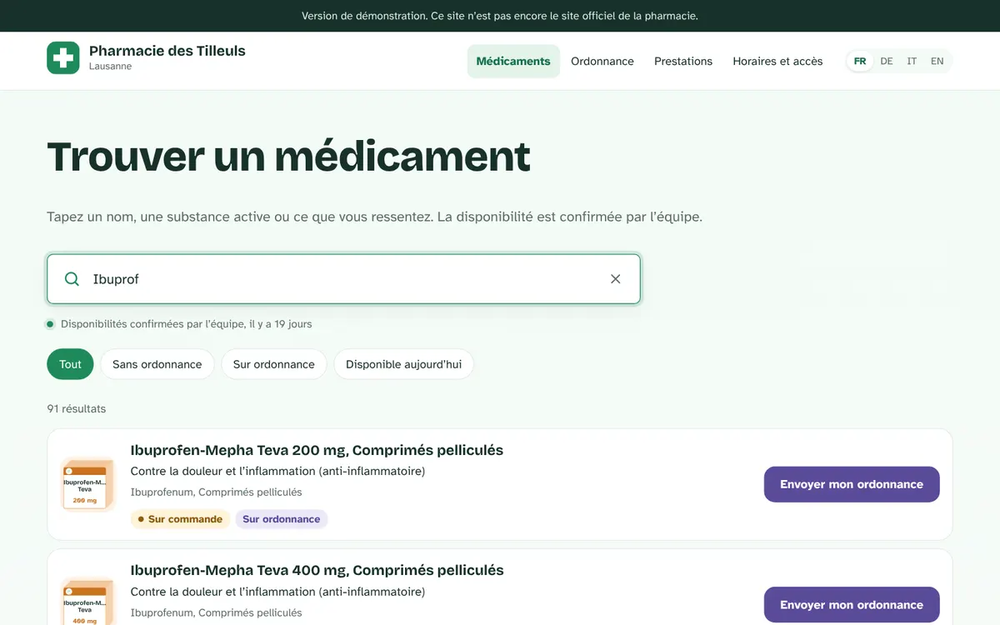

### 2. Parcourir par besoin

Quatorze besoins du quotidien – douleurs, rhume, allergies, sommeil, arrêt du tabac… – avec le nombre de produits pour chacun. Les médicaments sur ordonnance n’y figurent pas.

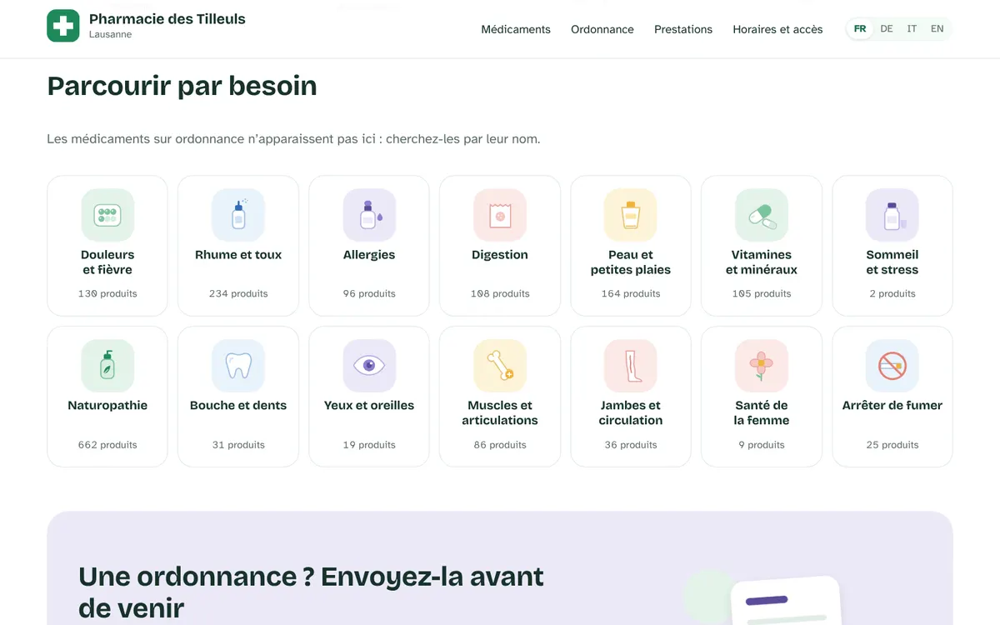

### 3. Des filtres qui répondent à la vraie question

Dans chaque catégorie : sans ordonnance, sur ordonnance, disponible aujourd’hui. La date du dernier contrôle de stock par l’équipe est affichée au-dessus.

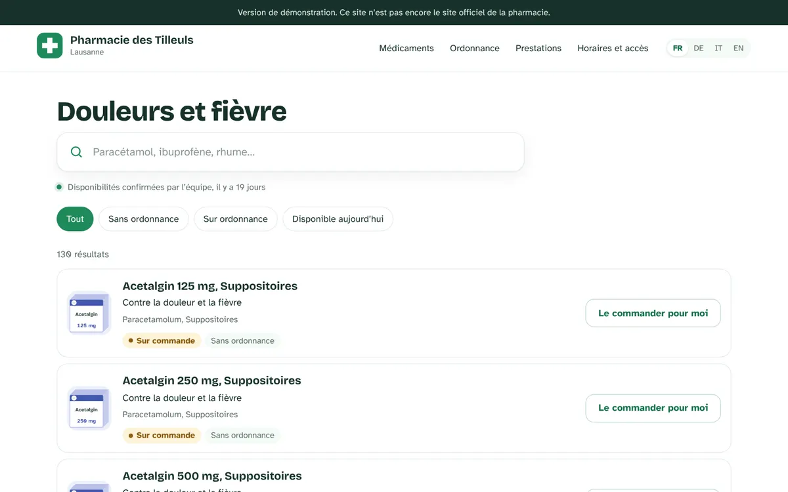

### 4. Envoyer son ordonnance avant de venir

Une photo ou un PDF (10 Mo max.), ou le renouvellement d’un traitement habituel sans photo. L’équipe vérifie chaque médicament et prévient quand tout est prêt.

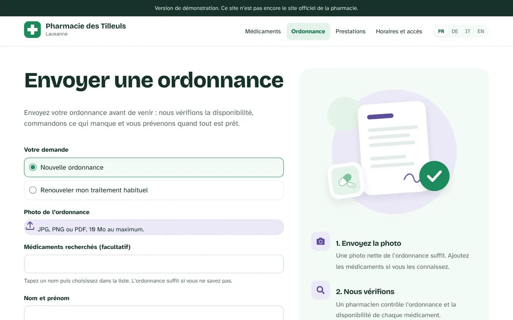

### 5. Prestations avec durée et prix

Tension, glycémie, cholestérol, tests d’intolérance et plus, filtrés par type. Chaque prestation indique s’il faut un rendez-vous, sa durée et son prix.

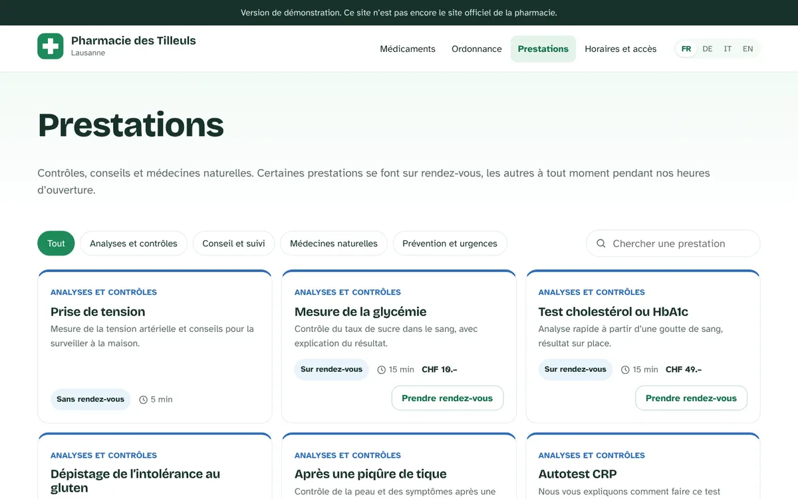

### 6. Espace pour médecins et EMS

Médecins, EMS et soins à domicile demandent un compte, la pharmacie le vérifie (numéro GLN), puis ils transmettent les ordonnances de leurs patients et suivent leur état.

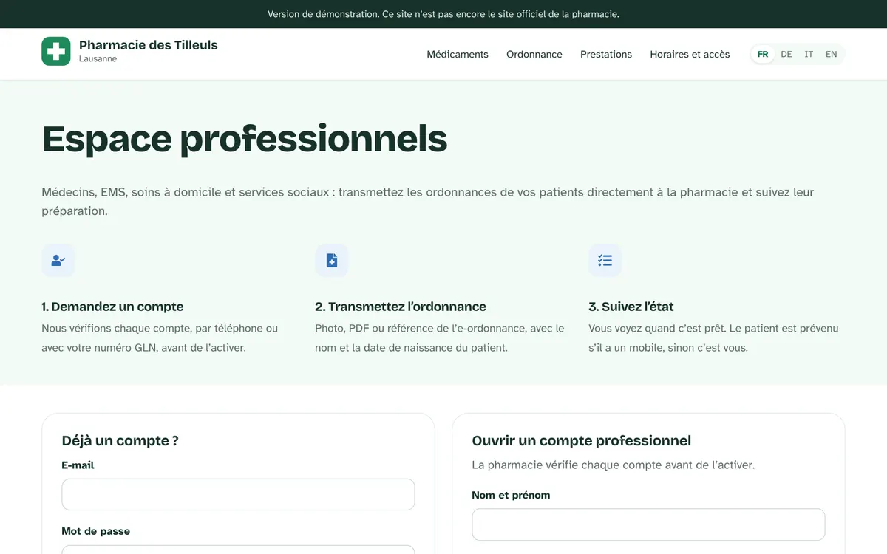

### 7. Horaires avec statut en direct

Ouvert ou fermé en ce moment, la prochaine ouverture, des boutons pour appeler ou écrire – la page la plus consultée, gardée simple.

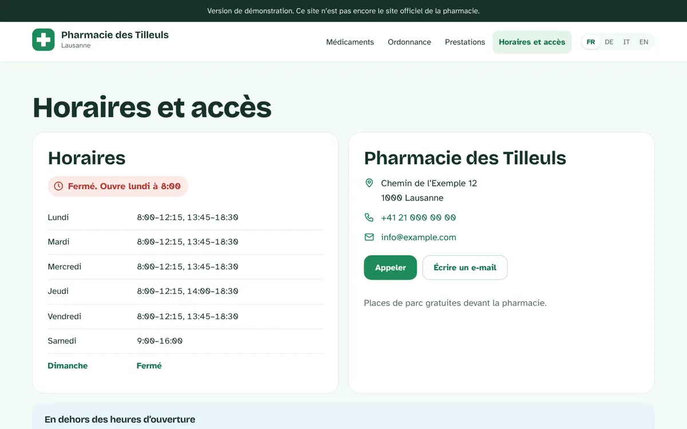

### 8. Actualités et notifications

Conseils de saison et nouvelles de la pharmacie. Les clients peuvent activer les notifications et recevoir un message sur leur téléphone, par exemple quand une commande est prête.

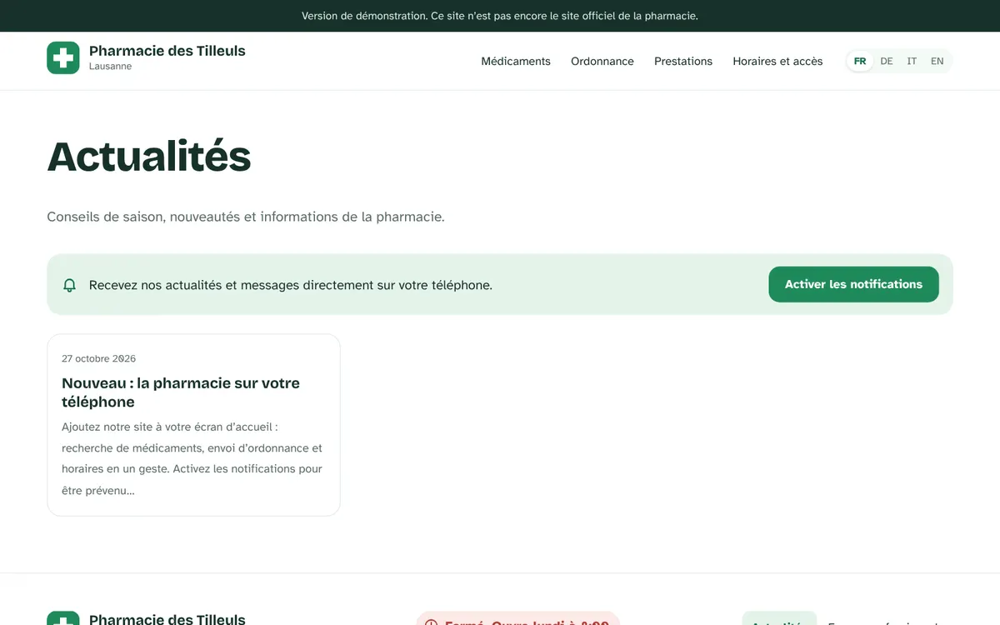

### 9. Comme une application sur le téléphone

Une barre en bas avec le bouton ordonnance au centre ; le site s’ajoute à l’écran d’accueil (PWA).

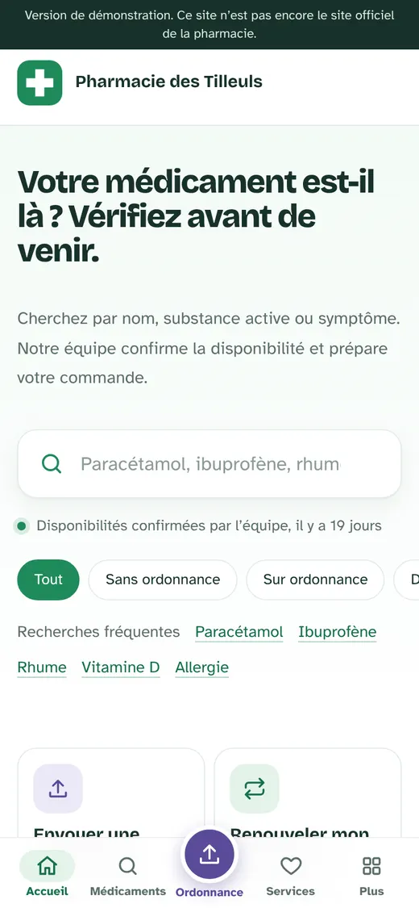

### 10. Quatre langues

Français, allemand, italien et anglais, chacune avec ses propres textes et termes de recherche.

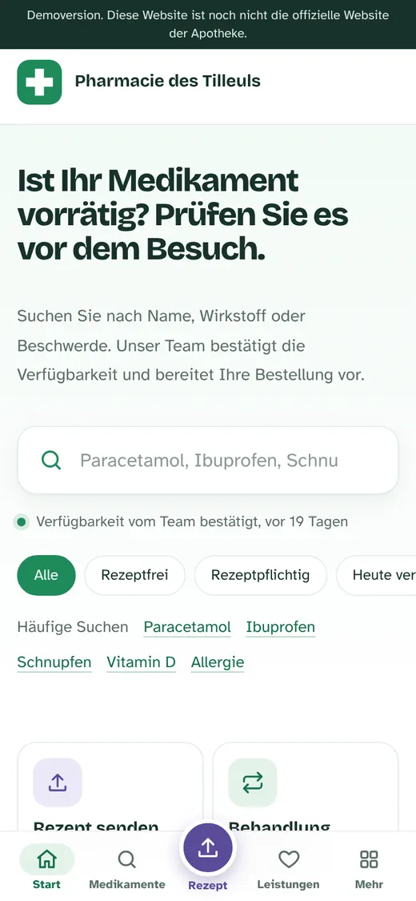

---

Le code source est privé : chaque installation est faite pour le client. Demandez un accès au code si vous évaluez mon travail.

[← Retour au profil](../README.md)
