[English](pharmacy.md) · [Français](pharmacy.fr.md) · [فارسی](pharmacy.fa.md)

# LikeServic Pharmacy

**Shows whether the medicine is in stock.**

Customers check that a medicine is available before they set off, send their prescription as a photo and pick collection or delivery. A theme and plugin made for independent pharmacies, in four languages.

**Live demo:** https://pharm.likenic.com/  
**Product page on NeoLivis:** https://neo.likenic.com/en/product/likeservic-pharmacy-en/

## Screenshots

| Computer | Phone |
|---|---|
| 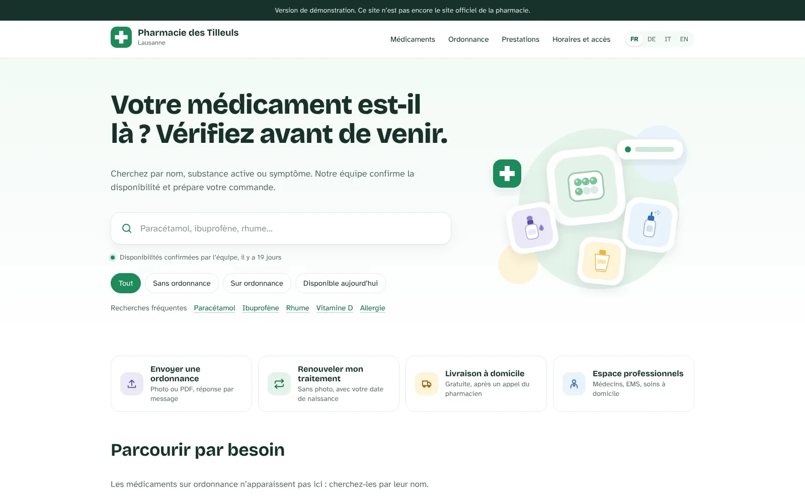 |  |

## Features, screen by screen

_Every screenshot below comes from the live demo; names, addresses and people on the demos are fictitious._

### 1. Search by name, ingredient or symptom

Results appear while the customer types. Each medicine shows whether it needs a prescription and whether it is in stock or ordered for them, with a button to reserve it.

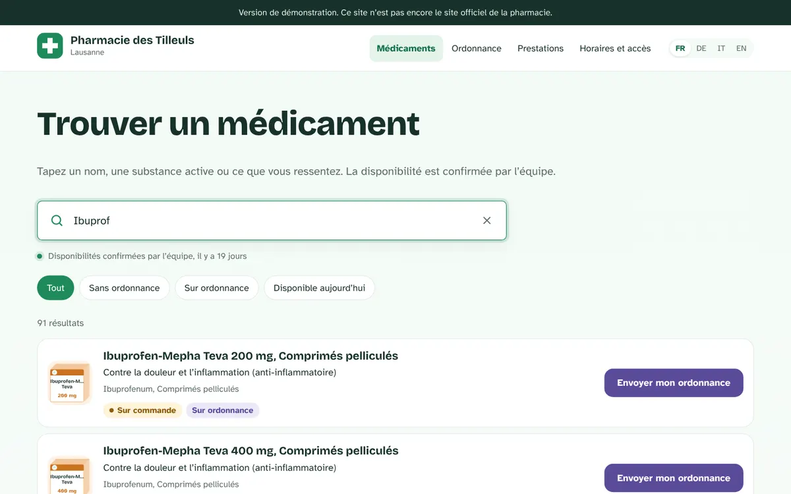

### 2. Browse by need

Fourteen everyday needs – pain, colds, allergies, sleep, quitting smoking… – each with the number of products behind it. Prescription-only medicines are kept out of this list.

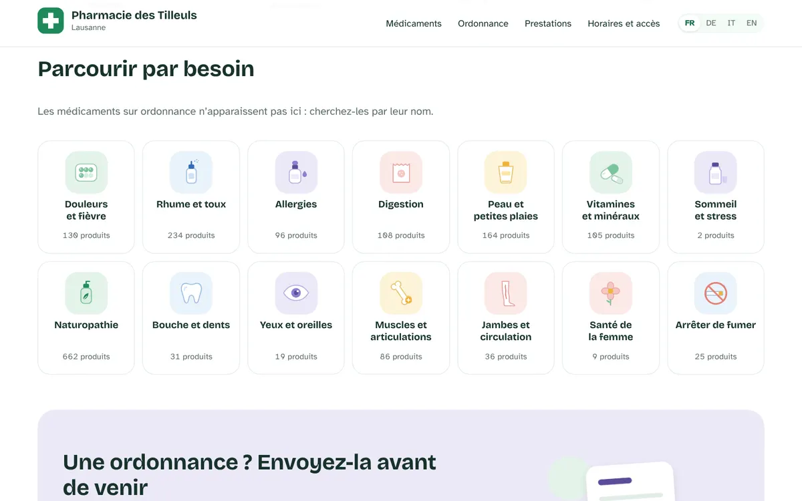

### 3. Filters that answer the real question

In every category: without prescription, with prescription, available today. The date of the last stock check by the team is shown above the list.

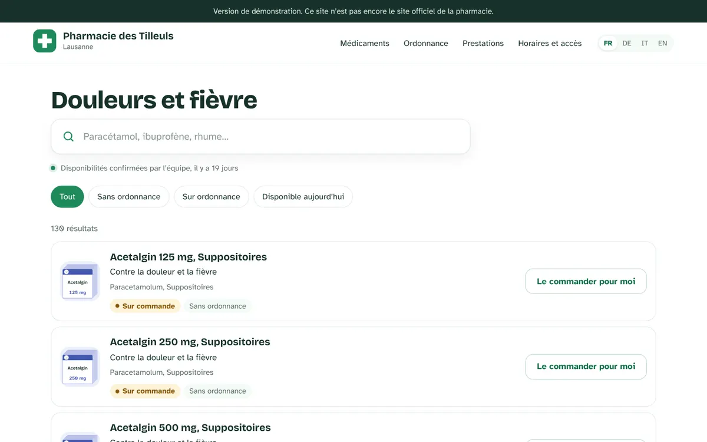

### 4. Send a prescription before coming in

A photo or PDF (up to 10 MB), or a renewal of a regular treatment without any photo. The team checks each medicine and tells the customer when everything is ready.

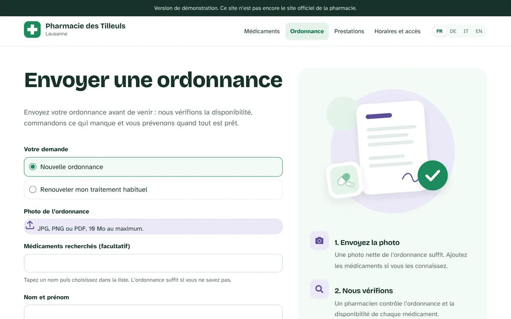

### 5. Services with duration and price

Blood pressure, blood sugar, cholesterol, intolerance tests and more, filtered by type. Each service says whether it needs an appointment, how long it takes and what it costs.

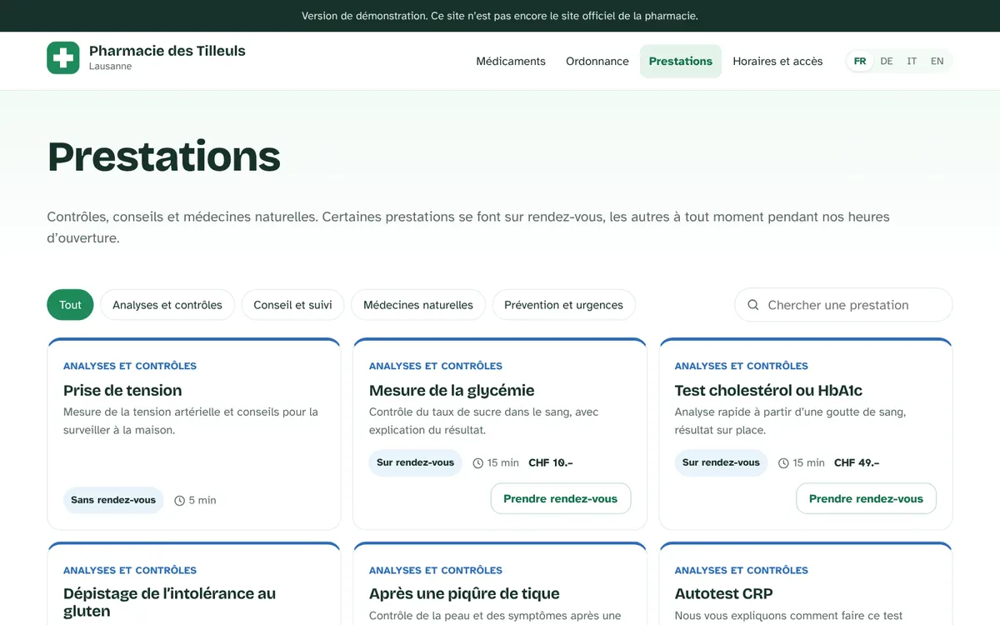

### 6. Area for doctors and care homes

Doctors, care homes and home-care services ask for an account, the pharmacy checks it (GLN number) and they then send prescriptions for their patients and follow their status.

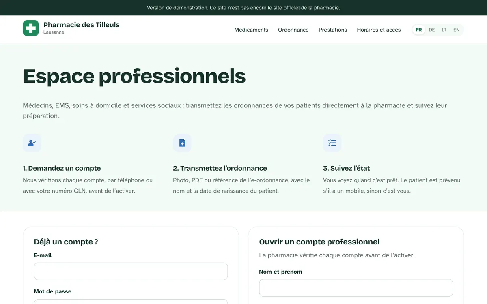

### 7. Opening hours with live status

Open or closed right now, the next opening time, buttons to call or write – the page people need most, kept simple.

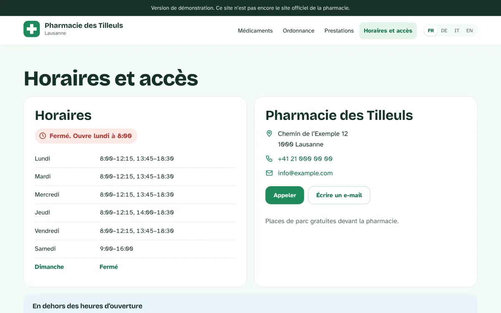

### 8. News and phone notifications

Seasonal advice and pharmacy news. Customers can turn on notifications and get a message on their phone, for example when an order is ready.

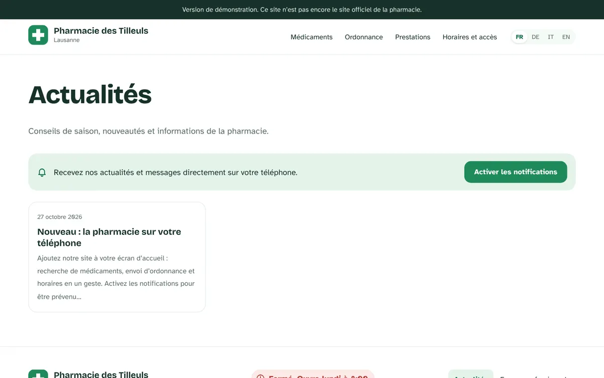

### 9. Works like an app on the phone

A bottom bar with the prescription button in the middle; the site can be added to the home screen (PWA).

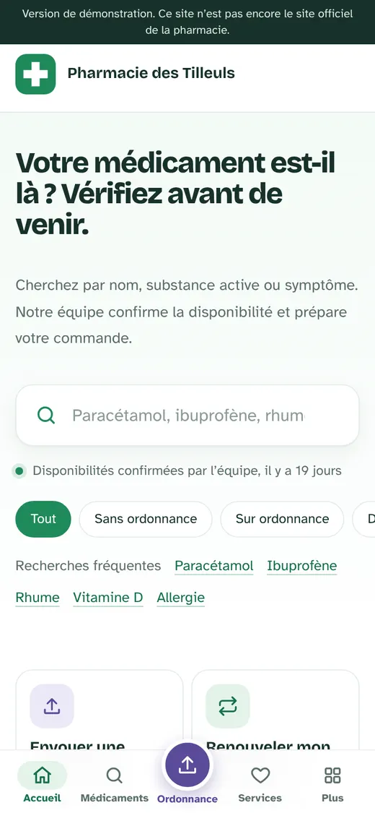

### 10. Four languages

French, German, Italian and English, each with its own texts and search terms.

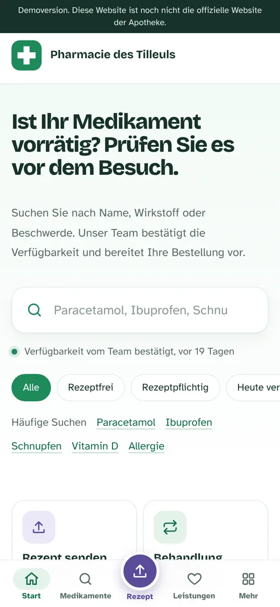

---

Source code is private: every installation is set up for the client. Ask for access to the code if you are evaluating my work.

[← Back to the profile](../README.md)
