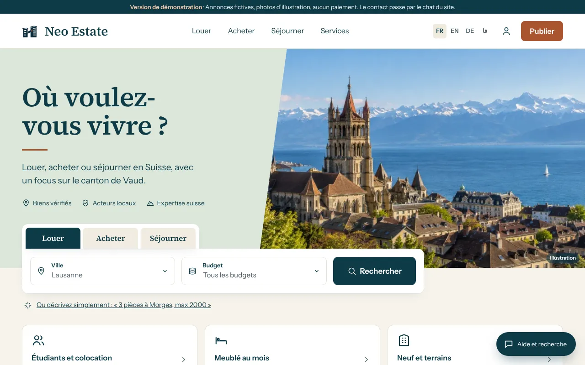
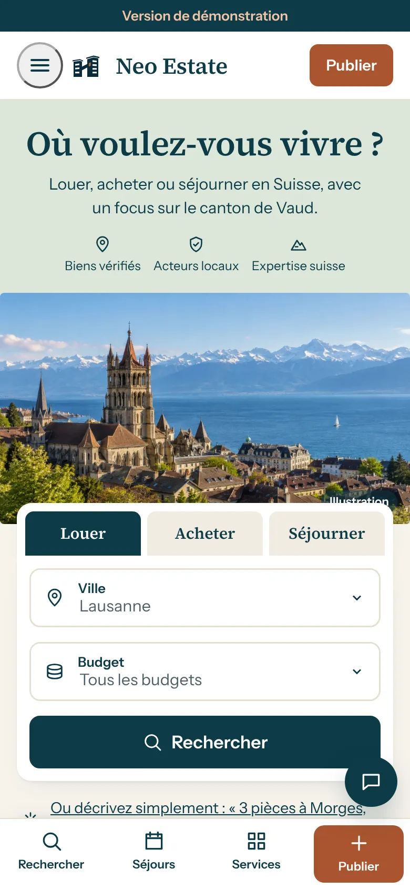
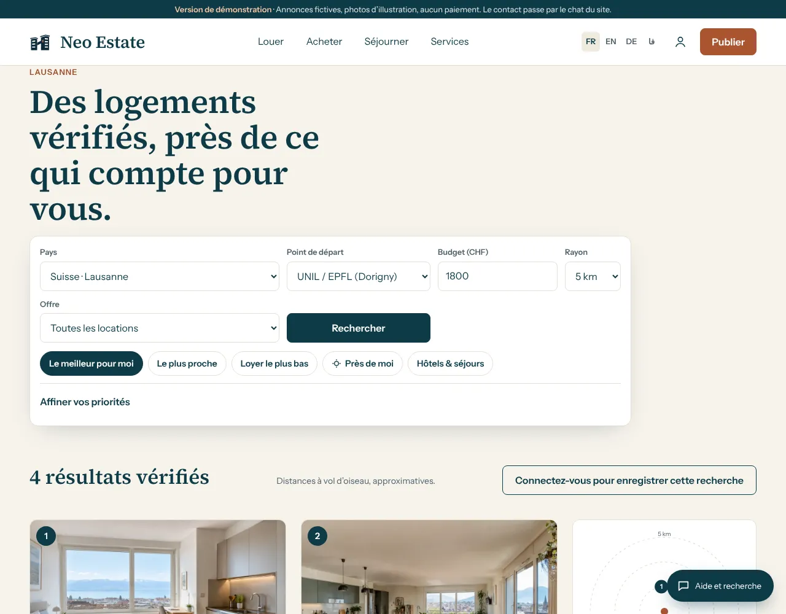
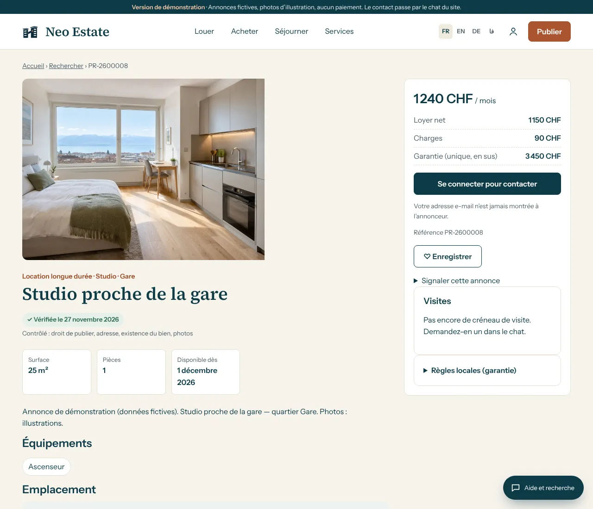
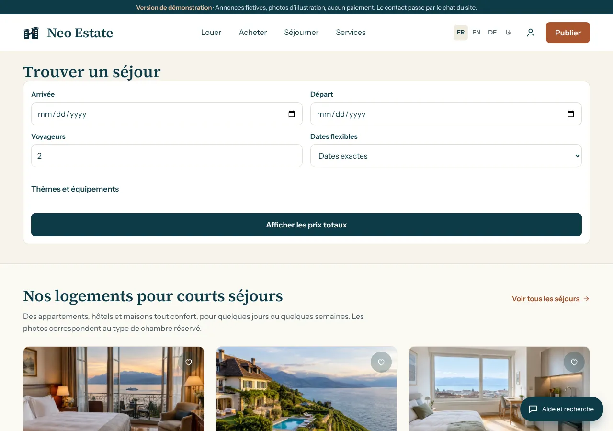
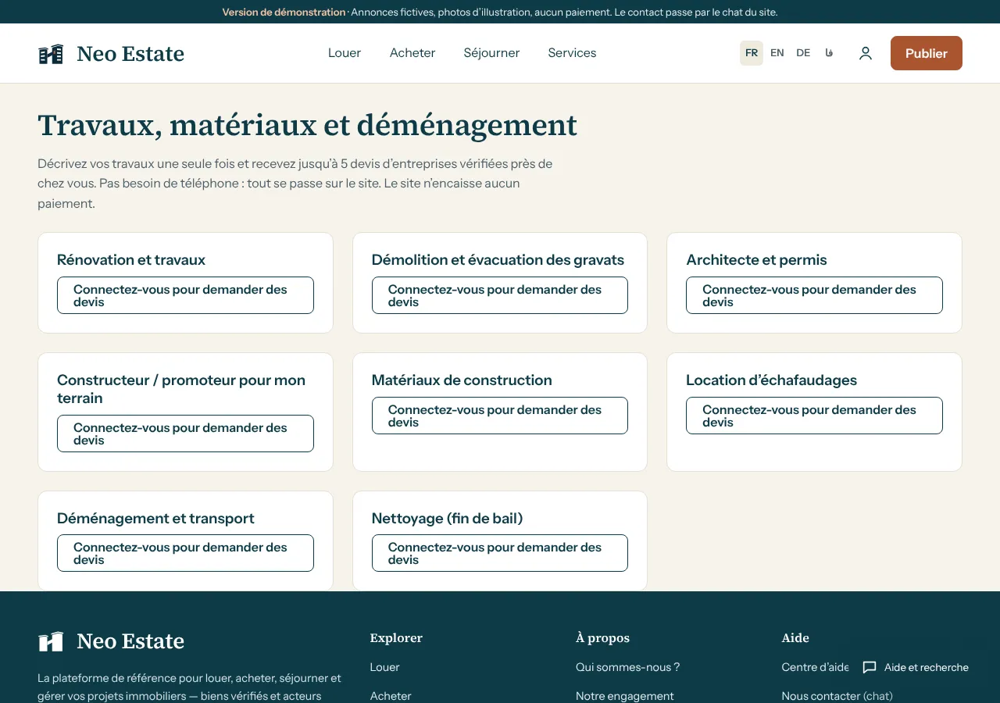
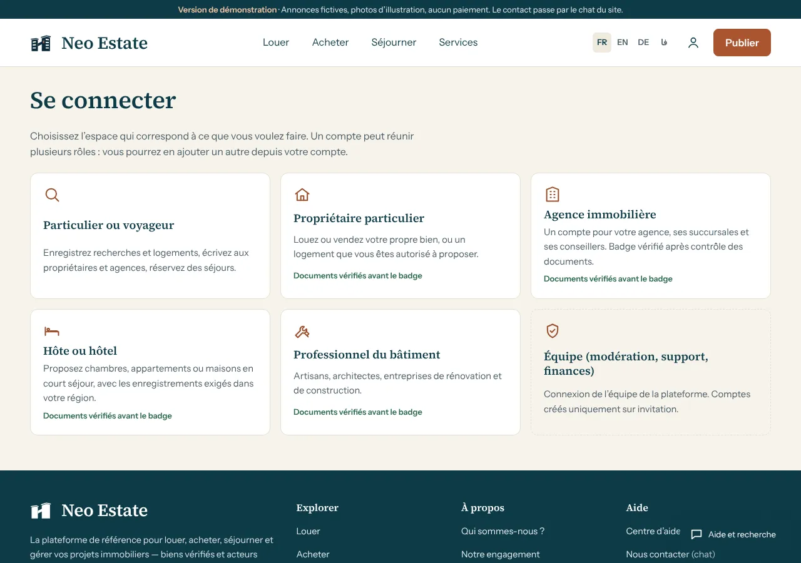
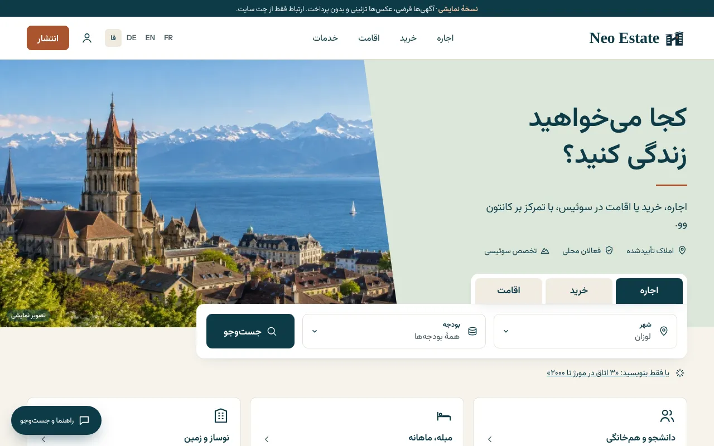

[English](real-estate.md) · [Français](real-estate.fr.md) · [فارسی](real-estate.fa.md)

# Neo Estate

**پلتفرم کامل املاک: اجاره، خرید، اقامت کوتاه و خدمات ساختمانی.**

برای آژانس‌ها، مالک‌ها و میزبان‌ها: آگهی‌ها پیش از انتشار بررسی می‌شوند، جست‌وجو دلیل هر نتیجه را می‌گوید، اقامت کوتاه رزروشدنی است و پیمانکار با پیش‌فاکتور پیدا می‌شود. همهٔ ارتباط از پیام‌رسان خود سایت است و هیچ شماره تلفنی نمایش داده نمی‌شود. چهار زبان (فرانسوی، انگلیسی، آلمانی، فارسی) و نصب‌شدنی مثل اپ (PWA). نسخهٔ نمایشی برای کانتون وو، با بازار کانادا به‌صورت اختیاری.

**دموی آنلاین:** https://real.likenic.com/ (ایندکس‌نشده)

| دسکتاپ | موبایل |
|---|---|
|  |  |

## امکانات، صفحه به صفحه
_تصاویر از دموی آنلاین است؛ آگهی‌ها، نام‌ها و عکس‌ها ساختگی‌اند (تصویرسازی)._

۱. **اجاره، خرید یا اقامت از همان صفحهٔ اول** — شهر و بودجه، میان‌بر برای دانشجو و هم‌خانه، مبله ماهانه، نوساز و زمین، پارکینگ، کمترین اجاره‌ها. 

۲. **نتیجه‌هایی که دلیلشان را می‌گویند** — هر نتیجه می‌گوید چرا آمده؛ آگهی با شارژ نامشخص «ارزان‌ترین» حساب نمی‌شود؛ ذخیرهٔ جست‌وجو با هشدار ایمیلی. 

۳. **آگهی بررسی‌شده، بدون نشانی دقیق** — چه چیزی و کی بررسی شده، قیمت جزءبه‌جزء، محدودهٔ تقریبی، رزرو زمان بازدید، گزارش با یک کلیک. 

۴. **اقامت کوتاه با قیمت کل** — تاریخ منعطف، موضوع‌ها، رزرو آنی، تخفیف هفتگی و ماهانه و لحظهٔ آخری، مقایسهٔ کنار هم. 

۵. **کار ساختمانی، مصالح و اسباب‌کشی** — یک درخواست، تا ۵ پیش‌فاکتور از شرکت‌های تأییدشدهٔ محلی، انتخاب یکی. 

۶. **فضای جدا برای هر نقش** — شخص، مالک، آژانس (شعبه، مشاور، ورود CSV، داشبورد)، میزبان یا هتل، متخصص ساختمان؛ هرکدام با مدارک خودش. 

۷. **فارسی هم، راست‌به‌چپ** — همهٔ صفحه‌ها در چهار زبان، با متن نوشته‌شده برای هر زبان. 

