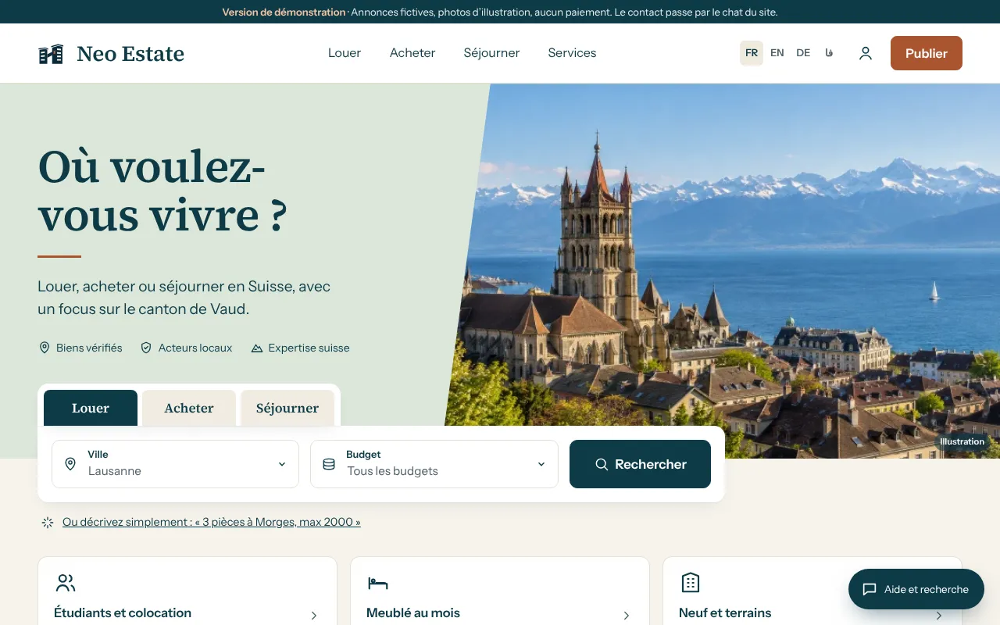
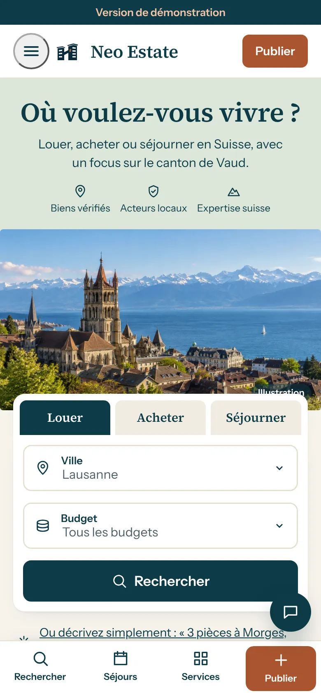
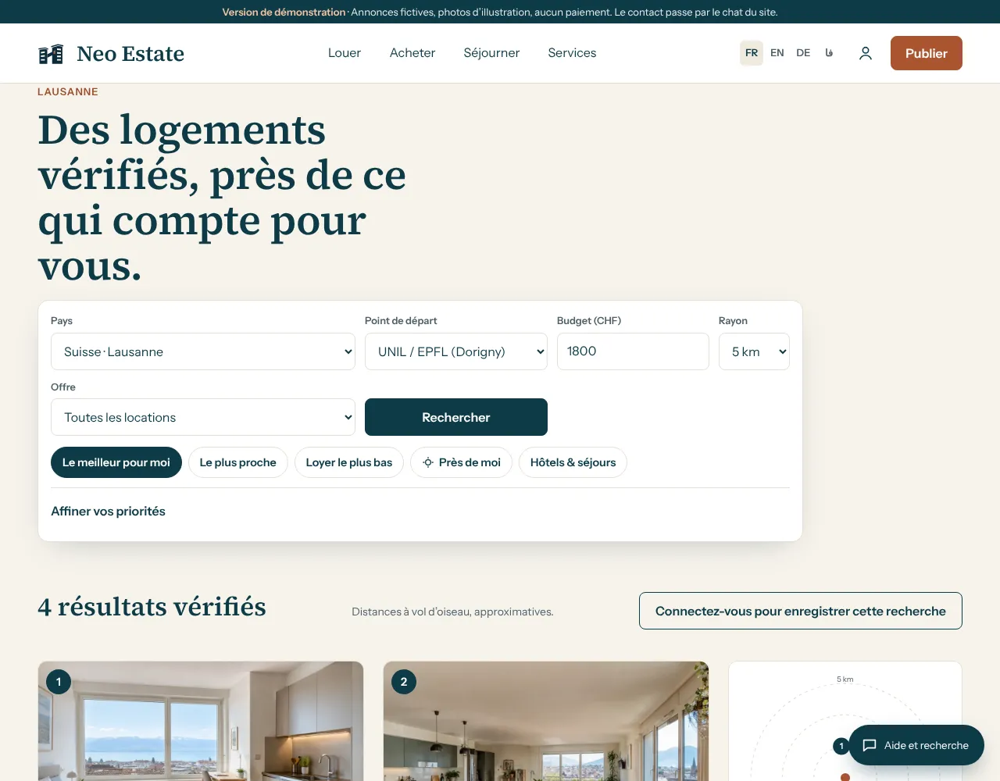
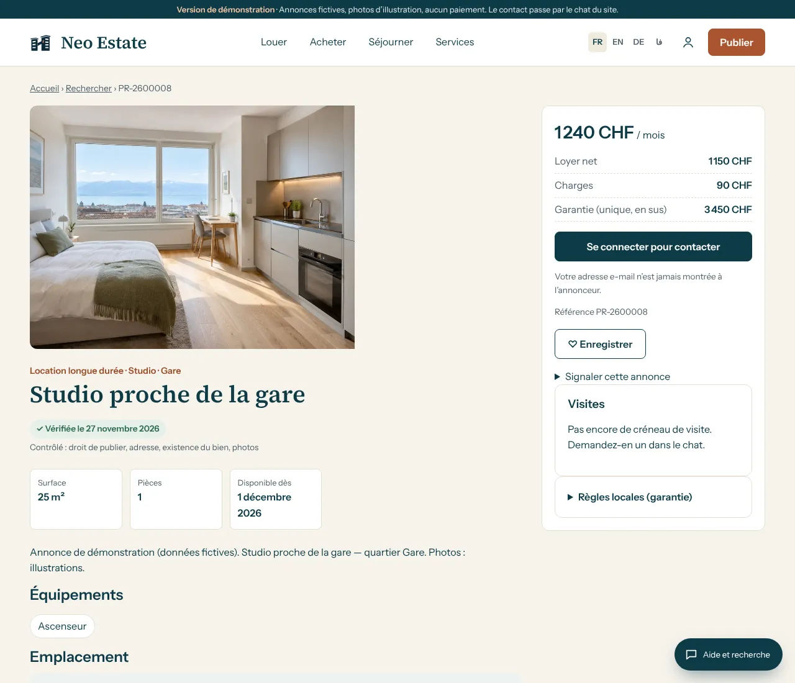
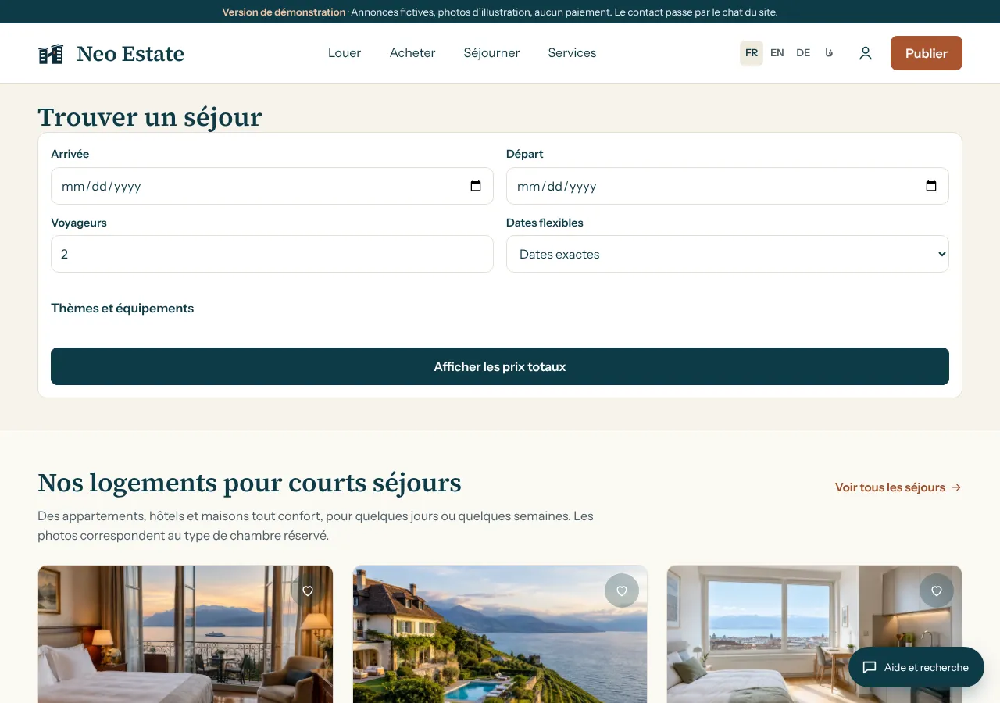
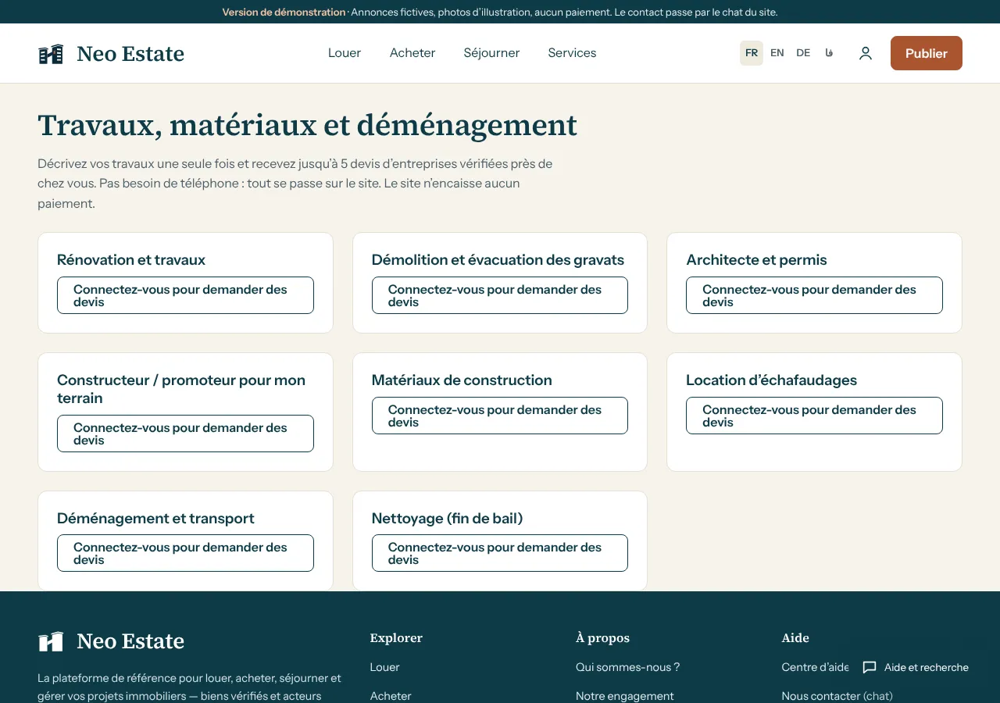
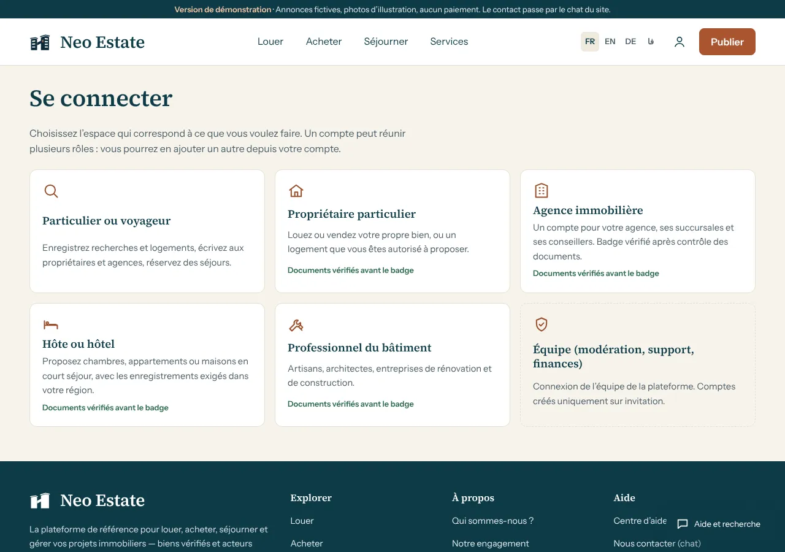
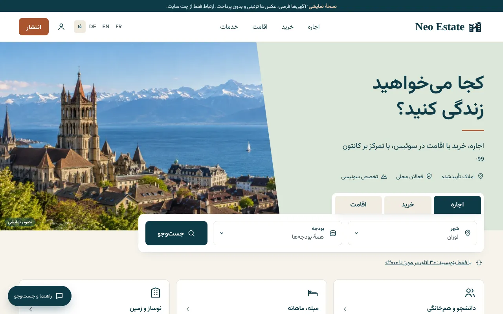

[English](real-estate.md) · [Français](real-estate.fr.md) · [فارسی](real-estate.fa.md)

# Neo Estate

**La plateforme immobilière complète : louer, acheter, séjourner, faire des travaux.**

Pour agences, propriétaires et hôtes : annonces vérifiées avant publication, recherche avec la raison de chaque résultat, séjours courts réservables, pros du bâtiment sur devis. Tout le contact passe par la messagerie du site, sans numéro de téléphone affiché. Quatre langues (FR, EN, DE, فارسی), installable comme une application (PWA). Démo pour le canton de Vaud, avec un marché Canada en option.

**Démo en ligne :** https://real.likenic.com/ (non indexée)

## Captures d’écran

| Ordinateur | Téléphone |
|---|---|
|  |  |

## Les fonctionnalités, écran par écran

_Chaque capture provient de la démo en ligne ; annonces, noms et photos sont fictifs (photos d’illustration)._

### 1. Louer, acheter ou séjourner, dès l’accueil
Ville et budget en deux champs, et des raccourcis pour les cas fréquents : étudiants et colocation, meublé au mois, neuf et terrains, parking, loyers les plus bas.

### 2. Des résultats qui disent pourquoi
Chaque annonce indique pourquoi elle apparaît (distance à l’université, budget, charges connues). Les annonces aux charges inconnues ne sont pas classées « moins chères ». Recherche enregistrable avec alerte par e-mail.

### 3. Une fiche vérifiée, sans adresse exacte
Badge « Vérifiée le … » avec ce qui a été contrôlé, prix détaillé (loyer net, charges, garantie), zone approximative pour protéger l’adresse, visites à réserver par créneau, signalement en un clic.

### 4. Séjours courts au prix total
Dates, voyageurs, dates flexibles ±3 jours, thèmes (vue lac, montagne, travail…). Le prix affiché est le total du séjour, ménage et remises compris. Réservation instantanée, remises semaine/mois et dernière minute, comparaison côte à côte.

### 5. Travaux, matériaux et déménagement
Une demande, jusqu’à 5 devis d’entreprises vérifiées de la région : rénovation, démolition, architecte, promoteur pour un terrain, matériaux, échafaudage, déménagement, nettoyage. Comparaison des devis, un seul accepté.

### 6. Un espace par rôle
Particulier, propriétaire, agence (succursales, conseillers, import CSV, tableau de bord), hôte ou hôtel, professionnel du bâtiment. Chaque rôle demande ses propres justificatifs, vérifiés avant le badge.

### 7. En persan aussi, de droite à gauche
Toute l’interface existe en français, anglais, allemand et persan ; les textes sont rédigés pour chaque langue.

## Sous le capot
WordPress + Elementor, thème sur mesure, une extension Core de thème indépendante et un module par domaine (annonces, recherche, séjours, agences, travaux, règles locales…), chacun activable sans code. Changer de thème ne perd aucune donnée. Règles locales (garantie, frais d’agence…) avec source officielle et relecture humaine avant application. Aucun paiement en ligne dans cette démo.
