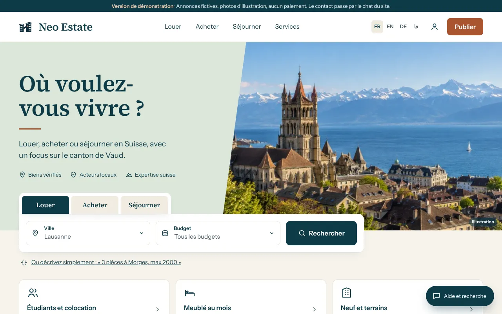
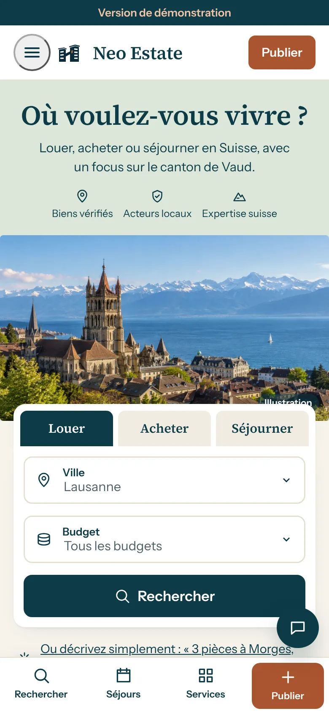
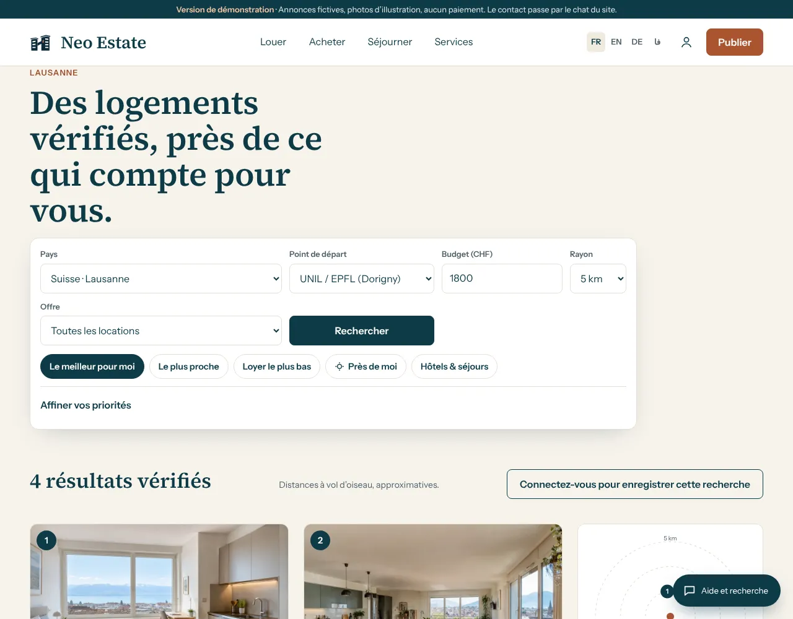
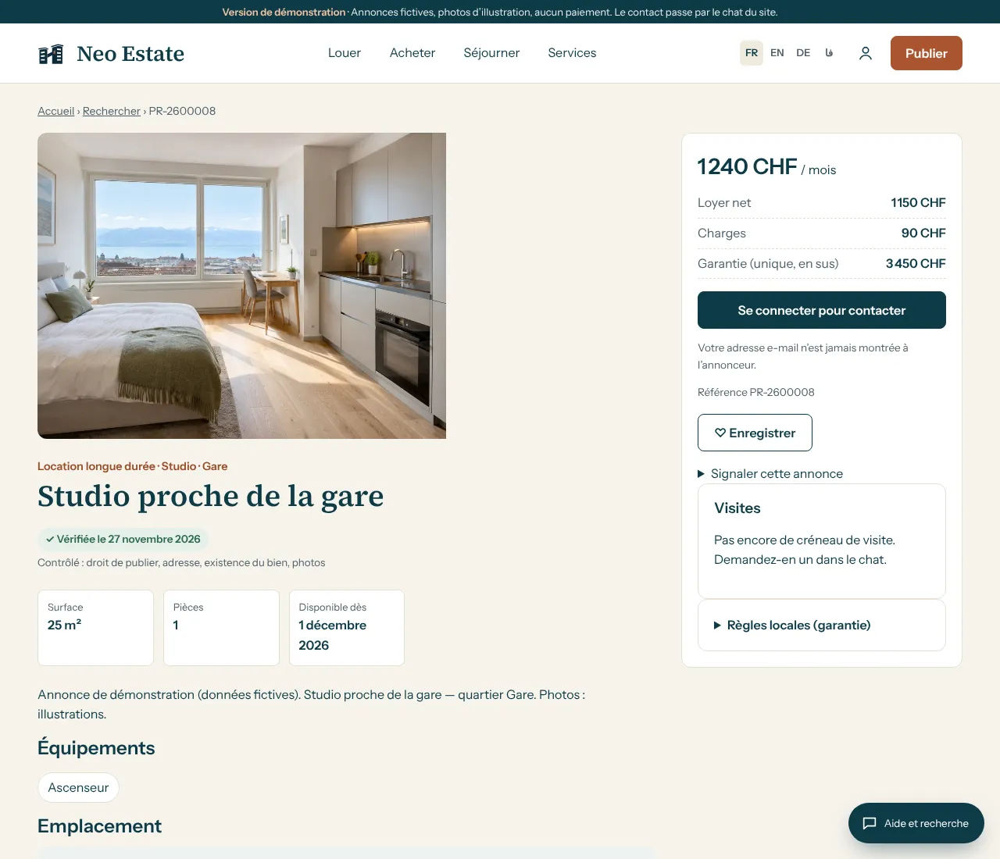
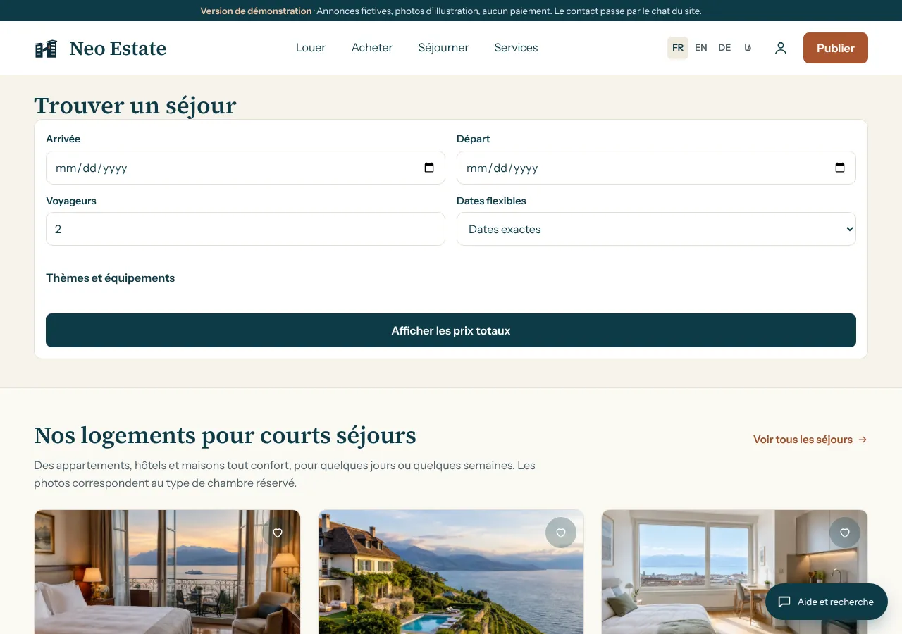
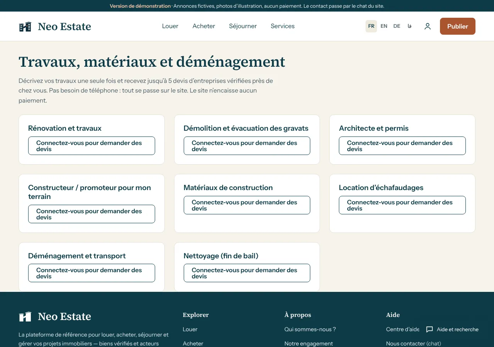
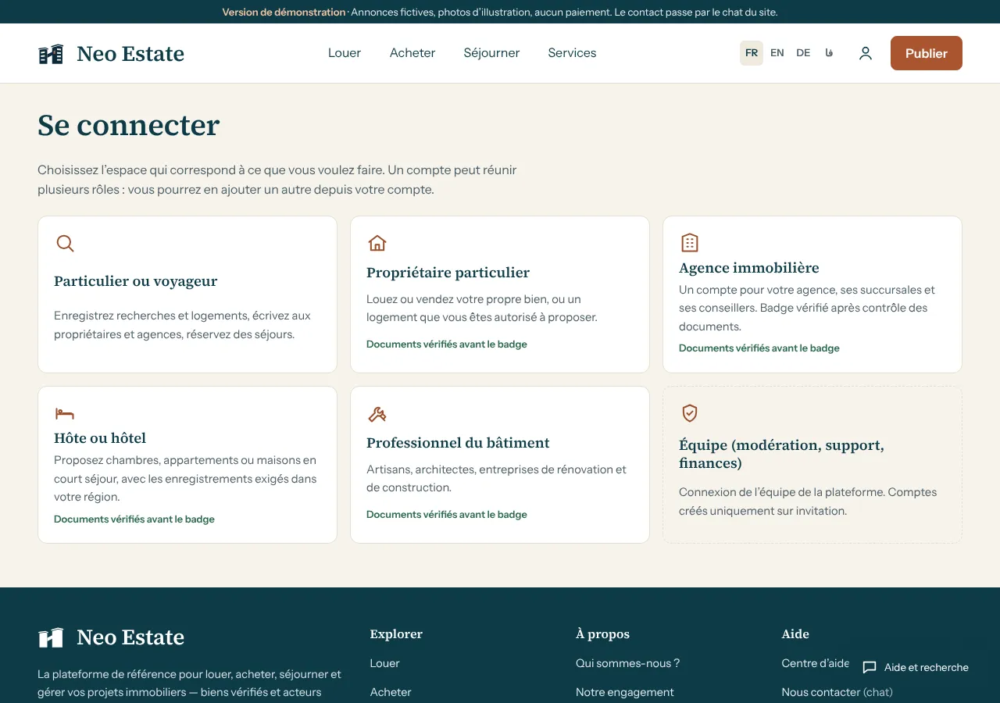
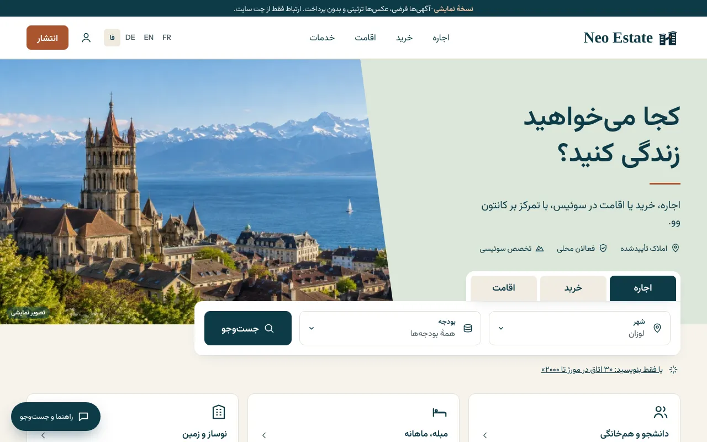

[English](real-estate.md) · [Français](real-estate.fr.md) · [فارسی](real-estate.fa.md)

# Neo Estate

**The complete real-estate platform: rent, buy, stay, build.**

For agencies, owners and hosts: listings verified before they go live, search that explains every result, bookable short stays, building pros on quotes. All contact goes through the site’s messaging; no phone number is shown. Four languages (FR, EN, DE, Persian), installable as an app (PWA). Demo for the canton of Vaud, with an optional Canada market.

**Live demo:** https://real.likenic.com/ (not indexed)

| Desktop | Phone |
|---|---|
|  |  |

## Features, screen by screen
_Screens from the live demo; listings, names and photos are fictitious (illustrations)._

1. **Rent, buy or stay from the home page** — city and budget, shortcuts for students & flatshares, furnished monthly, new builds & land, parking, lowest rents. 
2. **Results that say why** — each result explains its rank; unknown charges never count as “cheapest”; saved searches with e-mail alerts. 
3. **Verified listing, no exact address** — what was checked and when, detailed price, approximate area, viewing slots, one-click report. 
4. **Short stays at the total price** — flexible dates, themes, instant booking, weekly/monthly and last-minute discounts, side-by-side compare. 
5. **Works, materials, moving** — one request, up to 5 quotes from verified local companies, one accepted. 
6. **One space per role** — private person, owner, agency (branches, advisers, CSV import, dashboard), host or hotel, building professional, each with its own documents. 
7. **Persian too, right to left** — every screen in FR, EN, DE and Persian, written for each language. 

Under the hood: WordPress + Elementor, custom theme, independent theme-core plugin and one module per domain, each switchable without code; switching theme loses no data; local rules applied only after human review of an official source; no online payment in this demo.
