

[English](restaurant.md) · [Français](restaurant.fr.md) · [فارسی](restaurant.fa.md)

# LikeServic Restaurant

**سفارش سر میز، بیرون‌بر و رزرو میز.**

مهمان کد QR روی میز را اسکن می‌کند، غذا را با شماره و عکس انتخاب می‌کند و سفارش به‌صورت فیش در آشپزخانه چاپ می‌شود. رزرو، بیرون‌بر و لینک ارسال در یک جا. در رستوران کارون در حال استفاده است.

**دموی آنلاین:** https://restaurant-karun.ch/  
**صفحهٔ محصول در NeoLivis:** https://neo.likenic.com/fa/product/likeservic-restaurant-fa/

## تصاویر

| کامپیوتر | موبایل |
|---|---|
| 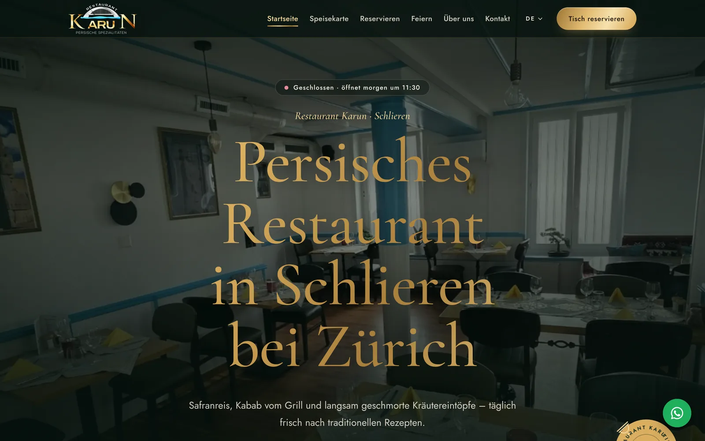 | 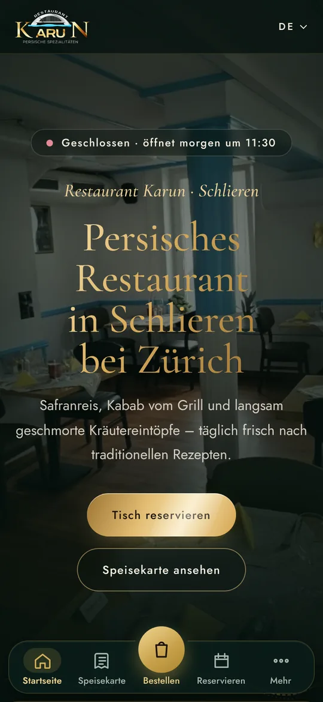 |

## امکانات، صفحه به صفحه

_همهٔ تصویرهای زیر از سایت فعال مشتری گرفته شده._

### 1. الان باز است یا نه

صفحهٔ اول از روی ساعات کاری نشان می‌دهد رستوران همین حالا باز است و تا چه ساعتی. رزرو میز با یک کلیک.

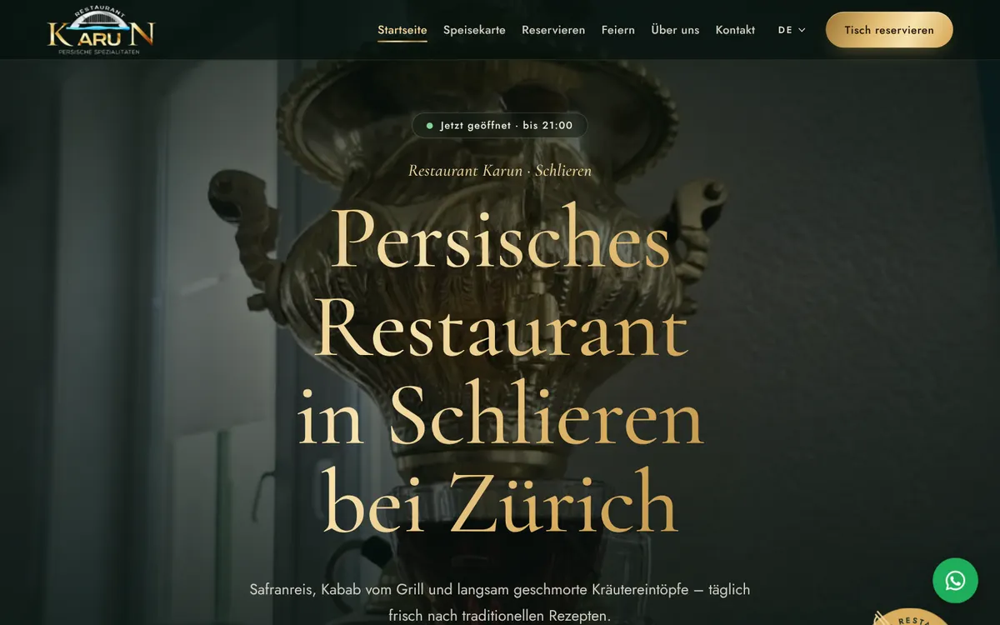

### 2. منوی هفتگی و منوی کامل

غذای مخصوص هر روز با عکس، شماره و قیمت، روزهای تعطیل مشخص، و بعد منوی کامل بر اساس دسته.

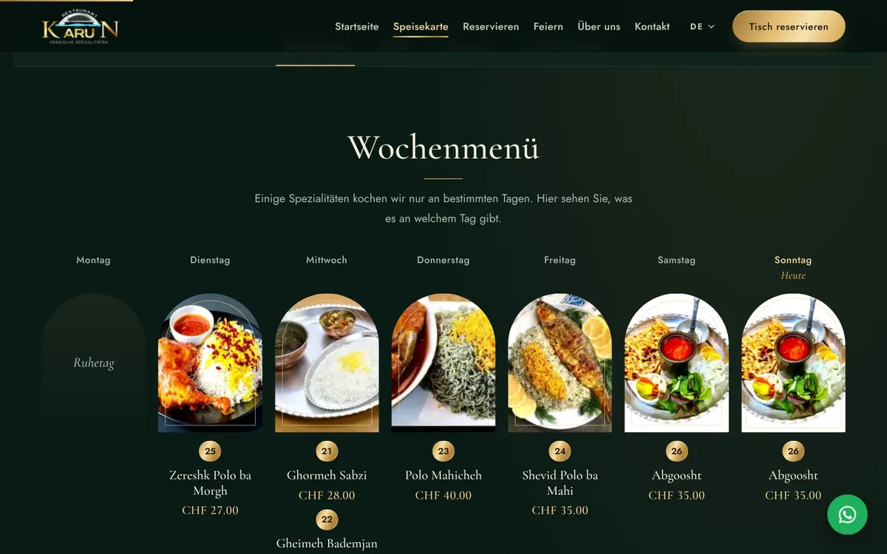

### 3. درخواست رزرو میز

ساعت‌ها بعد از انتخاب تاریخ و بر اساس ساعات کاری نشان داده می‌شوند. رستوران با ایمیل تأیید می‌کند؛ گروه‌های بیشتر از ده نفر تماس می‌گیرند.

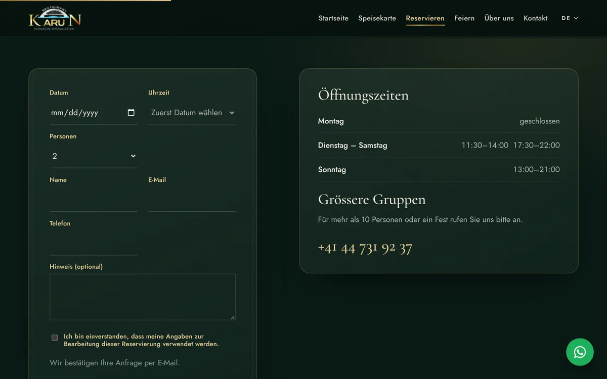

### 4. سفارش بیرون‌بر

صفحهٔ سفارش جداگانه با دسته‌ها، شمارهٔ غذا و قیمت؛ مناسب گوشی و کد QR روی میزها.

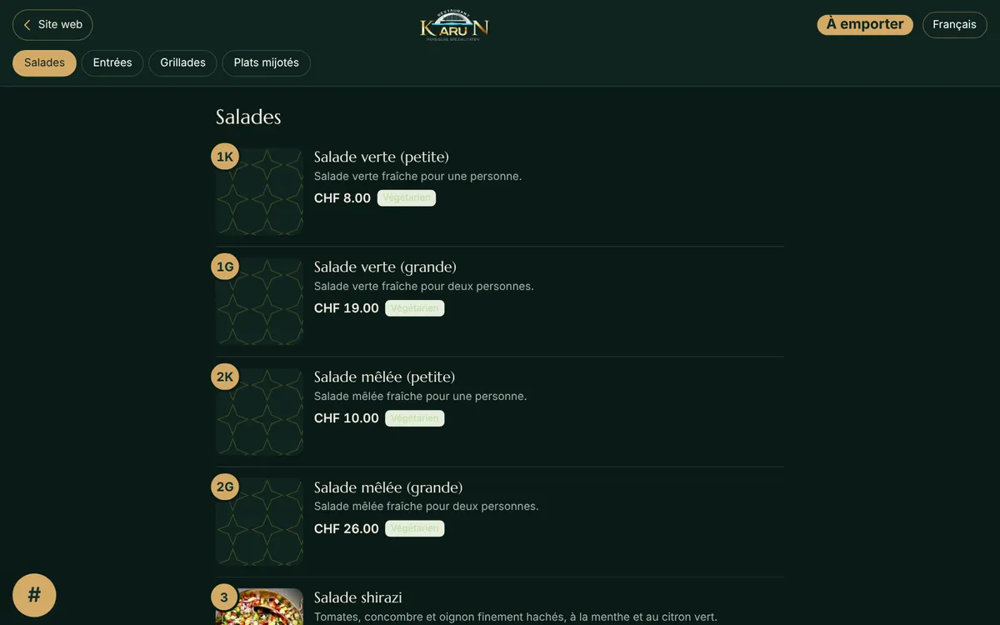

### 5. درخواست مراسم و کترینگ

تولد، عروسی، مهمانی شرکت، کترینگ… مهمان تاریخ و تعداد نفرات را می‌دهد، رستوران تماس می‌گیرد و پیشنهاد کتبی می‌فرستد.

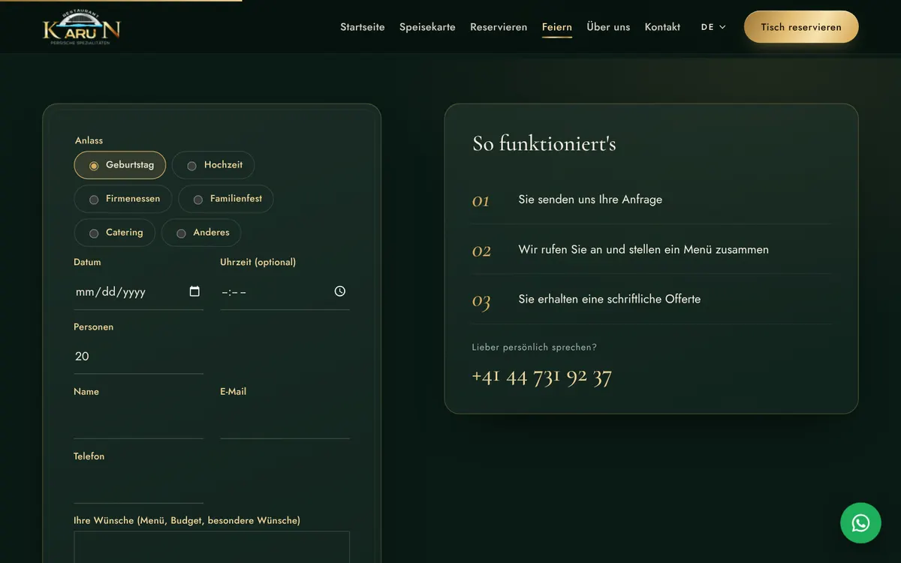

### 6. صفحه‌های محلی برای هر زبان

صفحه‌هایی مثل کترینگ ایرانی در زوریخ، غذای حلال یا بیرون‌بر در شلیرن که برای هر زبان جداگانه نوشته شده‌اند.

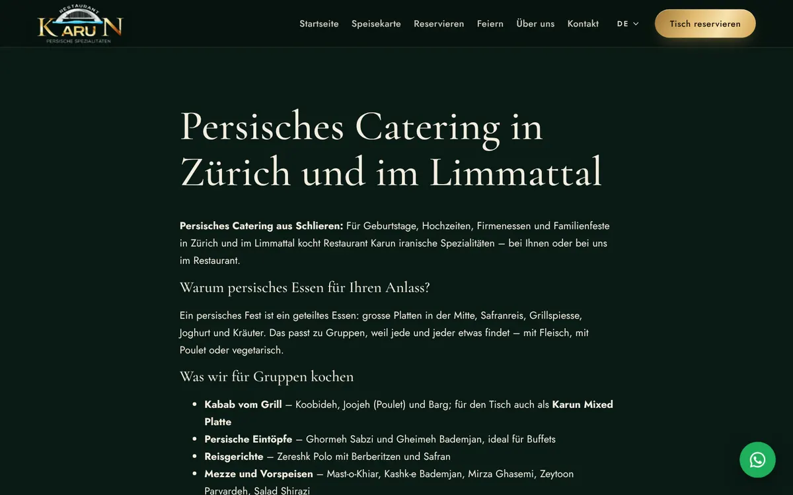

### 7. مقاله دربارهٔ غذا

مقاله‌های کوتاه مثل غذاهای ایرانی که باید بشناسید یا غذای گیاهی ایرانی که از موتور جستجو بازدیدکننده به منو می‌آورند.

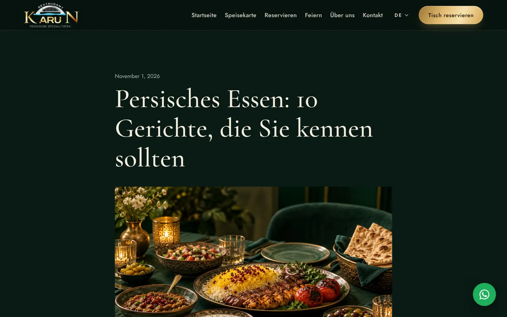

### 8. همهٔ راه‌های تماس

واتساپ، تلفن، ایمیل و مسیر کنار هم، فرم کوتاه تماس، آدرس و ساعات کاری.

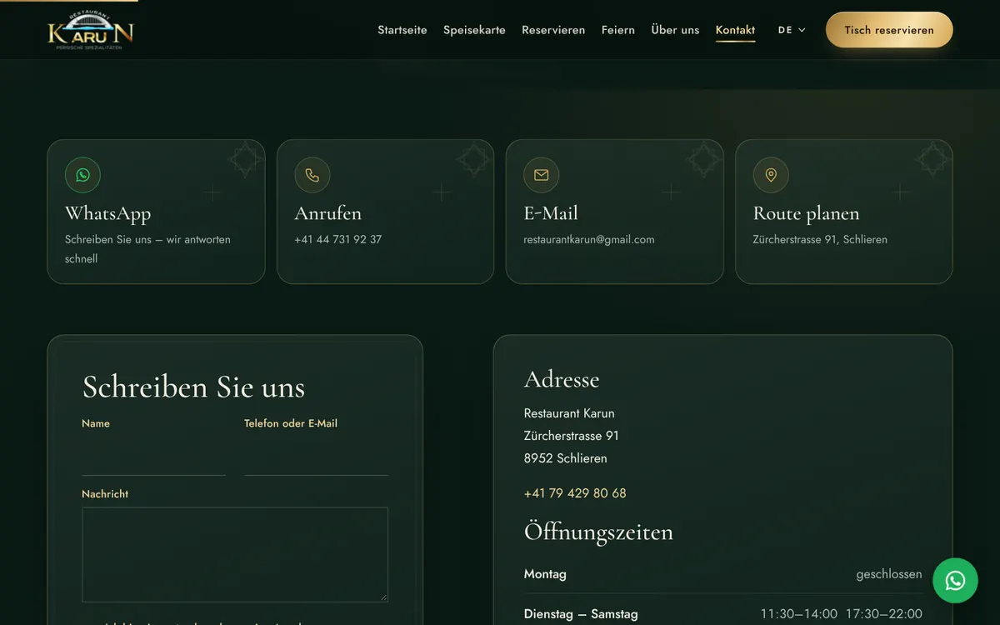

### 9. پنج زبان، عربی راست‌به‌چپ

آلمانی، فرانسوی، انگلیسی، ایتالیایی و عربی.

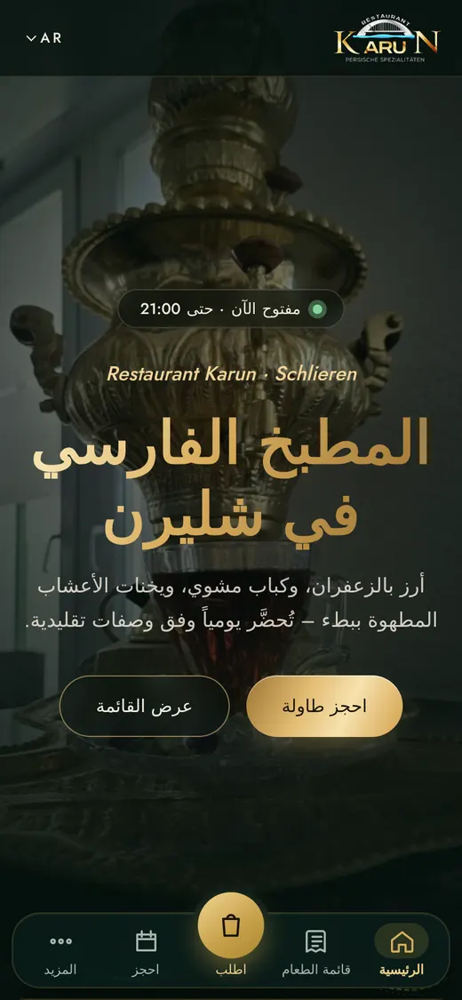

### 10. ناوبری روی گوشی

نوار پایین با دکمهٔ سفارش در وسط، کنار منو، رزرو و بقیهٔ بخش‌ها.

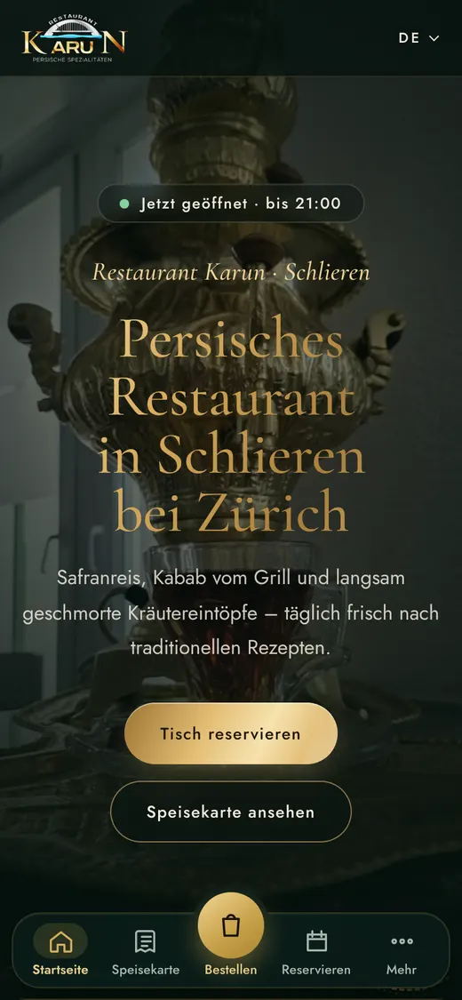

---

کد منبع خصوصی است و هر نصب برای همان مشتری انجام می‌شود. اگر کارم را ارزیابی می‌کنید، برای دیدن کد درخواست دسترسی بدهید.

[← بازگشت به پروفایل](../README.md)

