[English](restaurant.md) · [Français](restaurant.fr.md) · [فارسی](restaurant.fa.md)

# LikeServic Restaurant

**Commande à table, à l’emporter et réservation.**

Le client scanne le QR code de sa table, choisit ses plats par numéro et photo, et la commande sort en cuisine sur un ticket. Réservation, vente à l’emporter et lien de livraison au même endroit. En ligne chez le Restaurant Karun.

**Démo en ligne:** https://restaurant-karun.ch/  
**Page produit sur NeoLivis:** https://neo.likenic.com/product/likeservic-restaurant/

## Captures d’écran

| Ordinateur | Téléphone |
|---|---|
| 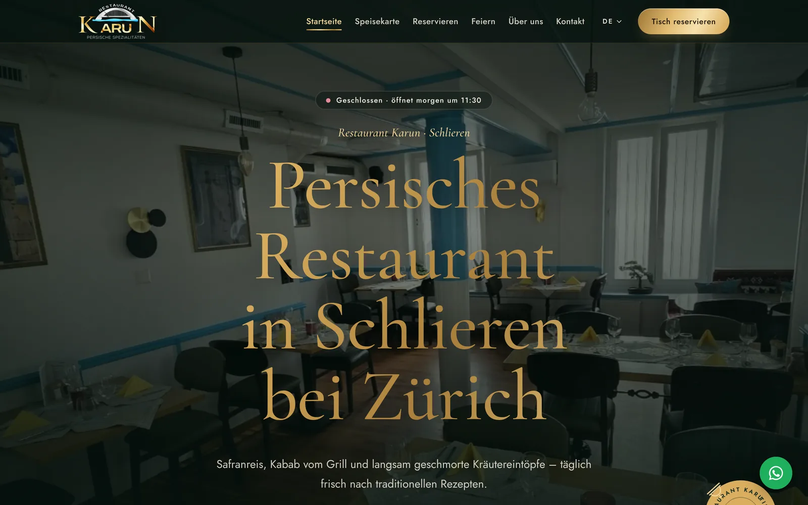 | 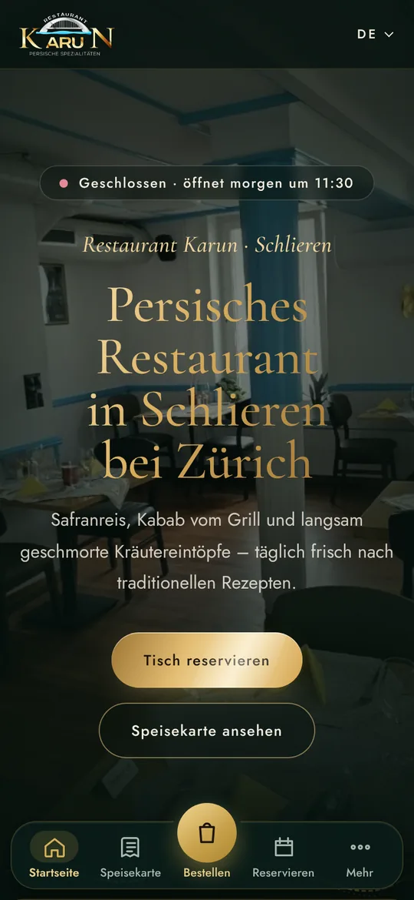 |

## Les fonctionnalités, écran par écran

_Chaque capture provient du site en ligne du client._

### 1. Ouvert en ce moment – ou pas

L’accueil indique si le restaurant est ouvert et jusqu’à quelle heure, calculé à partir des horaires. La réservation est à un clic.

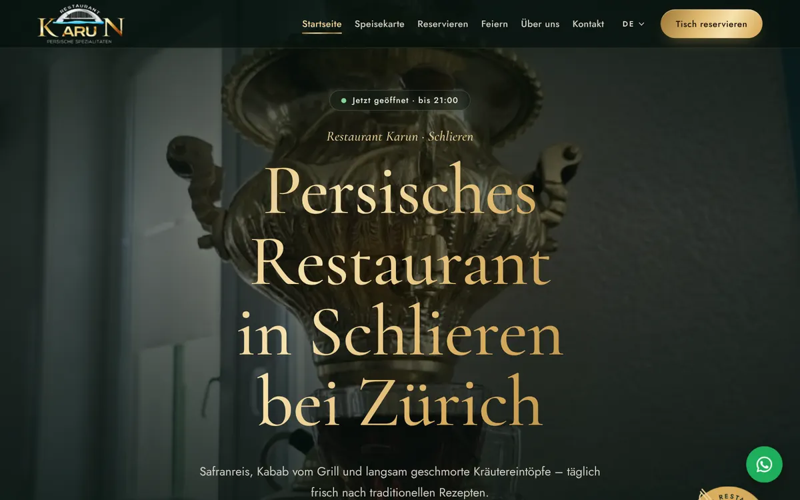

### 2. Menu de la semaine et carte

Les plats du jour, jour par jour, avec photo, numéro et prix, les jours de fermeture indiqués, puis toute la carte par catégorie.

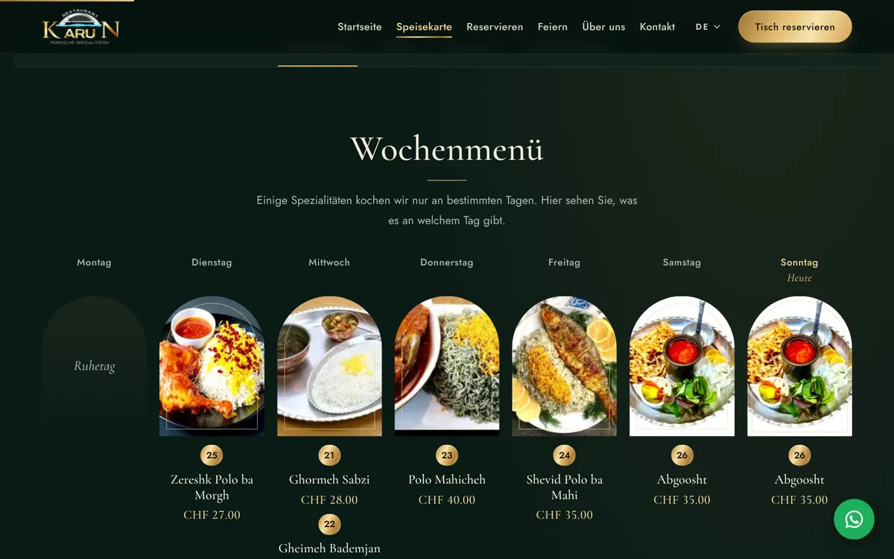

### 3. Demande de réservation

Les heures ne s’affichent qu’après le choix de la date et suivent les horaires. Le restaurant confirme par e-mail ; au-delà de dix personnes, on appelle.

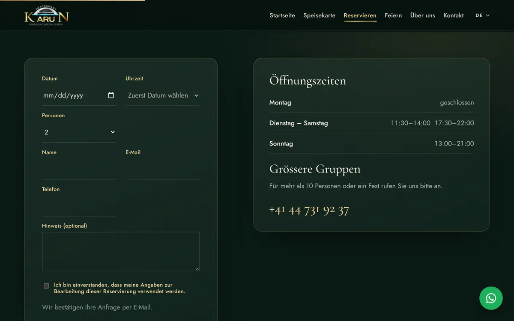

### 4. Commande à emporter

Un écran de commande séparé avec catégories, numéros de plats et prix, pensé pour le téléphone et pour les QR codes des tables.

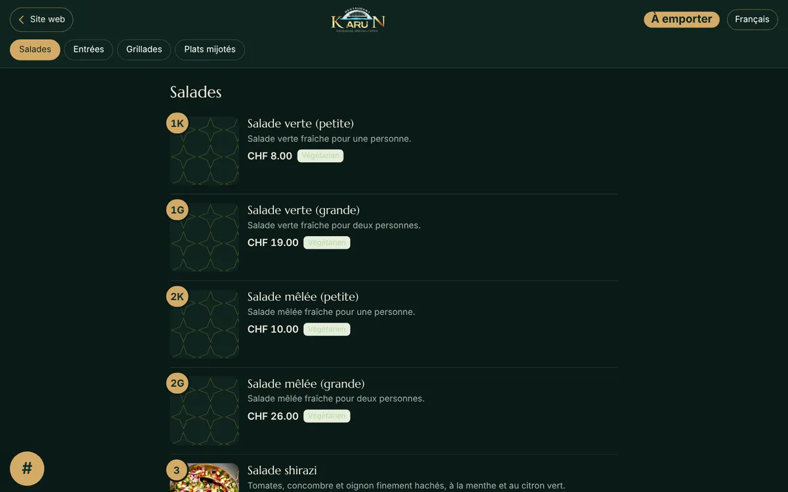

### 5. Événements et traiteur

Anniversaire, mariage, repas d’entreprise, traiteur… Le client indique la date et le nombre de personnes, le restaurant rappelle et envoie une offre écrite.

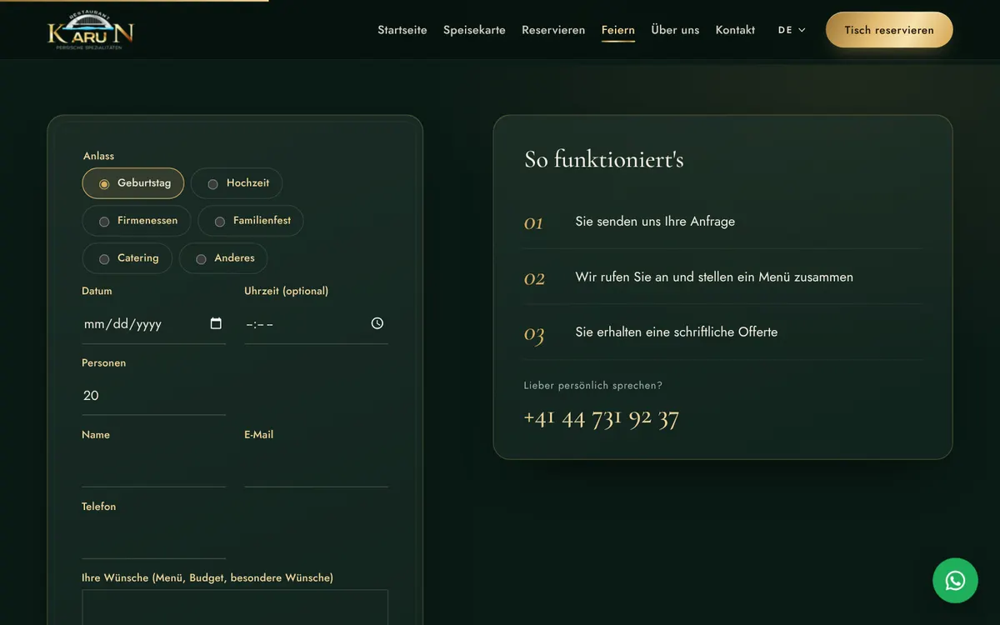

### 6. Pages locales écrites pour chaque langue

Des pages comme traiteur persan à Zurich, cuisine halal ou plats à emporter à Schlieren, écrites séparément dans chaque langue pour ceux qui les cherchent.

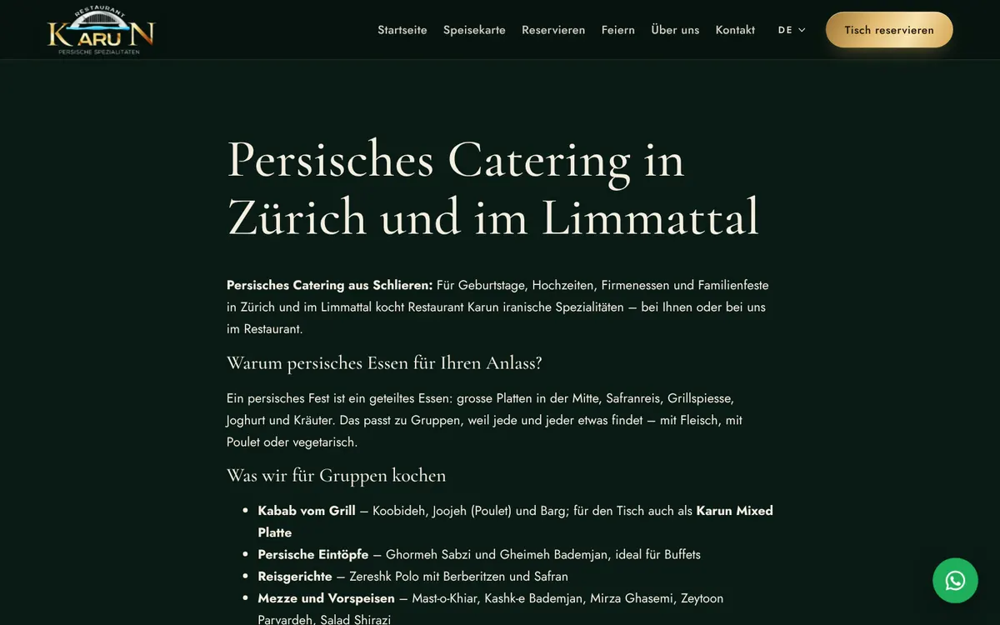

### 7. Articles sur la cuisine

De courts articles – plats persans à connaître, cuisine persane végétarienne – qui amènent les visiteurs des moteurs de recherche vers la carte.

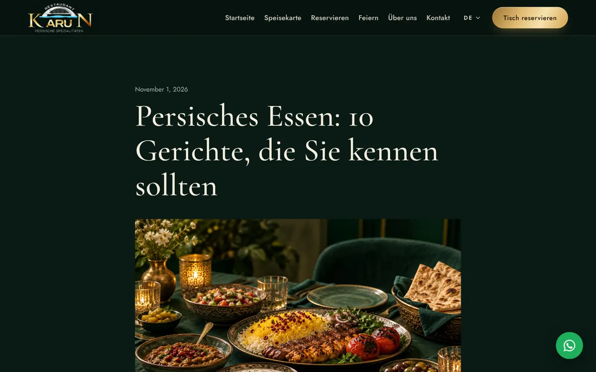

### 8. Tous les moyens de contact

WhatsApp, téléphone, e-mail et itinéraire côte à côte, un formulaire court, l’adresse et les horaires.

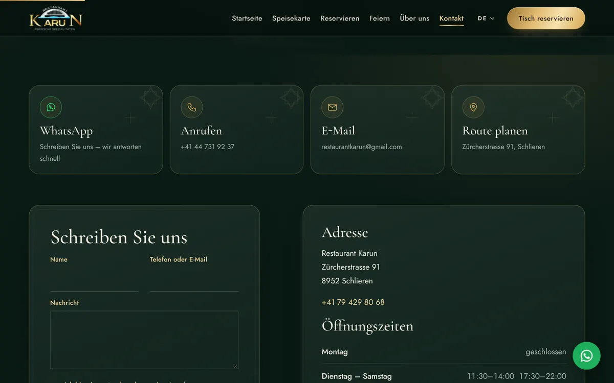

### 9. Cinq langues, l’arabe de droite à gauche

Allemand, français, anglais, italien et arabe.

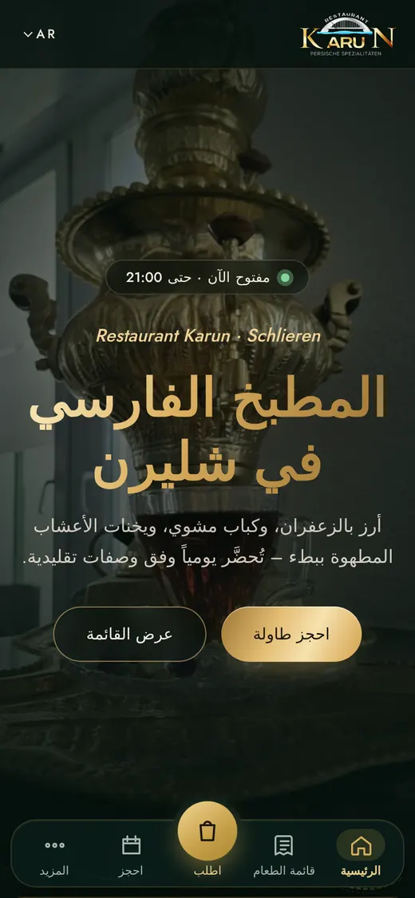

### 10. Navigation sur téléphone

Une barre en bas avec le bouton de commande au centre, à côté de la carte, de la réservation et du reste.

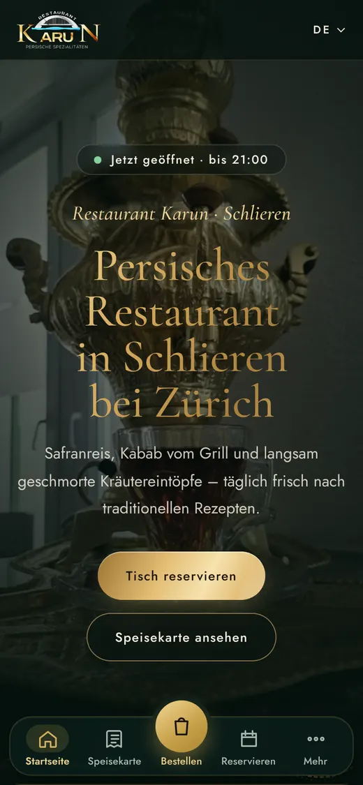

---

Le code source est privé : chaque installation est faite pour le client. Demandez un accès au code si vous évaluez mon travail.

[← Retour au profil](../README.md)
