[English](restaurant.md) · [Français](restaurant.fr.md) · [فارسی](restaurant.fa.md)

# LikeServic Restaurant

**Table ordering, takeaway and bookings.**

Guests scan the QR code on their table, choose dishes by number and photo, and the order prints in the kitchen. Bookings, takeaway and your delivery link in one place. Running at Restaurant Karun.

**Live demo:** https://restaurant-karun.ch/  
**Product page on NeoLivis:** https://neo.likenic.com/en/product/likeservic-restaurant-en/

## Screenshots

| Computer | Phone |
|---|---|
| 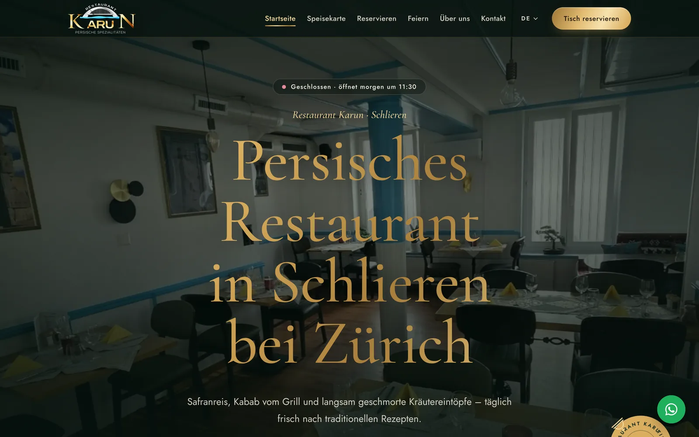 | 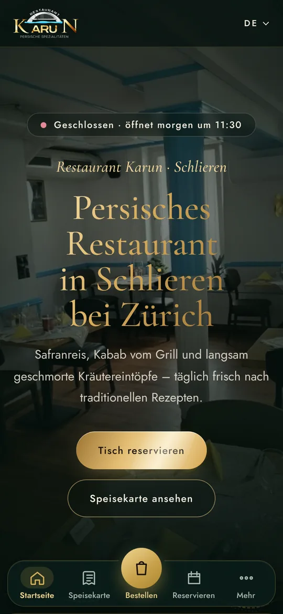 |

## Features, screen by screen

_Every screenshot below comes from the client’s live website._

### 1. Open now – or not

The home page shows whether the restaurant is open right now and until when, worked out from the opening hours. Reservation is one tap away.

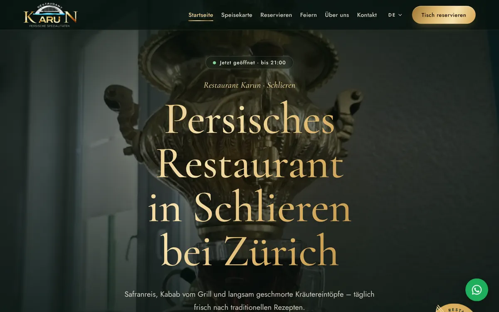

### 2. Weekly menu and full menu

Day-by-day specials with photo, dish number and price, closed days marked, followed by the full menu by category.

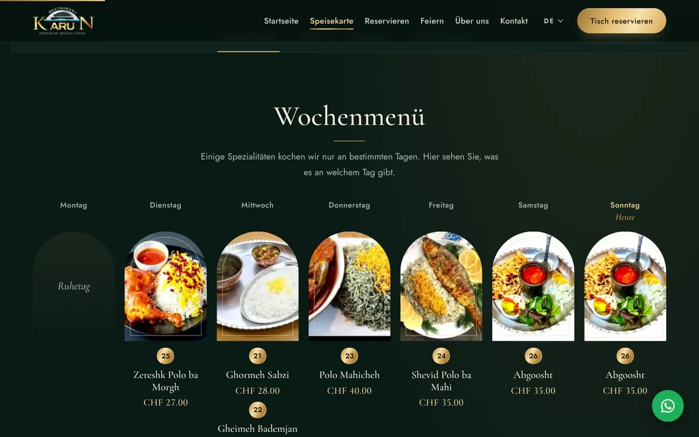

### 3. Table reservation request

Times are offered only once a date is chosen and follow the opening hours. The restaurant confirms by email; groups over ten people are asked to call.

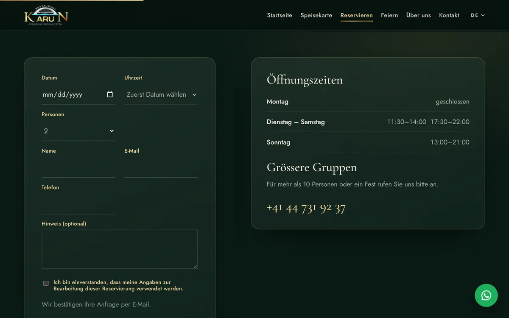

### 4. Takeaway ordering

A separate ordering screen with categories, dish numbers and prices, built for the phone and for the QR codes on the tables.

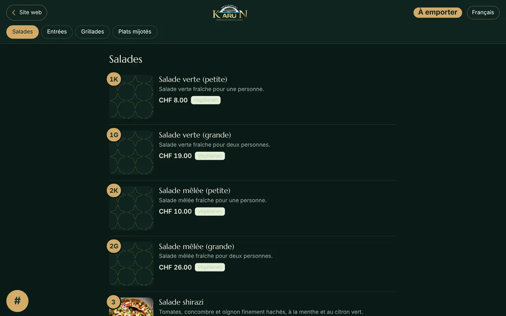

### 5. Events and catering requests

Birthday, wedding, company dinner, catering… The guest gives the date and number of people, the restaurant calls back and sends a written offer.

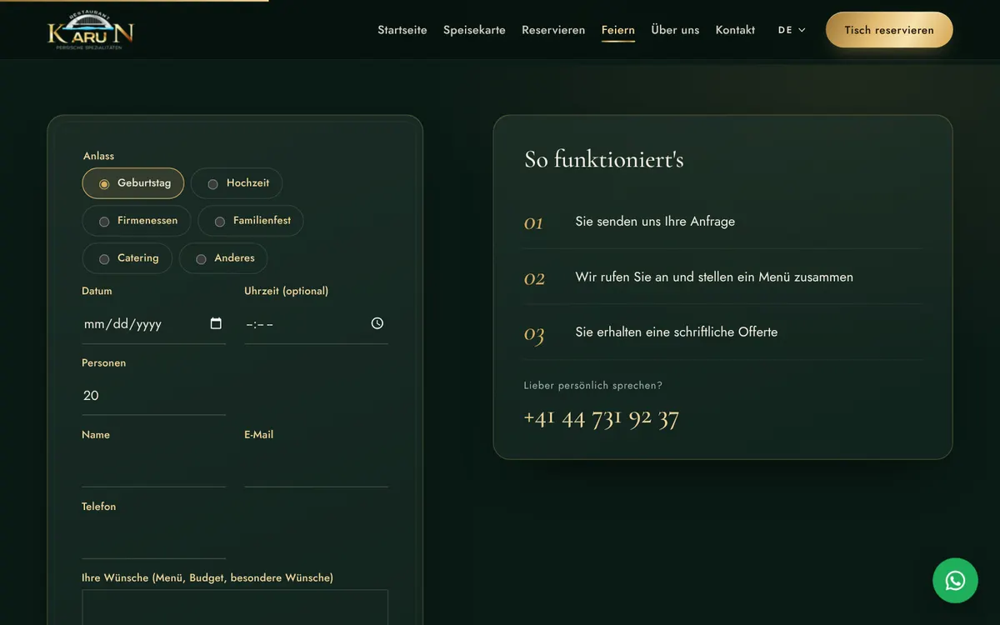

### 6. Local pages written for each language

Pages such as Persian catering in Zurich, halal food or takeaway in Schlieren, written separately in each language for the people who search for them.

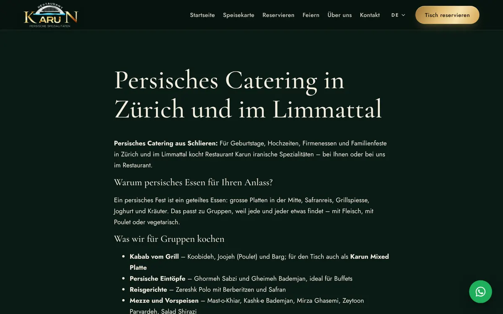

### 7. Articles about the food

Short articles – Persian dishes worth knowing, vegetarian Persian food – that bring visitors from search engines to the menu.

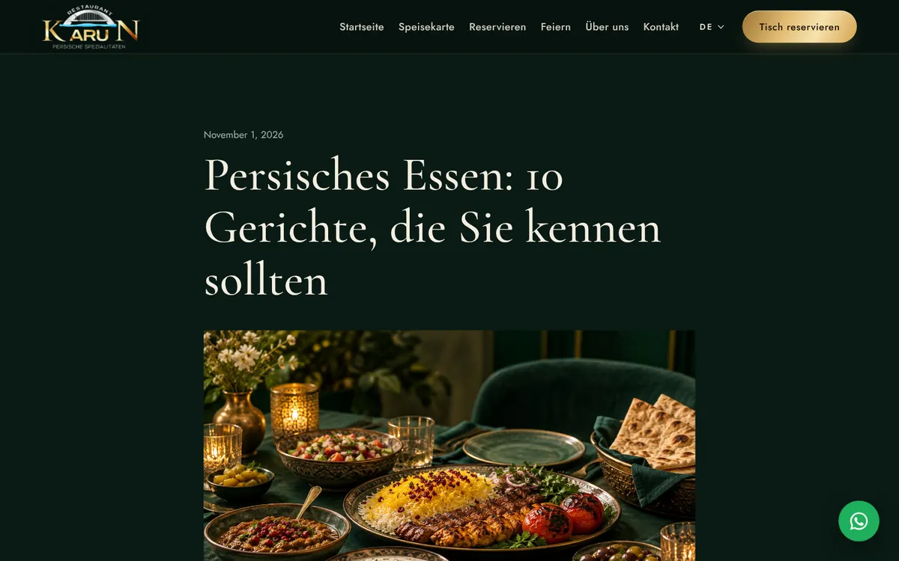

### 8. Every way to get in touch

WhatsApp, phone, email and directions side by side, a short contact form, the address and the opening hours.

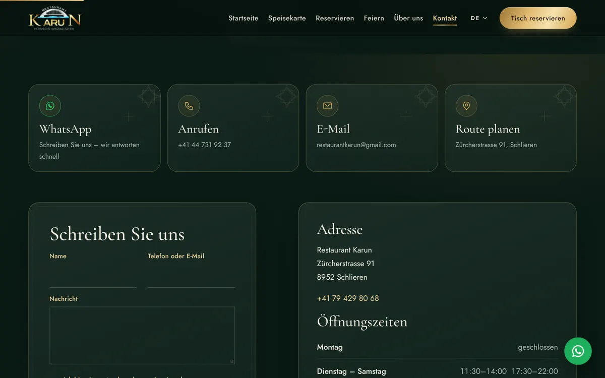

### 9. Five languages, Arabic right to left

German, French, English, Italian and Arabic.

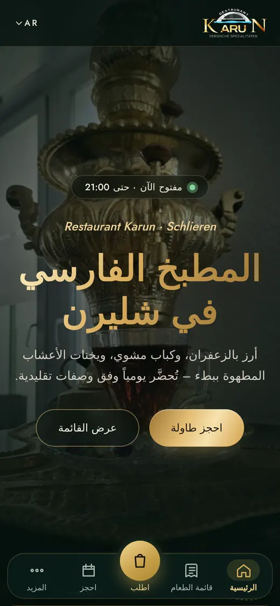

### 10. Phone navigation

A bottom bar with the order button in the middle, next to menu, reservation and more.

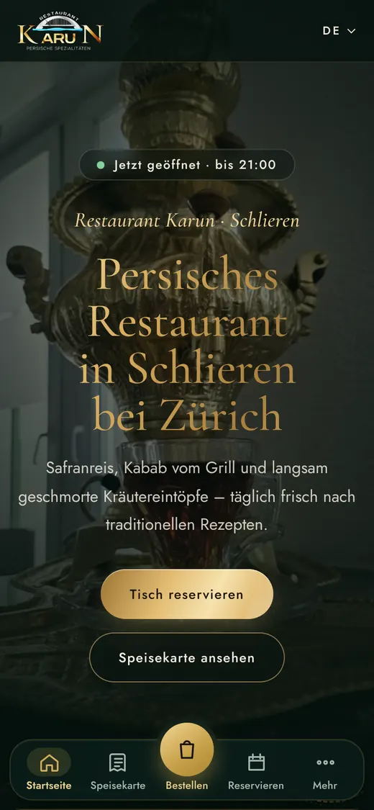

---

Source code is private: every installation is set up for the client. Ask for access to the code if you are evaluating my work.

[← Back to the profile](../README.md)
