

[English](surgery-practice.md) · [Français](surgery-practice.fr.md) · [فارسی](surgery-practice.fa.md)

# Sense Med

**سایتی آرام و روشن برای جراح و مرکز جراحی.**

سایتی برای مطب جراحی که عمل‌ها را ساده توضیح می‌دهد، مسیر بیمار را از ویزیت اول تا مراقبت بعدی نشان می‌دهد و دکمهٔ نوبت را همیشه در دسترس نگه می‌دارد. سه سبک طراحی، چهار زبان.

**دموی آنلاین:** https://med.likenic.com/  
**صفحهٔ محصول در NeoLivis:** https://neo.likenic.com/fa/product/sense-med-fa/

## تصاویر

| کامپیوتر | موبایل |
|---|---|
| 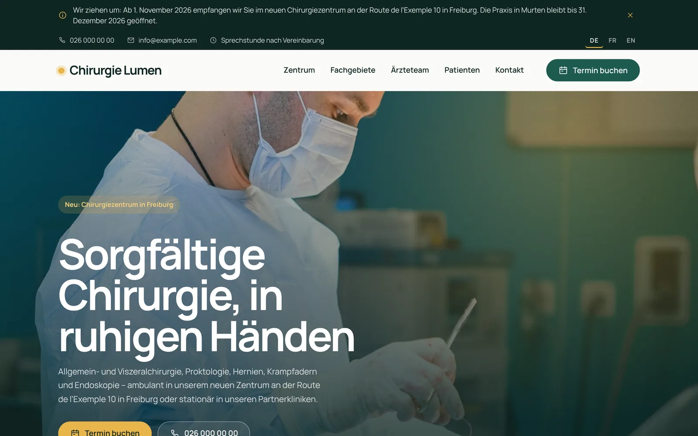 | 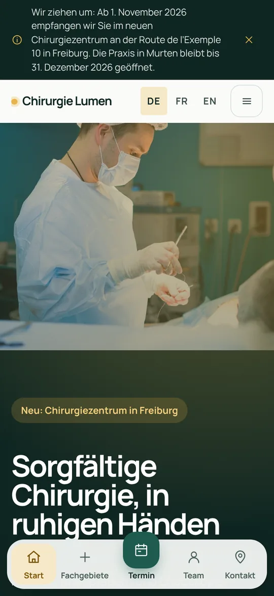 |

## امکانات، صفحه به صفحه

_همهٔ تصویرهای زیر از دموی آنلاین گرفته شده؛ نام‌ها، آدرس‌ها و افراد در دموها ساختگی هستند._

### 1. صفحهٔ اول آرام و روشن

تخصص‌ها، تیم و نوبت در یک نگاه، به آلمانی، فرانسوی و انگلیسی. نوار اطلاع‌رسانی خبرهایی مثل انتقال به مرکز جدید را نشان می‌دهد و بسته می‌شود.

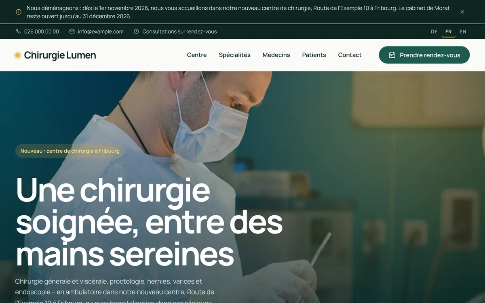

### 2. نمای کلی تخصص‌ها

فتق، پروکتولوژی، واریس، آندوسکوپی، جراحی لاپاراسکوپی و تیروئید؛ هر کدام با خلاصه و صفحهٔ جداگانه.

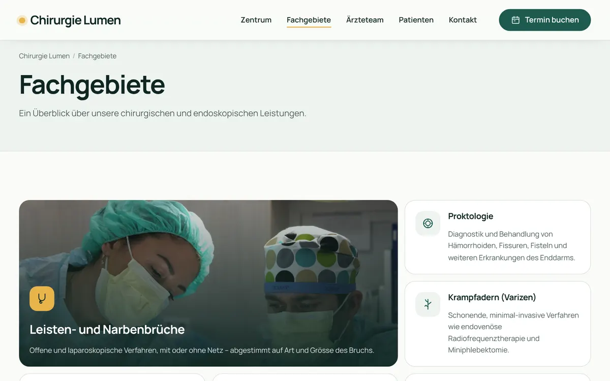

### 3. صفحهٔ هر عمل جراحی

بیماری چیست، چطور درمان می‌شود، سرپایی است یا با بستری، و کادر نوبت کنار متن.

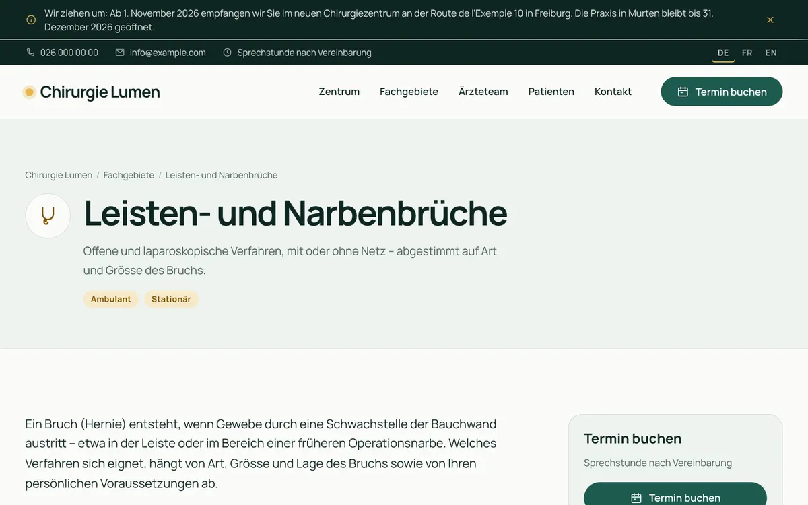

### 4. تیم به تفکیک رشته

جراحی، گوارش و بیهوشی؛ هر پزشک با کارتی که به پروفایلش می‌رود.

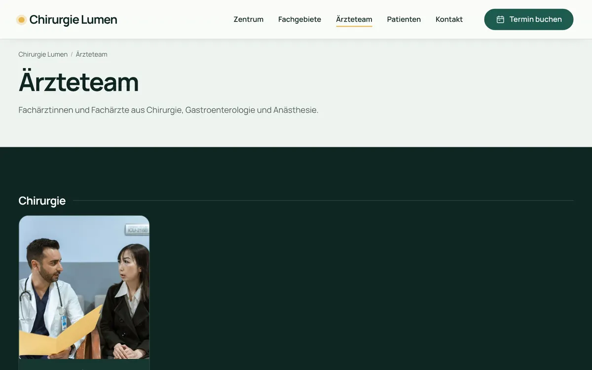

### 5. پروفایل پزشک

عنوان تخصص، حوزه‌های کاری، زبان‌ها و دکمهٔ تماس مستقیم.

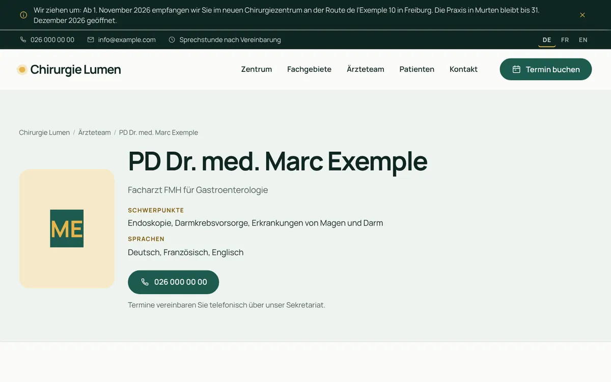

### 6. مسیر بیمار در چهار مرحله

نوبت، اولین مشاوره، عمل، پیگیری؛ و تفاوت‌ها در حالت سرپایی، بستری و اورژانس.

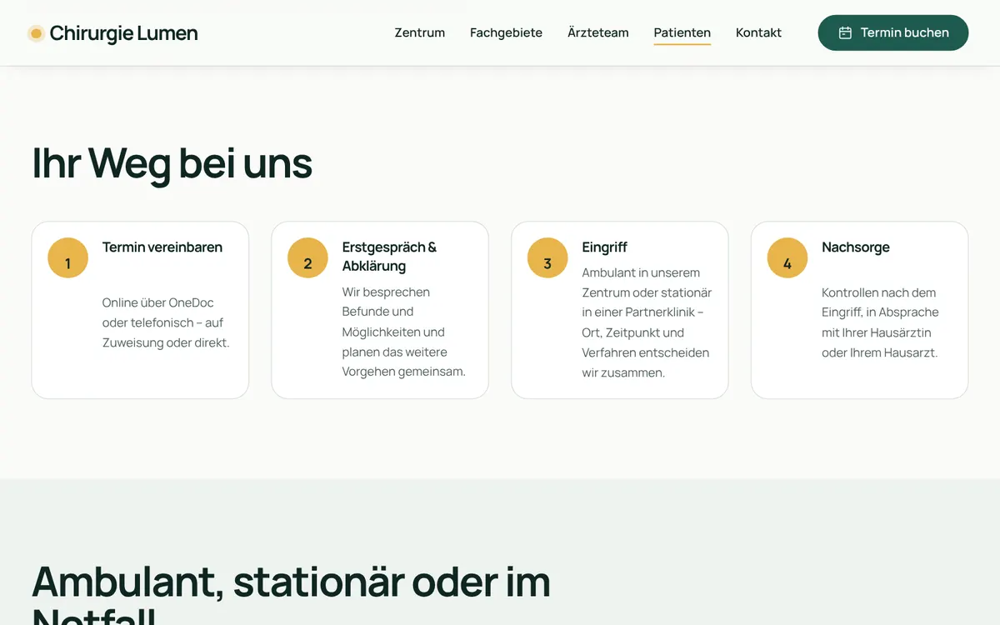

### 7. معرفی مرکز

صفحه‌ای برای معرفی مرکز جراحی: اتاق عمل، آندوسکوپی و ریکاوری.

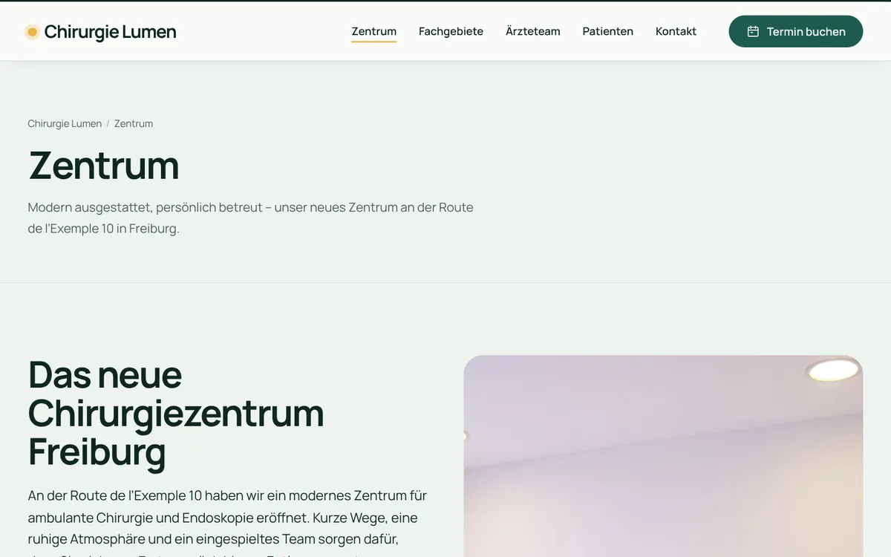

### 8. تماس و نوبت

نوبت آنلاین از طریق سرویس نوبت‌دهی مطب یا تلفنی در ساعات کاری.

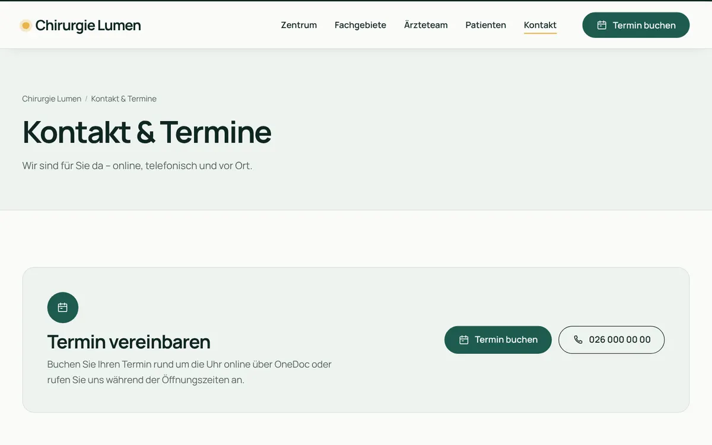

### 9. ناوبری شبیه اپلیکیشن روی گوشی

نوار پایین با خانه، تخصص‌ها، نوبت، تیم و تماس.

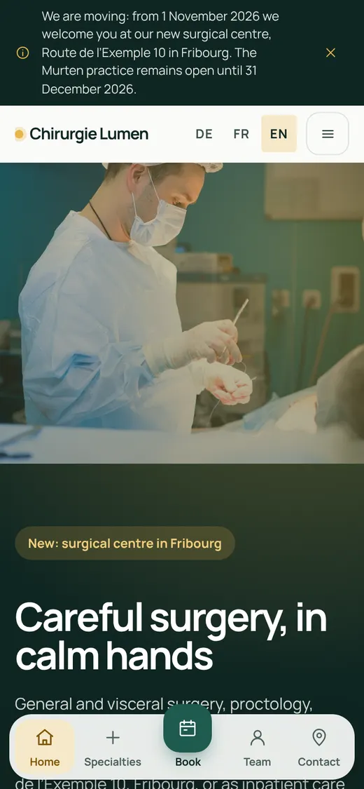

---

کد منبع خصوصی است و هر نصب برای همان مشتری انجام می‌شود. اگر کارم را ارزیابی می‌کنید، برای دیدن کد درخواست دسترسی بدهید.

[← بازگشت به پروفایل](../README.md)

