[English](surgery-practice.md) · [Français](surgery-practice.fr.md) · [فارسی](surgery-practice.fa.md)

# Sense Med

**Site de chirurgien ou de centre chirurgical, rassurant et clair.**

Un site pour cabinet de chirurgie qui explique les interventions simplement, montre le parcours du patient de la consultation au suivi, et met la prise de rendez-vous partout. Trois styles au choix, quatre langues.

**Démo en ligne:** https://med.likenic.com/  
**Page produit sur NeoLivis:** https://neo.likenic.com/product/sense-med/

## Captures d’écran

| Ordinateur | Téléphone |
|---|---|
| 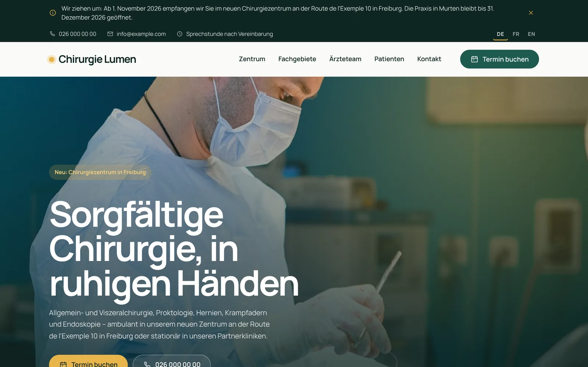 | 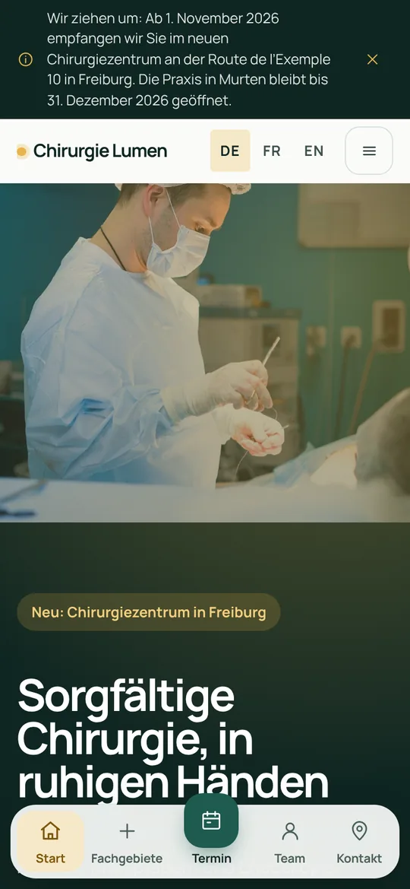 |

## Les fonctionnalités, écran par écran

_Chaque capture provient de la démo en ligne ; les noms, adresses et personnes des démos sont fictifs._

### 1. Un accueil calme et clair

Spécialités, équipe et rendez-vous d’un coup d’œil, en allemand, français et anglais. Une barre d’information annonce les nouvelles, comme un déménagement, et se ferme d’un clic.

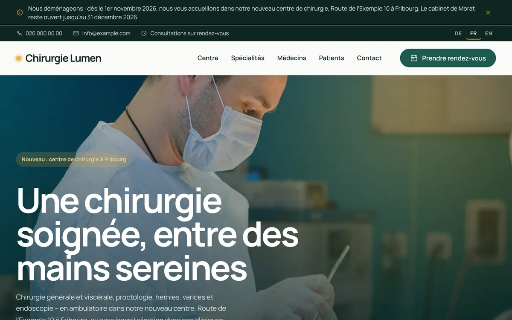

### 2. Vue d’ensemble des spécialités

Hernies, proctologie, varices, endoscopie, chirurgie laparoscopique et de la thyroïde – chacune avec un résumé et sa propre page.

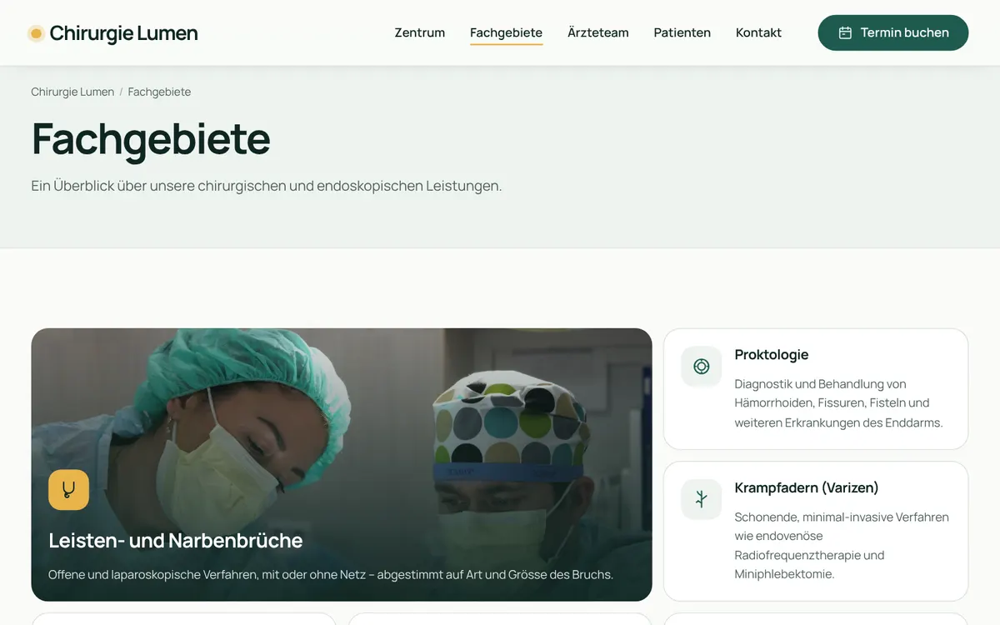

### 3. Pages d’intervention

Ce qu’est l’affection, comment on la traite, en ambulatoire ou avec hospitalisation, et un encadré de rendez-vous à côté du texte.

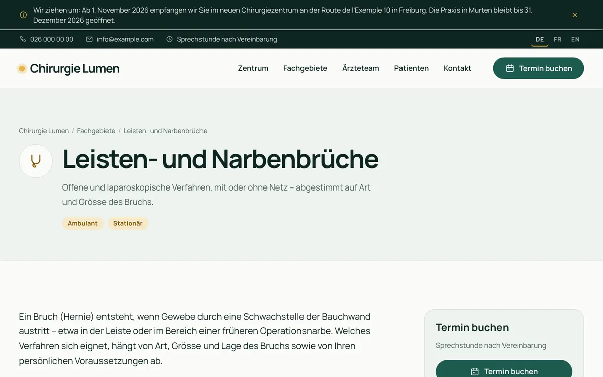

### 4. Équipe par discipline

Chirurgie, gastro-entérologie et anesthésie, chaque médecin avec une carte menant à son profil.

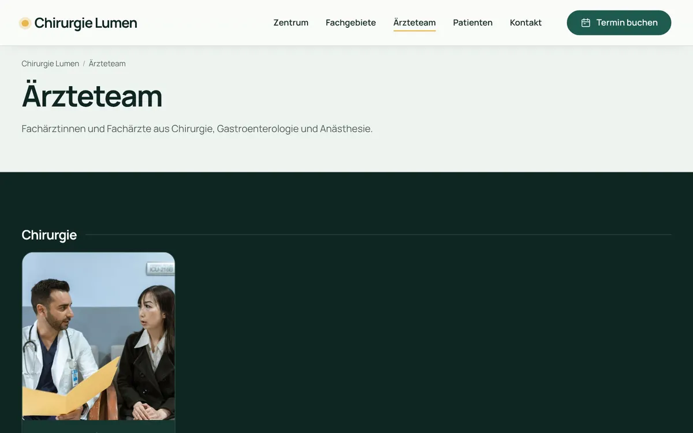

### 5. Profil du médecin

Titre de spécialiste, domaines, langues parlées et un bouton d’appel direct.

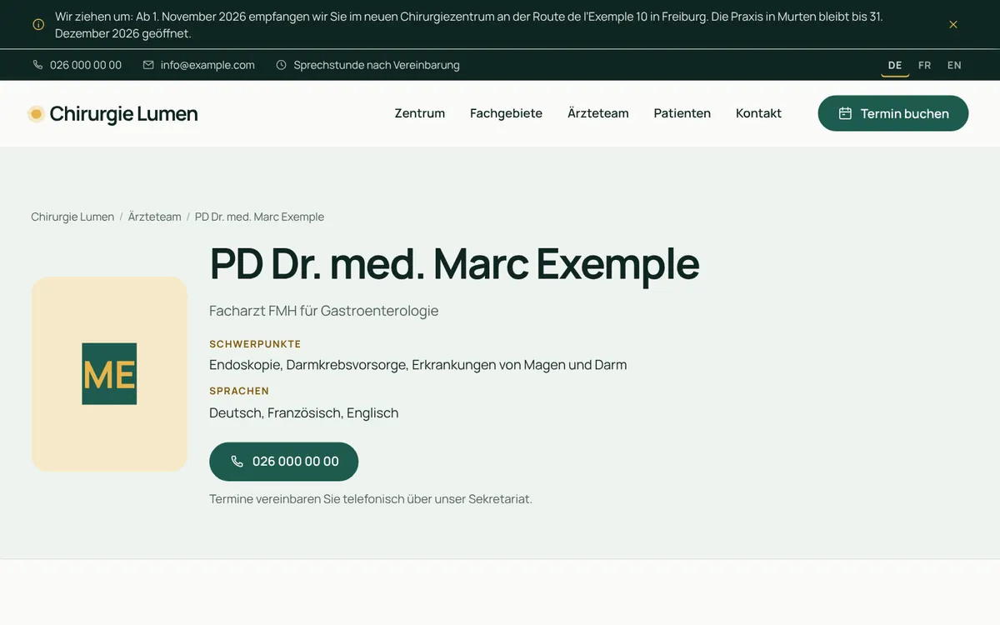

### 6. Le parcours du patient en quatre étapes

Rendez-vous, première consultation, intervention, suivi – et ce qui change en ambulatoire, en hospitalisation ou en urgence.

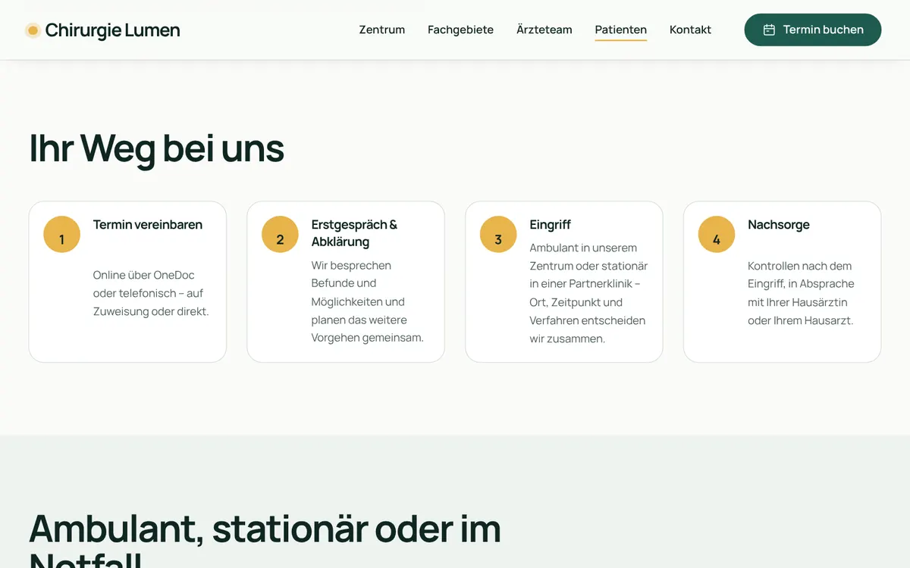

### 7. Le centre

Une page qui présente le centre de chirurgie : salles d’opération, endoscopie et salle de réveil.

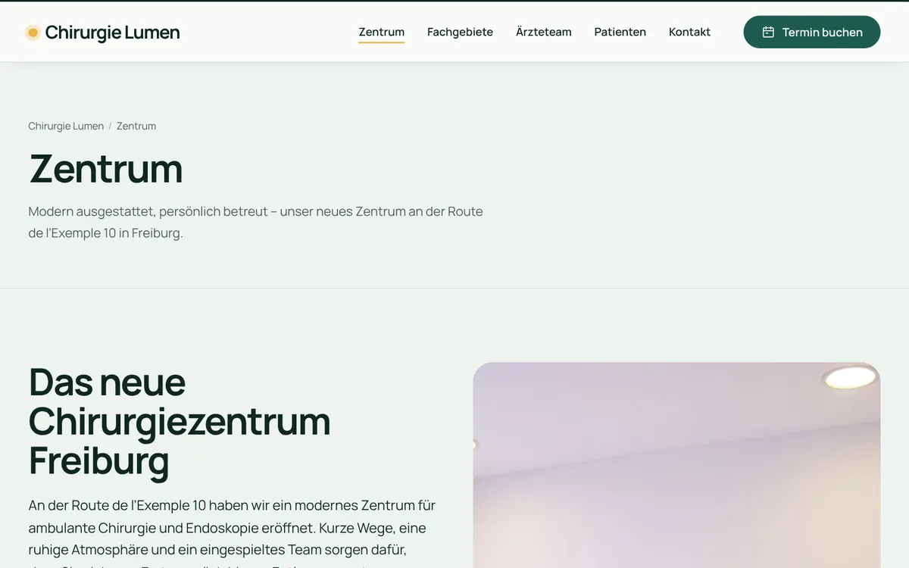

### 8. Contact et rendez-vous

Réservation en ligne via le service de rendez-vous du cabinet, ou par téléphone pendant les heures d’ouverture.

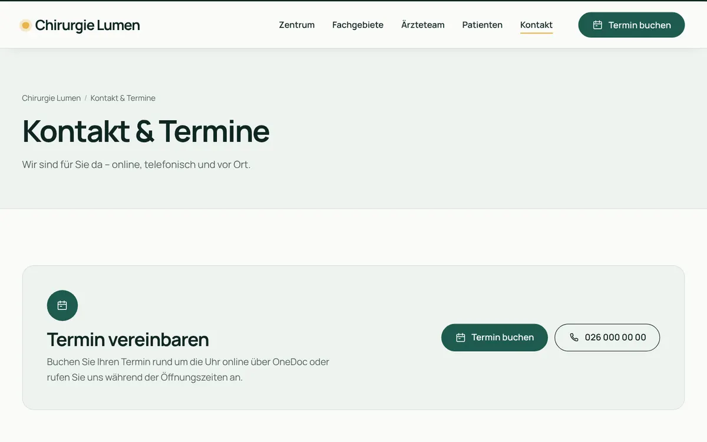

### 9. Navigation d’application sur téléphone

Une barre en bas avec accueil, spécialités, rendez-vous, équipe et contact.

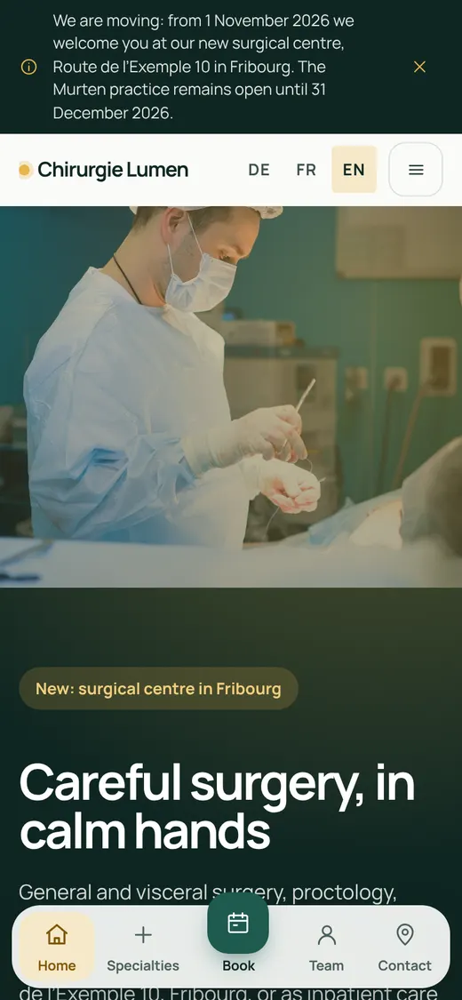

---

Le code source est privé : chaque installation est faite pour le client. Demandez un accès au code si vous évaluez mon travail.

[← Retour au profil](../README.md)
