[English](surgery-practice.md) · [Français](surgery-practice.fr.md) · [فارسی](surgery-practice.fa.md)

# Sense Med

**A calm, clear website for surgeons and surgical centres.**

A website for surgical practices that explains procedures in plain words, shows the patient journey from first visit to aftercare, and keeps the booking button within reach. Three styles to choose from, four languages.

**Live demo:** https://med.likenic.com/  
**Product page on NeoLivis:** https://neo.likenic.com/en/product/sense-med-en/

## Screenshots

| Computer | Phone |
|---|---|
| 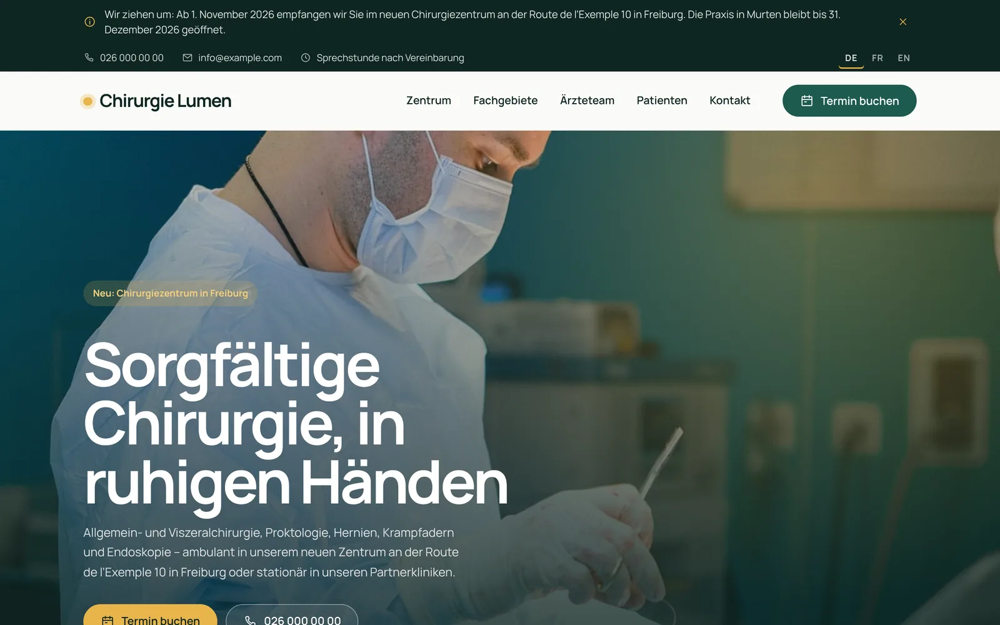 | 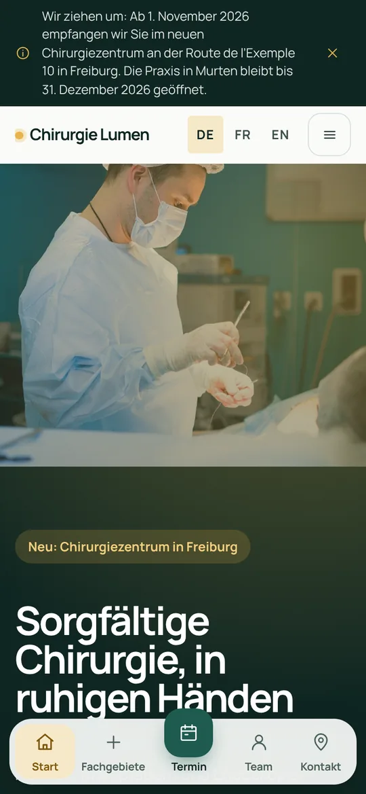 |

## Features, screen by screen

_Every screenshot below comes from the live demo; names, addresses and people on the demos are fictitious._

### 1. Calm, clear home page

Specialties, team and booking in one view, in German, French and English. A notice bar announces news such as a move to a new centre and can be closed.

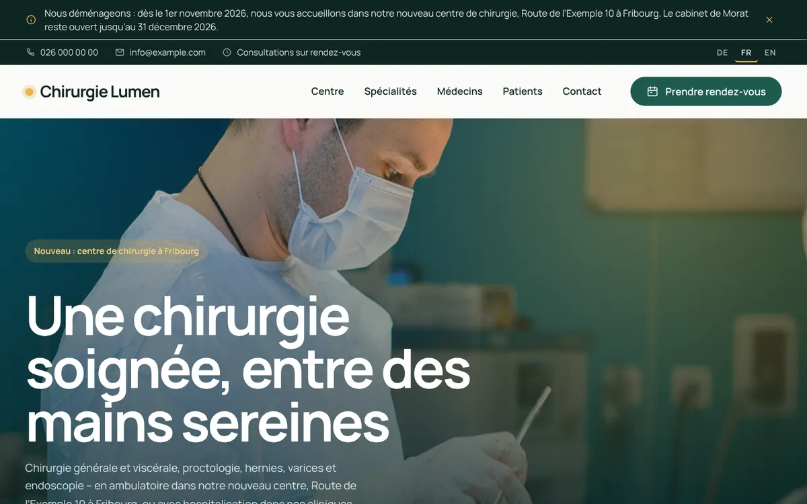

### 2. Specialties overview

Hernias, proctology, varicose veins, endoscopy, laparoscopic and thyroid surgery – each with a short summary and its own page.

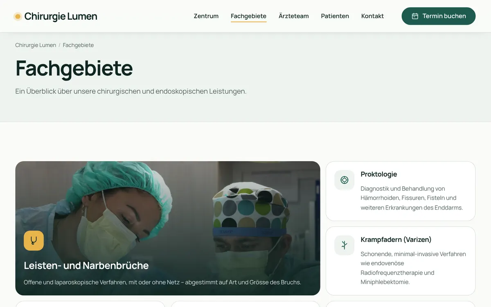

### 3. Procedure pages

What the condition is, how it is treated, whether it is outpatient or inpatient, and a booking box next to the text.

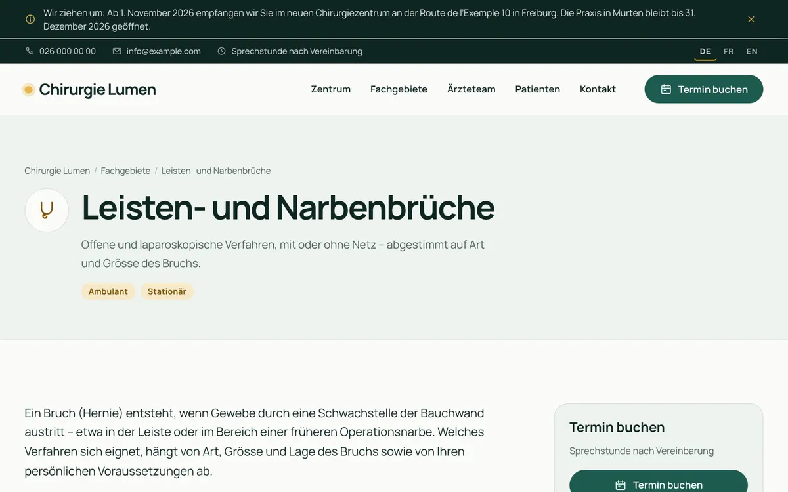

### 4. Team grouped by field

Surgery, gastroenterology and anaesthesia, each doctor with a photo card linking to the profile.

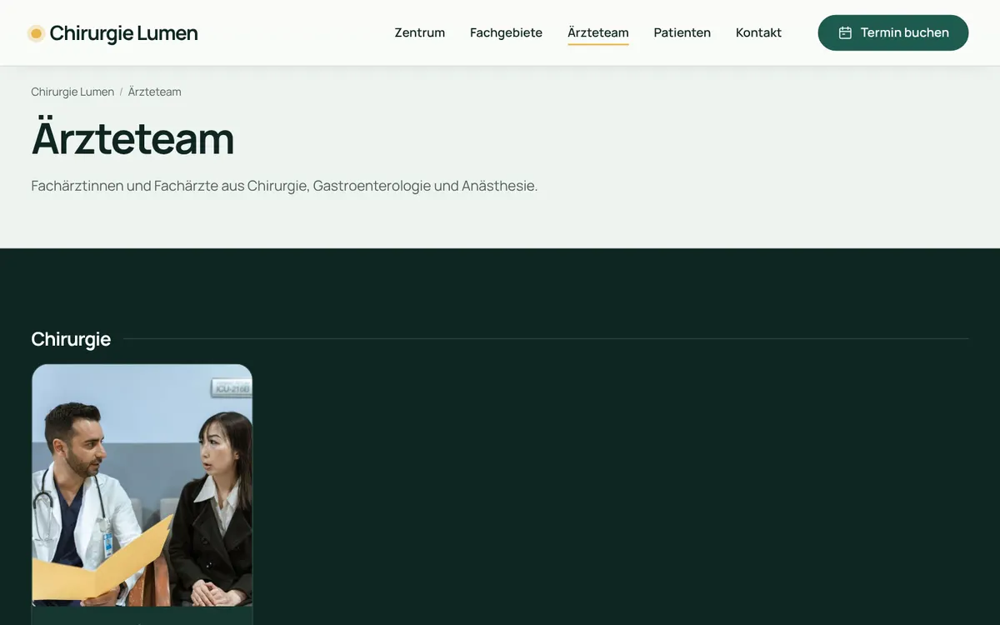

### 5. Doctor profile

Specialist title, focus areas, languages spoken and a direct phone button.

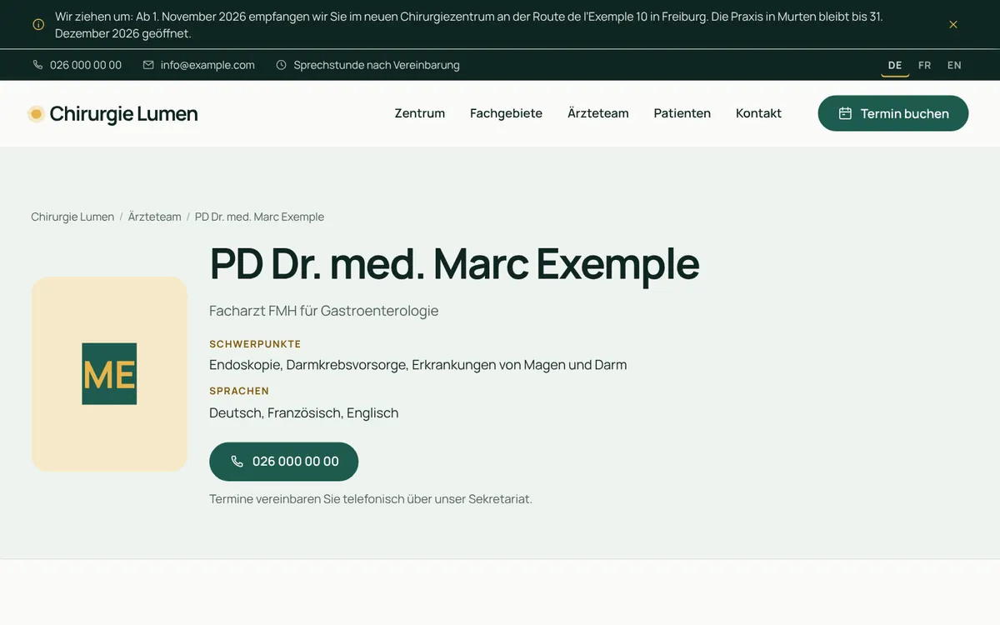

### 6. The patient’s path in four steps

Appointment, first consultation, procedure, follow-up – and what changes for outpatient, inpatient and emergency care.

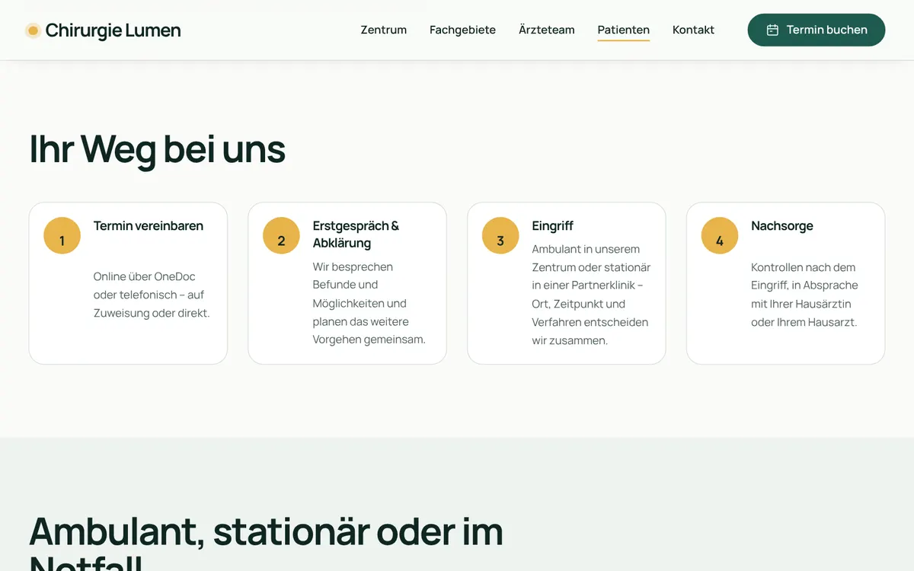

### 7. The centre

A page presenting the surgical centre: operating rooms, endoscopy and recovery.

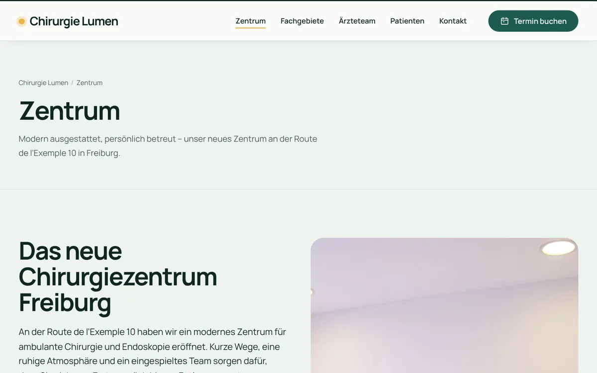

### 8. Contact and appointments

Online booking through the practice’s booking service or by phone during opening hours.

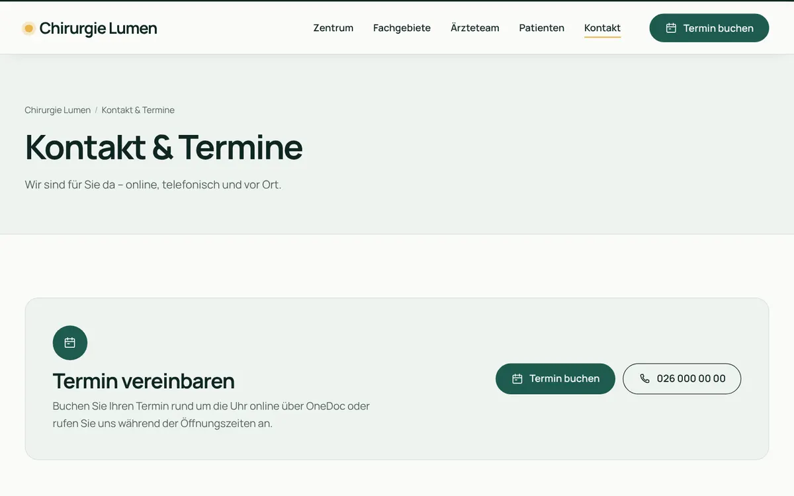

### 9. App-like navigation on the phone

A bottom bar with home, specialties, booking, team and contact.

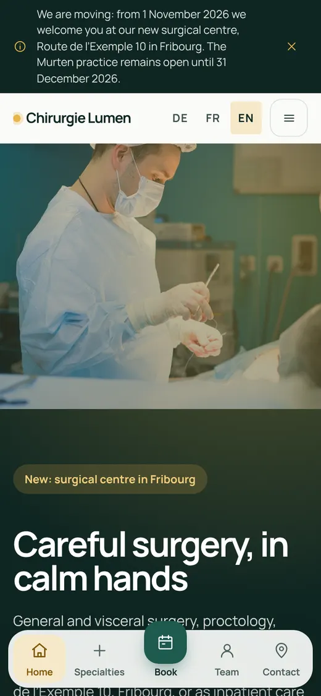

---

Source code is private: every installation is set up for the client. Ask for access to the code if you are evaluating my work.

[← Back to the profile](../README.md)
